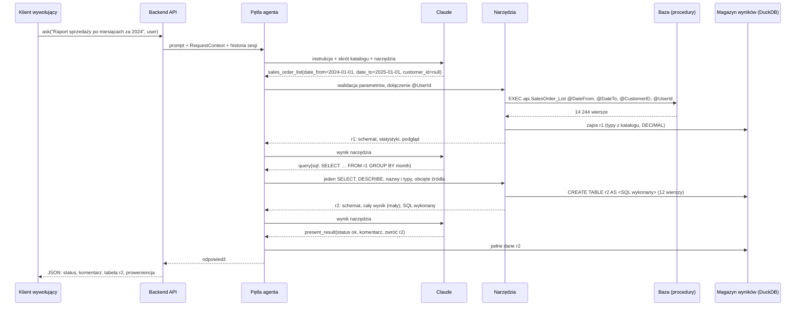

# Data Concierge: opis architektury backendu (wersja 3, happy-flow tylko do odczytu)

Status: opis koncepcji, implementacja w toku według planu [`docs/plans/2026-10-11-1011-feat-etapy-wdrozenia-v1-plan.md`](../plans/2026-10-11-1011-feat-etapy-wdrozenia-v1-plan.md). Wersja 3.7, data: 2026-10-24. Etap 2 (dostęp modelu do danych) opisuje [`002-dostep-modelu-do-danych.md`](002-dostep-modelu-do-danych.md).
Podstawa: notatki z `docs/prompts/podsumowanie-agent.md`, research źródłowy (sekcja 14), research bibliotek z 2026-10-11, prototyp parsera DuckDB z 2026-10-12, sprawdzenie danych i metadanych w lokalnej bazie AdventureWorks2025.

> **Historia zmian.**
> **v2:** źródłem danych jest katalog procedur składowanych, a nie zbiory danych sprzedaży. Stack: Python. Modele: wyłącznie Anthropic.
> **v3:** (1) osobny plik YAML z opisami procedur pisanymi pod agenta; (2) silnik obliczeń: DuckDB; (3) zakres zawężony do backendu: wejściem jest prompt, wyjściem dane w JSON, bez UI, wykresów i streamingu; (4) brak filtrowania w aplikacji: każdy filtr musi być parametrem procedury.
> **v3.1:** model `claude-haiku-5-5` z `effort: medium`; specyfikacja obliczeń niezależna od silnika (DuckDB teraz, Polars jako możliwa wersja alternatywna); komentarz w v1 pisany przez model swobodnie, bez placeholderów i bez kontroli liczb (do zrobienia później, razem z ochroną przed prompt injection); projekt testowy z jednym właścicielem.
> **v3.2:** pętla agenta na **Pydantic AI** zamiast samego Anthropic SDK (kod od razu gotowy na inne modele); filtrowanie po pobraniu w DuckDB/Polars jako przewidziane rozszerzenie (nie w v1); dedykowane konto SQL z minimalnymi uprawnieniami (sekcja 5.5); wyjaśnienie, czy DuckDB to sandbox (sekcja 7.4a).
> **v3.3:** nazwy kolumn tworzonych w specyfikacji przekształceń (aliasy, fakty) po angielsku, np. `month`, `net_sales`; instalacja zależności przez uv.
> **v3.4:** wnioski z researchu bibliotek (Pydantic AI 2.55.0, DuckDB 1.5.6, pyodbc 5.3.0, testy na lokalnym SQL Server) i z planu wdrożenia: (1) agent kończy turę wynikiem `AgentAnswer`, a `Response` składa `ResponseAssembler`; (2) proweniencja żyje przy uchwytach w magazynie wyników; (3) sesje w pamięci procesu za `SessionRepository`; (4) `data_range` czytany procedurą `api.SalesOrder_DataRange`; (5) konto `agent_reader` to login SQL (instancja w trybie mieszanym), a same uprawnienia `EXECUTE` wystarczają także do walidacji katalogu; (6) tryb `strict` tylko dla narzędzi procedur, z budżetem Anthropic; (7) `avg` i dzielenie rzutowane na `DECIMAL(38,6)`, pełna kolejność wierszy, kompilacja `pivot`, zakaz agregacji obciętych wyników; (8) narzędzia synchroniczne, limity czasu w sterownikach, błędy mapowane na `ModelRetry` albo `ToolFailed`; (9) stały początek rozmowy i data bieżąca w wiadomości użytkownika; (10) `find_procedures` poza v1, kandydatem na później jest `defer_loading`.
> **v3.5:** decyzja właściciela projektu: **wariant B** z sekcji 7.7 zastępuje wariant A. Agent wybiera i wywołuje procedury, każdy wynik trafia do DuckDB pod uchwytem, a obliczenia agent zapisuje jako jedno zapytanie `SELECT` w dialekcie DuckDB nad uchwytami sesji (narzędzie `query`, w tym `JOIN` kilku uchwytów i filtry po kolumnach wyniku). Zamknięta specyfikacja `transform` (kroki, fakty, walidator semantyczny, `SqlQueryBuilder`) znika. Backend odpowiada za bezpieczeństwo i determinizm: parser DuckDB z listami dozwolonych elementów, wykonanie w zablokowanym połączeniu, pełne `ORDER BY`, kontrola typów wyniku (kwoty nie wychodzą jako `DOUBLE`), proweniencja z pełnym SQL i wieloma źródłami. Zasada „model nie pisze SQL” dotyczy odtąd tylko SQL Server. Python i DataFrame'y (wariant C) odłożone. Zmienione sekcje: 1–4, 5.2, 6, 7 (w całości), 8–10, 11.2, 11.3, 12–14.
> **v3.5 (uzupełnienie z implementacji silnika zapytań, 2026-10-13):** `POSITIONAL JOIN` i `ASOF JOIN` poza listą (sekcja 7.2); ramka `ROWS` w agregatach okna odpada razem z funkcjami okna zależnymi od kolejności (reguła 5); `SAMPLE` odpada na każdym poziomie (reguła 6); reguła 9 działa na kolumnach z `DESCRIBE`; literały `INTERVAL` rozpoznawane w drzewie; `preserve_insertion_order` ustawione jawnie w połączeniu sesji; reguła 7 wymaga `CAST(… AS DECIMAL)` wokół dzielenia i `avg` w kolumnach wyniku na każdym poziomie zapytania (decyzja właściciela projektu).
> **v3.6:** decyzja właściciela projektu: **bez analizy treści zapytania**. Walidator drzewa parsera z listami dozwolonych węzłów i funkcji (reguły 2–8 z v3.5) i dopisywanie pełnego `ORDER BY` znikają. Bezpieczeństwo daje zablokowane połączenie DuckDB (sondy w sekcji 7.4a), dokładność `DECIMAL` i odrzucanie kolumn `DOUBLE` w wyniku. Backend sprawdza tylko: jedną instrukcję `SELECT`, nazwy i typy kolumn z `DESCRIBE` oraz obcięte źródła, które podaje plan zapytania DuckDB (`EXPLAIN`), a zapytanie na obciętym źródle jest odrzucane w całości. Funkcje niedeterministyczne, remisy i `DOUBLE` w krokach pośrednich zostają świadomie bez kontroli (sekcja 7.3). Zmienione sekcje: 1–4, 6.2, 7.1–7.4a, 7.6, 7.7, 8–14.
> **v3.6 (uzupełnienie z implementacji etapu 2, 2026-10-18):** połączenie z SQL Server, limit czasu i komunikaty błędów bez danych logowania ma jeden klient SQL Server (moduł `core`), z którego korzysta wykonawca procedur i odczyt metadanych katalogu (sekcja 4). Walidacja katalogu porównuje też kolejność kolumn wyniku, a procedurę bez opisu kolumn poznaje po pustym opisie albo wierszu z błędem (sekcja 5.3). Nazwę i typ klienta liczy dla procedur widok `api.vCustomer` (sekcja 5.4). Ścieżka `money` → `Decimal` → `decimal128(19,4)` potwierdzona na prawdziwej procedurze, a zapytania referencyjne zgadzają się z SQL Server (sekcje 7.4 i 13).
> **v3.6 (uzupełnienie z implementacji etapu 3, 2026-10-19):** opis narzędzia procedury podaje miary z podpowiedziami i `default_for` (sekcja 6.1). `present_result` kończy turę przed narzędziami z tej samej odpowiedzi (`end_strategy='early'`), a status `error` od modelu oznacza nieudaną procedurę i jest logowany (sekcja 6.2). Przykład P5 łączy klientów przez `SELECT DISTINCT`, bo `customer_list` ma wiersz na adres (sekcja 10). Pominięte bloki myślenia są logowane z `input_transformations`, bo przy jawnym `drop_block` ostrzeżenie Pydantic AI nie występuje (sekcja 11.3).
> **v3.6 (uzupełnienie z implementacji etapu 4, 2026-10-19):** `ask` z nieznanym `session_id` zwraca `error` z informacją o wygasłej sesji i nie woła agenta. Backend dokleja do promptu wiersz `Current date: RRRR-MM-DD`. Wejścia to `data-concierge ask` i `data-concierge chat` oraz `POST /ask` z fabryki `create_app` dla uvicorna (sekcja 4). Błąd przetwarzania to status `error` w odpowiedzi HTTP 200, a niepoprawne żądanie to 422 (sekcja 9). Błąd wewnętrzny DuckDB usuwa sesję (sekcja 11.2).
> **v3.6 (uzupełnienie z implementacji etapu 5, 2026-10-20):** zestaw ewaluacyjny to `evals/cases.yaml` (37 przypadków w 7 grupach), uruchamiany przez `uv run pytest -m eval tests/evals`. Wyniki porównujemy po wartościach, a nie po nazwach kolumn, a kwotę w skali kolumny odpowiedzi. Pierwsze uruchomienie (Haiku 5.5): 33/37, a po poprawce porównań 37/37, bez ponowień `query` (sekcja 13).
> **v3.7 (2026-10-24):** sprawy odłożone w v1 przechodzą do etapu 2, opisanego w [`002-dostep-modelu-do-danych.md`](002-dostep-modelu-do-danych.md): przełącznik dostępu modelu do danych (tryb zamknięty i ograniczony), kotwice zamiast liczb w komentarzu (sekcja 7.5) i oznaczanie kolumn wrażliwych w katalogu (sekcje 11.3 i 12). Poprawka sekcji 11.3: w v1 podgląd nie jest konfigurowany per kolumna. Zmienione sekcje: 3, 7.5, 11.3, 12.

## 1. Cel i zakres

Backend asystenta AI: przyjmuje prompt użytkownika i zwraca dane. Baza udostępnia dane wyłącznie przez procedury, które zwracają **surowe wiersze**. Łączenie zbiorów, dodatkowe filtry, grupowanie, sumy i pivoty liczy backend w DuckDB, a nie kolejne procedury. Nie przygotowujemy z góry procedur na wszystkie kombinacje pytań: agent sam decyduje, jakich danych potrzebuje, i zapisuje obliczenie jako zapytanie SQL nad pobranymi wynikami. Frontend jest poza zakresem tego ćwiczenia, a interfejsem jest funkcja lub endpoint `prompt → JSON`.

Szczęśliwa ścieżka v1:

1. backend dostaje prompt (i tożsamość użytkownika),
2. agent wybiera jedną lub kilka procedur z katalogu i ustala ich parametry (w razie potrzeby zwraca pytanie doprecyzowujące),
3. backend wywołuje procedury i zapisuje każdy wynik w DuckDB pod uchwytem (`r1`, `r2`…),
4. agent pisze jedno zapytanie `SELECT` nad uchwytami (np. `JOIN` listy klientów z zamówieniami i grupowanie po miesiącu), a backend sprawdza, że to jedna instrukcja `SELECT` z poprawnymi nazwami i typami kolumn, i wykonuje je w zablokowanym DuckDB,
5. backend zwraca status, tabele z danymi, krótki komentarz i proweniencję (jak policzono).

Przykładowe prośby:

| # | Prośba | Co musi umieć system |
|---|--------|----------------------|
| P1 | „Daj mi listę klientów z miejscowości Berlin” | wybór procedury, parametr miasta, obsługa niejednoznacznej nazwy |
| P2 | „Pokaż sprzedaż klienta Mohamed Pal w 2024” | wyszukanie klienta, dopytanie przy kilku trafieniach, druga procedura |
| P3 | „Zrób raport sprzedaży po miesiącach za 2024” | pobranie surowych zamówień, deterministyczna agregacja po miesiącu |
| P4 | „Pokaż strukturę materiałową produktu HL Mountain Frame” | inna dziedzina, istniejąca procedura `uspGetBillOfMaterials`, dowód, że projekt nie jest „pod sprzedaż” |
| P5 | „Sprzedaż po miesiącach w 2024 dla klientów z Berlina” | dwie procedury i `JOIN` ich wyników: lista klientów z miasta jako filtr zamówień, bez nowej procedury i bez parametru miasta w `api.SalesOrder_List` |

Poza zakresem v1: frontend, zapisy, procesy w tle, strażnicy, zatwierdzanie, obrona przed iniekcją. Sekcja 12 pokazuje, jak v1 zostawia na nie miejsce.

## 2. Wymagania

- **Dane tylko przez procedury** z katalogu. Model nie pisze SQL do bazy SQL Server: tam wywołuje wyłącznie procedury z katalogu z parametrami.
- **Żadnych procedur „pod pytanie”.** Procedury zwracają dane w naturalnym ziarnie (klient, zamówienie, pozycja), a zestawienia robi backend.
- **Najpierw parametry procedur, potem SQL nad wynikami.** Wolumen danych zawężają parametry procedur (okres, klient, kategoria). Dodatkowe filtry po kolumnach wyniku i łączenie kilku wyników agent zapisuje w zapytaniu `SELECT` nad uchwytami w DuckDB (sekcja 7). Status `unsupported` zostaje dla próśb o dane, których nie zwraca żadna procedura, albo których nie da się pobrać bez obcięcia wyniku.
- **Obliczenia deterministyczne.** Model nie liczy sum ani średnich i nie przepisuje liczb „z głowy”. Liczy DuckDB według SQL od modelu. Kwoty zostają `DECIMAL`, więc ten sam SQL na tych samych danych daje te same sumy, a kolejność wierszy wynika z `ORDER BY` w zapytaniu (sekcja 7).
- **Python.** Na start **modele Anthropic**, ale kod od początku niezależny od dostawcy, żeby później dało się użyć innych modeli (OpenAI, Azure, lokalne) bez przepisywania.
- **Wymienna baza danych.** Zależność od silnika siedzi w adapterze, który wywołuje procedury, i w odczycie metadanych katalogu. Oba korzystają z jednego klienta SQL Server.
- **Agent działa w imieniu użytkownika.** Tożsamość jest przekazywana do procedur już w v1, nawet jeśli procedury jeszcze jej nie sprawdzają.

## 3. Najważniejsze decyzje w skrócie

| Decyzja | Wybór dla v1 | Dlaczego |
|---------|--------------|----------|
| Skąd agent wie o procedurach | **Osobny plik YAML z opisami pisanymi pod agenta** (kiedy użyć, kiedy nie, przykłady, powiązania), walidowany przy starcie z metadanymi bazy | Wąski, opisany kontekst poprawia trafność [1]. Opis techniczny procedury i opis dla agenta to różne rzeczy (sekcja 5.1). |
| Jak model wywołuje procedury | Jedno narzędzie na procedurę, generowane z YAML, ze ścisłym schematem parametrów. Tryb `strict` dostawcy dla narzędzi procedur i narzędzia `query`, sterowany ustawieniem. | Typowane parametry, walidacja przed wywołaniem, model nie wymyśla nazw [2]. `query` ma jeden parametr tekstowy, więc mieści się w budżecie trybu `strict` Anthropic (sekcja 6.1). |
| Duża liczba procedur | W v1 bez wyszukiwania narzędzi: wszystkie definicje w kontekście | Przy kilkunastu procedurach to wystarcza. Gdy katalog urośnie: tool search Claude API (`defer_loading`, obsługiwany przez Pydantic AI) albo własne `find_procedures` (sekcja 6.3). |
| Gdzie są dane | W magazynie wyników backendu, pod uchwytami. Model widzi schemat, statystyki i kilka wierszy. | Koszt, opóźnienie, limit kontekstu [4][5]. Etap 2 ogranicza to, co widzi model, przełącznikiem trybów (dokument 002). |
| Jak liczyć | Model pisze **jedno zapytanie `SELECT` w dialekcie DuckDB nad uchwytami sesji** (narzędzie `query`: CTE, `JOIN`, `WHERE`, `GROUP BY`, `PIVOT`, wybrane funkcje okna). Backend sprawdza, że to jedna instrukcja `SELECT`, kontroluje nazwy i typy wyniku i wykonuje je w **DuckDB** (wariant B, sekcja 7.7). | Nie trzeba przewidywać z góry wszystkich kombinacji: agent łączy wyniki kilku procedur i filtruje je sam. Model ustala „co”, DuckDB liczy „ile”. |
| SQL od modelu w DuckDB | Wykonanie w zablokowanym połączeniu sesji (bez plików, sieci, rozszerzeń i zmian konfiguracji) z limitami pamięci, wątków, czasu i wierszy, bez analizy treści zapytania | Ochronę daje silnik, a nie własny walidator SQL. Zapytanie widzi tylko wyniki, które sesja już pobrała (sekcje 7.3 i 7.4a). |
| Liczby w komentarzu | v1: model pisze komentarz swobodnie, korzystając z wartości z małych wyników zapytań policzonych przez backend. Bez kontroli. | Prostota na start. Ryzyko pomyłki przy przepisywaniu liczb jest znane. Kotwice zamiast liczb przechodzą do etapu 2 (sekcja 7.5, dokument 002). |
| Pętla agenta | **Pydantic AI** z modelem `anthropic:claude-haiku-5-5` | Jeden kod dla wielu dostawców (zmiana modelu = zmiana konfiguracji) [6]. Vercel AI SDK jest w TypeScript, więc nie pasuje do backendu w Pythonie (sekcja 11). |
| Koniec tury | Model zwraca `AgentAnswer` (status, komentarz, uchwyty, założenia, pytanie), a `ResponseAssembler` dokleja dane uchwytów i proweniencję | Model nie przepisuje danych tabel, więc nie może ich przekłamać (sekcje 6.2 i 9). |
| Uprawnienia DB | Dedykowany login SQL `agent_reader` z samym `EXECUTE` na wybranych procedurach, bez dostępu do tabel, od v1 | Przy dostępie wyłącznie przez procedury kosztuje to tyle samo co konto read-only. Te same uprawnienia wystarczają do walidacji katalogu przy starcie (sekcja 5.5). |

## 4. Komponenty


| Komponent | Odpowiedzialność |
|-----------|------------------|
| **Backend API** | `ask(prompt, user, session_id?) → Response`. Buduje `RequestContext` (user_id, role, id korelacji). Trzyma sesje w pamięci procesu za interfejsem `SessionRepository`: sesja ma historię wiadomości Pydantic AI i własne połączenie DuckDB z uchwytami, więc uchwyty z poprzedniej tury są dostępne po pytaniu doprecyzowującym. Restart procesu czyści sesje, a nieznany `session_id` daje `error` z informacją o wygasłej sesji, bez wołania agenta. Datę bieżącą dokleja do promptu jako wiersz `Current date: RRRR-MM-DD`. W v1 to metoda `AskService.ask`, CLI (`data-concierge ask` na jedną turę, `data-concierge chat` na rozmowę ze standardowego wejścia) i cienki endpoint HTTP (`POST /ask`, `GET /health`, aplikacja z fabryki `data_concierge.bootstrap:create_app`). |
| **Pętla agenta** | Agent Pydantic AI: wysyła rozmowę do modelu, wykonuje wywołania narzędzi, pilnuje limitu kroków, kończy wynikiem `present_result` (typ `AgentAnswer`). Bez logiki biznesowej. |
| **Katalog agenta** | Plik YAML: opisy procedur pod agenta, parametry, kolumny wyniku z typami i rolami (sekcja 5). |
| **Rejestr narzędzi** | Generuje definicje narzędzi z YAML, waliduje parametry, dokleja parametry wstrzykiwane przez backend (np. `@UserId`). |
| **Wykonawca procedur** | `EXEC` z parametrami, limit wierszy i czasu, zamiana wyniku na tabelę z typami z katalogu (bez utraty precyzji), zapis do magazynu. Razem z odczytem metadanych katalogu to jedyny kod zależny od silnika bazy. Oba działają na wspólnym kliencie SQL Server w module `core` (`SqlServerClient`). Klient otwiera połączenie osobno na każde wywołanie, pilnuje limitu czasu i podaje komunikaty błędów bez danych logowania: przy błędzie połączenia lub logowania tylko kod SQLSTATE. To jedyne miejsce, które importuje sterownik `pyodbc`. |
| **Magazyn wyników** | Wyniki sesji pod uchwytami `r1`, `r2`… jako tabele w DuckDB (w pamięci procesu), ze schematem, statystykami i pochodzeniem każdego uchwytu: wywołaniem procedury albo zapytaniem `query` z pełnym SQL i listą uchwytów źródłowych. |
| **Silnik zapytań** | Przyjmuje SQL od modelu (narzędzie `query`): sprawdza, że to jedna instrukcja `SELECT`, wiąże je (`DESCRIBE`), sprawdza nazwy i typy wyniku oraz obcięte źródła, wykonuje w połączeniu sesji i zapisuje wynik pod nowym uchwytem (sekcja 7). |
| **Składanie odpowiedzi** | `ResponseAssembler`: z `AgentAnswer` od modelu buduje `Response` (sekcja 9). Dokleja pełne dane wskazanych uchwytów i proweniencję, czyli wszystkich przodków tych uchwytów z grafu pochodzenia. Docelowo także kontrola liczb w komentarzu (sekcja 7.5). |

Proweniencja nie jest osobnym komponentem. Magazyn wyników zapisuje pochodzenie przy każdym uchwycie, a składanie odpowiedzi odczytuje graf pochodzenia zwracanych uchwytów (sekcja 7.6). Ten graf pozwala odtworzyć wynik bez modelu i jest zalążkiem logu audytowego.

## 5. Katalog agenta (YAML)

### 5.1. Dlaczego osobny plik pod agenta

Dokumentacja techniczna procedury („zwraca nagłówki zamówień z kolumnami…”) jest pisana dla programisty. Agent potrzebuje innych informacji: **kiedy** sięgnąć po procedurę, kiedy **nie**, skąd wziąć wartości parametrów i jak interpretować kolumny. Dlatego katalog agenta to osobny plik (np. `catalog/agent-procedures.yaml`), utrzymywany razem z promptem i testami agenta.

- Plik jest **jedynym źródłem** opisów dla modelu: z niego powstają definicje narzędzi i skrót katalogu w instrukcji systemowej.
- Plik **nie dubluje** metadanych bazy. Typy parametrów i kolumn są w nim zadeklarowane, ale przy starcie backend porównuje je z bazą (sekcja 5.3), więc rozjazd wychodzi od razu.
- Zmiana w pliku to zmiana zachowania agenta, więc każdą zmianę sprawdza zestaw ewaluacyjny (sekcja 13).

### 5.2. Przykładowy wpis

```yaml
- procedure: api.SalesOrder_List          # nazwa w bazie
  tool: sales_order_list                  # nazwa narzędzia dla modelu
  access: read
  summary: Zamówienia sprzedaży (nagłówki) w okresie, opcjonalnie dla jednego klienta.
  use_when:
    - pytanie dotyczy sprzedaży, obrotów lub zamówień w czasie
    - potrzebny jest raport sprzedaży po dniach, miesiącach, latach, klientach lub terytoriach
  not_for:
    - sprzedaż w podziale na produkty lub kategorie → użyj sales_order_line_list
    - wyszukanie klienta po nazwie → najpierw customer_search
  grain: jeden wiersz = jedno zamówienie, dane nie są zgrupowane
  synonyms: [sprzedaż, zamówienia, obroty]
  max_rows: 100000
  params:
    - name: DateFrom
      arg: date_from
      type: date
      required: true
      hint: Początek okresu, włącznie (OrderDate). Dla „2024” podaj 2024-01-01.
    - name: DateTo
      arg: date_to
      type: date
      required: true
      hint: Koniec okresu, wyłącznie. Dla „2024” podaj 2025-01-01.
    - name: CustomerID
      arg: customer_id
      type: int
      required: false
      hint: Id klienta. Wartość bierz wyłącznie z wyniku customer_search, nigdy nie zgaduj.
    - name: UserId
      type: int
      inject: request_context.user_id      # model tego parametru nie widzi
  columns:
    - {name: SalesOrderID, type: int,           role: id}
    - {name: OrderDate,    type: date,          role: time,      hint: Data zamówienia}
    - {name: CustomerID,   type: int,           role: id}
    - {name: CustomerName, type: string,        role: dimension}
    - {name: CustomerType, type: string,        role: dimension, values: [individual, store]}
    - {name: Territory,    type: string,        role: dimension}
    - {name: SubTotal,     type: "decimal(19,4)", role: measure,   hint: "Sprzedaż netto, bez podatku i frachtu", default_for: [sprzedaż]}
    - {name: TotalDue,     type: "decimal(19,4)", role: measure,   hint: Kwota z podatkiem i frachtem}
  data_range: {procedure: api.SalesOrder_DataRange}  # min/max read once at startup
  examples:
    - prompt: "sprzedaż za I kwartał 2025"
      call: {date_from: 2025-01-01, date_to: 2025-04-01, customer_id: null}
    - prompt: "raport sprzedaży po miesiącach za 2024"
      call: {date_from: 2024-01-01, date_to: 2025-01-01, customer_id: null}
      then: "query: date_trunc('month', OrderDate), sum(SubTotal) GROUP BY month"
```

Pola istotne dla agenta:

- **`use_when` / `not_for`** kierują wyborem procedury i odsyłają do właściwej, gdy pytanie jest „obok”.
- **`hint` przy parametrze** mówi, skąd wziąć wartość (np. „bierz id z `customer_search`, nie zgaduj”) i jak zamienić język naturalny na wartość (okres → daty).
- **`role` kolumny** (`id`, `dimension`, `measure`, `time`) mówi modelowi, jak używać kolumny w SQL: sumować `measure`, grupować po `dimension` i okresach z `time`, łączyć uchwyty po `id`. Backend nie egzekwuje ról w SQL (sekcja 7.3), ale używa ich do statystyk w opisie uchwytu.
- **`default_for`** rozstrzyga typowe niejednoznaczności („sprzedaż” = SubTotal). Agent pokazuje to w `assumptions`.
- **`inject`** oznacza parametry doklejane przez backend (tożsamość). Model ich nie widzi ani nie ustawia.
- **`exposed: false`** oznacza procedurę wołaną tylko przez backend, np. procedurę zakresu dat. Model nie dostaje dla niej narzędzia.

Plik jest czytany ściśle: nieznany klucz to błąd katalogu, a nie cicho pominięte pole. W mapowaniach `{...}` wartości z przecinkiem, także typ `"decimal(19,4)"`, trzeba ująć w cudzysłów, bo przecinek kończy wartość.
- **`data_range`** wskazuje procedurę zakresu, która zwraca min/max dat. Konto agenta nie ma `SELECT` na tabelach, więc zakresu nie da się odczytać z kolumny. Zakres jest wspólny dla wszystkich użytkowników i czytany raz przy starcie, bez kontekstu żądania. Trafia do kontekstu modelu. Względne okresy poza zakresem danych kończą się statusem `no_data` z informacją o dostępnym zakresie.
- **`examples`** to przykłady pytanie → wywołanie. Pełnią rolę few-shot, podobnie jak przykłady w Fabric data agent [1], i od razu nadają się do zestawu testów.

Filtry, które mocno zawężają wolumen (okres, klient, kategoria), powinny istnieć jako parametry procedury. Filtr po kolumnie wyniku, której procedura nie ma jako parametru (np. typ klienta w zamówieniach), agent dokłada w zapytaniu `query`, a filtr „po innym zbiorze” (np. klienci z danego miasta) robi przez `JOIN` z wynikiem drugiej procedury. Warunek: wynik procedury nie może być obcięty przez `max_rows` (sekcja 7.3). Odmowy `unsupported` i błędy obcięcia są gotową informacją, jakie parametry warto dodać do procedur.

### 5.3. Walidacja z metadanymi bazy

| Element | Źródło w bazie | Uwagi |
|---------|----------------|-------|
| Istnienie procedury | `OBJECT_ID(<nazwa>, 'P')` | Konto agenta widzi tylko procedury, które może wykonać, więc procedura bez `GRANT` wygląda jak brakująca. Komunikat błędu mówi o obu przyczynach. |
| Parametry (nazwa, typ) | `sys.parameters` | Sprawdzone: działa dla wszystkich procedur w bazie. `has_default_value` jest dla procedur T-SQL zawsze 0, więc o tym, który parametr jest opcjonalny, rozstrzyga YAML. Typ czytamy z `system_type_id`, więc typ użytkownika (np. `dbo.Name`) porównuje się jako jego typ bazowy. |
| Kolumny wyniku (nazwa, typ) | `sys.dm_exec_describe_first_result_set_for_object` | Sprawdzone na `dbo.uspGetEmployeeManagers` (zwraca 7 kolumn z typami). Nie działa dla procedur z tabelami tymczasowymi, dynamicznym SQL lub wieloma zestawami wyników: zwraca wtedy wiersz z błędem albo nic (np. `dbo.uspLogError`). Nowe procedury `api.*` piszemy bez nich. Dla istniejących procedur, których nie da się opisać, obowiązuje lista z YAML z ostrzeżeniem w logu. Wykonawca procedur przy każdym wywołaniu porównuje nazwy kolumn wyniku z katalogiem, bo buduje tabelę według pozycji kolumn. Z tego samego powodu walidacja przy starcie sprawdza też kolejność kolumn. |
| Opisy pod agenta | tylko YAML | W bazie procedury nie mają `MS_Description` (0 extended properties). |

Typy z bazy porównujemy z typami z YAML przez jedną tabelę równoważności, np. `money` = `decimal(19,4)`, `smallmoney` = `decimal(10,4)`, `smallint` = `int`, `nvarchar(n)` = `string`, `datetime2` = `datetime`. Typ bez odpowiednika (np. `xml`) to błąd katalogu.

Przy starcie backend porównuje YAML z bazą. Brakująca procedura, inny typ parametru albo niezgodna lista kolumn to błąd konfiguracji, a nie niespodzianka w rozmowie. Ten sam mechanizm mógłby wygenerować szkielet wpisu YAML dla nowej procedury (parametry i kolumny), a człowiek dopisałby opisy pod agenta. W v1 tego nie budujemy, bo przy kilkunastu procedurach wpisy pisze się ręcznie.

### 5.4. Zestaw procedur do testów na AdventureWorks2025

W bazie są 4 procedury zwracające dane i 6 procedur zapisu lub pomocniczych. Do katalogu v1 trafiają tylko procedury odczytu, a uzupełniamy je kilkoma nowymi, które zwracają surowe wiersze.

| Procedura | Status | Zwraca |
|-----------|--------|--------|
| `dbo.uspGetBillOfMaterials(@StartProductID, @CheckDate)` | istniejąca | struktura materiałowa produktu |
| `dbo.uspGetWhereUsedProductID(@StartProductID, @CheckDate)` | istniejąca | gdzie użyto komponentu |
| `dbo.uspGetEmployeeManagers(@BusinessEntityID)` | istniejąca | łańcuch przełożonych |
| `dbo.uspGetManagerEmployees(@BusinessEntityID)` | istniejąca | podwładni |
| `api.Customer_Search(@Name)` | nowa | klienci (osoby i sklepy) pasujący do nazwy, z numerem konta i terytorium |
| `api.Customer_List(@City, @CountryRegionCode, @CustomerType)` | nowa | klienci z adresem (miasto, region, kraj). Musi obejmować adresy osób **i** sklepów. |
| `api.SalesOrder_List(@DateFrom, @DateTo, @CustomerID)` | nowa | nagłówki zamówień z klientem i terytorium |
| `api.SalesOrderLine_List(@DateFrom, @DateTo, @CustomerID, @ProductCategoryID)` | nowa | pozycje z produktem, podkategorią i kategorią |
| `api.Product_Search(@Name)` | nowa | produkty pasujące do nazwy (potrzebne do P4) |
| `api.SalesOrder_DataRange()` | nowa | min/max `OrderDate` zamówień dla `data_range`. Jedyna procedura bez `@UserId`, bo zakres jest wspólny i czytany przy starcie. |
| `api.vCustomer` | nowy widok | klient jako osoba albo sklep: nazwa (sklep z osobą kontaktową to sklep), typ, terytorium i podmiot, do którego należą adresy. Wspólny dla czterech procedur `api.*`. Konto agenta nie ma do niego dostępu, procedury czytają go dzięki łańcuchowi właścicielskiemu. |
| `uspUpdateEmployee*`, `uspLogError`, `uspPrintError` | pominięte | zapis lub obsługa błędów (`access: write`, poza v1) |

Fakty z bazy, które wpływają na projekt:

- **Zakres zamówień: 2022-05-30 do 2025-06-29** (31 465 zamówień, 121 317 pozycji). Bez `data_range` w kontekście „ostatni kwartał” zwróci pustkę.
- **Nazwy nie są unikalne.** „Mohamed Pal” to 3 różnych klientów (CustomerID 12698, 20550, 28763). 31 nazw miast występuje w więcej niż jednym regionie, np. „Berlin” w 5 regionach Niemiec. „HL Mountain Frame” to 10 wariantów produktu.
- **Klient to osoba albo sklep.** 18 484 osoby, 1 336 sklepów, w tym 635 z osobą kontaktową.
- **Kwoty to `money`/`decimal`.** To ważne dla deterministyczności obliczeń (sekcja 7.4).

### 5.5. Konto bazodanowe agenta

Backend łączy się z SQL Server dedykowanym kontem, używanym tylko przez agenta: login SQL z hasłem i użytkownik w bazie, oba o nazwie `agent_reader`.

- Login SQL wymaga instancji w trybie mieszanym (`SERVERPROPERTY('IsIntegratedSecurityOnly') = 0`). Skrypt wdrożeniowy sprawdza tryb i kończy się czytelnym komunikatem, gdy instancja przyjmuje tylko logowanie Windows.
- `GRANT EXECUTE ON SCHEMA::api TO agent_reader` dla nowych procedur oraz `GRANT EXECUTE` osobno na każdą z czterech istniejących procedur odczytu w `dbo`.
- Brak `SELECT` na tabelach i widokach, brak ról typu `db_datareader`, brak uprawnień do procedur zapisu.
- Procedury i tabele mają tego samego właściciela (`dbo`), więc procedura czyta tabele dzięki mechanizmowi ownership chaining, choć konto samo nie ma do nich dostępu. Wyjątek: procedury z dynamicznym SQL (`sp_executesql`) przerywają ten łańcuch i wymagałyby `EXECUTE AS` lub podpisu certyfikatem. Nowe procedury piszemy więc bez dynamicznego SQL.
- Hasło lub inny sekret konta trzymamy w konfiguracji backendu, nigdy w prompcie. Model nie zna danych logowania i nie ma narzędzia, które by je ujawniało.
- Do walidacji katalogu przy starcie (sekcja 5.3) wystarczą same uprawnienia `EXECUTE`. Sprawdzone na lokalnym SQL Server: użytkownik z samym `EXECUTE` widzi `sys.parameters` i wynik `sys.dm_exec_describe_first_result_set_for_object` dla procedur, które może wykonać. Osobne konto techniczne ani `VIEW DEFINITION` nie są potrzebne.
- ODBC Driver 18 domyślnie szyfruje połączenie i sprawdza certyfikat serwera. `TrustServerCertificate=yes` (zaufanie do certyfikatu samopodpisanego) włącza ustawienie konfiguracji i używamy go tylko lokalnie.

## 6. Narzędzia widziane przez model

### 6.1. Narzędzia procedur (generowane)

Każda procedura z katalogu to osobne narzędzie, np. `sales_order_list`. Opis narzędzia składa się z `summary`, `grain`, `use_when`, `not_for`, listy miar i zakresu danych. Lista miar podaje każdą kolumnę z rolą `measure` z jej `hint` i `default_for` (np. „Miary: SubTotal (Sprzedaż netto, bez podatku i frachtu; domyślna dla: sprzedaż), TotalDue (Kwota z podatkiem i frachtem).”), bo model wybiera miarę, zanim zobaczy wynik procedury. Wskazówki parametrów są w opisach pól schematu, więc opis ich nie powtarza. Parametry opisuje model Pydantic budowany z `params` (`pydantic.create_model`) dla każdego wpisu katalogu. Ten sam model daje schemat narzędzia (`additionalProperties: false`) i walidację argumentów, a błąd walidacji Pydantic AI sam odsyła do modelu jako prośbę o poprawkę. Parametry `inject` nie trafiają do schematu. Pola opcjonalne mają kształt `anyOf` z `null` i wartość domyślną `null`. Backend dodatkowo sprawdza zakresy i wartości, a błąd wraca do modelu jako błąd narzędzia z czytelnym opisem (sekcja 11.2).

**Tryb `strict` dostawcy** włączamy dla narzędzi procedur i narzędzia `query`, jednym przełącznikiem w konfiguracji. Anthropic dopuszcza w jednym żądaniu 20 narzędzi `strict`, 24 parametry opcjonalne i 16 parametrów z unią, liczone łącznie dla wszystkich narzędzi `strict`. `query` ma jeden wymagany parametr tekstowy, więc zużywa tylko jedno miejsce z puli narzędzi. `present_result` nie jest `strict`, bo `AgentAnswer` ma pola opcjonalne i unie, które niepotrzebnie zużywałyby budżet. Tryb `strict` nie egzekwuje też `const`, `minimum` ani `maxLength`, dlatego walidacja w backendzie jest obowiązkowa niezależnie od trybu. Przekroczenie budżetu kończy każde żądanie błędem 400, więc test jednostkowy sprawdza budżet na katalogu z repozytorium.

```json
{
  "name": "sales_order_list",
  "description": "Zamówienia sprzedaży (nagłówki) w okresie, opcjonalnie dla jednego klienta. Jeden wiersz = jedno zamówienie, dane nie są zgrupowane. Używaj do: sprzedaż/obroty/zamówienia w czasie, raporty po okresach, klientach, terytoriach. Nie używaj do: sprzedaży po produktach (sales_order_line_list), wyszukiwania klienta (customer_search). Dane: 2022-05-30 – 2025-06-29.",
  "strict": true,
  "input_schema": {
    "type": "object",
    "properties": {
      "date_from":   {"type": "string", "format": "date", "description": "Początek okresu, włącznie. Dla „2024” podaj 2024-01-01."},
      "date_to":     {"type": "string", "format": "date", "description": "Koniec okresu, wyłącznie. Dla „2024” podaj 2025-01-01."},
      "customer_id": {"anyOf": [{"type": "integer"}, {"type": "null"}], "default": null, "description": "Id klienta wyłącznie z wyniku customer_search."}
    },
    "required": ["date_from", "date_to"],
    "additionalProperties": false
  }
}
```

Wynik wywołania procedury zwracany modelowi (nie pełne dane):

```json
{
  "handle": "r1",
  "row_count": 14244,
  "truncated": false,
  "columns": [{"name": "OrderDate", "type": "date", "role": "time"}, {"name": "SubTotal", "type": "decimal(19,4)", "role": "measure"}, "..."],
  "stats": {"OrderDate": {"min": "2024-01-01", "max": "2024-12-31"}, "CustomerType": {"values": ["individual", "store"]}, "CustomerName": {"distinct_count": 9876}},
  "preview": ["… do 10 wierszy …"]
}
```

### 6.2. Narzędzia stałe

| Narzędzie | Rola |
|-----------|------|
| `query` | Przyjmuje jedno zapytanie `SELECT` w dialekcie DuckDB nad uchwytami sesji (sekcja 7). Zwraca nowy uchwyt z opisem jak po wywołaniu procedury (schemat, statystyki, podgląd, a dla małych wyników cały wynik) i SQL faktycznie wykonany przez backend. Błąd kontroli z sekcji 7.3 albo wykonania wraca do modelu jako prośba o poprawkę (`ModelRetry`). |
| `describe_result` | Pełny schemat i statystyki uchwytu (gdy podgląd nie wystarcza). |
| `present_result` | Koniec tury: wynik `AgentAnswer` ze statusem, komentarzem, uchwytami do zwrócenia (z tytułami tabel), założeniami i ewentualnym pytaniem doprecyzowującym. W Pydantic AI to nie zwykłe narzędzie, tylko **typ wyniku agenta** (`output_type=ToolOutput(AgentAnswer, name="present_result")`): framework udostępnia go modelowi jako specjalne narzędzie wyjściowe i sam prosi o poprawkę, gdy odpowiedź nie pasuje do schematu [6]. `AgentAnswer` nie zawiera danych tabel. Pełną odpowiedź (sekcja 9) buduje z niego `ResponseAssembler`. Agent działa z `end_strategy='early'`: odpowiedź kończy turę, zanim wykonają się narzędzia wywołane w tej samej odpowiedzi modelu, więc model wskazuje tylko uchwyty, których opis już widział (sekcja 7.5). Status `error` model wybiera tylko wtedy, gdy procedura zawiodła i danych nie udało się pobrać. Odpowiedź pokazuje wtedy ogólny komunikat z identyfikatorem zgłoszenia, a komentarz modelu trafia do logu. |

Definicja narzędzia `query` (opis skrócony):

```json
{
  "name": "query",
  "description": "Run one read-only SELECT in DuckDB SQL over result handles of this session (r1, r2, ...). Use CTEs, JOIN, WHERE, GROUP BY, PIVOT. Keep money as DECIMAL: CAST(avg(...) AS DECIMAL(38,6)), divide with NULLIF(divisor, 0) and CAST the quotient to DECIMAL(38,6). Give every computed column an English snake_case alias. Write dates as literals, not current_date or now(). Add ORDER BY when order matters, with a tie-breaking id column for a stable top N. The result is stored under a new handle.",
  "strict": true,
  "input_schema": {
    "type": "object",
    "properties": {"sql": {"type": "string", "description": "A single SELECT statement (CTEs allowed) reading only result handles."}},
    "required": ["sql"],
    "additionalProperties": false
  }
}
```

Wynik `query` zwracany modelowi:

```json
{
  "handle": "r3",
  "row_count": 12,
  "truncated": false,
  "sources": ["r1", "r2"],
  "sql": "WITH … SELECT … ORDER BY m.month",
  "columns": [{"name": "month", "type": "date", "role": "time"}, {"name": "net_sales", "type": "decimal(38,4)", "role": "measure"}, "..."],
  "stats": {"…": "…"},
  "preview": ["… cały wynik, bo ma do 50 wierszy …"]
}
```

### 6.3. Gdy procedur jest dużo

Dopóki procedur jest kilkanaście, wszystkie definicje mieszczą się w kontekście i są cache'owane (prompt caching). W v1 nie budujemy wyszukiwania narzędzi.

Gdy katalog urośnie, kandydatem jest wbudowany **tool search** Claude API (`defer_loading`) [8]. Research z 2026-10-11 potwierdził, że Pydantic AI obsługuje `defer_loading` także na bezpośrednim Claude API, a nie tylko na Bedrock. Dla dostawców bez tool search zostaje własne narzędzie `find_procedures(query)`, które przeszukuje `summary`, `use_when` i `synonyms` z YAML i zwraca kilka pasujących procedur, a ich narzędzia są udostępniane w kolejnym kroku. Próg przełączenia trzeba zmierzyć na zestawie ewaluacyjnym.

## 7. Deterministyczne obliczenia: SQL agenta nad uchwytami

### 7.1. Zasada

**Model decyduje, jakie dane pobrać i co z nich policzyć. DuckDB liczy. Bezpieczeństwo daje zablokowany silnik, a nie analiza tekstu zapytania.** Model nigdy nie dostaje pełnych danych do zsumowania „w głowie” i nigdy sam nie wpisuje wyniku obliczeń. Wywołuje procedury, które uzna za potrzebne, a ich wyniki trafiają do DuckDB pod uchwytami. Obliczenie zapisuje jako jedno zapytanie `SELECT` w dialekcie DuckDB nad tymi uchwytami. Pliki, sieć, rozszerzenia i zmiany konfiguracji blokuje samo połączenie DuckDB (sekcja 7.4a). Backend sprawdza tylko to, czego silnik nie sprawdzi sam: że to jedna instrukcja `SELECT`, że kolumny wyniku mają nazwy i typy zgodne z kontraktem odpowiedzi i że zapytanie nie liczy na obciętych danych (sekcja 7.3).

```
procedura A ──► r1 ─┐
                    ├──► SQL od modelu ──► jedna instrukcja SELECT ──► DESCRIBE: nazwy, typy, źródła ──► DuckDB ──► r3 ──► odpowiedź JSON
procedura B ──► r2 ─┘
```

Podział odpowiedzialności:

| Kto | Za co odpowiada |
|-----|-----------------|
| Model | Wybór procedur i parametrów, treść zapytania: które uchwyty połączyć, jak filtrować, grupować, sortować, jakie miary policzyć. |
| DuckDB | Blokada plików, sieci, rozszerzeń i zmian konfiguracji, limity pamięci i wątków (sekcja 7.4a). Dokładna arytmetyka `DECIMAL`. |
| Backend | Jedna instrukcja `SELECT`, nazwy i typy kolumn wyniku, odmowa obliczeń na obciętych wynikach, limity czasu i wierszy, proweniencja. |
| SQL Server | Bez zmian: wyłącznie procedury z katalogu z parametrami (sekcja 5). Zasada „model nie pisze SQL” obowiązuje tam nadal. |

### 7.2. Narzędzie `query`

Wejściem jest jeden tekst `sql` (definicja w sekcji 6.2). Zapytanie czyta tabele nazwane jak uchwyty sesji (`r1`, `r2`…) z kolumnami nazwanymi jak w schemacie uchwytu. Dozwolony jest każdy `SELECT` dialektu DuckDB: CTE, `JOIN`, `WHERE`, `GROUP BY`, `HAVING`, `QUALIFY`, funkcje okna, `UNION`, podzapytania, `PIVOT` w składni `FROM … PIVOT (<agregat> FOR <kolumna> IN (<wartości>))`, `range` i `generate_series` do siatki okresów. Uproszczona instrukcja `PIVOT <tabela> ON …` odpada, bo nie jest instrukcją `SELECT`. Wartości kolumny obrotu model bierze ze statystyk uchwytu albo z wcześniejszego `query`.

Wynik `query` zapisuje się pod nowym uchwytem. Model może go użyć w kolejnym `query`, opisać przez `describe_result` albo zwrócić w `present_result`.

**Wskazówki dla modelu** (instrukcja systemowa i opis narzędzia, sekcja 11.3):

- **Kwoty zostają `DECIMAL`.** `sum`, `min`, `max`, dodawanie, odejmowanie i mnożenie kwot dają `DECIMAL`. `avg` i dzielenie dają w DuckDB `DOUBLE`, więc model rzutuje je w tym samym wyrażeniu: `CAST(avg("SubTotal") AS DECIMAL(38,6))`, `CAST(sum(a) / NULLIF(sum(b), 0) AS DECIMAL(38,6))`. `NULLIF` jest konieczne, bo dzielenie przez zero daje `NaN` albo nieskończoność, których nie da się rzutować na `DECIMAL`. Najpierw agregujemy dokładne wartości, dzielimy na końcu.
- **Daty jako literały.** Data bieżąca jest w wiadomości użytkownika (sekcja 11.3). Model wpisuje okresy jawnie, np. `DATE '2026-10-01'`, a nie `current_date` czy `now()`, żeby w proweniencji było widać, za jaki okres jest wynik.
- **Kolejność.** Backend nie dopisuje sortowania. Model pisze `ORDER BY`, gdy kolejność ma znaczenie, a przy `LIMIT` (top N) dodaje kolumnę rozstrzygającą remisy (np. `CustomerID`), jeśli lista ma być za każdym razem taka sama.
- **Okresy:** `CAST(date_trunc('month', "OrderDate") AS DATE) AS month`, bo `date_trunc` zwraca `TIMESTAMP`.
- **Brakujące okresy:** `LEFT JOIN` z siatką `range(DATE '2024-01-01', DATE '2025-01-01', INTERVAL 1 MONTH)` w zakresie z prośby (nie z min/max danych) i `COALESCE(…, 0)`. Miesiąc bez sprzedaży na początku lub końcu roku inaczej zniknąłby z raportu.
- **Nazwy kolumn wyniku** po angielsku w `snake_case` (`month`, `net_sales`, `order_count`). Kolumny przeniesione bez zmian mogą zachować nazwę źródłową (`CustomerName`).
- **Łączenie uchwytów** po kolumnach `id` (np. `CustomerID`), a nie po nazwach, bo nazwy nie są unikalne (sekcja 5.4).
- `random()`, `row_number()` bez pełnego `ORDER BY` i agregaty zależne od kolejności (`string_agg`, `any_value`) dają przy każdym uruchomieniu albo przy remisach inny wynik. Model używa ich tylko wtedy, gdy użytkownik o to prosi (np. losowa próbka).

### 7.3. Kontrole backendu

**Decyzja v3.6: backend nie analizuje treści zapytania.** Wersja 3.5 przechodziła drzewo parsera DuckDB (`json_serialize_sql`) i sprawdzała listy dozwolonych węzłów, funkcji i konstrukcji. Ten walidator był większością kodu modułu zapytań i wymagał znajomości wewnętrznego formatu drzewa, a chronił głównie przed przypadkami brzegowymi: bezpieczeństwo i tak daje zablokowane połączenie (sekcja 7.4a), a kwoty są dokładne dzięki `DECIMAL`. Zostają kontrole, których silnik nie zrobi sam:

1. **Jedna instrukcja `SELECT`.** `extract_statements` zwraca dokładnie jedną instrukcję typu `SELECT`. Odpada DDL, DML, `PRAGMA`, `SET`, `ATTACH`, `COPY`, `INSTALL`, `LOAD`, `CALL`, `EXPORT`, `PIVOT … ON` i każda druga instrukcja po średniku. Funkcja `query('…')` wewnątrz `SELECT` też przyjmuje tylko `SELECT` (sprawdzone na DuckDB 1.5.6).
2. **Wiązanie bez wykonania.** Backend uruchamia `DESCRIBE <zapytanie>`, które wiąże zapytanie ze schematem uchwytów (nazwy kolumn, typy, funkcje) bez liczenia wyniku. Błąd wiązania (nieznana kolumna, nieznana tabela, zły typ argumentu) wraca do modelu z komunikatem DuckDB, np. „Binder Error: Referenced column "Subtotal" not found… Candidate bindings: "SubTotal"”.
3. **Nazwy kolumn wyniku** (z `DESCRIBE`, bo nazwy kolumn z `*` i kolumn bez aliasu powstają dopiero przy wiązaniu) pasują do `^[A-Za-z][A-Za-z0-9_]*$` i są unikalne bez względu na wielkość liter (tak DuckDB rozwiązuje identyfikatory). Wymusza to jawny alias każdej wyliczanej kolumny, bo nazwy nadawane automatycznie przez DuckDB (np. `sum("SubTotal")`) zawierają nawiasy. Kolumny obrotu dostają aliasy w liście `IN ('Bikes' AS bikes, …)`.
4. **Typy wyniku** według tabeli z sekcji 7.4. Kolumna `DOUBLE` jest odrzucana z prośbą o `CAST(… AS DECIMAL(38,6))`.
5. **Obcięte źródła.** Źródła zapytania podaje DuckDB: backend czyta tabele z planu logicznego przed optymalizacją (`EXPLAIN (FORMAT json)` przy `explain_output = 'all'`). Binder rozwiązał tam już CTE (także nazwane jak uchwyt), wielkość liter i `query('…')`, a optymalizator nie usunął jeszcze tabeli, o której statystyki mówią, że nic nie wniesie. `get_table_names` odpada, bo wiąże zapytanie na pustych tabelach i zgłasza błąd przy `JOIN … USING` i `NATURAL JOIN` (DuckDB 1.5.6). Gdy którekolwiek źródło ma w grafie pochodzenia wynik procedury obcięty przez `max_rows`, zapytanie jest odrzucane z prośbą o zawężenie parametrów procedury. Wiersze samego obciętego wyniku agent może zwrócić bez `query`, wskazując uchwyt procedury w `present_result`, a odpowiedź niesie wtedy flagę `truncated`.

**Dlaczego obcięte źródło to błąd, a nie ostrzeżenie.** Suma, liczba czy średnia z obciętych danych wygląda na pełną: w tabeli odpowiedzi nie widać, których wierszy brakuje, a wszystkie pozycje zamówień z całego zakresu (121 317) przekraczają domyślne `max_rows` 100 000. Obcięty zbiór użyty jako filtr (`JOIN` sprzedaży z obciętą listą klientów) też po cichu zaniża sumy. Ostrzeżenie zależałoby od tego, czy model przekaże je użytkownikowi, a komentarz w v1 nie jest kontrolowany (sekcja 7.5). Bez analizy drzewa backend nie odróżnia agregacji od wyboru wierszy, więc odrzuca każde zapytanie na obciętym źródle. To prostsze i bezpieczniejsze, a zwrot surowych wierszy zostaje przez uchwyt procedury.

**Błąd wraca do modelu** jako prośba o poprawkę (`ModelRetry`, sekcja 11.2) z czytelnym komunikatem, np. „Result type: column avg_order is DOUBLE; CAST it to DECIMAL(38,6)”. Model poprawia SQL w kolejnym kroku pętli. Budżet ponowień i limit 10 kroków (sekcja 8) ograniczają liczbę prób.

**Czego backend świadomie nie sprawdza** (wrócimy do tego, gdy zestaw ewaluacyjny pokaże problem):

- **Funkcje niedeterministyczne** (`random`, `now`, `current_date`): wskazówka dla modelu z sekcji 7.2, a SQL i tak trafia do proweniencji.
- **Remisy przy sortowaniu i `LIMIT`:** zachowują się jak w każdym ręcznie pisanym SQL. Przy remisie każdy z wyników jest poprawny, a stałą listę daje kolumna rozstrzygająca z sekcji 7.2.
- **`DOUBLE` w krokach pośrednich** (np. suma wartości `avg` z CTE): ostatnie cyfry mogą zależeć od kolejności sumowania. Pomiar z 2026-10-18 (zwykłe sumowanie `DOUBLE`, 10 losowych kolejności): 100 tys. wierszy o sumie ok. 1 mld daje błąd ok. 0,00003, przy sumie ok. 100 mld ok. 0,002, a widoczny w groszach (ok. 0,07) dopiero przy 1 mln wierszy i sumie ok. 1 bln. Kwoty z procedur są `DECIMAL`, więc sumy kwot są dokładne zawsze, a `DOUBLE` dają tylko średnie i ilorazy.
- **Widoki i funkcje systemowe DuckDB** (`duckdb_settings()`, `duckdb_tables()`, `current_setting`): są czytelne, ale pokazują tylko ustawienia i tabele własnej sesji.

### 7.4. Silnik: DuckDB

**Czym jest DuckDB:** bazą analityczną (OLAP) uruchamianą wewnątrz procesu Pythona, jako biblioteka (`uv add duckdb`). Nie ma serwera ani instalacji. Dane trzyma w pamięci, a operuje się na nich zwykłym SQL. Jest zoptymalizowana pod grupowania i agregacje na dużych tabelach.

**Dlaczego DuckDB, a nie Polars czy pandas:**

| | DuckDB | Polars | pandas |
|---|--------|--------|--------|
| Czym jest | SQL-owa baza analityczna w procesie | Biblioteka DataFrame (tabele w pamięci) z własnym API wyrażeń, napisana w Rust | Klasyczna biblioteka DataFrame w Pythonie |
| Język operacji | SQL | Metody Pythona (`group_by`, `agg`, `pivot`…) | Metody Pythona |
| Typ dziesiętny | `DECIMAL(p,s)`, pełne wsparcie | Typ `Decimal` jest, ale stan wsparcia operacji trzeba by sprawdzić | Tylko jako obiekty Pythona (wolno) albo `float` (niedokładnie) |
| Czytelność proweniencji | SQL jest czytelny dla każdego, kto zna SQL | Kod Polars trzeba znać | Kod pandas trzeba znać |
| Model pisze zapytania (wariant B) | SQL, który modele znają najlepiej, wykonywany w połączeniu bez dostępu do plików i sieci | Kod Pythona, czyli wariant C z sandboxem | Kod Pythona, czyli wariant C z sandboxem |

Polars jest bardzo szybki i popularny, ale w wariancie B obliczenia są zapisane w dialekcie DuckDB, więc wymiana silnika oznaczałaby zmianę języka, w którym pisze model. To świadomy koszt wyboru wariantu B. SQLite odpada, bo nie ma typu `DECIMAL`, a kwoty musiałyby być liczbami zmiennoprzecinkowymi albo groszami w liczbach całkowitych.

**Jak to działa w praktyce:**

1. Wykonawca procedur wywołuje procedurę przez pyodbc w postaci `SET NOCOUNT ON; EXEC <proc> @Name = ?, ...` i odbiera wiersze (pyodbc zwraca `Decimal` dla `money`/`decimal` i `date`/`datetime` dla dat). Z `fetchall()` buduje tabelę Arrow z typami z katalogu (np. `decimal128(19,4)`, `date32`). Odrzucona alternatywa: `arrow-odbc`, które przyjmuje parametry tylko jako tekst i otwiera połączenie z ciągu znaków przy każdym wywołaniu. Przy wynikach rzędu kilkudziesięciu tysięcy wierszy budowa kolumn z `fetchall()` wystarcza.
2. Magazyn wyników zapisuje tabelę w DuckDB jako `r1`. Zablokowane połączenie nie skanuje zmiennych Pythona, więc rejestracja jest jawna: `register`, potem `CREATE TABLE r1 AS SELECT …`, potem `unregister`. DuckDB zachowuje `DECIMAL(19,4)`, a wynik odczytany przez `to_arrow_table()` ma typy dziesiętne, np. suma kwot `decimal128(38,4)` (sprawdzone na DuckDB 1.5.6). Tak samo trafia do DuckDB każdy kolejny wynik procedury (`r2`…).
3. Model wysyła `query`. Silnik zapytań sprawdza, że to jedna instrukcja `SELECT`, wiąże zapytanie (`DESCRIBE`), sprawdza nazwy i typy kolumn oraz obcięte źródła (sekcja 7.3). Wykonany SQL to tekst od modelu. Backend opakowuje go tylko wtedy, gdy trzeba rzutować kolumny całkowite na `BIGINT` (niżej).
4. Wynik zapisuje się jako nowy uchwyt (`CREATE TABLE r3 AS SELECT * FROM (<SQL>) LIMIT <limit + 1>`), a przy uchwycie jego pochodzenie: SQL od modelu, SQL wykonany, uchwyty źródłowe (sekcja 7.6). Wynik większy niż limit wierszy zapytania (domyślnie 100 000) jest usuwany, a model dostaje prośbę o agregację albo zawężenie. `LIMIT` pozwala DuckDB przerwać liczenie zaraz po przekroczeniu limitu.

**Typy wyniku.** Typ każdej kolumny wyniku z `DESCRIBE` mapuje się na typ katalogu:

```text
DECIMAL(p,s)                        -> decimal(p,s)
BIGINT                              -> int
other integer types (TINYINT, INTEGER, HUGEINT, UBIGINT, ...) -> int, cast to BIGINT by the backend (overflow is an error)
VARCHAR                             -> string
DATE                                -> date
TIMESTAMP                           -> datetime
BOOLEAN                             -> bool
FLOAT | REAL | DOUBLE               -> rejected: "column net_avg is DOUBLE; CAST it to DECIMAL(38,6)"
anything else (LIST, STRUCT, MAP, INTERVAL, TIME, BLOB, UUID, ...) -> rejected
```

`HUGEINT` pojawia się przy `sum` po kolumnie całkowitej (np. `sum("OrderQty")`), a `INTEGER` przy literałach (`1 AS one`), więc backend rzutuje każdą kolumnę całkowitą inną niż `BIGINT` na `BIGINT` w zewnętrznym `SELECT * REPLACE (…) FROM (<SQL>)`, zamiast obciążać tym model. Zewnętrzny `SELECT` nie zmienia kolejności wierszy podzapytania. Kolumna zmiennoprzecinkowa w wyniku to błąd, a nie ciche rzutowanie, bo backend nie wie, jakiej skali chce model. Rola kolumny wyniku: kolumna o tej samej nazwie i typie co kolumna źródłowa dziedziczy jej rolę, pozostałe dostają rolę z typu (`date`/`datetime` → `time`, `decimal`/`int` → `measure`, reszta → `dimension`). Rola służy tylko do statystyk w opisie uchwytu.

**Kolejność wierszy** wynika z `ORDER BY` w zapytaniu modelu. `preserve_insertion_order` zachowuje ją przy `CREATE TABLE … AS` i przy odczycie uchwytu. Zapytanie bez `ORDER BY` nie gwarantuje kolejności, tak jak każdy SQL.

Przykład: SQL od modelu dla raportu miesięcznego (P3, sekcja 10):

```sql
WITH months AS (
  SELECT CAST(range AS DATE) AS month
  FROM range(DATE '2024-01-01', DATE '2025-01-01', INTERVAL 1 MONTH)
), sales AS (
  SELECT CAST(date_trunc('month', "OrderDate") AS DATE) AS month,
         sum("SubTotal")                AS net_sales,
         count(DISTINCT "SalesOrderID") AS order_count
  FROM r1
  GROUP BY 1
)
SELECT m.month,
       COALESCE(s.net_sales, 0)   AS net_sales,
       COALESCE(s.order_count, 0) AS order_count
FROM months m LEFT JOIN sales s USING (month)
ORDER BY m.month
```

Backend wykonuje ten tekst bez zmian, bo wszystkie kolumny mają już dozwolone typy. Wynik: `month DATE`, `net_sales DECIMAL(38,4)`, `order_count BIGINT` → `int` (sumy dokładne, puste miesiące jako 0).

**Co daje powtarzalny wynik:**

- **Typy dokładne:** kwoty przez całą ścieżkę są `DECIMAL`, a suma `DECIMAL` jest dokładna w dowolnej kolejności dodawania i przy dowolnej liczbie wątków. Wynik nie może mieć kolumn `DOUBLE`/`FLOAT`. Odcinek Arrow → DuckDB → Arrow potwierdził research, a odcinek pyodbc → Arrow test adaptera SQL Server z 2026-10-18 (`money` → `Decimal` → `decimal128(19,4)`, suma równa sumie w SQL Server). Wartości dziesiętne trafiają do JSON jako tekst (sekcja 9).
- **Kolejność:** z `ORDER BY` modelu (sekcja 7.2).
- **Brakujące okresy:** siatka okresów z zakresu z prośby, a nie z min/max danych (wskazówka w sekcji 7.2, sprawdzana zestawem ewaluacyjnym).
- **Testy:** zapytania referencyjne dla P1–P5 (agregacja miesięczna, `count(DISTINCT)`, `PIVOT`, top N, siatka okresów, `JOIN` dwóch uchwytów) dają w DuckDB ten sam wynik co równoważne zapytanie w SQL Server na tych samych danych. Zapytanie z agregacją na wierszach źródłowych w odwróconej kolejności daje identyczny wynik.

### 7.4a. Czy DuckDB to sandbox?

Nie jest to osobny proces ani kontener, a w wariancie B wykonuje SQL napisany przez model. Ochrona opiera się na silniku:

1. **Zablokowane połączenie sesji** (sprawdzone na DuckDB 1.5.6):

   ```sql
   SET enable_external_access = false;      -- no file or network access (read_csv, COPY, ATTACH, HTTP)
   SET autoinstall_known_extensions = false;
   SET autoload_known_extensions = false;
   SET memory_limit = '512MB';
   SET threads = 2;
   SET preserve_insertion_order = true;    -- the model's ORDER BY survives CREATE TABLE AS and reads
   SET lock_configuration = true;           -- settings can no longer change on this connection
   ```

   Sondy z 2026-10-18 w tym połączeniu: `read_csv`, `read_blob` i `glob` na plikach lokalnych, `read_text` z adresu HTTP, `COPY … TO`, `ATTACH`, `INSTALL httpfs`, `duckdb_secrets()` i `duckdb_extensions()` kończą się błędem uprawnień. `SET enable_external_access = true` zwraca błąd konfiguracji, a `query('DROP TABLE r1')` błąd parsera, bo `query` przyjmuje tylko `SELECT`. Czytelne zostają ustawienia (`current_setting`, `duckdb_settings()`) i tabele własnej sesji. Wynik procedury trafia do bazy przez jawną rejestrację tabeli Arrow (sekcja 7.4), bo zablokowane połączenie nie skanuje zmiennych Pythona.
2. **Jedna instrukcja `SELECT`** (sekcja 7.3), więc model nie zmieni tabel sesji ani ustawień.
3. **Limity zasobów:** `memory_limit`, `threads`, limit czasu (`interrupt()` wywołany z `threading.Timer`) i limit wierszy wyniku zapytania. Iloczyn kartezjański dwóch dużych uchwytów kończy się błędem limitu, a nie zatrzymaniem procesu.
4. **Zasięg danych:** każda sesja ma osobne połączenie, w którym są wyłącznie wyniki procedur wywołanych w tej sesji, w imieniu jej użytkownika. Zapytanie nie może więc odczytać niczego, czego sesja już nie pobrała. Do SQL Server zapytanie w ogóle nie sięga.

Narzędzia działają w wątkach roboczych, więc każde wywołanie pracuje na własnym `cursor()` pod blokadą magazynu wyników.

**Ryzyko szczątkowe:** błąd w samym DuckDB (np. błąd pamięci wywołany spreparowanym zapytaniem) działa w procesie backendu, a powierzchnią ataku jest cały dialekt `SELECT` DuckDB. Dane w sesji i tak należą do jej użytkownika, więc w projekcie testowym z jednym właścicielem v1 zostaje w procesie. Przed udostępnieniem wielu użytkownikom albo danych wrażliwych są dwie drogi (sekcja 12): DuckDB sesji w osobnym procesie albo kontenerze bez sieci i dostępu do dysku, albo osobna baza SQL Server, w której model pisze SQL na koncie bez żadnych uprawnień do tabel, a wyniki procedur leżą w tabelach tymczasowych połączenia sesji. Wariant C (kod Pythona od modelu) wymagałby takiego sandboxa od pierwszego dnia.

### 7.5. Liczby w komentarzu

Tabele w odpowiedzi liczy DuckDB, ale krótki komentarz tekstowy (np. „Sprzedaż netto w 2024 wyniosła …, najlepszy był czerwiec”) pisze model. Nawet jeśli tylko przepisuje liczbę z wyniku, może ją źle zaokrąglić albo pomylić.

**v1:** model pisze komentarz swobodnie. Instrukcja systemowa każe mu brać liczby wyłącznie z wyników zapytań, które widzi w całości (np. jednowierszowe `query` z sumą roczną i najlepszym miesiącem), a nie liczyć samodzielnie. Nie ma mechanizmu, który by to wymuszał. Źródłem prawdy są tabele w odpowiedzi, a komentarz jest pomocniczy.

**Przeszło do etapu 2** ([`002-dostep-modelu-do-danych.md`](002-dostep-modelu-do-danych.md), sekcja 6.1): odwołania zamiast liczb (kotwice) w obu trybach dostępu modelu do danych. Kontrola liczb zostaje odłożona (002, sekcja 12). Pierwotny zapis:

- **Kontrola liczb:** backend wyszukuje liczby w komentarzu i sprawdza, czy występują w wynikach zapytań, tabelach odpowiedzi lub prośbie. Liczba spoza nich oznacza prośbę do modelu o poprawkę, a przy kolejnej porażce odpowiedź bez komentarza.
- **Odwołania zamiast liczb:** model pisze w komentarzu odwołanie do komórki wyniku, który sam policzył w tej turze (np. `{r4.annual_total}` dla jednowierszowego uchwytu `r4`), a backend wstawia wartość. Szablonów nie przygotowuje się z góry, bo model tworzy je przy każdym pytaniu. To mocniejsza gwarancja niż kontrola, ale wymaga od modelu dyscypliny w pisaniu komentarza.
- Zestaw testowy sprawdza od początku, czy liczby w komentarzu zgadzają się z wynikami, więc skalę problemu będzie widać, zanim trzeba będzie go rozwiązać.

### 7.6. Proweniencja

Pochodzenie wyniku to **graf**, a nie łańcuch: zapytanie może łączyć kilka uchwytów, a każdy z nich pochodzi z procedury albo z wcześniejszego zapytania. Magazyn wyników zapisuje przy każdym uchwycie jego pochodzenie:

- **procedura:** nazwa, parametry (bez wartości wstrzykiwanych), liczba wierszy, flaga `truncated`;
- **zapytanie:** lista uchwytów źródłowych (z planu zapytania, sekcja 7.3), SQL od modelu, SQL wykonany (ten sam tekst albo opakowany w rzutowanie kolumn całkowitych na `BIGINT`) i liczba wierszy.

Backend zwraca w odpowiedzi (pole `provenance`) wszystkich przodków zwracanych uchwytów, każdego raz, w kolejności nadania uchwytów. Uchwyty są numerowane rosnąco, a źródło zawsze powstaje przed wynikiem, więc ta kolejność jest porządkiem topologicznym grafu. Flaga `truncated` uchwytu to „którykolwiek przodek-procedura był obcięty”, liczona po tym samym grafie. Proweniencja:

- pozwala sprawdzić decyzję modelu (np. suma `TotalDue` zamiast `SubTotal`, `JOIN` po złej kolumnie),
- pozwala odtworzyć wynik bez modelu: ponowne wywołanie procedur i wykonanie zapisanych SQL w tej samej kolejności. SQL odwołuje się do uchwytów po nazwie, a nowa sesja numeruje od `r1`, więc odtworzenie bez zmian działa, gdy proweniencja zaczyna się od `r1`. Po kilku turach rozmowy (np. P2 po pytaniu doprecyzowującym, z proweniencją `r3`, `r4`) trzeba przemianować uchwyty w SQL. Etap 4 sprawdza odtworzenie testem dla P3 i P5; narzędzia do odtwarzania z przemianowaniem v1 nie ma,
- jest gotowym zapisem do późniejszego logu audytowego.

### 7.7. Porównanie z alternatywami i wybór

| Podejście | Deterministyczne wykonanie | Kto ustala logikę obliczeń | Audyt i powtarzalność | Gdzie są dane | Ocena |
|-----------|----------------------------|-----------------------------|------------------------|---------------|-------|
| **A. Specyfikacja deklaratywna → SQL w DuckDB** | Tak | Model wybiera z zamkniętego zestawu operacji, a kod je realizuje | Pełne | W backendzie | **Zastąpione w v3.5.** Było wyborem v3.0–v3.4 i zostało zaimplementowane w gałęzi roboczej (moduł `transform`). |
| **B. Model pisze SQL dla DuckDB nad uchwytami** | Tak, przy kwotach `DECIMAL` i `ORDER BY` w zapytaniu | Model, dowolny `SELECT` w zablokowanym silniku | Dobre: pełny SQL i źródła w proweniencji, wynik odtwarzalny bez modelu | W backendzie | **v1 (wybrane w v3.5).** Wzorzec: przykład data-analyst w Pydantic AI [5]. |
| **C. Model pisze Python w sandboxie** (DataFrame'y, code execution / programmatic tool calling w Claude API) | Tak (wykonanie) | Model, dowolny kod | Słabe: kod jest inny przy każdym pytaniu | W sandboxie: w kontenerze Anthropic pełne wiersze opuszczają backend, własny sandbox to osobna infrastruktura | **Odłożone.** Ewentualnie później jako osobne narzędzie w piaskownicy dla analiz, których SQL nie wyrazi. |
| **D. Model liczy sam z wierszy** | Nie | Model | Brak | W kontekście modelu | Odrzucone. |

**Dlaczego B zamiast A.** Decyzja właściciela projektu: ideą rozwiązania jest to, żeby nie trzeba było przygotowywać wszystkich możliwych kombinacji, bo po to jest agent. Typowa prośba („sprzedaż klientów z miejscowości XYZ”) to dwa zbiory: lista klientów z miasta i zamówienia, połączone zwykłym `JOIN`. W wariancie A każda taka potrzeba oznaczała nowy krok specyfikacji (`filter`, `join`), jego walidację semantyczną, kompilację i testy, a zamknięty język i tak zostawałby w tyle za pytaniami. SQL to język, który modele znają najlepiej, a DuckDB już był silnikiem obliczeń. Koszt B to zabezpieczenie SQL pisanego przez model. Rozwiązuje go zablokowane połączenie DuckDB i kilka kontroli backendu (sekcje 7.3 i 7.4a). Dokładność, którą w A zapewniał kompilator, w B zapewniają kwoty `DECIMAL` i odrzucanie kolumn `DOUBLE` w wyniku. W v3.5 backend dodatkowo analizował drzewo zapytania i dopisywał pełne `ORDER BY`; v3.6 z tego rezygnuje (sekcja 7.3). Co tracimy: walidację semantyczną ról kolumn (np. „sumować wolno tylko `measure`”), wymienny silnik (Polars) i sekcję `facts`. Błędy logiczne SQL (zła kolumna, zły `JOIN`) wykrywa zestaw ewaluacyjny i proweniencja, a nie walidator.

**Dlaczego nie C (na razie).** Kod Pythona wymaga prawdziwego sandboxa (osobny proces lub kontener z limitami) albo wysłania pełnych wierszy do kontenera dostawcy [4], a programmatic tool calling nie łączy się ze `strict: true` [8]. Audyt kodu zmiennego przy każdym pytaniu jest słabszy niż audyt jednego `SELECT`. Wrócimy do C jako osobnego narzędzia, gdy pojawią się prośby, których SQL nie wyrazi (np. modele statystyczne).

## 8. Przebieg żądania



Zasady ustalania parametrów:

| Sytuacja | Zachowanie |
|----------|------------|
| Brak wymaganego parametru (np. okresu) | `needs_clarification`. |
| Okres względny („ostatni kwartał”) | Rozwiązać względem daty bieżącej i pokazać daty w `assumptions`. Jeśli wypada poza `data_range`, zwrócić `no_data` z informacją o dostępnym zakresie. |
| Wyszukiwanie zwraca 0 trafień | `no_data` z propozycją doprecyzowania. |
| Wyszukiwanie zwraca kilka encji (klient, produkt) | `needs_clarification` z listą kandydatów. Nie wybierać samodzielnie. |
| Parametr niejednoznaczny, ale wynik może to pokazać (miasto w kilku regionach) | Zwrócić wszystko z kolumną rozróżniającą i zapisać to w `assumptions`. |
| Filtr po kolumnie wyniku, której procedura nie ma jako parametru (np. typ klienta w zamówieniach) | Pobrać dane zawężone dostępnymi parametrami i przefiltrować w `query`. |
| Filtr „po innym zbiorze” (np. sprzedaż klientów z miasta) | Wywołać obie procedury i połączyć wyniki przez `JOIN` po kolumnie `id` w `query` (P5). |
| Wynik procedury obcięty przez `max_rows`, a prośba wymaga obliczeń na nim | Zawęzić parametry (np. krótszy okres, kategoria). Gdy się nie da: `unsupported` z wyjaśnieniem albo wiersze samego wyniku procedury z flagą `truncated` i informacją w `assumptions` (sekcja 7.3). |
| Dane, których nie zwraca żadna procedura | `unsupported` z wyjaśnieniem, czego brakuje. |
| Niejasna miara („sprzedaż”) | `default_for` z katalogu, nazwa kolumny w `assumptions`. |

Limity v1: maks. 10 kroków pętli, `max_rows` z katalogu (domyślnie 100 000), 30 s na procedurę, 30 s i 100 000 wierszy wyniku na zapytanie `query`, podgląd dla modelu do 10 wierszy (cały wynik, jeśli ma do 50 wierszy, np. raport 12 miesięcy), maks. 10 000 wierszy na tabelę w odpowiedzi (z flagą `truncated`). Limity są w konfiguracji backendu. Limit czasu egzekwują sterowniki (sekcja 11.2). Prośba łącząca dwie procedury z jednym `query` i `present_result` zużywa 4 kroki.

## 9. Kontrakt odpowiedzi backendu

Pętla kończy się wynikiem `AgentAnswer` (narzędzie wyjściowe `present_result`, sekcja 6.2). `ResponseAssembler` buduje z niego odpowiedź: dokleja pełne dane wskazanych uchwytów i wszystkich ich przodków jako `provenance` (sekcja 7.6):

```json
{
  "status": "ok | no_data | needs_clarification | unsupported | error",
  "session_id": "…",
  "message": "Sprzedaż netto w 2024: 32 145 678,12. Najlepszy miesiąc: 2024-06.",
  "tables": [
    {
      "handle": "r2",
      "title": "Sprzedaż netto po miesiącach, 2024",
      "columns": [
        {"name": "month", "type": "date"},
        {"name": "net_sales", "type": "decimal(38,4)"},
        {"name": "order_count", "type": "int"}
      ],
      "rows": [["2024-01-01", "1234567.8900", 1102], ["…"]],
      "row_count": 12,
      "truncated": false
    }
  ],
  "assumptions": ["sprzedaż = SubTotal (netto)", "okres: 2024-01-01 – 2024-12-31"],
  "clarification": null,
  "provenance": [
    {"step": "procedure", "name": "api.SalesOrder_List", "params": {"DateFrom": "2024-01-01", "DateTo": "2025-01-01", "CustomerID": null}, "rows": 14244, "handle": "r1"},
    {"step": "query", "sources": ["r1"], "submitted_sql": "WITH months AS (…) SELECT … ORDER BY m.month", "sql": "WITH months AS (…) SELECT … ORDER BY m.month", "rows": 12, "handle": "r2"}
  ]
}
```

(Wartości liczbowe w przykładzie są ilustracyjne.)

- **Kwoty dziesiętne jako tekst** (`"1234567.8900"`), żeby JSON nie zgubił precyzji. Typ podaje `columns`.
- **`provenance`** ma krok `procedure` dla każdego wywołania procedury i krok `query` z listą `sources`, SQL od modelu (`submitted_sql`) i SQL wykonanym (`sql`). Kroki są w kolejności nadania uchwytów, a wspólny przodek kilku tabel pojawia się raz.
- **Błędy:** `ask` nie rzuca wyjątku. Błąd przetwarzania daje `status: error` z ogólnym komunikatem i identyfikatorem zgłoszenia, a szczegóły trafiają do logu. Endpoint HTTP zwraca wtedy 200, a 422 tylko dla żądania, którego nie da się zwalidować (np. bez `prompt`).
- **`clarification`** zawiera pytanie i listę kandydatów z id, np. trzech klientów „Mohamed Pal”. Kolejne wywołanie `ask` z tym samym `session_id` i odpowiedzią użytkownika kontynuuje rozmowę.
- **Koniec tury bez wymuszania narzędzia:** Sonnet 5.5 i Opus 5.5 nie pozwalają wymusić wywołania konkretnego narzędzia (`tool_choice` `any` lub `tool` zwraca błąd 400) [8], a Pydantic AI nie wymusza narzędzia przy włączonym myśleniu. Projekt na tym nie polega: odpowiedź to `output_type` agenta, a gdy model odpowie czymś, co nie pasuje do schematu, Pydantic AI prosi go o poprawkę [6]. Po wyczerpaniu ponowień backend zwraca `error` i loguje przypadek.

## 10. Przykłady przepływu

**P1: „Daj mi listę klientów z miejscowości Berlin”**

1. `customer_list(city="Berlin", country_region_code=null, customer_type=null)` → `r1` z kolumnami m.in. `CustomerName`, `CustomerType`, `City`, `StateProvince`, `CountryRegion`.
2. Statystyki `r1` pokazują 5 różnych wartości `StateProvince`. Według zasad z sekcji 8 nie trzeba dopytywać, wystarczy zwrócić kolumnę regionu.
3. `query`: `SELECT "CustomerName", "CustomerType", "City", "StateProvince" FROM r1 ORDER BY "StateProvince", "CustomerName"` → `r2`. Liczbę klientów model bierze z `row_count` w opisie `r2`.
4. Odpowiedź: `ok`, tabela `r2`, komentarz z liczbą klientów, w `assumptions` informacja, że „Berlin występuje w 5 regionach, zwrócono wszystkie”.

**P2: „Pokaż sprzedaż klienta Mohamed Pal w 2024”**

1. `customer_search(name="Mohamed Pal")` → 3 trafienia (12698, 20550, 28763).
2. Odpowiedź: `needs_clarification` z trzema kandydatami (numer konta, terytorium, liczba zamówień).
3. Kolejne `ask` z wyborem → `sales_order_list(date_from="2024-01-01", date_to="2025-01-01", customer_id=12698)` → `r1`.
4. `query`: `SELECT "SalesOrderID", "OrderDate", "SubTotal", "TotalDue" FROM r1 ORDER BY "OrderDate"` → `r2` (tabela zamówień) i `query`: `SELECT sum("SubTotal") AS net_sales, count(*) AS order_count FROM r1` → `r3` (jeden wiersz do komentarza).
5. Odpowiedź: tabela zamówień `r2`, w komentarzu suma z `r3`.

**P3: „Zrób raport sprzedaży po miesiącach za 2024”**

1. `sales_order_list(date_from="2024-01-01", date_to="2025-01-01", customer_id=null)` → `r1`, 14 244 wiersze.
2. `query` z SQL z sekcji 7.4 (siatka miesięcy z zakresu prośby, `sum("SubTotal")`, `count(DISTINCT "SalesOrderID")`, `LEFT JOIN` i `COALESCE`) → `r2`, 12 wierszy.
3. `r2` wraca do modelu w całości, bo ma do 50 wierszy. Do komentarza model może policzyć jeszcze sumę roczną i najlepszy miesiąc:

```sql
SELECT month     AS best_month,
       net_sales AS best_month_sales,
       (SELECT sum(net_sales) FROM r2) AS annual_total
FROM r2
ORDER BY net_sales DESC, month
LIMIT 1
```

   → `r3`, jeden wiersz. Przy remisie `ORDER BY` wybiera wcześniejszy miesiąc, a miesiące są unikalne, więc wynik nie zależy od kolejności wierszy.
4. Odpowiedź: `ok`, tabela `r2`, komentarz oparty na wynikach zapytań, w `provenance` procedura i SQL (od modelu i wykonany).

Wariant „po miesiącach i kategoriach”: `sales_order_line_list` → `r1`, a potem jedno `query` z `PIVOT`:

```sql
WITH monthly AS (
  SELECT CAST(date_trunc('month', "OrderDate") AS DATE) AS month, "Category" AS category, "LineTotal" AS line_total
  FROM r1
)
SELECT *
FROM monthly
PIVOT (sum(line_total) FOR category IN ('Bikes' AS bikes, 'Components' AS components, 'Clothing' AS clothing, 'Accessories' AS accessories))
```

Wartości kategorii model bierze ze statystyk `r1` (wymiar ma do 20 wartości). Komórki bez sprzedaży mają `NULL`, chyba że model użyje `COALESCE` w zewnętrznym `SELECT`.

**P4: „Pokaż strukturę materiałową produktu HL Mountain Frame”**

1. `product_search(name="HL Mountain Frame")` → 10 wariantów (Black/Silver × rozmiary 38–48), więc `needs_clarification`.
2. Po wyborze: `get_bill_of_materials(start_product_id=…, check_date=<dziś lub data z prośby>)` → `r1`.
3. `query` z wyborem kolumn i sortowaniem po poziomie → odpowiedź z tabelą.

**P5: „Sprzedaż po miesiącach w 2024 dla klientów z Berlina”**

1. `customer_list(city="Berlin", country_region_code=null, customer_type=null)` → `r1` (klienci z 5 regionów, w `assumptions`).
2. `sales_order_list(date_from="2024-01-01", date_to="2025-01-01", customer_id=null)` → `r2`, 14 244 wiersze, `truncated: false`.
3. `query` łączy oba uchwyty:

```sql
SELECT CAST(date_trunc('month', o."OrderDate") AS DATE) AS month,
       sum(o."SubTotal")                AS net_sales,
       count(DISTINCT o."SalesOrderID") AS order_count
FROM r2 AS o
JOIN (SELECT DISTINCT "CustomerID" FROM r1) AS c ON c."CustomerID" = o."CustomerID"
GROUP BY 1
ORDER BY month
```

   → `r3`. `customer_list` zwraca jeden wiersz na adres klienta (sklep może mieć kilka adresów w Berlinie), więc `JOIN` bez `DISTINCT` zwielokrotniłby sprzedaż takiego klienta. Proweniencja `r3` ma dwa źródła: `r1` i `r2`. Gdyby `r1` albo `r2` był obcięty, backend odrzuciłby zapytanie (sekcja 7.3).
4. Odpowiedź: `ok`, tabela `r3`, w `provenance` obie procedury i zapytanie.

Żaden z tych przepływów nie wymagał nowej procedury dla nowego pytania. Raport miesięczny, sprzedaż klienta, sprzedaż za okres i sprzedaż klientów z miasta korzystają z tej samej `api.SalesOrder_List`, a filtr po mieście z P5 nie wymagał nowego parametru.

## 11. Pętla agenta: Pydantic AI

### 11.1. Dlaczego Pydantic AI, a nie Vercel AI SDK

| | Pydantic AI | Vercel AI SDK | Anthropic SDK |
|---|-------------|---------------|---------------|
| Język | **Python** | TypeScript / JavaScript | Python (i inne) |
| Wielu dostawców | Tak: model wybierany tekstem `dostawca:model`, np. `anthropic:claude-haiku-5-5`, `openai:…`, `azure:…`, `ollama:…`, `vllm:…`; endpointy zgodne z API OpenAI bez własnej klasy [6] | Tak (nie sprawdzone w researchu) | Nie, tylko Claude |
| Pasuje do backendu w Pythonie | Tak | Nie: wymagałby backendu w TypeScript albo osobnej usługi | Tak |
| Funkcje specyficzne dla Claude | Część dostępna przez ustawienia `anthropic_*` (sekcja 11.2) | Nie dotyczy | Wszystkie |

**Vercel AI SDK** jest popularny, ale to biblioteka TypeScript. Wybór oznaczałby przepisanie backendu na Node.js albo osobną usługę tylko do rozmowy z modelem, podczas gdy reszta (DuckDB, pyodbc, walidacja) zostałaby w Pythonie. Nie ma to sensu w projekcie, który i tak jest w Pythonie. Vercel AI SDK może się natomiast pojawić **po stronie frontendu**: Pydantic AI ma adapter `VercelAIAdapter`, który mówi protokołem strumienia Vercel AI, więc frontend w React z `useChat` może rozmawiać z agentem w Pythonie bez zmian w UI [6].

**LiteLLM** (bramka ujednolicająca API wielu dostawców) to inna możliwa droga, ale żadne twierdzenie o nim nie przeszło weryfikacji w researchu. Może się przydać później jako osobna bramka (klucze, limity, routing), a nie jako framework agenta.

### 11.2. Jak to wygląda w Pydantic AI

- **Agent:** `Agent('anthropic:claude-haiku-5-5', output_type=ToolOutput(AgentAnswer, name='present_result'), tools=[…])`. Tekst modelu pochodzi z konfiguracji, więc zmiana modelu to zmiana ustawienia.
- **Narzędzia:** funkcje synchroniczne, które Pydantic AI uruchamia w wątkach roboczych. Narzędzia procedur to obiekty `Tool` generowane z YAML, z modelem parametrów z `pydantic.create_model` (sekcja 6.1). `Tool.from_schema` odpada, bo nie waliduje argumentów ani nie stosuje wartości domyślnych. Narzędzia są cienkie: walidacja parametrów, wywołanie procedury i zapis pochodzenia uchwytu dzieją się w serwisach.
- **Błędy:** jeden dekorator `retry_on_domain_error` mapuje błędy domenowe. Błędy wejścia (zła wartość parametru, nieznany uchwyt) zamienia na `ModelRetry`, czyli prośbę o poprawkę, która zużywa budżet ponowień (`retries`). Wszystkie błędy narzędzia `query` także idą jako `ModelRetry`: odrzucenie przez kontrole z sekcji 7.3 (`QueryValidationError`), błąd wiązania lub wykonania w DuckDB, niedozwolony typ wyniku, przekroczenie limitu czasu, pamięci lub wierszy (`QueryExecutionError`, `QueryTimeoutError`). We wszystkich tych przypadkach model może poprawić SQL, a komunikat mówi, co poprawić. Błędy wykonania procedur (błąd procedury, przekroczenie czasu) zamienia na `ToolFailed`, który nie zużywa budżetu ponowień i mówi modelowi, żeby nie powtarzał tego samego wywołania. Błąd wewnętrzny DuckDB (`InternalException`, `FatalException`) nie jest błędem zapytania: unieważnia połączenie sesji, więc magazyn wyników zgłasza `ResultStoreError`, tura kończy się statusem `error`, a backend usuwa sesję. Kolejne `ask` z jej `session_id` dostaje informację o wygasłej sesji.
- **Kontekst żądania:** `RequestContext`, magazyn wyników i serwisy trafiają do narzędzi przez mechanizm zależności Pydantic AI (`deps`), ten sam, którego przykład data-analyst używa do przechowywania DataFrame'ów [5].
- **Wynik:** `AgentAnswer` jako narzędzie wyjściowe `present_result` (sekcja 6.2). Framework sam prosi model o poprawkę, gdy odpowiedź nie pasuje do schematu [6]. `Response` (sekcja 9) składa `ResponseAssembler`.
- **Historia sesji:** Pydantic AI zwraca listę wiadomości z przebiegu, którą zapisujemy w sesji i przekazujemy przy kolejnym `ask` (np. po pytaniu doprecyzowującym).
- **Asynchroniczność:** asynchroniczna jest tylko ścieżka agenta (`AgentService.run`, `AskService.ask`). Endpoint HTTP woła `await AskService.ask(...)`, a CLI uruchamia ją przez `asyncio.run`, bo `run_sync` nie działa w uruchomionej pętli zdarzeń. Serwisy katalogu, procedur, zapytań i wyników są synchroniczne. DuckDB pracuje przez `cursor()` na każde wywołanie pod blokadą magazynu wyników, a pyodbc otwiera połączenie na każde wywołanie (`threadsafety` 1).
- **Limity czasu:** egzekwują je sterowniki, a nie Pydantic AI, bo timeout narzędzia w Pydantic AI nie zatrzymuje wątku. Procedura dostaje `connection.timeout = 30` ustawione przed utworzeniem kursora (błąd `HYT00`). DuckDB dostaje `interrupt()` z `threading.Timer`.

**Ustawienia Claude dostępne w Pydantic AI** (według dokumentacji modelu Anthropic w Pydantic AI): `anthropic_thinking`, `anthropic_effort`, `anthropic_task_budget` oraz ustawienia cache (`anthropic_cache`, `anthropic_cache_instructions`, `anthropic_cache_tool_definitions`). Dla innego dostawcy te ustawienia się nie stosują, więc konfiguracja modelu jest per dostawca, a kod agenta wspólny.

**Wyniki researchu z 2026-10-11 (Pydantic AI 2.55.0):** tool search z `defer_loading` działa także na bezpośrednim Claude API (sekcja 6.3). Tryb `strict` jest dostępny dla zwykłych narzędzi, a jego budżet i polityka są w sekcji 6.1. Serwerowe `fallbacks` nie są potrzebne w v1.

### 11.3. Model i ustawienia

- **Model:** start na `claude-haiku-5-5` (następca Haiku 4.5) z `effort: medium`, ustawionym jawnie (`anthropic_effort`). Cena: $0,10 / $0,50 za milion tokenów wejścia/wyjścia przy promptach do 100 tys. tokenów, powyżej $0,50 / $2,50. Okno kontekstu 1M. Myślenie jest adaptacyjne i włączone domyślnie, a jego głębię steruje się `effort`. Bloki `thinking` muszą wracać do modelu bez zmian razem z wynikami narzędzi. Historią wiadomości zarządza framework. Działanie `strict` i `effort: medium` z Haiku 5.5 potwierdza sprawdzenie na żywo w etapie 3 planu. Gdy Haiku nie radzi sobie z wyborem procedury lub pisaniem SQL nad uchwytami, kolejny krok to `anthropic:claude-sonnet-5-5`. Koszt liczyć na całe zadanie (cała pętla), a nie na pojedyncze wywołanie.
- **Odmowy:** odmowa modelu kończy się statusem `error`. Dla Haiku 5.5 nie ma automatycznego przełączenia na inny model po stronie serwera.
- **Instrukcje o SQL:** instrukcja systemowa zawiera stałą część o pisaniu zapytań `query`: dialekt DuckDB, tabele to uchwyty z opisów wyników, cytowanie nazw kolumn w `"…"`, wskazówki z sekcji 7.2 (kwoty jako `DECIMAL`, `CAST` dla `avg` i dzielenia, `NULLIF`, `CAST(date_trunc(…) AS DATE)`, siatka okresów z zakresu prośby, `JOIN` po kolumnach `id`, aliasy po angielsku w `snake_case`, daty jako literały, kolumna rozstrzygająca remisy przy top N) oraz 2–3 przykłady z sekcji 10. Backend nie dopisuje `ORDER BY`, więc model pisze je zawsze, gdy kolejność ma znaczenie dla użytkownika lub dla `LIMIT`.
- **Stały początek rozmowy:** Haiku 5.5 wiąże bloki myślenia z niezmiennym początkiem rozmowy. Gdy zmieni się początek, który wytworzył blok, model odrzuca kontynuację, a Pydantic AI ponawia żądanie bez tego bloku, co kosztuje dodatkowe wywołanie i gubi rozumowanie. Dlatego instrukcje (reguły, skrót katalogu, zakresy danych) i zestaw narzędzi w stałej kolejności powstają raz przy starcie i nie zmieniają się w obrębie procesu. `block_binding.prefix_mismatch_behavior` ustawiamy jawnie na `drop_block`. Wtedy Anthropic sam pomija nieaktualny blok bez błędu 400, a Pydantic AI nie zgłasza ostrzeżenia `AnthropicStaleThinkingBlockWarning`. Pominięcie widać tylko w `provider_details['input_transformations']` odpowiedzi modelu, więc `AgentService` loguje je z identyfikatorem zgłoszenia. Sprawdzenie na żywo z 2026-10-19 (Haiku 5.5, narzędzia `strict`, `effort: medium`) potwierdziło dwie tury bez pominiętych bloków.
- **Prompt caching:** stała część (definicje narzędzi w ustalonej kolejności, instrukcja systemowa, skrót katalogu) idzie na początek i jest cache'owana przez ustawienia `anthropic_cache*`. Data bieżąca trafia do wiadomości użytkownika, a nie do instrukcji, żeby początek rozmowy się nie zmieniał.
- **Claude Agent SDK się nie nadaje.** To harness Claude Code z narzędziami do plików i powłoki, a tu potrzebne są wyłącznie nasze narzędzia.
- **Co trafia do dostawcy modelu:** instrukcje, opisy procedur, parametry, schematy, statystyki, podglądy do 10 wierszy (cały wynik do 50 wierszy), SQL zapytań `query` i komunikaty błędów DuckDB i SQL Server, które mogą cytować wartości. Pełne zbiory danych zostają w backendzie. W v1 podgląd i statystyki nie są konfigurowane per kolumna (wcześniejsza wersja tego punktu twierdziła inaczej). Przełącznik trybów i oznaczanie kolumn wrażliwych w katalogu przechodzą do etapu 2 ([`002-dostep-modelu-do-danych.md`](002-dostep-modelu-do-danych.md)).

## 12. Jak v1 zostawia miejsce na kolejne warstwy

| Przyszła warstwa | Co v1 już ma |
|------------------|--------------|
| Konto z samym `EXECUTE`, uprawnienia sprawdzane w procedurach | Konto `EXECUTE` od v1. `@UserId` wstrzykiwany przez `inject`, poza zasięgiem modelu. |
| Zapisy z zatwierdzaniem, dry-run, limity rekordów | Katalog ma pole `access: read/write`. Procedury zapisu dojdą jako narzędzia wymagające zatwierdzenia. |
| Log audytowy | Proweniencja: rzeczywiste wywołania procedur i pełny SQL zapytań z uchwytami źródłowymi, a nie opis wygenerowany przez model. |
| Niezaufane pola tekstowe (pośrednia iniekcja) | Model widzi tylko podgląd. Oznaczanie kolumn w katalogu (`sensitive`) wchodzi w etapie 2 (dokument 002, sekcja 5.3). Wyłączenie kolumn wolnotekstowych jako ochrona przed iniekcją zostaje odłożone (002, sekcja 12). |
| Kontrola liczb w komentarzu | Wartości liczone przez backend są w wynikach zapytań `query` i tabelach odpowiedzi, więc kontrola będzie porównaniem tekstu z gotową listą wartości (sekcja 7.5). Etap 2 wprowadza kotwice, a kontrolę odkłada (002, sekcja 12). |
| Strażnik wejścia lub akcji | Pętla jest cienka, a strażnik to dodatkowy krok przed lub po wyborze narzędzia. |
| Limity kroków, tokenów, rate limiting | Limity kroków i wierszy już są. `task_budget` w Claude API to opcja na limit tokenów w pętli. |
| Frontend | Kontrakt odpowiedzi (sekcja 9) zawiera wszystko, czego UI potrzebuje: dane z typami, komentarz, pytania doprecyzowujące, proweniencję. |
| Inne modele (OpenAI, Azure, lokalne) | Zmiana `dostawca:model` w konfiguracji Pydantic AI i dostrojenie promptu. Narzędzia, katalog i obliczenia bez zmian. Jakość wywoływania narzędzi i pisania SQL przez mniejsze modele trzeba zmierzyć tym samym zestawem testów. |
| Filtrowanie i łączenie w backendzie | Działa od v1: agent filtruje i łączy uchwyty w `query` (sekcja 7). |
| Silniejsza izolacja SQL od modelu | Zablokowane połączenie i kontrole z sekcji 7.3 od v1. Magazyn wyników ma jeden interfejs (`ResultStore`) i jedno miejsce wykonania zapytań, więc da się przenieść DuckDB sesji do osobnego procesu albo kontenera bez sieci i dysku, albo zastąpić go osobną bazą SQL Server z kontem bez uprawnień do tabel i tabelami tymczasowymi sesji (sekcja 7.4a). |
| Python i DataFrame'y (wariant C) | Osobne narzędzie w sandboxie, czytające te same uchwyty przez Arrow. Odłożone (sekcja 7.7). |

## 13. Otwarte kwestie i zestaw ewaluacyjny

**Do decyzji:**

Ustalone: projekt testowy z jednym właścicielem (YAML, prompt i testy), Python, Claude API (start: Haiku 5.5, `effort: medium`), DuckDB, komentarz w v1 bez kontroli liczb, wariant B (SQL agenta nad uchwytami, v3.5). Model i `effort` dobierane na bieżąco.

Szczegóły wariantu B ustalone przy aktualizacji v3.5, do zatwierdzenia przez właściciela:

- v3.6: bez analizy treści zapytania i bez dopisywania `ORDER BY`; świadomie bez kontroli funkcji niedeterministycznych, remisów i `DOUBLE` w krokach pośrednich (sekcja 7.3), decyzja właściciela projektu;
- zapytanie czytające obcięte źródło to błąd, a nie ostrzeżenie, także gdy obcięty zbiór służy tylko jako filtr (sekcja 7.3);
- kolumna `DOUBLE` w wyniku to błąd z prośbą o `CAST`, a nie ciche rzutowanie przez backend; `HUGEINT` backend rzutuje na `BIGINT` sam;
- DuckDB w procesie backendu w v1, osobny proces dopiero przed wieloma użytkownikami (sekcja 7.4a);
- limit wierszy wyniku `query` równy domyślnemu `max_rows` (100 000).

**Do sprawdzenia w prototypie** (stan po researchu z 2026-10-11):

- [x] Zablokowane połączenie DuckDB 1.5.6 (prototyp z 2026-10-12, sondy z 2026-10-18): `extract_statements` rozpoznaje instrukcje inne niż `SELECT` i kilka instrukcji, `DESCRIBE` daje typy bez wykonania, plan logiczny przed optymalizacją podaje źródła (a `get_table_names` zawodzi przy `USING`), `PIVOT … IN (…)` z aliasami działa, a pliki, sieć, rozszerzenia i zmiana konfiguracji kończą się błędem (sekcje 7.3, 7.4 i 7.4a).
- [x] Narzędzie `query` w trybie `strict` z Haiku 5.5. Działa w sprawdzeniu na żywo z etapu 3 i w zestawie ewaluacyjnym.
- [x] Jak Haiku 5.5 pisze SQL DuckDB nad uchwytami. Zestaw ewaluacyjny z 2026-10-20 nie wykazał żadnego ponowienia `query` po błędach kontroli i wiązania, a `JOIN`, miary i top N dały wyniki zgodne z zapytaniami referencyjnymi. Model często rzutuje sumy kwot na `DECIMAL(38,2)`, czyli zaokrągla je do groszy w tabeli odpowiedzi.
- [x] Ścieżka typu dziesiętnego: pyodbc → Arrow → DuckDB → JSON. Oba odcinki potwierdzone (2026-10-18): zapytania referencyjne (agregacja miesięczna, `count(DISTINCT)`, `PIVOT`, top N z `LIMIT`, siatka okresów, `JOIN` dwóch uchwytów) na danych z procedur dają w JSON te same wartości i skale co równoważne zapytania w SQL Server (sekcja 7.4).
- [ ] Jak model radzi sobie z wyborem procedury przy rosnącym katalogu i od jakiej liczby procedur włączyć wyszukiwanie narzędzi (`defer_loading` albo `find_procedures`). Poza v1, mierzy to zestaw ewaluacyjny.
- [x] Pydantic AI z Haiku 5.5: przekazywanie bloków `thinking`, `anthropic_effort`, cache, typ wyniku jako narzędzie wyjściowe. Wiązanie bloków myślenia z początkiem rozmowy jest rozpoznane (sekcja 11.3). Potwierdzone na żywo w etapie 3 planu.
- [x] Minimalne uprawnienia konta agenta. Sam `EXECUTE` wystarcza, także do odczytu metadanych procedur (sekcja 5.5).
- [x] Wczytanie wyniku procedury do zablokowanego DuckDB przez Arrow z zachowaniem `DECIMAL`. Działa przez jawną rejestrację (sekcja 7.4).

**Zestaw ewaluacyjny:** 30–50 próśb z oczekiwaną procedurą i parametrami, oczekiwanym wynikiem (liczonym ręcznie SQL-em w SQL Server) i oczekiwanym statusem. Część przypadków pochodzi wprost z `examples` w YAML. Grupy: listy z filtrem (miasto, typ klienta), sprzedaż za okres, sprzedaż klienta, raporty po czasie i pivoty, łączenie zbiorów (P5), inne dziedziny (BOM, przełożeni). Przypadki trudne: okres względny, okres poza danymi, niejednoznaczny klient lub produkt, miasto w kilku regionach, „sprzedaż” bez miary, filtr po kolumnie bez parametru w procedurze (filtr w `query`), obliczenia na obciętym wyniku, dane, których nie zwraca żadna procedura (`unsupported`). Testy bezpieczeństwa SQL (próby czytania plików, dostępu do sieci, DDL, zmiany konfiguracji, wielu instrukcji) sprawdzają zablokowany silnik i są testami jednostkowymi, a nie częścią zestawu ewaluacyjnego. Ponieważ backend zwraca JSON, testy porównują odpowiedź z oczekiwaną automatycznie. Zestaw uruchamiamy przy każdej zmianie promptu, YAML lub modelu, a później dołączą do niego testy red-teamowe.

Zestaw jest w `evals/cases.yaml`, a uruchamia go `uv run pytest -m eval tests/evals`, na prawdziwym modelu i bazie. Przypadek podaje oczekiwany status, wywołania procedur z argumentami modelu (porównywane jako podzbiór) i, dla odpowiedzi `ok`, zapytanie referencyjne w SQL Server. Tabelę odpowiedzi porównujemy z jego wierszami po wartościach, niezależnie od nazw i kolejności kolumn, które wybiera model. Kwota z odpowiedzi pasuje także do wartości referencyjnej zaokrąglonej do własnej skali tej kolumny. Przypadek może podać kilka poprawnych kształtów wyniku, np. sumę albo rozbicie na miesiące z sumą w komentarzu. Raport po przebiegu pokazuje dla każdej grupy trafność statusu, procedury, parametrów i wyniku, liczbę ponowień `query` oraz liczby z komentarza, których nie ma w tabelach ani w wynikach narzędzi. Liczby te są tylko mierzone i nie oblewają przypadku (sekcja 7.5); daty, lata i małe liczności pomijamy. Każdy przebieg zapisuje w `evals/runs/<początek przebiegu>` (poza gitem) plik JSON na przypadek: wywołania narzędzi w kolejności z SQL każdego zapytania `query`, prośby o poprawkę z komunikatem kontroli, wywołania procedur z parametrami, pełną odpowiedź i wynik oceny, oraz `report.md` z raportem. Plik przypadków sprawdzają testy bez modelu: schemat, nazwy narzędzi i argumentów, pokrycie przykładów z katalogu, a testy integracyjne wykonują każde zapytanie referencyjne.

## 14. Źródła i stan weryfikacji

Research z wersji 1: 5 kierunków wyszukiwania, 22 źródła, 105 wyodrębnionych twierdzeń. 25 najważniejszych przeszło głosowanie weryfikacyjne (3 głosy): 19 potwierdzonych, 6 odrzuconych.

**Potwierdzone i nadal istotne:**

- [1] Wąski, wyselekcjonowany kontekst (opisy, przykłady, ograniczona liczba obiektów) poprawia trafność NL→dane: Uber QueryGPT, Databricks Genie, Fabric data agent (przykłady pytanie→zapytanie dobierane do pytania).
  https://www.uber.com/en-us/blog/query-gpt/ · https://docs.databricks.com/aws/en/genie/trusted-assets · https://learn.microsoft.com/en-us/fabric/data-science/data-agent-example-queries
- [2] SQL generowany przez LLM nadal wymyśla tabele i kolumny. Argument za zamkniętą przestrzenią akcji w SQL Server (tylko procedury) i za walidacją w backendzie. W DuckDB (wariant B) łagodzi to wąski kontekst: model widzi schemat każdego uchwytu, a błąd wiązania wraca do niego z listą pasujących kolumn.
  https://www.uber.com/en-us/blog/query-gpt/
- [3] Microsoft SQL MCP Server: stały zestaw generycznych narzędzi, deterministyczny SQL, celowo bez NL2SQL, procedury jako nazwane narzędzia. Wzorzec zbieżny z tym projektem.
  https://learn.microsoft.com/en-us/azure/data-api-builder/mcp/overview
- [4] Wyniki pośrednie przechodzące przez kontekst modelu zwiększają koszt i opóźnienie. Kod pisany przez agenta wymaga sandboxa.
  https://www.anthropic.com/engineering/code-execution-with-mcp
- [5] Wzorzec uchwytów wyników z podglądem i SQL DuckDB pisanym przez model nad przechowywanym DataFrame (przykład data-analyst w Pydantic AI). Bezpośredni wzorzec wariantu B.
  https://ai.pydantic.dev/examples/data-analyst

- [6] Pydantic AI: wybór modelu tekstem `dostawca:model`, endpointy zgodne z OpenAI, Azure, `VercelAIAdapter` (z researchu); wynik strukturalny przez narzędzie wyjściowe z ponowieniami oraz ustawienia `anthropic_*` (dokumentacja sprawdzona 2026-10-10).
  https://pydantic.dev/docs/ai/models/overview/ · https://pydantic.dev/docs/ai/models/anthropic/ · https://pydantic.dev/docs/ai/core-concepts/output/ · https://pydantic.dev/docs/ai/integrations/ui/vercel-ai/

**Mniej istotne po zmianie wymagań:** [7] Microsoft Agent Framework (stack .NET).

**Funkcje Claude API** [8] (tool search z `defer_loading`, `strict`, brak wymuszania narzędzia w Sonnet 5.5 i Opus 5.5, `effort` i jego wartości domyślne, `fallbacks` i ich brak dla Haiku 5.5, ceny i zachowanie myślenia w Haiku 5.5, programmatic tool calling i jego niezgodność ze `strict`) pochodzą z dokumentacji referencyjnej Claude API (stan na 2026-10-06), a nie z researchu. Limity trybu `strict` potwierdził research z 2026-10-11 [9].
  https://platform.claude.com/docs/en/build-with-claude/structured-outputs

**Research bibliotek z 2026-10-11** [9] (wersja 3.4): testy na Pythonie 3.14.3, DuckDB 1.5.6, pyodbc 5.3.0 i lokalnym SQL Server z ODBC Driver 18 oraz dokumentacja Pydantic AI 2.55.0. Z niego pochodzą: typy wynikowe DuckDB i jawna rejestracja Arrow (sekcja 7.4), widoczność metadanych przy samym `EXECUTE` (sekcja 5.5), budżet trybu `strict` (sekcja 6.1), `defer_loading` w Pydantic AI (sekcja 6.3), wiązanie bloków myślenia, `ToolFailed` i limity czasu (sekcja 11).

- Pydantic AI, narzędzia i `strict`: https://pydantic.dev/docs/ai/tools-toolsets/tools-advanced/
- Pydantic AI, model Anthropic i wiązanie bloków myślenia: https://pydantic.dev/docs/ai/models/anthropic/
- Pydantic AI, wynik (`ToolOutput`, `retries`): https://pydantic.dev/docs/ai/core-concepts/output/
- Pydantic AI, testy (`FunctionModel`, `TestModel`): https://pydantic.dev/docs/ai/guides/testing/
- pyodbc, wywoływanie procedur: https://github.com/mkleehammer/pyodbc/wiki/Calling-Stored-Procedures
- SQL Server, widoczność metadanych: https://learn.microsoft.com/en-us/sql/relational-databases/security/metadata-visibility-configuration

**Odrzucone w weryfikacji:** liczby trafności z benchmarków Spider 2.0, BIRD i BEAVER oraz twierdzenie o uprawnieniach użytkownika w Databricks Genie. Nie są tu przytaczane.

**Prototyp parsera z 2026-10-12** (wersja 3.5) i **sondy z 2026-10-18** (wersja 3.6): DuckDB 1.5.6 na Pythonie 3.14, zablokowane połączenie. Z nich pochodzą twierdzenia o `extract_statements`, `DESCRIBE`, `EXPLAIN` i `get_table_names`, typach wyniku (`avg` i dzielenie → `DOUBLE`, `sum` po liczbach całkowitych → `HUGEINT`, `date_trunc` → `TIMESTAMP`), `PIVOT`, blokadach połączenia i błędzie sumowania `DOUBLE` (sekcje 7.3, 7.4 i 7.4a).

**Wnioski własne, nie ze źródeł:** katalog agenta i jego pola, generowanie narzędzi, kontrole SQL nad uchwytami, wybór DuckDB, zasady deterministyczności, proweniencja, kontrakt odpowiedzi, przebiegi. Fakty o AdventureWorks2025 (zakres dat, liczby klientów, duplikaty nazw, miast i produktów, lista procedur, działanie `dm_exec_describe_first_result_set_for_object`) pochodzą z zapytań do lokalnej bazy.
