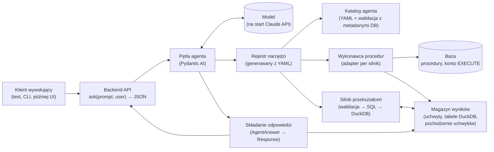
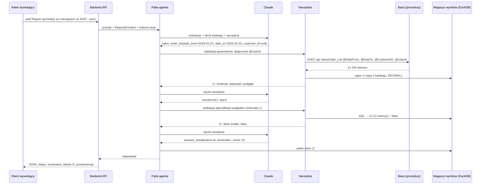

# Data Concierge: opis architektury backendu (wersja 3, happy-flow tylko do odczytu)

Status: opis koncepcji, implementacja w toku według planu [`docs/plans/2026-10-11-1011-feat-etapy-wdrozenia-v1-plan.md`](../plans/2026-10-11-1011-feat-etapy-wdrozenia-v1-plan.md). Wersja 3.4, data: 2026-10-11.
Podstawa: notatki z `docs/prompts/podsumowanie-agent.md`, research źródłowy (sekcja 14), research bibliotek z 2026-10-11, sprawdzenie danych i metadanych w lokalnej bazie AdventureWorks2025.

> **Historia zmian.**
> **v2:** źródłem danych jest katalog procedur składowanych, a nie zbiory danych sprzedaży. Stack: Python. Modele: wyłącznie Anthropic.
> **v3:** (1) osobny plik YAML z opisami procedur pisanymi pod agenta; (2) silnik obliczeń: DuckDB; (3) zakres zawężony do backendu: wejściem jest prompt, wyjściem dane w JSON, bez UI, wykresów i streamingu; (4) brak filtrowania w aplikacji: każdy filtr musi być parametrem procedury.
> **v3.1:** model `claude-haiku-5-5` z `effort: medium`; specyfikacja obliczeń niezależna od silnika (DuckDB teraz, Polars jako możliwa wersja alternatywna); komentarz w v1 pisany przez model swobodnie, bez placeholderów i bez kontroli liczb (do zrobienia później, razem z ochroną przed prompt injection); projekt testowy z jednym właścicielem.
> **v3.2:** pętla agenta na **Pydantic AI** zamiast samego Anthropic SDK (kod od razu gotowy na inne modele); filtrowanie po pobraniu w DuckDB/Polars jako przewidziane rozszerzenie (nie w v1); dedykowane konto SQL z minimalnymi uprawnieniami (sekcja 5.5); wyjaśnienie, czy DuckDB to sandbox (sekcja 7.4a).
> **v3.3:** nazwy kolumn tworzonych w specyfikacji przekształceń (aliasy, fakty) po angielsku, np. `month`, `net_sales`; instalacja zależności przez uv.
> **v3.4:** wnioski z researchu bibliotek (Pydantic AI 2.55.0, DuckDB 1.5.6, pyodbc 5.3.0, testy na lokalnym SQL Server) i z planu wdrożenia: (1) agent kończy turę wynikiem `AgentAnswer`, a `Response` składa `ResponseAssembler`; (2) proweniencja żyje przy uchwytach w magazynie wyników; (3) sesje w pamięci procesu za `SessionRepository`; (4) `data_range` czytany procedurą `api.SalesOrder_DataRange`; (5) konto `agent_reader` to login SQL (instancja w trybie mieszanym), a same uprawnienia `EXECUTE` wystarczają także do walidacji katalogu; (6) tryb `strict` tylko dla narzędzi procedur, z budżetem Anthropic; (7) `avg` i dzielenie rzutowane na `DECIMAL(38,6)`, pełna kolejność wierszy, kompilacja `pivot`, zakaz agregacji obciętych wyników; (8) narzędzia synchroniczne, limity czasu w sterownikach, błędy mapowane na `ModelRetry` albo `ToolFailed`; (9) stały początek rozmowy i data bieżąca w wiadomości użytkownika; (10) `find_procedures` poza v1, kandydatem na później jest `defer_loading`.

## 1. Cel i zakres

Backend asystenta AI: przyjmuje prompt użytkownika i zwraca dane. Baza udostępnia dane wyłącznie przez procedury, które zwracają **surowe wiersze**. Grupowanie, sumy i pivoty robi backend, a nie kolejne procedury. Frontend jest poza zakresem tego ćwiczenia, a interfejsem jest funkcja lub endpoint `prompt → JSON`.

Szczęśliwa ścieżka v1:

1. backend dostaje prompt (i tożsamość użytkownika),
2. agent wybiera procedurę z katalogu i ustala jej parametry (w razie potrzeby zwraca pytanie doprecyzowujące),
3. backend wywołuje procedurę i zapisuje wynik,
4. agent opisuje, **co** policzyć, a backend liczy to deterministycznie,
5. backend zwraca status, tabele z danymi, krótki komentarz i proweniencję (jak policzono).

Przykładowe prośby:

| # | Prośba | Co musi umieć system |
|---|--------|----------------------|
| P1 | „Daj mi listę klientów z miejscowości Berlin” | wybór procedury, parametr miasta, obsługa niejednoznacznej nazwy |
| P2 | „Pokaż sprzedaż klienta Mohamed Pal w 2024” | wyszukanie klienta, dopytanie przy kilku trafieniach, druga procedura |
| P3 | „Zrób raport sprzedaży po miesiącach za 2024” | pobranie surowych zamówień, deterministyczna agregacja po miesiącu |
| P4 | „Pokaż strukturę materiałową produktu HL Mountain Frame” | inna dziedzina, istniejąca procedura `uspGetBillOfMaterials`, dowód, że projekt nie jest „pod sprzedaż” |

Poza zakresem v1: frontend, zapisy, procesy w tle, strażnicy, zatwierdzanie, obrona przed iniekcją. Sekcja 12 pokazuje, jak v1 zostawia na nie miejsce.

## 2. Wymagania

- **Dane tylko przez procedury** z katalogu. Model nie pisze SQL do bazy.
- **Żadnych procedur „pod pytanie”.** Procedury zwracają dane w naturalnym ziarnie (klient, zamówienie, pozycja), a zestawienia robi backend.
- **Filtry w v1 tylko w procedurach.** Zakres danych zawężają parametry procedury. Jeśli filtra nie da się wyrazić parametrem, agent w v1 mówi, że tego nie obsługuje (status `unsupported`). **Docelowo** brakujące filtry wykona backend (krok `filter` w DuckDB lub Polars, sekcja 7.2). Projekt jest na to przygotowany, ale w v1 tego nie włączamy.
- **Obliczenia deterministyczne.** Model nie liczy sum ani średnich i nie przepisuje liczb „z głowy” (sekcja 7).
- **Python.** Na start **modele Anthropic**, ale kod od początku niezależny od dostawcy, żeby później dało się użyć innych modeli (OpenAI, Azure, lokalne) bez przepisywania.
- **Wymienna baza danych.** Zależność od silnika siedzi w jednym adapterze, który wywołuje procedury.
- **Agent działa w imieniu użytkownika.** Tożsamość jest przekazywana do procedur już w v1, nawet jeśli procedury jeszcze jej nie sprawdzają.

## 3. Najważniejsze decyzje w skrócie

| Decyzja | Wybór dla v1 | Dlaczego |
|---------|--------------|----------|
| Skąd agent wie o procedurach | **Osobny plik YAML z opisami pisanymi pod agenta** (kiedy użyć, kiedy nie, przykłady, powiązania), walidowany przy starcie z metadanymi bazy | Wąski, opisany kontekst poprawia trafność [1]. Opis techniczny procedury i opis dla agenta to różne rzeczy (sekcja 5.1). |
| Jak model wywołuje procedury | Jedno narzędzie na procedurę, generowane z YAML, ze ścisłym schematem parametrów. Tryb `strict` dostawcy tylko dla narzędzi procedur, sterowany ustawieniem. | Typowane parametry, walidacja przed wywołaniem, model nie wymyśla nazw [2]. Budżet trybu `strict` w Anthropic nie mieści specyfikacji `transform` (sekcja 6.1). |
| Duża liczba procedur | W v1 bez wyszukiwania narzędzi: wszystkie definicje w kontekście | Przy kilkunastu procedurach to wystarcza. Gdy katalog urośnie: tool search Claude API (`defer_loading`, obsługiwany przez Pydantic AI) albo własne `find_procedures` (sekcja 6.3). |
| Gdzie są dane | W magazynie wyników backendu, pod uchwytami. Model widzi schemat, statystyki i kilka wierszy. | Koszt, opóźnienie, limit kontekstu [4][5]. |
| Jak liczyć | Model pisze **deklaratywną specyfikację przekształcenia** (JSON), backend ją waliduje, tłumaczy na SQL i wykonuje w **DuckDB**. Specyfikacja nie zależy od silnika, więc później można dodać wykonawcę w Polars. | Ten sam wynik dla tych samych danych i tej samej specyfikacji. Model wybiera „co”, kod liczy „ile”. |
| Liczby w komentarzu | v1: model pisze komentarz swobodnie, korzystając z faktów policzonych przez backend. Bez kontroli. | Prostota na start. Ryzyko pomyłki przy przepisywaniu liczb jest znane i odłożone na później (sekcja 7.5). |
| Pętla agenta | **Pydantic AI** z modelem `anthropic:claude-haiku-5-5` | Jeden kod dla wielu dostawców (zmiana modelu = zmiana konfiguracji) [6]. Vercel AI SDK jest w TypeScript, więc nie pasuje do backendu w Pythonie (sekcja 11). |
| Koniec tury | Model zwraca `AgentAnswer` (status, komentarz, uchwyty, założenia, pytanie), a `ResponseAssembler` dokleja dane uchwytów i proweniencję | Model nie przepisuje danych tabel, więc nie może ich przekłamać (sekcje 6.2 i 9). |
| Uprawnienia DB | Dedykowany login SQL `agent_reader` z samym `EXECUTE` na wybranych procedurach, bez dostępu do tabel, od v1 | Przy dostępie wyłącznie przez procedury kosztuje to tyle samo co konto read-only. Te same uprawnienia wystarczają do walidacji katalogu przy starcie (sekcja 5.5). |

## 4. Komponenty



| Komponent | Odpowiedzialność |
|-----------|------------------|
| **Backend API** | `ask(prompt, user, session_id?) → Response`. Buduje `RequestContext` (user_id, role, id korelacji). Trzyma sesje w pamięci procesu za interfejsem `SessionRepository`: sesja ma historię wiadomości Pydantic AI i własne połączenie DuckDB z uchwytami, więc uchwyty z poprzedniej tury są dostępne po pytaniu doprecyzowującym. Restart procesu czyści sesje. W v1 to funkcja Pythona, CLI i cienki endpoint HTTP. |
| **Pętla agenta** | Agent Pydantic AI: wysyła rozmowę do modelu, wykonuje wywołania narzędzi, pilnuje limitu kroków, kończy wynikiem `present_result` (typ `AgentAnswer`). Bez logiki biznesowej. |
| **Katalog agenta** | Plik YAML: opisy procedur pod agenta, parametry, kolumny wyniku z typami i rolami (sekcja 5). |
| **Rejestr narzędzi** | Generuje definicje narzędzi z YAML, waliduje parametry, dokleja parametry wstrzykiwane przez backend (np. `@UserId`). |
| **Wykonawca procedur** | `EXEC` z parametrami, limit wierszy i czasu, zamiana wyniku na tabelę z typami z katalogu (bez utraty precyzji), zapis do magazynu. Jedyny komponent zależny od silnika bazy. |
| **Magazyn wyników** | Wyniki sesji pod uchwytami `r1`, `r2`… jako tabele w DuckDB (w pamięci procesu), ze schematem, statystykami i pochodzeniem każdego uchwytu: wywołaniem procedury albo krokiem `transform` ze źródłem, specyfikacją i SQL. |
| **Silnik przekształceń** | Waliduje specyfikację względem schematu uchwytu, tłumaczy ją na SQL DuckDB i wykonuje (sekcja 7). |
| **Składanie odpowiedzi** | `ResponseAssembler`: z `AgentAnswer` od modelu buduje `Response` (sekcja 9). Dokleja pełne dane wskazanych uchwytów i proweniencję, czyli łańcuch pochodzenia tych uchwytów. Docelowo także kontrola liczb w komentarzu (sekcja 7.5). |

Proweniencja nie jest osobnym komponentem. Magazyn wyników zapisuje pochodzenie przy każdym uchwycie, a składanie odpowiedzi odczytuje łańcuch zwracanych uchwytów (sekcja 7.6). Ten łańcuch pozwala odtworzyć wynik bez modelu i jest zalążkiem logu audytowego.

## 5. Katalog agenta (YAML)

### 5.1. Dlaczego osobny plik pod agenta

Dokumentacja techniczna procedury („zwraca nagłówki zamówień z kolumnami…”) jest pisana dla programisty. Agent potrzebuje innych informacji: **kiedy** sięgnąć po procedurę, kiedy **nie**, skąd wziąć wartości parametrów i jak interpretować kolumny. Dlatego katalog agenta to osobny plik (np. `catalog/agent-procedures.yaml`), utrzymywany razem z promptem i testami agenta.

- Plik jest **jedynym źródłem** opisów dla modelu: z niego powstają definicje narzędzi i skrót katalogu w instrukcji systemowej.
- Plik **nie dubluje** metadanych bazy. Typy parametrów i kolumn są w nim zadeklarowane, ale przy starcie backend porównuje je z bazą (sekcja 5.3), więc rozjazd wychodzi od razu.
- Zmiana w pliku to zmiana zachowania agenta, więc każdą zmianę sprawdza zestaw ewaluacyjny (sekcja 13).

### 5.2. Przykładowy wpis

```yaml
- procedure: api.SalesOrder_List          # nazwa w bazie
  tool: sales_order_list                  # nazwa narzędzia dla modelu
  access: read
  summary: Zamówienia sprzedaży (nagłówki) w okresie, opcjonalnie dla jednego klienta.
  use_when:
    - pytanie dotyczy sprzedaży, obrotów lub zamówień w czasie
    - potrzebny jest raport sprzedaży po dniach, miesiącach, latach, klientach lub terytoriach
  not_for:
    - sprzedaż w podziale na produkty lub kategorie → użyj sales_order_line_list
    - wyszukanie klienta po nazwie → najpierw customer_search
  grain: jeden wiersz = jedno zamówienie, dane nie są zgrupowane
  synonyms: [sprzedaż, zamówienia, obroty]
  max_rows: 100000
  params:
    - name: DateFrom
      arg: date_from
      type: date
      required: true
      hint: Początek okresu, włącznie (OrderDate). Dla „2024” podaj 2024-01-01.
    - name: DateTo
      arg: date_to
      type: date
      required: true
      hint: Koniec okresu, wyłącznie. Dla „2024” podaj 2025-01-01.
    - name: CustomerID
      arg: customer_id
      type: int
      required: false
      hint: Id klienta. Wartość bierz wyłącznie z wyniku customer_search, nigdy nie zgaduj.
    - name: UserId
      type: int
      inject: request_context.user_id      # model tego parametru nie widzi
  columns:
    - {name: SalesOrderID, type: int,           role: id}
    - {name: OrderDate,    type: date,          role: time,      hint: Data zamówienia}
    - {name: CustomerID,   type: int,           role: id}
    - {name: CustomerName, type: string,        role: dimension}
    - {name: CustomerType, type: string,        role: dimension, values: [individual, store]}
    - {name: Territory,    type: string,        role: dimension}
    - {name: SubTotal,     type: "decimal(19,4)", role: measure,   hint: "Sprzedaż netto, bez podatku i frachtu", default_for: [sprzedaż]}
    - {name: TotalDue,     type: "decimal(19,4)", role: measure,   hint: Kwota z podatkiem i frachtem}
  data_range: {procedure: api.SalesOrder_DataRange}  # min/max read once at startup
  examples:
    - prompt: "sprzedaż za I kwartał 2025"
      call: {date_from: 2025-01-01, date_to: 2025-04-01, customer_id: null}
    - prompt: "raport sprzedaży po miesiącach za 2024"
      call: {date_from: 2024-01-01, date_to: 2025-01-01, customer_id: null}
      then: "transform: miesiąc z OrderDate, suma SubTotal"
```

Pola istotne dla agenta:

- **`use_when` / `not_for`** kierują wyborem procedury i odsyłają do właściwej, gdy pytanie jest „obok”.
- **`hint` przy parametrze** mówi, skąd wziąć wartość (np. „bierz id z `customer_search`, nie zgaduj”) i jak zamienić język naturalny na wartość (okres → daty).
- **`role` kolumny** (`id`, `dimension`, `measure`, `time`) mówi silnikowi przekształceń, co wolno z kolumną zrobić: sumować można tylko `measure`, ziarno czasu stosować tylko do `time`.
- **`default_for`** rozstrzyga typowe niejednoznaczności („sprzedaż” = SubTotal). Agent pokazuje to w `assumptions`.
- **`inject`** oznacza parametry doklejane przez backend (tożsamość). Model ich nie widzi ani nie ustawia.
- **`exposed: false`** oznacza procedurę wołaną tylko przez backend, np. procedurę zakresu dat. Model nie dostaje dla niej narzędzia.

Plik jest czytany ściśle: nieznany klucz to błąd katalogu, a nie cicho pominięte pole. W mapowaniach `{...}` wartości z przecinkiem, także typ `"decimal(19,4)"`, trzeba ująć w cudzysłów, bo przecinek kończy wartość.
- **`data_range`** wskazuje procedurę zakresu, która zwraca min/max dat. Konto agenta nie ma `SELECT` na tabelach, więc zakresu nie da się odczytać z kolumny. Zakres jest wspólny dla wszystkich użytkowników i czytany raz przy starcie, bez kontekstu żądania. Trafia do kontekstu modelu. Względne okresy poza zakresem danych kończą się statusem `no_data` z informacją o dostępnym zakresie.
- **`examples`** to przykłady pytanie → wywołanie. Pełnią rolę few-shot, podobnie jak przykłady w Fabric data agent [1], i od razu nadają się do zestawu testów.

Każdy filtr potrzebny użytkownikom musi istnieć jako parametr procedury. Gdy agent dostaje prośbę z filtrem, którego żadna procedura nie obsługuje, zwraca `unsupported` z wyjaśnieniem. Lista takich odmów to gotowa informacja, jakie parametry warto dodać do procedur.

### 5.3. Walidacja z metadanymi bazy

| Element | Źródło w bazie | Uwagi |
|---------|----------------|-------|
| Parametry (nazwa, typ) | `sys.parameters` | Sprawdzone: działa dla wszystkich procedur w bazie. `has_default_value` jest dla procedur T-SQL zawsze 0, więc o tym, który parametr jest opcjonalny, rozstrzyga YAML. |
| Kolumny wyniku (nazwa, typ) | `sys.dm_exec_describe_first_result_set_for_object` | Sprawdzone na `dbo.uspGetEmployeeManagers` (zwraca 7 kolumn z typami). Nie działa dla procedur z tabelami tymczasowymi, dynamicznym SQL lub wieloma zestawami wyników. Nowe procedury `api.*` piszemy bez nich. Dla istniejących procedur, których nie da się opisać, obowiązuje lista z YAML, sprawdzana przy pierwszym wywołaniu. |
| Opisy pod agenta | tylko YAML | W bazie procedury nie mają `MS_Description` (0 extended properties). |

Typy z bazy porównujemy z typami z YAML przez jedną tabelę równoważności, np. `money` = `decimal(19,4)`, `smallmoney` = `decimal(10,4)`, `smallint` = `int`, `nvarchar(n)` = `string`, `datetime2` = `datetime`. Typ bez odpowiednika (np. `xml`) to błąd katalogu.

Przy starcie backend porównuje YAML z bazą. Brakująca procedura, inny typ parametru albo niezgodna lista kolumn to błąd konfiguracji, a nie niespodzianka w rozmowie. Ten sam mechanizm mógłby wygenerować szkielet wpisu YAML dla nowej procedury (parametry i kolumny), a człowiek dopisałby opisy pod agenta. W v1 tego nie budujemy, bo przy kilkunastu procedurach wpisy pisze się ręcznie.

### 5.4. Zestaw procedur do testów na AdventureWorks2025

W bazie są 4 procedury zwracające dane i 6 procedur zapisu lub pomocniczych. Do katalogu v1 trafiają tylko procedury odczytu, a uzupełniamy je kilkoma nowymi, które zwracają surowe wiersze.

| Procedura | Status | Zwraca |
|-----------|--------|--------|
| `dbo.uspGetBillOfMaterials(@StartProductID, @CheckDate)` | istniejąca | struktura materiałowa produktu |
| `dbo.uspGetWhereUsedProductID(@StartProductID, @CheckDate)` | istniejąca | gdzie użyto komponentu |
| `dbo.uspGetEmployeeManagers(@BusinessEntityID)` | istniejąca | łańcuch przełożonych |
| `dbo.uspGetManagerEmployees(@BusinessEntityID)` | istniejąca | podwładni |
| `api.Customer_Search(@Name)` | nowa | klienci (osoby i sklepy) pasujący do nazwy, z numerem konta i terytorium |
| `api.Customer_List(@City, @CountryRegionCode, @CustomerType)` | nowa | klienci z adresem (miasto, region, kraj). Musi obejmować adresy osób **i** sklepów. |
| `api.SalesOrder_List(@DateFrom, @DateTo, @CustomerID)` | nowa | nagłówki zamówień z klientem i terytorium |
| `api.SalesOrderLine_List(@DateFrom, @DateTo, @CustomerID, @ProductCategoryID)` | nowa | pozycje z produktem, podkategorią i kategorią |
| `api.Product_Search(@Name)` | nowa | produkty pasujące do nazwy (potrzebne do P4) |
| `api.SalesOrder_DataRange()` | nowa | min/max `OrderDate` zamówień dla `data_range`. Jedyna procedura bez `@UserId`, bo zakres jest wspólny i czytany przy starcie. |
| `uspUpdateEmployee*`, `uspLogError`, `uspPrintError` | pominięte | zapis lub obsługa błędów (`access: write`, poza v1) |

Fakty z bazy, które wpływają na projekt:

- **Zakres zamówień: 2022-05-30 do 2025-06-29** (31 465 zamówień, 121 317 pozycji). Bez `data_range` w kontekście „ostatni kwartał” zwróci pustkę.
- **Nazwy nie są unikalne.** „Mohamed Pal” to 3 różnych klientów (CustomerID 12698, 20550, 28763). 31 nazw miast występuje w więcej niż jednym regionie, np. „Berlin” w 5 regionach Niemiec. „HL Mountain Frame” to 10 wariantów produktu.
- **Klient to osoba albo sklep.** 18 484 osoby, 1 336 sklepów, w tym 635 z osobą kontaktową.
- **Kwoty to `money`/`decimal`.** To ważne dla deterministyczności obliczeń (sekcja 7.4).

### 5.5. Konto bazodanowe agenta

Backend łączy się z SQL Server dedykowanym kontem, używanym tylko przez agenta: login SQL z hasłem i użytkownik w bazie, oba o nazwie `agent_reader`.

- Login SQL wymaga instancji w trybie mieszanym (`SERVERPROPERTY('IsIntegratedSecurityOnly') = 0`). Skrypt wdrożeniowy sprawdza tryb i kończy się czytelnym komunikatem, gdy instancja przyjmuje tylko logowanie Windows.
- `GRANT EXECUTE ON SCHEMA::api TO agent_reader` dla nowych procedur oraz `GRANT EXECUTE` osobno na każdą z czterech istniejących procedur odczytu w `dbo`.
- Brak `SELECT` na tabelach i widokach, brak ról typu `db_datareader`, brak uprawnień do procedur zapisu.
- Procedury i tabele mają tego samego właściciela (`dbo`), więc procedura czyta tabele dzięki mechanizmowi ownership chaining, choć konto samo nie ma do nich dostępu. Wyjątek: procedury z dynamicznym SQL (`sp_executesql`) przerywają ten łańcuch i wymagałyby `EXECUTE AS` lub podpisu certyfikatem. Nowe procedury piszemy więc bez dynamicznego SQL.
- Hasło lub inny sekret konta trzymamy w konfiguracji backendu, nigdy w prompcie. Model nie zna danych logowania i nie ma narzędzia, które by je ujawniało.
- Do walidacji katalogu przy starcie (sekcja 5.3) wystarczą same uprawnienia `EXECUTE`. Sprawdzone na lokalnym SQL Server: użytkownik z samym `EXECUTE` widzi `sys.parameters` i wynik `sys.dm_exec_describe_first_result_set_for_object` dla procedur, które może wykonać. Osobne konto techniczne ani `VIEW DEFINITION` nie są potrzebne.
- ODBC Driver 18 domyślnie szyfruje połączenie i sprawdza certyfikat serwera. `TrustServerCertificate=yes` (zaufanie do certyfikatu samopodpisanego) włącza ustawienie konfiguracji i używamy go tylko lokalnie.

## 6. Narzędzia widziane przez model

### 6.1. Narzędzia procedur (generowane)

Każda procedura z katalogu to osobne narzędzie, np. `sales_order_list`. Opis narzędzia składa się z `summary`, `use_when`, `not_for`, `grain` i zakresu danych. Parametry opisuje model Pydantic budowany z `params` (`pydantic.create_model`) dla każdego wpisu katalogu. Ten sam model daje schemat narzędzia (`additionalProperties: false`) i walidację argumentów, a błąd walidacji Pydantic AI sam odsyła do modelu jako prośbę o poprawkę. Parametry `inject` nie trafiają do schematu. Pola opcjonalne mają kształt `anyOf` z `null` i wartość domyślną `null`. Backend dodatkowo sprawdza zakresy i wartości, a błąd wraca do modelu jako błąd narzędzia z czytelnym opisem (sekcja 11.2).

**Tryb `strict` dostawcy** włączamy tylko dla narzędzi procedur, przełącznikiem w konfiguracji. Anthropic dopuszcza w jednym żądaniu 20 narzędzi `strict`, 24 parametry opcjonalne i 16 parametrów z unią, liczone łącznie dla wszystkich narzędzi `strict`. Unia kroków specyfikacji przekroczyłaby ten budżet, więc `transform` i `present_result` nie są `strict`. Tryb `strict` nie egzekwuje też `const`, `minimum` ani `maxLength`, dlatego walidacja w backendzie jest obowiązkowa niezależnie od trybu. Przekroczenie budżetu kończy każde żądanie błędem 400, więc test jednostkowy sprawdza budżet na katalogu z repozytorium.

```json
{
  "name": "sales_order_list",
  "description": "Zamówienia sprzedaży (nagłówki) w okresie, opcjonalnie dla jednego klienta. Jeden wiersz = jedno zamówienie, dane nie są zgrupowane. Używaj do: sprzedaż/obroty/zamówienia w czasie, raporty po okresach, klientach, terytoriach. Nie używaj do: sprzedaży po produktach (sales_order_line_list), wyszukiwania klienta (customer_search). Dane: 2022-05-30 – 2025-06-29.",
  "strict": true,
  "input_schema": {
    "type": "object",
    "properties": {
      "date_from":   {"type": "string", "format": "date", "description": "Początek okresu, włącznie. Dla „2024” podaj 2024-01-01."},
      "date_to":     {"type": "string", "format": "date", "description": "Koniec okresu, wyłącznie. Dla „2024” podaj 2025-01-01."},
      "customer_id": {"anyOf": [{"type": "integer"}, {"type": "null"}], "default": null, "description": "Id klienta wyłącznie z wyniku customer_search."}
    },
    "required": ["date_from", "date_to"],
    "additionalProperties": false
  }
}
```

Wynik wywołania procedury zwracany modelowi (nie pełne dane):

```json
{
  "handle": "r1",
  "row_count": 14244,
  "truncated": false,
  "columns": [{"name": "OrderDate", "type": "date", "role": "time"}, {"name": "SubTotal", "type": "decimal(19,4)", "role": "measure"}, "..."],
  "stats": {"OrderDate": {"min": "2024-01-01", "max": "2024-12-31"}, "CustomerType": {"values": ["individual", "store"]}, "CustomerName": {"distinct_count": 9876}},
  "preview": ["… do 10 wierszy …"]
}
```

### 6.2. Narzędzia stałe

| Narzędzie | Rola |
|-----------|------|
| `transform` | Przyjmuje specyfikację przekształcenia (sekcja 7) dla uchwytu i zwraca nowy uchwyt z podglądem i faktami. |
| `describe_result` | Pełny schemat i statystyki uchwytu (gdy podgląd nie wystarcza). |
| `present_result` | Koniec tury: wynik `AgentAnswer` ze statusem, komentarzem, uchwytami do zwrócenia (z tytułami tabel), założeniami i ewentualnym pytaniem doprecyzowującym. W Pydantic AI to nie zwykłe narzędzie, tylko **typ wyniku agenta** (`output_type=ToolOutput(AgentAnswer, name="present_result")`): framework udostępnia go modelowi jako specjalne narzędzie wyjściowe i sam prosi o poprawkę, gdy odpowiedź nie pasuje do schematu [6]. `AgentAnswer` nie zawiera danych tabel. Pełną odpowiedź (sekcja 9) buduje z niego `ResponseAssembler`. |

### 6.3. Gdy procedur jest dużo

Dopóki procedur jest kilkanaście, wszystkie definicje mieszczą się w kontekście i są cache'owane (prompt caching). W v1 nie budujemy wyszukiwania narzędzi.

Gdy katalog urośnie, kandydatem jest wbudowany **tool search** Claude API (`defer_loading`) [8]. Research z 2026-10-11 potwierdził, że Pydantic AI obsługuje `defer_loading` także na bezpośrednim Claude API, a nie tylko na Bedrock. Dla dostawców bez tool search zostaje własne narzędzie `find_procedures(query)`, które przeszukuje `summary`, `use_when` i `synonyms` z YAML i zwraca kilka pasujących procedur, a ich narzędzia są udostępniane w kolejnym kroku. Próg przełączenia trzeba zmierzyć na zestawie ewaluacyjnym.

## 7. Deterministyczne obliczenia: jak to zrobić

### 7.1. Zasada

**Model decyduje, co policzyć. Kod liczy.** Model nigdy nie dostaje pełnych danych do zsumowania „w głowie” i nigdy sam nie wpisuje wyniku obliczeń. Opisuje przekształcenie w zamkniętym języku (specyfikacja JSON). Backend sprawdza specyfikację względem rzeczywistego schematu danych, tłumaczy ją na SQL i wykonuje w DuckDB. Te same dane wejściowe i ta sama specyfikacja dają zawsze ten sam wynik.

```
procedura ──► surowe wiersze (r1, tabela DuckDB) ──► specyfikacja od modelu ──► walidacja ──► SQL ──► DuckDB ──► r2 + fakty ──► odpowiedź JSON
```

### 7.2. Język specyfikacji (v1)

Specyfikacja to lista kroków nad jednym uchwytem. Zestaw kroków jest zamknięty i rozszerzany świadomie, gdy pojawi się potrzeba.

| `op` | Co robi | Przykład parametrów |
|------|---------|---------------------|
| `derive` | Nowa kolumna z funkcji z białej listy: `date_trunc`, `year`, `month`, `quarter`, arytmetyka dwóch kolumn | `{"name": "month", "fn": "date_trunc", "unit": "month", "column": "OrderDate"}` |
| `aggregate` | Grupowanie i miary: `sum`, `count`, `count_distinct`, `avg`, `min`, `max` | `{"group_by": ["month"], "measures": [...]}` |
| `fill_periods` | Uzupełnienie brakujących okresów zerami w **zadanym** zakresie | `{"column": "month", "unit": "month", "from": "2024-01-01", "to": "2025-01-01"}` |
| `pivot` | Obrót: wiersze × kolumny × miara | `{"rows": "month", "columns": "Territory", "measure": "net_sales"}` |
| `sort`, `limit` | Kolejność i top N (np. 10 najlepszych klientów) | `{"by": [{"column": "net_sales", "dir": "desc"}]}`, `{"n": 10}` |
| `select` | Wybór, kolejność i zmiana nazw kolumn w wyniku | `{"columns": [{"column": "CustomerName", "alias": "customer"}, {"column": "City"}]}` |

Do tego sekcja `facts`, czyli nazwane wartości skalarne liczone z wyniku (`sum`, `avg`, `min`, `max`, `argmax`, `count`). Tylko z nich model może korzystać w komentarzu. `argmax` przy remisie zwraca najmniejszą wartość kolumny `return`, więc wynik nie zależy od kolejności wierszy.

Reguły języka:

- **Nazwy nadawane przez model** (aliasy w `derive`, `aggregate` i `select`, nazwy faktów) muszą pasować do `^[a-z][a-z0-9_]*$`. Nazwy kolumn są unikalne bez względu na wielkość liter, bo DuckDB tak rozwiązuje identyfikatory: alias `subtotal` obok kolumny `SubTotal` to błąd walidacji.
- **`derive`** liczy `date_trunc` (z `unit`), `year`, `quarter` i `month` z kolumny `time` albo arytmetykę `{"fn": "arithmetic", "operator": "/", "left": ..., "right": ...}` na dwóch kolumnach liczbowych.
- **`fill_periods`** wymaga, żeby `from` było pierwszym dniem okresu, a kolumna okresu była jedyną kolumną poza miarami. Kolumna okresu może zawierać tylko początki okresów, np. wynik `date_trunc` z tą samą jednostką: przed wykonaniem wykonawca liczy wartości spoza siatki okresów i zgłasza błąd, bo inaczej takie wiersze zostałyby po cichu zastąpione wartością `fill`. Wiersze spoza zakresu `from`–`to` odpadają.
- **`pivot` jest ostatnim krokiem.** Po nim wolno tylko `sort` po kolumnie wierszy i `limit`. Nazwy kolumn obrotu pochodzą z wartości danych, więc walidator nie zna ich przed wykonaniem.
- **Obcięty wynik procedury nie trafia do agregacji.** Flaga `truncated` przechodzi na każdy uchwyt pochodny. `aggregate`, `pivot`, `fill_periods` i `facts` na uchwycie z obciętym przodkiem kończą się błędem walidacji z prośbą o zawężenie parametrów procedury. Suma z obciętych danych wyglądałaby na pełną, a np. wszystkie pozycje zamówień z całego zakresu (121 317) przekraczają domyślne `max_rows` 100 000. Pozostałe kroki przenoszą flagę do wyniku i do `truncated` tabeli w odpowiedzi.

**Przewidziane rozszerzenie: `filter`.** Filtr wierszy na pobranych danych (porównania, `in`, `between`, `is_null`, łączone `and`/`or`), np. `{"column": "CustomerType", "in": ["store"]}`, dla filtrów, których procedura nie ma jako parametru. Wchodzi do języka specyfikacji bez zmian w architekturze: walidacja sprawdza kolumny i typy, a wykonawca dodaje `WHERE` (DuckDB) lub `.filter()` (Polars). W YAML procedura dostanie wtedy listę kolumn, po których wolno filtrować w backendzie (`app_filters`). Warunek: procedura nadal musi mieć sensowne parametry zawężające (np. okres), bo filtr w backendzie oznacza pobranie większej liczby wierszy, a `max_rows` i flaga `truncated` pilnują, żeby wynik nie był po cichu niepełny. W v1 krok `filter` jest wyłączony. Nie ma też `join` dwóch uchwytów. Oba dojdą, gdy konkretna prośba będzie ich wymagać.

### 7.3. Walidacja przed wykonaniem

1. **Schemat:** specyfikacja jest modelem Pydantic (unia dyskryminowana po `op`). Z niego generowany jest `input_schema` narzędzia `transform`. Narzędzie `transform` nie używa trybu `strict`, bo unia kroków przekracza budżet Anthropic (sekcja 6.1). Walidację schematu robi Pydantic po stronie backendu.
2. **Semantyka, krok po kroku:** walidator śledzi schemat i typy kolumn po każdym kroku. Sprawdza, czy kolumna istnieje (także ta utworzona w poprzednim kroku), czy `sum`/`avg` dotyczy kolumny `measure` o typie liczbowym, czy `date_trunc` dotyczy kolumny `time`, czy nazwy nadane przez model są poprawne, czy `pivot` jest ostatnim krokiem i czy uchwyt źródłowy nie ma obciętego przodka (reguły z sekcji 7.2). Limit kolumn `pivot` sprawdza kompilator, gdy pobierze wartości kolumny obrotu (sekcja 7.4).
3. **Błąd wraca do modelu** jako błąd narzędzia z prośbą o poprawkę (`ModelRetry`, sekcja 11.2) i konkretnym komunikatem, np. „`sum` wymaga kolumny liczbowej; `CustomerName` to `string`. Dostępne miary: SubTotal, TotalDue”. Model poprawia specyfikację w kolejnym kroku pętli.

### 7.4. Silnik: DuckDB

**Czym jest DuckDB:** bazą analityczną (OLAP) uruchamianą wewnątrz procesu Pythona, jako biblioteka (`uv add duckdb`). Nie ma serwera ani instalacji. Dane trzyma w pamięci, a operuje się na nich zwykłym SQL. Jest zoptymalizowana pod grupowania i agregacje na dużych tabelach.

**Dlaczego DuckDB, a nie Polars czy pandas:**

| | DuckDB | Polars | pandas |
|---|--------|--------|--------|
| Czym jest | SQL-owa baza analityczna w procesie | Biblioteka DataFrame (tabele w pamięci) z własnym API wyrażeń, napisana w Rust | Klasyczna biblioteka DataFrame w Pythonie |
| Język operacji | SQL | Metody Pythona (`group_by`, `agg`, `pivot`…) | Metody Pythona |
| Typ dziesiętny | `DECIMAL(p,s)`, pełne wsparcie | Typ `Decimal` jest, ale stan wsparcia operacji trzeba by sprawdzić | Tylko jako obiekty Pythona (wolno) albo `float` (niedokładnie) |
| Czytelność proweniencji | Wygenerowany SQL jest czytelny dla każdego, kto zna SQL | Kod Polars trzeba znać | Kod pandas trzeba znać |
| Droga do wariantu B (sekcja 7.7) | Model pisze SQL nad uchwytem, ten sam silnik | Inny mechanizm | Inny mechanizm |

Polars jest bardzo szybki i popularny, ale na start nie daje nic ponad DuckDB, a wymagałby nauki nowego API. SQL jest znany, więc DuckDB jest naturalnym wyborem na v1.

**Wersja alternatywna w Polars.** Specyfikacja (sekcja 7.2) nie zawiera SQL, tylko opis operacji, więc silnik jest wymienny. Silnik przekształceń to interfejs `Executor` z jedną metodą `run(spec, tables) -> Result`. W v1 jest jedna implementacja (`DuckDBExecutor`, tłumaczy specyfikację na SQL). Wersja w Polars (`PolarsExecutor`, tłumaczy ją na wyrażenia Polars) korzysta z tej samej walidacji, tych samych testów i tego samego magazynu wyników, bo DuckDB i Polars wymieniają dane przez Arrow bez kopiowania. Dodatkowy zysk: uruchomienie obu wykonawców na tych samych specyfikacjach i porównanie wyników to mocny test poprawności każdego z nich. Warunek: obsługa `Decimal` w Polars musi zostać sprawdzona, zanim wyniki z Polars uznamy za równoważne.

**Jak to działa w praktyce:**

1. Wykonawca procedur wywołuje procedurę przez pyodbc w postaci `SET NOCOUNT ON; EXEC <proc> @Name = ?, ...` i odbiera wiersze (pyodbc zwraca `Decimal` dla `money`/`decimal` i `date`/`datetime` dla dat). Z `fetchall()` buduje tabelę Arrow z typami z katalogu (np. `decimal128(19,4)`, `date32`). Odrzucona alternatywa: `arrow-odbc`, które przyjmuje parametry tylko jako tekst i otwiera połączenie z ciągu znaków przy każdym wywołaniu. Przy wynikach rzędu kilkudziesięciu tysięcy wierszy budowa kolumn z `fetchall()` wystarcza.
2. Magazyn wyników zapisuje tabelę w DuckDB jako `r1`. Zablokowane połączenie nie skanuje zmiennych Pythona, więc rejestracja jest jawna: `register`, potem `CREATE TABLE r1 AS SELECT …`, potem `unregister`. DuckDB zachowuje `DECIMAL(19,4)`, a wynik odczytany przez `to_arrow_table()` ma typy dziesiętne, np. suma kwot `decimal128(38,4)` (sprawdzone na DuckDB 1.5.6).
3. Silnik przekształceń tłumaczy zwalidowaną specyfikację na zapytanie. Nazwy kolumn pochodzą wyłącznie ze schematu uchwytu (biała lista, cytowane identyfikatory), a wartości idą jako parametry zapytania. Model nigdy nie dostarcza tekstu SQL.
4. Wynik zapisuje się jako `r2`, a przy uchwycie jego pochodzenie: źródło, specyfikacja i wygenerowany SQL (sekcja 7.6).

**Typy wynikowe.** Walidator liczy typ każdej kolumny wyniku. Operacje, które w DuckDB dają `DOUBLE`, kompilator rzutuje na `DECIMAL(38,6)`:

```text
aggregate.measures[i].fn:
  sum | min | max          -> type of the source column (sum widens to DECIMAL(38,s))
  count | count_distinct   -> int
  avg                      -> DECIMAL(38,6)   # CAST added by the compiler
derive.fn = arithmetic:
  + | - | *                -> DECIMAL per DuckDB rules
  /                        -> DECIMAL(38,6)   # CAST added by the compiler
```

Dzielenie przez zero daje `NULL`: kompilator dzieli przez `NULLIF(<dzielnik>, 0)`, bo dzielenie dziesiętne w DuckDB idzie przez `DOUBLE` i bez tego zwraca `NaN`, którego nie da się rzutować na `DECIMAL`. `sum` po kolumnie całkowitej kompilator rzutuje na `BIGINT`, bo DuckDB zwraca `HUGEINT`. Magazyn wyników porównuje typy faktycznego wyniku z typami przewidzianymi przez walidator i odrzuca rozjazd.

Suma pod `avg` jest dokładna, więc wynik nie zależy od kolejności wierszy. Stała skala 6 wystarcza dla v1. Pole skali w specyfikacji dodamy, gdy zażąda tego konkretna prośba.

**Pełna kolejność wierszy.** Kompilator dokleja do końcowego `ORDER BY`, po kluczach `sort` albo kluczach grupowania, wszystkie pozostałe kolumny wyniku w kolejności schematu. `limit` działa po tym porządku. Bez tego remisy w `sort` (np. trzech klientów „Mohamed Pal”, równe `net_sales`) dają przy `threads = 2` różną kolejność i różne top N między uruchomieniami.

**Kompilacja `pivot`.** `pivot` to agregacja warunkowa z wartościami pobranymi w osobnym zapytaniu. Kompilator buduje zapytanie `SELECT DISTINCT` kolumny obrotu na łańcuchu CTE przed `pivot`, a wykonawca uruchamia je przed zapytaniem końcowym, z limitem kolumn plus jeden, żeby wykryć przekroczenie limitu. Potem tworzy jedną kolumnę `SUM(CASE WHEN <column> = ? THEN <measure> ELSE 0 END)` na każdą wartość, z wartością jako parametrem. Oba zapytania trafiają do proweniencji. Wszystkie identyfikatory, także nazwy kolumn z wartości danych, przechodzą przez jeden pomocnik cytowania, który podwaja znak `"`, bo w danych są np. nazwy z apostrofem („Margie's Travel”). Statystyki źródła nie wystarczą, bo nie znają kolumn utworzonych przez `derive` ani wartości wymiarów z ponad 20 wartościami.

SQL wygenerowany dla raportu miesięcznego z sekcji 10 (sprawdzony na DuckDB na danych testowych: sumy wychodzą jako dokładny `DECIMAL`, puste miesiące jako 0):

```sql
WITH s1 AS (
  SELECT *, CAST(date_trunc('month', "OrderDate") AS DATE) AS "month" FROM r1
), s2 AS (
  SELECT "month",
         SUM("SubTotal")                 AS "net_sales",
         COUNT(DISTINCT "SalesOrderID")  AS "order_count"
  FROM s1 GROUP BY "month"
), periods AS (
  SELECT CAST(range AS DATE) AS "month" FROM range(DATE '2024-01-01', DATE '2025-01-01', INTERVAL 1 MONTH)
)
SELECT p."month",
       COALESCE(s2."net_sales", 0)   AS "net_sales",
       COALESCE(s2."order_count", 0) AS "order_count"
FROM periods p LEFT JOIN s2 USING ("month")
ORDER BY p."month", "net_sales", "order_count";  -- sort keys, then remaining columns
```

**Warunki deterministyczności:**

- **Typy dokładne:** kwoty przez całą ścieżkę są `DECIMAL`, a `avg` i dzielenie są rzutowane na `DECIMAL(38,6)`. Rzutowanie na `float` daje sumy niedokładne i zależne od kolejności wierszy, czyli niedeterministyczne. Odcinek Arrow → DuckDB → Arrow potwierdził research. Odcinek pyodbc → Arrow sprawdzamy na początku implementacji adaptera SQL Server, a wartości dziesiętne trafiają do JSON jako tekst (sekcja 9).
- **Kolejność:** SQL bez `ORDER BY` nie gwarantuje kolejności wierszy. Generator zawsze dodaje pełne `ORDER BY`: klucze `sort` albo klucze grupowania, a po nich pozostałe kolumny wyniku.
- **Brakujące okresy:** `fill_periods` korzysta z zakresu z prośby, a nie z min/max danych, bo miesiąc bez sprzedaży na początku lub końcu roku inaczej zniknąłby z raportu.
- **Testy:** każdy `op` ma testy jednostkowe porównujące wynik z równoważnym zapytaniem w SQL Server na tych samych danych.

### 7.4a. Czy DuckDB to sandbox?

Nie, i w wariancie A nie musi nim być. DuckDB to biblioteka działająca w procesie backendu, podobnie jak sterownik bazy. Sandbox jest potrzebny wtedy, gdy wykonuje się **kod napisany przez model**. Tu model nie dostarcza ani SQL, ani kodu, tylko specyfikację JSON z zamkniętej listy operacji. SQL buduje nasz kod: nazwy kolumn biorą się z białej listy schematu, a wartości idą jako parametry zapytania. Model nie ma jak „przemycić” polecenia do DuckDB. To samo dotyczy Polars.

Mimo to połączenie DuckDB jest od początku zablokowane (tania obrona w głąb, sprawdzone na DuckDB 1.5.6):

```sql
SET enable_external_access = false;      -- brak dostępu do plików i sieci (read_csv, COPY, ATTACH, HTTP)
SET autoinstall_known_extensions = false;
SET autoload_known_extensions = false;
SET memory_limit = '512MB';
SET threads = 2;
SET lock_configuration = true;           -- ustawień nie da się już zmienić w tym połączeniu
```

Po tych ustawieniach `read_csv('C:/Windows/win.ini')` i `COPY ... TO 'x.csv'` kończą się błędem uprawnień, a próba ponownego włączenia dostępu zwraca błąd konfiguracji. Wynik procedury trafia do bazy przez jawną rejestrację tabeli Arrow (sekcja 7.4), bo zablokowane połączenie nie skanuje zmiennych Pythona. Każda sesja ma osobne połączenie. Narzędzia działają w wątkach roboczych, więc każde wywołanie pracuje na własnym `cursor()` pod blokadą magazynu wyników. Długie zapytanie przerywa `interrupt()` wywołany z `threading.Timer` po przekroczeniu limitu czasu.

Prawdziwy sandbox (osobny proces lub kontener z limitami) będzie potrzebny dopiero przy wariancie B lub C z sekcji 7.7, czyli gdy model sam pisze SQL lub kod.

### 7.5. Liczby w komentarzu

Tabele w odpowiedzi liczy DuckDB, ale krótki komentarz tekstowy (np. „Sprzedaż netto w 2024 wyniosła …, najlepszy był czerwiec”) pisze model. Nawet jeśli tylko przepisuje liczbę z wyniku, może ją źle zaokrąglić albo pomylić.

**v1:** model pisze komentarz swobodnie. Instrukcja systemowa każe mu brać liczby wyłącznie z faktów (`facts`) i małych wyników zwróconych przez `transform`, a nie liczyć samodzielnie. Nie ma mechanizmu, który by to wymuszał. Źródłem prawdy są tabele i fakty w odpowiedzi, a komentarz jest pomocniczy.

**Docelowo (razem z innymi zabezpieczeniami, np. przed prompt injection):**

- **Kontrola liczb:** backend wyszukuje liczby w komentarzu i sprawdza, czy występują w faktach, wynikach lub prośbie. Liczba spoza nich oznacza prośbę do modelu o poprawkę, a przy kolejnej porażce odpowiedź bez komentarza.
- **Odwołania zamiast liczb:** model pisze w komentarzu odwołanie do faktu, który sam zdefiniował w specyfikacji tego pytania (np. `{r2.annual_total}`), a backend wstawia wartość. Szablonów nie przygotowuje się z góry, bo model tworzy je przy każdym pytaniu. To mocniejsza gwarancja niż kontrola, ale wymaga od modelu dyscypliny w pisaniu komentarza.
- Zestaw testowy sprawdza od początku, czy liczby w komentarzu zgadzają się z faktami, więc skalę problemu będzie widać, zanim trzeba będzie go rozwiązać.

### 7.6. Proweniencja

Każdy wynik niesie łańcuch: procedura + parametry → uchwyt → specyfikacja + wygenerowany SQL → uchwyt. Łańcuch żyje przy uchwytach: magazyn wyników zapisuje przy każdym uchwycie jego pochodzenie, czyli wywołanie procedury z parametrami i flagą `truncated` albo krok `transform` ze źródłem, specyfikacją oraz każdym zapytaniem SQL z jego parametrami (dla `pivot` także z zapytaniem o wartości kolumny obrotu). Backend zwraca w odpowiedzi (pole `provenance`) łańcuch pochodzenia zwracanych uchwytów, więc nie potrzeba osobnego komponentu proweniencji. Łańcuch:

- pozwala sprawdzić decyzję modelu (np. suma `TotalDue` zamiast `SubTotal`),
- pozwala odtworzyć wynik bez modelu (ponowne wykonanie zapisanego łańcucha),
- jest gotowym zapisem do późniejszego logu audytowego.

### 7.7. Porównanie z alternatywami

| Podejście | Deterministyczne wykonanie | Kto ustala logikę obliczeń | Audyt i powtarzalność | Gdzie są dane | Ocena |
|-----------|----------------------------|-----------------------------|------------------------|---------------|-------|
| **A. Specyfikacja deklaratywna → SQL w DuckDB** (rekomendowane) | Tak | Model wybiera z zamkniętego zestawu operacji, a kod je realizuje | Pełne | W backendzie | **v1** |
| **B. Model pisze SQL dla DuckDB nad uchwytem** | Tak (wykonanie) | Model, dowolny SQL | Średnie: SQL trzeba czytać | W backendzie | Opcja na v2 dla przypadków, których A nie obsłuży. Wymaga parsowania (tylko `SELECT`, tylko tabele uchwytów) i wyłączenia dostępu DuckDB do plików i sieci. Wzorzec: przykład data-analyst w Pydantic AI [5]. |
| **C. Model pisze Python w sandboxie** (code execution / programmatic tool calling w Claude API) | Tak (wykonanie) | Model, dowolny kod | Słabe: kod jest inny przy każdym pytaniu | W kontenerze Anthropic: pełne wiersze opuszczają backend | Nie dla v1. Sandbox to narzut i ryzyko [4], a programmatic tool calling nie łączy się ze `strict: true` [8]. |
| **D. Model liczy sam z wierszy** | Nie | Model | Brak | W kontekście modelu | Odrzucone. |

## 8. Przebieg żądania



Zasady ustalania parametrów:

| Sytuacja | Zachowanie |
|----------|------------|
| Brak wymaganego parametru (np. okresu) | `needs_clarification`. |
| Okres względny („ostatni kwartał”) | Rozwiązać względem daty bieżącej i pokazać daty w `assumptions`. Jeśli wypada poza `data_range`, zwrócić `no_data` z informacją o dostępnym zakresie. |
| Wyszukiwanie zwraca 0 trafień | `no_data` z propozycją doprecyzowania. |
| Wyszukiwanie zwraca kilka encji (klient, produkt) | `needs_clarification` z listą kandydatów. Nie wybierać samodzielnie. |
| Parametr niejednoznaczny, ale wynik może to pokazać (miasto w kilku regionach) | Zwrócić wszystko z kolumną rozróżniającą i zapisać to w `assumptions`. |
| Filtr, którego nie obsługuje żadna procedura | v1: `unsupported` z wyjaśnieniem, czego brakuje. Docelowo: krok `filter` w backendzie, jeśli kolumna jest na liście `app_filters`. |
| Niejasna miara („sprzedaż”) | `default_for` z katalogu, nazwa kolumny w `assumptions`. |

Limity v1: maks. 10 kroków pętli, `max_rows` z katalogu (domyślnie 100 000), 30 s na procedurę, podgląd dla modelu do 10 wierszy (cały wynik, jeśli ma do 50 wierszy, np. raport 12 miesięcy), maks. 10 000 wierszy na tabelę w odpowiedzi (z flagą `truncated`). Limity są w konfiguracji backendu. Limit czasu egzekwują sterowniki (sekcja 11.2).

## 9. Kontrakt odpowiedzi backendu

Pętla kończy się wynikiem `AgentAnswer` (narzędzie wyjściowe `present_result`, sekcja 6.2). `ResponseAssembler` buduje z niego odpowiedź: dokleja pełne dane wskazanych uchwytów i łańcuch ich pochodzenia jako `provenance`:

```json
{
  "status": "ok | no_data | needs_clarification | unsupported | error",
  "session_id": "…",
  "message": "Sprzedaż netto w 2024: 32 145 678,12. Najlepszy miesiąc: 2024-06.",
  "tables": [
    {
      "handle": "r2",
      "title": "Sprzedaż netto po miesiącach, 2024",
      "columns": [
        {"name": "month", "type": "date"},
        {"name": "net_sales", "type": "decimal(38,4)"},
        {"name": "order_count", "type": "int"}
      ],
      "rows": [["2024-01-01", "1234567.8900", 1102], ["…"]],
      "row_count": 12,
      "truncated": false
    }
  ],
  "assumptions": ["sprzedaż = SubTotal (netto)", "okres: 2024-01-01 – 2024-12-31"],
  "clarification": null,
  "provenance": [
    {"step": "procedure", "name": "api.SalesOrder_List", "params": {"DateFrom": "2024-01-01", "DateTo": "2025-01-01", "CustomerID": null}, "rows": 14244, "handle": "r1"},
    {"step": "transform", "source": "r1", "spec": {"…": "…"}, "sql": "WITH s1 AS (…)", "rows": 12, "handle": "r2"}
  ]
}
```

(Wartości liczbowe w przykładzie są ilustracyjne.)

- **Kwoty dziesiętne jako tekst** (`"1234567.8900"`), żeby JSON nie zgubił precyzji. Typ podaje `columns`.
- **`clarification`** zawiera pytanie i listę kandydatów z id, np. trzech klientów „Mohamed Pal”. Kolejne wywołanie `ask` z tym samym `session_id` i odpowiedzią użytkownika kontynuuje rozmowę.
- **Koniec tury bez wymuszania narzędzia:** Sonnet 5.5 i Opus 5.5 nie pozwalają wymusić wywołania konkretnego narzędzia (`tool_choice` `any` lub `tool` zwraca błąd 400) [8], a Pydantic AI nie wymusza narzędzia przy włączonym myśleniu. Projekt na tym nie polega: odpowiedź to `output_type` agenta, a gdy model odpowie czymś, co nie pasuje do schematu, Pydantic AI prosi go o poprawkę [6]. Po wyczerpaniu ponowień backend zwraca `error` i loguje przypadek.

## 10. Przykłady przepływu

**P1: „Daj mi listę klientów z miejscowości Berlin”**

1. `customer_list(city="Berlin", country_region_code=null, customer_type=null)` → `r1` z kolumnami m.in. `CustomerName`, `CustomerType`, `City`, `StateProvince`, `CountryRegion`.
2. Statystyki `r1` pokazują 5 różnych wartości `StateProvince`. Według zasad z sekcji 8 nie trzeba dopytywać, wystarczy zwrócić kolumnę regionu.
3. `transform(r1, {steps: [select(CustomerName, CustomerType, City, StateProvince), sort(StateProvince, CustomerName)], facts: [count]})` → `r2`.
4. Odpowiedź: `ok`, tabela `r2`, komentarz z liczbą klientów (fakt `count`), w `assumptions` informacja, że „Berlin występuje w 5 regionach, zwrócono wszystkie”.

**P2: „Pokaż sprzedaż klienta Mohamed Pal w 2024”**

1. `customer_search(name="Mohamed Pal")` → 3 trafienia (12698, 20550, 28763).
2. Odpowiedź: `needs_clarification` z trzema kandydatami (numer konta, terytorium, liczba zamówień).
3. Kolejne `ask` z wyborem → `sales_order_list(date_from="2024-01-01", date_to="2025-01-01", customer_id=12698)` → `r1`.
4. `transform(r1, {steps: [select, sort(OrderDate)], facts: [sum(SubTotal), count]})` → `r2`.
5. Odpowiedź: tabela zamówień, w komentarzu suma z faktów.

**P3: „Zrób raport sprzedaży po miesiącach za 2024”**

1. `sales_order_list(date_from="2024-01-01", date_to="2025-01-01", customer_id=null)` → `r1`, 14 244 wiersze.
2. `transform` ze specyfikacją:

```json
{
  "source": "r1",
  "steps": [
    {"op": "derive", "name": "month", "fn": "date_trunc", "unit": "month", "column": "OrderDate"},
    {"op": "aggregate", "group_by": ["month"], "measures": [
      {"name": "net_sales", "fn": "sum", "column": "SubTotal"},
      {"name": "order_count", "fn": "count_distinct", "column": "SalesOrderID"}
    ]},
    {"op": "fill_periods", "column": "month", "unit": "month", "from": "2024-01-01", "to": "2025-01-01",
     "fill": {"net_sales": 0, "order_count": 0}},
    {"op": "sort", "by": [{"column": "month", "dir": "asc"}]}
  ],
  "facts": [
    {"name": "annual_total", "fn": "sum", "column": "net_sales"},
    {"name": "best_month", "fn": "argmax", "column": "net_sales", "return": "month"}
  ]
}
```

   Backend tłumaczy ją na SQL z sekcji 7.4 i wykonuje w DuckDB.
3. Wynik `r2` (12 wierszy) wraca do modelu w całości razem z faktami.
4. Odpowiedź: `ok`, tabela `r2`, komentarz oparty na faktach, w `provenance` procedura, specyfikacja i SQL.

Wariant „po miesiącach i kategoriach”: `sales_order_line_list` → `derive(month)` → `aggregate(month, Category; sum LineTotal)` → `pivot(rows=month, columns=Category)`.

**P4: „Pokaż strukturę materiałową produktu HL Mountain Frame”**

1. `product_search(name="HL Mountain Frame")` → 10 wariantów (Black/Silver × rozmiary 38–48), więc `needs_clarification`.
2. Po wyborze: `get_bill_of_materials(start_product_id=…, check_date=<dziś lub data z prośby>)` → `r1`.
3. `transform(select + sort po poziomie)` → odpowiedź z tabelą.

Żaden z tych przepływów nie wymagał nowej procedury dla nowego pytania. Raport miesięczny, sprzedaż klienta i sprzedaż za okres korzystają z tej samej `api.SalesOrder_List`.

## 11. Pętla agenta: Pydantic AI

### 11.1. Dlaczego Pydantic AI, a nie Vercel AI SDK

| | Pydantic AI | Vercel AI SDK | Anthropic SDK |
|---|-------------|---------------|---------------|
| Język | **Python** | TypeScript / JavaScript | Python (i inne) |
| Wielu dostawców | Tak: model wybierany tekstem `dostawca:model`, np. `anthropic:claude-haiku-5-5`, `openai:…`, `azure:…`, `ollama:…`, `vllm:…`; endpointy zgodne z API OpenAI bez własnej klasy [6] | Tak (nie sprawdzone w researchu) | Nie, tylko Claude |
| Pasuje do backendu w Pythonie | Tak | Nie: wymagałby backendu w TypeScript albo osobnej usługi | Tak |
| Funkcje specyficzne dla Claude | Część dostępna przez ustawienia `anthropic_*` (sekcja 11.2) | Nie dotyczy | Wszystkie |

**Vercel AI SDK** jest popularny, ale to biblioteka TypeScript. Wybór oznaczałby przepisanie backendu na Node.js albo osobną usługę tylko do rozmowy z modelem, podczas gdy reszta (DuckDB, pyodbc, walidacja) zostałaby w Pythonie. Nie ma to sensu w projekcie, który i tak jest w Pythonie. Vercel AI SDK może się natomiast pojawić **po stronie frontendu**: Pydantic AI ma adapter `VercelAIAdapter`, który mówi protokołem strumienia Vercel AI, więc frontend w React z `useChat` może rozmawiać z agentem w Pythonie bez zmian w UI [6].

**LiteLLM** (bramka ujednolicająca API wielu dostawców) to inna możliwa droga, ale żadne twierdzenie o nim nie przeszło weryfikacji w researchu. Może się przydać później jako osobna bramka (klucze, limity, routing), a nie jako framework agenta.

### 11.2. Jak to wygląda w Pydantic AI

- **Agent:** `Agent('anthropic:claude-haiku-5-5', output_type=ToolOutput(AgentAnswer, name='present_result'), tools=[…])`. Tekst modelu pochodzi z konfiguracji, więc zmiana modelu to zmiana ustawienia.
- **Narzędzia:** funkcje synchroniczne, które Pydantic AI uruchamia w wątkach roboczych. Narzędzia procedur to obiekty `Tool` generowane z YAML, z modelem parametrów z `pydantic.create_model` (sekcja 6.1). `Tool.from_schema` odpada, bo nie waliduje argumentów ani nie stosuje wartości domyślnych. Narzędzia są cienkie: walidacja parametrów, wywołanie procedury i zapis pochodzenia uchwytu dzieją się w serwisach.
- **Błędy:** jeden dekorator `retry_on_domain_error` mapuje błędy domenowe. Błędy wejścia (zła wartość parametru, zła specyfikacja, nieznany uchwyt) zamienia na `ModelRetry`, czyli prośbę o poprawkę, która zużywa budżet ponowień (`retries`). Błędy wykonania (błąd procedury, przekroczenie czasu) zamienia na `ToolFailed`, który nie zużywa budżetu ponowień i mówi modelowi, żeby nie powtarzał tego samego wywołania.
- **Kontekst żądania:** `RequestContext`, magazyn wyników i serwisy trafiają do narzędzi przez mechanizm zależności Pydantic AI (`deps`), ten sam, którego przykład data-analyst używa do przechowywania DataFrame'ów [5].
- **Wynik:** `AgentAnswer` jako narzędzie wyjściowe `present_result` (sekcja 6.2). Framework sam prosi model o poprawkę, gdy odpowiedź nie pasuje do schematu [6]. `Response` (sekcja 9) składa `ResponseAssembler`.
- **Historia sesji:** Pydantic AI zwraca listę wiadomości z przebiegu, którą zapisujemy w sesji i przekazujemy przy kolejnym `ask` (np. po pytaniu doprecyzowującym).
- **Asynchroniczność:** asynchroniczna jest tylko ścieżka agenta (`AgentService.run`, `AskService.ask`). Endpoint HTTP woła `await AskService.ask(...)`, a CLI uruchamia ją przez `asyncio.run`, bo `run_sync` nie działa w uruchomionej pętli zdarzeń. Serwisy katalogu, procedur, przekształceń i wyników są synchroniczne. DuckDB pracuje przez `cursor()` na każde wywołanie pod blokadą magazynu wyników, a pyodbc otwiera połączenie na każde wywołanie (`threadsafety` 1).
- **Limity czasu:** egzekwują je sterowniki, a nie Pydantic AI, bo timeout narzędzia w Pydantic AI nie zatrzymuje wątku. Procedura dostaje `connection.timeout = 30` ustawione przed utworzeniem kursora (błąd `HYT00`). DuckDB dostaje `interrupt()` z `threading.Timer`.

**Ustawienia Claude dostępne w Pydantic AI** (według dokumentacji modelu Anthropic w Pydantic AI): `anthropic_thinking`, `anthropic_effort`, `anthropic_task_budget` oraz ustawienia cache (`anthropic_cache`, `anthropic_cache_instructions`, `anthropic_cache_tool_definitions`). Dla innego dostawcy te ustawienia się nie stosują, więc konfiguracja modelu jest per dostawca, a kod agenta wspólny.

**Wyniki researchu z 2026-10-11 (Pydantic AI 2.55.0):** tool search z `defer_loading` działa także na bezpośrednim Claude API (sekcja 6.3). Tryb `strict` jest dostępny dla zwykłych narzędzi, a jego budżet i polityka są w sekcji 6.1. Serwerowe `fallbacks` nie są potrzebne w v1.

### 11.3. Model i ustawienia

- **Model:** start na `claude-haiku-5-5` (następca Haiku 4.5) z `effort: medium`, ustawionym jawnie (`anthropic_effort`). Cena: $0,10 / $0,50 za milion tokenów wejścia/wyjścia przy promptach do 100 tys. tokenów, powyżej $0,50 / $2,50. Okno kontekstu 1M. Myślenie jest adaptacyjne i włączone domyślnie, a jego głębię steruje się `effort`. Bloki `thinking` muszą wracać do modelu bez zmian razem z wynikami narzędzi. Historią wiadomości zarządza framework. Działanie `strict` i `effort: medium` z Haiku 5.5 potwierdza sprawdzenie na żywo w etapie 3 planu. Gdy Haiku nie radzi sobie z wyborem procedury lub specyfikacją, kolejny krok to `anthropic:claude-sonnet-5-5`. Koszt liczyć na całe zadanie (cała pętla), a nie na pojedyncze wywołanie.
- **Odmowy:** odmowa modelu kończy się statusem `error`. Dla Haiku 5.5 nie ma automatycznego przełączenia na inny model po stronie serwera.
- **Stały początek rozmowy:** Haiku 5.5 wiąże bloki myślenia z niezmiennym początkiem rozmowy. Gdy zmieni się początek, który wytworzył blok, model odrzuca kontynuację, a Pydantic AI ponawia żądanie bez tego bloku, co kosztuje dodatkowe wywołanie i gubi rozumowanie. Dlatego instrukcje (reguły, skrót katalogu, zakresy danych) i zestaw narzędzi w stałej kolejności powstają raz przy starcie i nie zmieniają się w obrębie procesu. `block_binding.prefix_mismatch_behavior` ustawiamy jawnie na `drop_block`, a ostrzeżenie `AnthropicStaleThinkingBlockWarning` logujemy.
- **Prompt caching:** stała część (definicje narzędzi w ustalonej kolejności, instrukcja systemowa, skrót katalogu) idzie na początek i jest cache'owana przez ustawienia `anthropic_cache*`. Data bieżąca trafia do wiadomości użytkownika, a nie do instrukcji, żeby początek rozmowy się nie zmieniał.
- **Claude Agent SDK się nie nadaje.** To harness Claude Code z narzędziami do plików i powłoki, a tu potrzebne są wyłącznie nasze narzędzia.
- **Co trafia do dostawcy modelu:** instrukcje, opisy procedur, parametry, schematy, statystyki i podglądy do 10 wierszy (lub małe wyniki zagregowane). Pełne zbiory danych zostają w backendzie. Przy późniejszej klasyfikacji danych wrażliwych da się to zawęzić, bo podgląd jest konfigurowany per kolumna.

## 12. Jak v1 zostawia miejsce na kolejne warstwy

| Przyszła warstwa | Co v1 już ma |
|------------------|--------------|
| Konto z samym `EXECUTE`, uprawnienia sprawdzane w procedurach | Konto `EXECUTE` od v1. `@UserId` wstrzykiwany przez `inject`, poza zasięgiem modelu. |
| Zapisy z zatwierdzaniem, dry-run, limity rekordów | Katalog ma pole `access: read/write`. Procedury zapisu dojdą jako narzędzia wymagające zatwierdzenia. |
| Log audytowy | Proweniencja: rzeczywiste wywołania procedur, specyfikacje i SQL, a nie opis wygenerowany przez model. |
| Niezaufane pola tekstowe (pośrednia iniekcja) | Model widzi tylko podgląd. W katalogu można oznaczyć kolumny wolnotekstowe jako wyłączone z podglądu. |
| Kontrola liczb w komentarzu | Fakty liczone przez backend są już w wyniku `transform`, więc kontrola będzie porównaniem tekstu z gotową listą wartości (sekcja 7.5). |
| Strażnik wejścia lub akcji | Pętla jest cienka, a strażnik to dodatkowy krok przed lub po wyborze narzędzia. |
| Limity kroków, tokenów, rate limiting | Limity kroków i wierszy już są. `task_budget` w Claude API to opcja na limit tokenów w pętli. |
| Frontend | Kontrakt odpowiedzi (sekcja 9) zawiera wszystko, czego UI potrzebuje: dane z typami, komentarz, pytania doprecyzowujące, proweniencję. |
| Inne modele (OpenAI, Azure, lokalne) | Zmiana `dostawca:model` w konfiguracji Pydantic AI i dostrojenie promptu. Narzędzia, katalog i obliczenia bez zmian. Jakość wywoływania narzędzi przez mniejsze modele trzeba zmierzyć tym samym zestawem testów. |
| Filtrowanie w backendzie | Krok `filter` w języku specyfikacji i pole `app_filters` w YAML są zaprojektowane (sekcja 7.2), w v1 wyłączone. |

## 13. Otwarte kwestie i zestaw ewaluacyjny

**Do decyzji:**

Brak otwartych decyzji architektonicznych. Ustalone: projekt testowy z jednym właścicielem (YAML, prompt i testy), Python, Claude API (start: Haiku 5.5, `effort: medium`), DuckDB, komentarz w v1 bez kontroli liczb. Model i `effort` dobierane na bieżąco.

**Do sprawdzenia w prototypie** (stan po researchu z 2026-10-11):

- [x] Czy schemat specyfikacji (unia po `op`) przechodzi w trybie `strict`. Nie: przekracza budżet Anthropic, więc `transform` działa bez `strict` z walidacją w backendzie (sekcja 6.1).
- [ ] Ścieżka typu dziesiętnego: pyodbc → Arrow → DuckDB → JSON. Odcinek Arrow → DuckDB → Arrow potwierdzony. Odcinek pyodbc → Arrow sprawdzamy na początku implementacji adaptera SQL Server.
- [ ] Jak model radzi sobie z wyborem procedury przy rosnącym katalogu i od jakiej liczby procedur włączyć wyszukiwanie narzędzi (`defer_loading` albo `find_procedures`). Poza v1, mierzy to zestaw ewaluacyjny.
- [ ] Pydantic AI z Haiku 5.5: przekazywanie bloków `thinking`, `anthropic_effort`, cache, typ wyniku jako narzędzie wyjściowe. Wiązanie bloków myślenia z początkiem rozmowy jest rozpoznane (sekcja 11.3). Działanie na żywo potwierdza sprawdzenie w etapie 3 planu.
- [x] Minimalne uprawnienia konta agenta. Sam `EXECUTE` wystarcza, także do odczytu metadanych procedur (sekcja 5.5).
- [x] Wczytanie wyniku procedury do zablokowanego DuckDB przez Arrow z zachowaniem `DECIMAL`. Działa przez jawną rejestrację (sekcja 7.4).

**Zestaw ewaluacyjny:** 30–50 próśb z oczekiwaną procedurą i parametrami, oczekiwanym wynikiem (liczonym ręcznie SQL-em w SQL Server) i oczekiwanym statusem. Część przypadków pochodzi wprost z `examples` w YAML. Grupy: listy z filtrem (miasto, typ klienta), sprzedaż za okres, sprzedaż klienta, raporty po czasie i pivoty, inne dziedziny (BOM, przełożeni). Przypadki trudne: okres względny, okres poza danymi, niejednoznaczny klient lub produkt, miasto w kilku regionach, „sprzedaż” bez miary, filtr bez parametru w procedurze (`unsupported`). Ponieważ backend zwraca JSON, testy porównują odpowiedź z oczekiwaną automatycznie. Zestaw uruchamiamy przy każdej zmianie promptu, YAML lub modelu, a później dołączą do niego testy red-teamowe.

## 14. Źródła i stan weryfikacji

Research z wersji 1: 5 kierunków wyszukiwania, 22 źródła, 105 wyodrębnionych twierdzeń. 25 najważniejszych przeszło głosowanie weryfikacyjne (3 głosy): 19 potwierdzonych, 6 odrzuconych.

**Potwierdzone i nadal istotne:**

- [1] Wąski, wyselekcjonowany kontekst (opisy, przykłady, ograniczona liczba obiektów) poprawia trafność NL→dane: Uber QueryGPT, Databricks Genie, Fabric data agent (przykłady pytanie→zapytanie dobierane do pytania).
  https://www.uber.com/en-us/blog/query-gpt/ · https://docs.databricks.com/aws/en/genie/trusted-assets · https://learn.microsoft.com/en-us/fabric/data-science/data-agent-example-queries
- [2] SQL generowany przez LLM nadal wymyśla tabele i kolumny. Argument za zamkniętą przestrzenią akcji i walidacją w backendzie.
  https://www.uber.com/en-us/blog/query-gpt/
- [3] Microsoft SQL MCP Server: stały zestaw generycznych narzędzi, deterministyczny SQL, celowo bez NL2SQL, procedury jako nazwane narzędzia. Wzorzec zbieżny z tym projektem.
  https://learn.microsoft.com/en-us/azure/data-api-builder/mcp/overview
- [4] Wyniki pośrednie przechodzące przez kontekst modelu zwiększają koszt i opóźnienie. Kod pisany przez agenta wymaga sandboxa.
  https://www.anthropic.com/engineering/code-execution-with-mcp
- [5] Wzorzec uchwytów wyników z podglądem i SQL DuckDB nad przechowywanym DataFrame (przykład data-analyst w Pydantic AI).
  https://ai.pydantic.dev/examples/data-analyst

- [6] Pydantic AI: wybór modelu tekstem `dostawca:model`, endpointy zgodne z OpenAI, Azure, `VercelAIAdapter` (z researchu); wynik strukturalny przez narzędzie wyjściowe z ponowieniami oraz ustawienia `anthropic_*` (dokumentacja sprawdzona 2026-10-10).
  https://pydantic.dev/docs/ai/models/overview/ · https://pydantic.dev/docs/ai/models/anthropic/ · https://pydantic.dev/docs/ai/core-concepts/output/ · https://pydantic.dev/docs/ai/integrations/ui/vercel-ai/

**Mniej istotne po zmianie wymagań:** [7] Microsoft Agent Framework (stack .NET).

**Funkcje Claude API** [8] (tool search z `defer_loading`, `strict`, brak wymuszania narzędzia w Sonnet 5.5 i Opus 5.5, `effort` i jego wartości domyślne, `fallbacks` i ich brak dla Haiku 5.5, ceny i zachowanie myślenia w Haiku 5.5, programmatic tool calling i jego niezgodność ze `strict`) pochodzą z dokumentacji referencyjnej Claude API (stan na 2026-10-06), a nie z researchu. Limity trybu `strict` potwierdził research z 2026-10-11 [9].
  https://platform.claude.com/docs/en/build-with-claude/structured-outputs

**Research bibliotek z 2026-10-11** [9] (wersja 3.4): testy na Pythonie 3.14.3, DuckDB 1.5.6, pyodbc 5.3.0 i lokalnym SQL Server z ODBC Driver 18 oraz dokumentacja Pydantic AI 2.55.0. Z niego pochodzą: typy wynikowe DuckDB i jawna rejestracja Arrow (sekcja 7.4), widoczność metadanych przy samym `EXECUTE` (sekcja 5.5), budżet trybu `strict` (sekcja 6.1), `defer_loading` w Pydantic AI (sekcja 6.3), wiązanie bloków myślenia, `ToolFailed` i limity czasu (sekcja 11).

- Pydantic AI, narzędzia i `strict`: https://pydantic.dev/docs/ai/tools-toolsets/tools-advanced/
- Pydantic AI, model Anthropic i wiązanie bloków myślenia: https://pydantic.dev/docs/ai/models/anthropic/
- Pydantic AI, wynik (`ToolOutput`, `retries`): https://pydantic.dev/docs/ai/core-concepts/output/
- Pydantic AI, testy (`FunctionModel`, `TestModel`): https://pydantic.dev/docs/ai/guides/testing/
- pyodbc, wywoływanie procedur: https://github.com/mkleehammer/pyodbc/wiki/Calling-Stored-Procedures
- SQL Server, widoczność metadanych: https://learn.microsoft.com/en-us/sql/relational-databases/security/metadata-visibility-configuration

**Odrzucone w weryfikacji:** liczby trafności z benchmarków Spider 2.0, BIRD i BEAVER oraz twierdzenie o uprawnieniach użytkownika w Databricks Genie. Nie są tu przytaczane.

**Wnioski własne, nie ze źródeł:** katalog agenta i jego pola, generowanie narzędzi, język specyfikacji przekształceń, wybór DuckDB, zasady deterministyczności, proweniencja, kontrakt odpowiedzi, przebiegi. Fakty o AdventureWorks2025 (zakres dat, liczby klientów, duplikaty nazw, miast i produktów, lista procedur, działanie `dm_exec_describe_first_result_set_for_object`) pochodzą z zapytań do lokalnej bazy.
