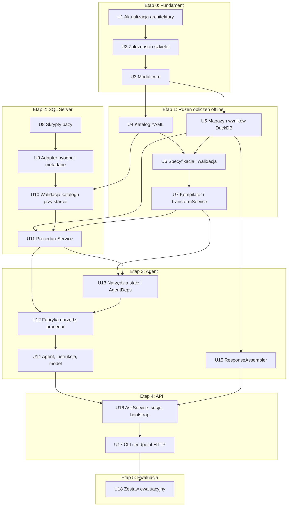
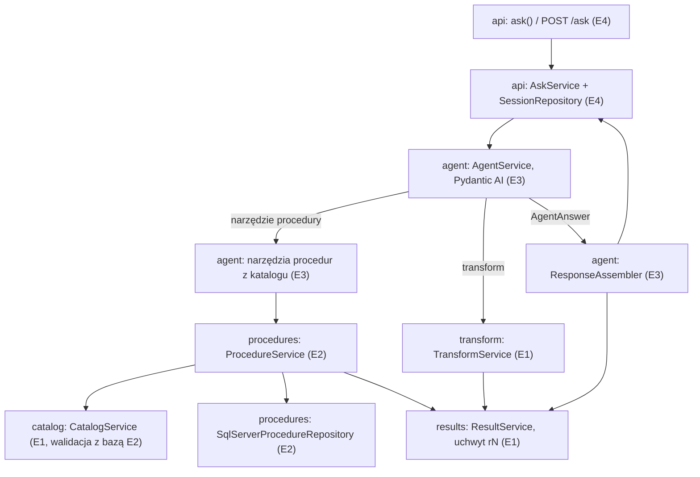

# Etapy wdrożenia Data Concierge v1 - Plan

## Goal Capsule

- **Objective:** Właściciel projektu wysyła do backendu prośbę w języku naturalnym (P1–P4 z architektury) i dostaje JSON z danymi policzonymi deterministycznie, krótkim komentarzem i proweniencją. Po każdym etapie w repozytorium jest działający, przetestowany fragment systemu.
- **Means:** sześć etapów, od deterministycznego rdzenia obliczeń bez bazy i modelu, przez SQL Server i agenta, do API i zestawu ewaluacyjnego (KTD1, KTD2).
- **Authority:** `docs/architecture/001-architektura-data-concierge.md` jest źródłem prawdy o projekcie systemu. Ten plan ustala kolejność prac i decyzje techniczne. `CLAUDE.md` i `docs/standards/` ustalają sposób pisania kodu. Gdy plan i architektura się rozjadą, najpierw aktualizujemy dokument architektury (wymóg `CLAUDE.md`), potem plan.
- **Execution profile:** każdy etap to osobne uruchomienie `ce-work` na podstawie tego planu. Etap kończy się, gdy spełnia swoje kryteria z sekcji Definition of Done. Commity i PR robi się tylko na prośbę użytkownika.
- **Stop conditions:** przerwij i zapytaj użytkownika, gdy:
  - sprawdzenie prototypowe obali decyzję techniczną (np. Haiku 5.5 odrzuca tryb `strict` albo ścieżka `DECIMAL` gubi precyzję),
  - lokalny SQL Server z `AdventureWorks2025` jest niedostępny na początku etapu 2 albo nadal przyjmuje tylko logowanie Windows (KTD24),
  - brakuje klucza Anthropic albo zgody na koszt przed sprawdzeniem na żywo w U14 (etap 3) i przed etapem 5,
  - zmiana wymagałaby odejścia od dokumentu architektury.

---

## Product Contract

### Summary

Plan dzieli architekturę Data Concierge v1 na sześć etapów: fundament, rdzeń obliczeń offline, SQL Server, agent, API i ewaluacja. Każdy etap ma jednostki pracy z plikami, scenariuszami testów i kryterium zakończenia, więc można go przekazać do `ce-work` osobno. Pierwsza jednostka nanosi na dokument architektury poprawki wynikające z researchu bibliotek.

### Problem Frame

Dokument architektury (wersja 3.3) opisuje cały backend naraz: katalog procedur, wywołania SQL Server, magazyn wyników w DuckDB, język przekształceń, pętlę agenta i kontrakt odpowiedzi. W repozytorium jest tylko pusty pakiet `src/data_concierge/` i konfiguracja uv oraz ruff. Bez podziału na etapy pierwszy działający wynik pojawiłby się dopiero po zbudowaniu wszystkiego, a błędy w fundamentach, np. utrata precyzji kwot, wyszłyby późno.

Research bibliotek z 2026-10-11 (Pydantic AI 2.55.0, DuckDB 1.5.6, pyodbc 5.3.0, FastAPI 0.143.0, testy na lokalnym SQL Server) pokazał też, że część założeń dokumentu jest nieaktualna albo niepełna. Przykłady: `avg` w DuckDB zwraca `DOUBLE`, Anthropic ogranicza liczbę narzędzi w trybie `strict`, a Haiku 5.5 wiąże bloki myślenia z niezmiennym początkiem rozmowy.

### Requirements

**Kontrakt i przepływy**

- R1. `ask(prompt, user, session_id?)` zwraca odpowiedź w kształcie z sekcji 9 architektury: `status` (`ok`, `no_data`, `needs_clarification`, `unsupported`, `error`), `session_id`, `message`, `tables`, `assumptions`, `clarification`, `provenance`.
- R2. System obsługuje przepływy P1–P4 z sekcji 10 architektury, łącznie z pytaniem doprecyzowującym przy niejednoznacznym kliencie lub produkcie.
- R3. Kolejne `ask` z tym samym `session_id` kontynuuje rozmowę z zachowaną historią wiadomości.
- R4. Reguły ustalania parametrów z tabeli w sekcji 8 architektury (brak parametru, okres względny, 0 trafień, kilka encji, miasto w kilku regionach, filtr bez parametru, niejasna miara) obowiązują jako instrukcje dla agenta i są sprawdzane przez zestaw ewaluacyjny.

**Dostęp do danych**

- R5. Dane pochodzą wyłącznie z procedur opisanych w katalogu YAML. Model nie pisze SQL.
- R6. Przy starcie backend porównuje katalog z metadanymi bazy. Brak procedury, inny typ parametru albo niezgodne kolumny kończą start błędem konfiguracji.
- R7. Parametry oznaczone `inject` (np. `@UserId`) dokleja backend. Model ich nie widzi.
- R8. Backend łączy się z bazą kontem `agent_reader`, które ma tylko `EXECUTE` na procedurach z katalogu.
- R9. Obowiązują limity z sekcji 8 architektury: 10 kroków pętli, `max_rows` z katalogu z flagą `truncated`, 30 s na procedurę, podgląd do 10 wierszy (cały wynik do 50), do 10 000 wierszy na tabelę w odpowiedzi.

**Obliczenia**

- R10. Zestawienia liczy backend według specyfikacji z zamkniętej listy operacji z sekcji 7.2 architektury (`derive`, `aggregate`, `fill_periods`, `pivot`, `sort`, `limit`, `select` i `facts`). Model nie liczy sam.
- R11. Specyfikacja przechodzi walidację względem schematu przed wykonaniem. Błąd wraca do modelu z opisem, który pozwala poprawić wywołanie.
- R12. Te same dane i ta sama specyfikacja dają ten sam wynik. Kwoty zostają typem dziesiętnym przez całą ścieżkę i trafiają do JSON jako tekst. Każde zapytanie ma `ORDER BY`.
- R13. Połączenie DuckDB nie ma dostępu do plików, sieci ani rozszerzeń, a jego konfiguracja jest zablokowana.
- R14. Każda tabela w odpowiedzi niesie łańcuch proweniencji (procedura z parametrami, specyfikacja, wygenerowany SQL), który pozwala odtworzyć wynik bez modelu.

**Model i jakość**

- R15. Model wybiera się tekstem `dostawca:model` w konfiguracji. Start: `anthropic:claude-haiku-5-5` z `effort: medium`.
- R16. Zestaw ewaluacyjny ma 30–50 próśb z oczekiwaną procedurą, parametrami, wynikiem i statusem, w grupach i przypadkach trudnych z sekcji 13 architektury. Mierzy też zgodność liczb w komentarzu z faktami.

### Scope Boundaries

- Frontend, streaming i wykresy.
- Procedury zapisu (`access: write`), zatwierdzanie i dry-run.
- `find_procedures` i wyszukiwanie narzędzi (`defer_loading`). Przy kilkunastu procedurach wszystkie definicje mieszczą się w kontekście.
- Krok `filter`, pole `app_filters` i `join` dwóch uchwytów.
- Wykonawca Polars.
- Kontrola liczb w komentarzu i odwołania do faktów zamiast liczb (sekcja 7.5 architektury). Zestaw ewaluacyjny tylko mierzy skalę problemu.
- Obrona przed iniekcją, strażnicy wejścia i akcji.
- Uwierzytelnianie wywołującego. `user_id` przychodzi w żądaniu i jest przekazywany do procedur bez sprawdzania.
- Rozważone i niebudowane:
  - **Wygasanie sesji i limit pamięci.** Projekt testowy ma jednego właściciela, a restart procesu czyści sesje. Wrócić do tematu, gdy backend będzie działał długo albo obsłuży wielu użytkowników.
  - **Blokada równoległych `ask` w jednej sesji.** Jeden użytkownik nie wysyła równoległych żądań w jednej sesji. Wrócić, gdy pojawi się UI z możliwością wielokrotnego wysłania.
  - **Startowa kontrola budżetu trybu `strict`.** Przekroczenie budżetu kończy każde żądanie błędem 400, więc widać je od razu. Wystarczy test jednostkowy na katalogu z repozytorium (U12).
  - **Generator szkieletu wpisu YAML z metadanych** (sekcja 5.3 architektury). Przy dziewięciu procedurach wpisy pisze się ręcznie.

---

## Planning Contract

### Key Technical Decisions

- KTD1. **Kolejność etapów: najpierw deterministyczny rdzeń obliczeń, potem baza, potem agent.** Katalog, magazyn wyników i przekształcenia da się w całości przetestować bez SQL Server i bez modelu, a od nich zależy poprawność liczb. (session-settled: user-approved — chosen over cienka ścieżka prompt → JSON dla jednej prośby rozbudowywana wszerz: rdzeń obliczeń jest fundamentem pozostałych etapów i można go sprawdzić offline)
- KTD2. **Jeden plan główny, etap jako pakiet dla `ce-work`.** Każdy etap ma własne jednostki i kryterium zakończenia. (session-settled: user-approved — chosen over sama mapa etapów i osobne plany później: jeden dokument trzyma decyzje i zależności między etapami w jednym miejscu)
- KTD3. **Skrypty T-SQL w repozytorium, w katalogu `db/`.** Nowe procedury `api.*` i konto `agent_reader` nie istnieją w bazie, a bez nich etapy 2–5 nie mają czego wołać. (session-settled: user-approved — chosen over pozostawienie strony bazy poza planem: procedury są częścią kontraktu systemu)
- KTD4. **Niewiadome z sekcji 13 architektury sprawdzamy na początku jednostek, których dotyczą.** Ścieżka `DECIMAL` w U5 i U9, Pydantic AI z Haiku 5.5 i tryb `strict` w U14. Wynik niezgodny z założeniem uruchamia warunek stopu z Goal Capsule. (session-settled: user-approved — chosen over sprawdzenie wszystkiego na końcu: wyniki mogą zmienić podstawowe typy)
- KTD5. **Zestaw ewaluacyjny na prawdziwym Claude API jako osobny, ostatni etap z własnym markerem pytest.** Testy jednostkowe i integracyjne działają bez modelu. (session-settled: user-approved — chosen over uruchamianie ewaluacji w zwykłym przebiegu testów: ewaluacja kosztuje i wymaga klucza)
- KTD6. **Wyniki procedur i przekształceń jako tabele Arrow (`pyarrow`).** Typy kolumn pochodzą z katalogu, np. `decimal128(19,4)` i `date32`. DuckDB rejestruje tabelę Arrow i zachowuje `DECIMAL(19,4)`, a `to_arrow_table()` oddaje `decimal128(38,4)` (sprawdzone w researchu). Rejestracja jest jawna (`register`, potem `CREATE TABLE <uchwyt> AS SELECT`, potem `unregister`), bo zablokowane połączenie nie skanuje zmiennych Pythona.
- KTD7. **Operacje, które w DuckDB dają `DOUBLE`, kompilator rzutuje na `DECIMAL(38,6)`.** Dotyczy to `avg` i dzielenia w `derive`. `sum`, `min`, `max` i mnożenie zostają dokładne. Suma pod spodem jest dokładna, więc wynik nie zależy od kolejności wierszy. Stała skala 6 wystarcza dla v1. Pole skali w specyfikacji dodamy, gdy zażąda tego konkretna prośba.
- KTD8. **Narzędzie procedury jako `Tool` z modelem parametrów budowanym przez `pydantic.create_model` dla każdego wpisu katalogu.** Ten sam model daje schemat i walidację, a błąd walidacji Pydantic AI sam odsyła do modelu jako prośbę o poprawkę. `Tool.from_schema` nie waliduje argumentów ani nie stosuje wartości domyślnych. Pola opcjonalne mają kształt `anyOf` z `null`, a nie tablicę typów, bo tak działa `TestModel`. Działanie domknięcia z dynamicznym typem przy leniwych adnotacjach (PEP 649) nie jest potwierdzone. Jeśli nie zadziała, wariant zapasowy to `Tool.from_schema` z jawną walidacją przez ten sam model i `ModelRetry`.
- KTD9. **Tryb `strict` tylko dla narzędzi procedur, sterowany ustawieniem.** `transform` i `present_result` waliduje Pydantic po stronie backendu. Anthropic dopuszcza w jednym żądaniu 20 narzędzi `strict`, 24 parametry opcjonalne i 16 parametrów z unią. Unia kroków specyfikacji przekroczyłaby ten budżet, a `strict` i tak nie egzekwuje `const`, `minimum` ani `maxLength`. Walidacja w backendzie jest obowiązkowa niezależnie od trybu.
- KTD10. **Błędy domenowe mapuje jeden dekorator `retry_on_domain_error`.** Błędy wejścia (`ParameterValidationError`, `SpecValidationError`, nieznany uchwyt) zamienia na `ModelRetry`. Błędy wykonania (`ProcedureError`, przekroczenie czasu) zamienia na `ToolFailed`, który nie zużywa budżetu ponowień i mówi modelowi, żeby nie powtarzał tego samego wywołania.
- KTD11. **Początek rozmowy jest stały w obrębie procesu, a data bieżąca idzie w wiadomości użytkownika.** Instrukcje (reguły, skrót katalogu, zakresy danych) i zestaw narzędzi w stałej kolejności powstają raz przy starcie. Haiku 5.5 odrzuca kontynuację, gdy zmieni się początek, który wytworzył blok myślenia. Pydantic AI ponawia wtedy żądanie bez tego bloku, co kosztuje dodatkowe wywołanie. `block_binding.prefix_mismatch_behavior` ustawiamy jawnie na `drop_block`, a ostrzeżenie `AnthropicStaleThinkingBlockWarning` logujemy.
- KTD12. **Asynchroniczna jest tylko ścieżka agenta: `AgentService.run` i `AskService.ask`.** Endpoint HTTP woła `await AskService.ask(...)`, a CLI uruchamia ją przez `asyncio.run`, bo `run_sync` nie działa w uruchomionej pętli zdarzeń. `CatalogService`, `ProcedureService`, `TransformService` i `ResultService` są synchroniczne. Narzędzia są funkcjami synchronicznymi i Pydantic AI uruchamia je w wątkach roboczych. Dlatego DuckDB pracuje przez `cursor()` na każde wywołanie pod blokadą magazynu wyników, a pyodbc otwiera połączenie na każde wywołanie (`threadsafety` 1).
- KTD13. **Limit czasu egzekwują sterowniki, a nie Pydantic AI.** Timeout narzędzia w Pydantic AI nie zatrzymuje wątku. Procedura dostaje `connection.timeout = 30` ustawione przed utworzeniem kursora (błąd `HYT00`). DuckDB dostaje `interrupt()` z `threading.Timer`.
- KTD14. **Dostęp do SQL Server przez pyodbc, z budową tabeli Arrow z typów katalogu.** Wywołanie ma postać `SET NOCOUNT ON; EXEC <proc> @Name = ?, ...`. Odrzucona alternatywa: `arrow-odbc`, które przyjmuje parametry tylko jako tekst i otwiera połączenie z ciągu znaków przy każdym wywołaniu. Przy wynikach rzędu kilkudziesięciu tysięcy wierszy budowa kolumn z `fetchall()` wystarcza.
- KTD15. **Zakres dat (`data_range`) czytamy procedurą `api.SalesOrder_DataRange`.** Konto `agent_reader` nie ma `SELECT` na tabelach, a architektura nie mówi, skąd wziąć min/max przy starcie. Wpis katalogu wskazuje procedurę zakresu zamiast kolumny. Zakres jest wspólny dla wszystkich użytkowników i czytany raz przy starcie, bez kontekstu żądania, więc ta procedura jako jedyna nie przyjmuje `@UserId`.
- KTD16. **Same uprawnienia `EXECUTE` wystarczają do walidacji katalogu.** Research potwierdził, że użytkownik z samym `EXECUTE` widzi `sys.parameters` i wynik `sys.dm_exec_describe_first_result_set_for_object` dla swoich procedur. Osobne konto techniczne i `VIEW DEFINITION` z sekcji 5.5 architektury odpadają. `has_default_value` jest dla procedur T-SQL zawsze 0, więc o tym, który parametr jest opcjonalny, rozstrzyga YAML.
- KTD17. **Dwa obiekty wyniku: `AgentAnswer` od modelu i `Response` dla wywołującego.** Model kończy turę wynikiem `AgentAnswer` przez `ToolOutput(name="present_result")`: status, komentarz, uchwyty z tytułami, założenia, pytanie doprecyzowujące. `ResponseAssembler` dokleja pełne dane uchwytów i proweniencję. Model nie przepisuje danych tabel.
- KTD18. **Proweniencja żyje przy uchwytach.** Magazyn wyników zapisuje przy każdym uchwycie jego pochodzenie: wywołanie procedury albo krok `transform` ze źródłem, specyfikacją i SQL. Proweniencja w odpowiedzi to łańcuch pochodzenia zwracanych uchwytów, więc nie potrzeba osobnego komponentu.
- KTD19. **Sesje w pamięci procesu, za interfejsem `SessionRepository`.** Sesja trzyma historię wiadomości Pydantic AI i własne połączenie DuckDB z uchwytami. Uchwyty z poprzedniej tury pozostają dostępne po pytaniu doprecyzowującym.
- KTD20. **Narzędzia: pytest, mypy z wtyczką Pydantic, pydantic-settings, FastAPI z uvicorn, httpx2 dla `TestClient`.** Standard `python-czysty-kod.md` wymienia pytest, mypy i pydantic-settings jako propozycje. Ten plan je zatwierdza. Testy integracyjne i ewaluacyjne mają markery `integration` i `eval` i nie uruchamiają się w domyślnym przebiegu.
- KTD21. **Kolejność wierszy jest zawsze pełna.** Kompilator dokleja do końcowego `ORDER BY`, po kluczach `sort` albo kluczach grupowania, wszystkie pozostałe kolumny wyniku w kolejności schematu. `limit` działa po tym porządku. Fakty `argmax` przy remisie zwracają najmniejszą wartość kolumny `return`. Bez tego remisy w `sort` (np. trzech klientów „Mohamed Pal”, równe `net_sales`) dają przy `threads = 2` różną kolejność i różne top N między uruchomieniami, wbrew R12.
- KTD22. **`pivot` kompilujemy jako agregację warunkową z wartościami pobranymi w osobnym zapytaniu.** Kompilator najpierw wykonuje `SELECT DISTINCT` kolumny obrotu na łańcuchu CTE przed `pivot` (z limitem kolumn plus jeden). Potem tworzy jedną kolumnę `SUM(CASE WHEN <kolumna> = ? THEN <miara> ELSE 0 END)` na każdą wartość, z wartością jako parametrem. Oba zapytania trafiają do `Lineage`. Wszystkie identyfikatory, także nazwy kolumn z wartości danych, przechodzą przez jeden pomocnik cytowania, który podwaja znak `"`. Nazwy nadawane przez model (aliasy w `derive` i `aggregate`, nazwy faktów) muszą pasować do `^[a-z][a-z0-9_]*$`. Statystyki źródła nie wystarczą, bo nie znają kolumn utworzonych przez `derive` ani wartości wymiarów z ponad 20 wartościami. W bazie są też nazwy z apostrofem (np. „Margie's Travel”). `pivot` jest ostatnim krokiem specyfikacji, po nim wolno tylko `sort` po kolumnie wierszy i `limit`, bo walidator nie zna nazw kolumn obrotu przed wykonaniem.
- KTD23. **Obcięty wynik procedury nie trafia do agregacji.** Flaga `truncated` przechodzi przez `Lineage` na każdy uchwyt pochodny. `TransformService` odrzuca `aggregate`, `pivot`, `fill_periods` i `facts` na uchwycie z obciętym przodkiem (`SpecValidationError` z prośbą o zawężenie parametrów procedury). Inne kroki przenoszą flagę do `ResultSummary` i do `truncated` tabeli w odpowiedzi. Suma z obciętych danych wyglądałaby na pełną, a wszystkie pozycje zamówień z całego zakresu (121 317) przekraczają domyślne `max_rows` 100 000. Sekcja 7.2 architektury wymaga, żeby wynik nie był po cichu niepełny.
- KTD24. **Konto agenta to login SQL `agent_reader` z hasłem, a lokalna instancja działa w trybie mieszanym.** Lokalna instancja `MSSQLSERVER` przyjmowała tylko logowanie Windows (`SERVERPROPERTY('IsIntegratedSecurityOnly') = 1`). Użytkownik przełącza ją na tryb mieszany przed etapem 2. `db/deploy.ps1` sprawdza tryb i kończy się czytelnym komunikatem, gdy instancja nadal nie przyjmuje loginów SQL. (session-settled: user-directed — chosen over konto Windows dla agenta: zostaje zgodność z sekcją 5.5 architektury, a backend i testy nie muszą działać jako osobny użytkownik Windows)

### High-Level Technical Design

Etapy i zależności jednostek:



Przepływ żądania przez moduły, z etapem, który dostarcza każdy element:



Zmiana w języku specyfikacji względem sekcji 7.2 architektury (wskazówka kierunkowa, nie specyfikacja implementacji): kroki pozostają unią dyskryminowaną po `op`, a typ wynikowy liczy walidator.

```text
aggregate.measures[i].fn:
  sum | min | max          -> type of the source column (sum widens to DECIMAL(38,s))
  count | count_distinct   -> int
  avg                      -> DECIMAL(38,6)   # CAST added by the compiler (KTD7)
derive.fn = arithmetic:
  + | - | *                -> DECIMAL per DuckDB rules
  /                        -> DECIMAL(38,6)   # CAST added by the compiler (KTD7)
```

### Output Structure

```text
catalog/agent-procedures.yaml
db/
  deploy.ps1
  schema/001_api_schema.sql
  procedures/                 # one file per api.* procedure
  security/agent_reader.sql
evals/cases.yaml
src/data_concierge/
  core/ (types.py, errors.py, settings.py, context.py)
  catalog/ (models.py, repository.py, service.py)
  procedures/ (models.py, repository.py, service.py)
  results/ (models.py, repository.py, service.py)
  transform/ (spec.py, validator.py, compiler.py, executor.py, service.py)
  agent/ (deps.py, tools.py, registry.py, prompts.py, service.py, assembler.py)
  api/ (schemas.py, service.py, sessions.py, controller.py, cli.py)
  bootstrap.py
tests/                        # mirrors src/data_concierge/, plus tests/evals/
```

Układ modułów i warstw pochodzi z `docs/standards/architektura-warstwowa.md` (sekcja 5). Różnice: `transform/validator.py` jako osobna klasa, `agent/registry.py` i `agent/assembler.py` jako osobne pliki, `api/sessions.py` i `api/cli.py`.

### Sequencing

Etap kończy się zielonymi testami swojego zakresu i spełnionym kryterium z Definition of Done. Etapy 0 i 1 nie potrzebują bazy ani klucza API. Etap 2 potrzebuje lokalnego SQL Server z bazą `AdventureWorks2025` (odtwarzanej skryptem `db-backup/restore-databases.ps1`, katalog poza repozytorium). Etap 3 testuje agenta offline (`FunctionModel`, `TestModel`), a jedno sprawdzenie prototypowe w U14 woła prawdziwe Claude API. Etap 5 w całości działa na prawdziwym API.

### Risks & Dependencies

| Ryzyko | Skutek | Ograniczenie |
|--------|--------|--------------|
| Haiku 5.5 nie obsługuje `strict` dla narzędzi albo nie przyjmuje `effort: medium` | błąd 400 przy każdym żądaniu | sprawdzenie w U14. Ustawienie `strict` można wyłączyć bez zmiany kodu (KTD9). |
| Wiązanie bloków myślenia z początkiem rozmowy obowiązuje na tym koncie | dodatkowe żądanie i utrata rozumowania przy każdej kontynuacji, jeśli początek się zmienia | stały początek (KTD11). Test w U14 porównuje bajtowo instrukcje i narzędzia dwóch kolejnych tur. |
| Dynamiczny model parametrów w domknięciu nie działa przy PEP 649 | narzędzia procedur nie powstaną | wariant zapasowy z KTD8 |
| Instancja SQL Server nadal przyjmuje tylko logowanie Windows | konto `agent_reader` z hasłem nie połączy się, etap 2 stoi | przełączenie na tryb mieszany przed etapem 2 i kontrola w `db/deploy.ps1` (KTD24) |
| Procedura `api.*` używa tabel tymczasowych lub dynamicznego SQL | `dm_exec_describe_first_result_set_for_object` nie opisze kolumn i łańcuch właścicielski pęknie | zakaz w U8 i test walidacji katalogu w U10 |
| Koszt i niedeterminizm ewaluacji | wynik zestawu zmienia się między uruchomieniami | zestaw raportuje odsetek trafień w grupach i nie blokuje zwykłych testów (KTD5) |

### Sources & Research

- `docs/architecture/001-architektura-data-concierge.md`: projekt systemu (sekcje 1–13).
- `docs/standards/`: zasady kodu, warstwy i wzorce.
- Research bibliotek z 2026-10-11, testy na Pythonie 3.14.3 i lokalnym SQL Server z ODBC Driver 18:
  - Pydantic AI, narzędzia i `strict`: https://pydantic.dev/docs/ai/tools-toolsets/tools-advanced/
  - Pydantic AI, model Anthropic i wiązanie bloków myślenia: https://pydantic.dev/docs/ai/models/anthropic/
  - Pydantic AI, wynik (`ToolOutput`, `retries`): https://pydantic.dev/docs/ai/core-concepts/output/
  - Pydantic AI, testy (`FunctionModel`, `TestModel`): https://pydantic.dev/docs/ai/guides/testing/
  - Claude API, limity trybu `strict`: https://platform.claude.com/docs/en/build-with-claude/structured-outputs
  - pyodbc, wywoływanie procedur: https://github.com/mkleehammer/pyodbc/wiki/Calling-Stored-Procedures
  - SQL Server, widoczność metadanych: https://learn.microsoft.com/en-us/sql/relational-databases/security/metadata-visibility-configuration
- Fakty ze środowiska: Python 3.14.3, uv 0.9.26, ODBC Driver 17 i 18, lokalna usługa `MSSQLSERVER` z bazą `AdventureWorks2025`.

---

## Implementation Units

| U-ID | Tytuł | Główne pliki | Zależy od |
|------|-------|--------------|-----------|
| U1 | Aktualizacja architektury i standardów | `docs/architecture/001-architektura-data-concierge.md`, `docs/standards/` | — |
| U2 | Zależności, narzędzia, szkielet pakietu | `pyproject.toml`, `tests/conftest.py` | U1 |
| U3 | Moduł core | `src/data_concierge/core/` | U2 |
| U4 | Katalog agenta | `src/data_concierge/catalog/`, `catalog/agent-procedures.yaml` | U3 |
| U5 | Magazyn wyników | `src/data_concierge/results/` | U3 |
| U6 | Specyfikacja i walidacja przekształceń | `src/data_concierge/transform/spec.py`, `validator.py` | U4, U5 |
| U7 | Kompilator SQL i TransformService | `src/data_concierge/transform/compiler.py`, `executor.py`, `service.py` | U6 |
| U8 | Skrypty bazy | `db/` | — |
| U9 | Adapter SQL Server i metadane | `src/data_concierge/procedures/repository.py`, `catalog/repository.py` | U3, U8 |
| U10 | Walidacja katalogu przy starcie | `src/data_concierge/catalog/service.py` | U4, U9 |
| U11 | ProcedureService | `src/data_concierge/procedures/service.py` | U5, U7, U10 |
| U12 | Fabryka narzędzi procedur i rejestr | `src/data_concierge/agent/registry.py` | U11, U13 |
| U13 | Narzędzia stałe i AgentDeps | `src/data_concierge/agent/tools.py`, `deps.py` | U7, U11 |
| U14 | Agent, instrukcje, ustawienia modelu | `src/data_concierge/agent/service.py`, `prompts.py` | U12, U13 |
| U15 | ResponseAssembler | `src/data_concierge/agent/assembler.py` | U5 |
| U16 | AskService, sesje, composition root | `src/data_concierge/api/`, `bootstrap.py` | U14, U15 |
| U17 | CLI i endpoint HTTP | `src/data_concierge/api/controller.py`, `cli.py` | U16 |
| U18 | Zestaw ewaluacyjny | `evals/cases.yaml`, `tests/evals/` | U17 |

### Etap 0: Fundament

### U1. Aktualizacja architektury i standardów o wnioski z researchu

- **Goal:** dokument architektury i standardy odpowiadają decyzjom tego planu, zanim powstanie kod.
- **Requirements:** R6, R8, R9, R12, R15
- **Dependencies:** brak
- **Files:**
  - `docs/architecture/001-architektura-data-concierge.md`
  - `docs/standards/architektura-warstwowa.md`
  - `docs/standards/wzorce-projektowe.md`
  - `docs/standards/python-czysty-kod.md`
- **Approach:**
  1. Architektura v3.4, z wpisem w historii zmian. Sekcja 5.2: `data_range` wskazuje procedurę zakresu (KTD15). Sekcja 5.4: dochodzi `api.SalesOrder_DataRange`. Sekcja 5.5: same uprawnienia `EXECUTE` (KTD16), wymóg trybu mieszanego dla loginu SQL (KTD24) i `TrustServerCertificate` tylko lokalnie. Sekcja 6.1: polityka `strict` i jej budżet (KTD9). Sekcja 6.3: Pydantic AI obsługuje `defer_loading` na bezpośrednim Claude API, co jest kandydatem zamiast `find_procedures`. Sekcja 7.4: typy wynikowe `avg` i dzielenia (KTD7), `to_arrow_table()`, jawna rejestracja. Sekcja 11.2: `retries`, `ToolFailed`, kształt asynchroniczny (KTD12), limity czasu (KTD13). Sekcja 11.3: data w wiadomości użytkownika i wiązanie bloków myślenia (KTD11). Sekcja 13: odhaczone pozycje sprawdzone w researchu.
  2. Dalsze zmiany w architekturze. Sekcje 4, 6.2 i 11.2: agent zwraca `AgentAnswer`, a `ResponseAssembler` buduje `Response` (KTD17). Sekcje 4 i 7.6: proweniencja żyje przy uchwytach i nie jest osobnym komponentem (KTD18). Sekcja 7.2: `pivot` jako ostatni krok, reguła nazw nadawanych przez model i zakaz agregacji obciętych wyników (KTD22, KTD23). Sekcja 7.4: pełna kolejność wierszy (KTD21) i kompilacja `pivot` (KTD22).
  3. `architektura-warstwowa.md` (sekcja 2) i `wzorce-projektowe.md` (sekcja 10.2): dekorator mapuje błędy na `ModelRetry` albo `ToolFailed` (KTD10). Przykład narzędzia w `architektura-warstwowa.md` staje się funkcją synchroniczną z uwagą, że narzędzia synchroniczne działają w wątkach roboczych (KTD12).
  4. `python-czysty-kod.md` (sekcja 8): pytest, mypy i pydantic-settings przechodzą z propozycji do ustalonych (KTD20).
- **Test expectation:** none -- zmiana dokumentacji.
- **Verification:** każda KTD, która zmienia projekt, ma odpowiednik w dokumencie architektury, a dokument nie zawiera już twierdzeń obalonych przez research.

### U2. Zależności, narzędzia i szkielet pakietu

- **Goal:** `uv sync` instaluje komplet zależności, a puste przebiegi pytest, mypy i ruff kończą się sukcesem.
- **Requirements:** wspiera wszystkie
- **Dependencies:** U1
- **Files:**
  - `pyproject.toml`, `uv.lock`
  - `src/data_concierge/{core,catalog,procedures,results,transform,agent,api}/__init__.py`
  - `tests/conftest.py`
  - `.env.example`
  - `.gitignore`
- **Approach:**
  1. Zależności przez `uv add`: `pydantic`, `pydantic-settings`, `pydantic-ai-slim[anthropic]` (>= 2.55), `duckdb` (>= 1.5.6), `pyarrow`, `pyodbc`, `pyyaml`, `fastapi`, `uvicorn`. Deweloperskie: `pytest`, `anyio`, `mypy`, `httpx2`, `types-PyYAML`.
  2. Konfiguracja w `pyproject.toml`: markery `integration` i `eval`, domyślny przebieg z wyłączonymi oboma, mypy w trybie strict z wtyczką Pydantic.
  3. `tests/conftest.py` ustawia `ALLOW_MODEL_REQUESTS = False` i `PYDANTIC_AI_NO_BANNER`.
  4. `.env.example` wymienia zmienne konfiguracji bez sekretów, a `.gitignore` dostaje `.env`.
- **Execution note:** głównie konfiguracja. Wystarczy sprawdzić, że narzędzia działają na pustym pakiecie.
- **Test expectation:** none -- szkielet i konfiguracja.
- **Verification:** `uv sync` przechodzi na Pythonie 3.14, a pytest, mypy i ruff kończą się bez błędów.

### U3. Moduł core: typy domenowe, wyjątki, konfiguracja, kontekst żądania

- **Goal:** wspólne typy i konfiguracja, od których zależą pozostałe moduły.
- **Requirements:** R7, R9, R12, R15
- **Dependencies:** U2
- **Files:**
  - `src/data_concierge/core/types.py`
  - `src/data_concierge/core/errors.py`
  - `src/data_concierge/core/settings.py`
  - `src/data_concierge/core/context.py`
  - `tests/core/test_types.py`
  - `tests/core/test_settings.py`
- **Approach:**
  1. `ColumnType` (`int`, `string`, `date`, `datetime`, `bool`, `decimal(p,s)`) z mapowaniem na typ Arrow w jednym miejscu. Obok tabela równoważności typów SQL Server, z której korzysta walidacja katalogu (U10): `money` → `decimal(19,4)`, `smallmoney` → `decimal(10,4)`, `tinyint`/`smallint`/`int`/`bigint` → `int`, `char`/`nchar`/`varchar`/`nvarchar` → `string`, `bit` → `bool`, `date` → `date`, `datetime`/`datetime2` → `datetime`, `decimal(p,s)` → `decimal(p,s)`. `ColumnRole` (`id`, `dimension`, `measure`, `time`). Niemutowalny `TableSchema` z metodami `require` i `with_column`.
  2. Hierarchia wyjątków od `DataConciergeError`: `ConfigurationError`, `CatalogError`, `ParameterValidationError`, `ProcedureError`, `ProcedureTimeoutError`, `SpecValidationError`, `UnknownHandleError`.
  3. `Settings` (pydantic-settings, prefiks zmiennych `DC_`): połączenie SQL, `TrustServerCertificate`, model, `effort`, przełącznik `strict`, limity z R9.
  4. `RequestContext`: `user_id`, `role`, `correlation_id`.
- **Patterns to follow:** `docs/standards/python-czysty-kod.md` (sekcje 2, 5, 6) i `docs/standards/wzorce-projektowe.md` (sekcja 8).
- **Test scenarios:**
  - `ColumnType.parse("decimal(19,4)")` daje precyzję 19 i skalę 4 oraz typ Arrow `decimal128(19,4)`.
  - `ColumnType.parse("decimal(19)")` i `ColumnType.parse("money")` zgłaszają `CatalogError` z nazwą typu w komunikacie.
  - Typ SQL `money` jest równoważny `decimal(19,4)`, a `smallint` jest równoważny `int`. Typ `xml` nie ma odpowiednika i zgłasza `CatalogError`.
  - `TableSchema.require("SubTotal", role=MEASURE)` przechodzi dla kolumny `measure`, a dla kolumny `dimension` zgłasza błąd z listą dostępnych miar.
  - `with_column` zwraca nowy schemat i nie zmienia oryginału.
  - `Settings` czyta wartości ze zmiennych środowiskowych, a brak wymaganego połączenia SQL zgłasza błąd walidacji.
- **Verification:** moduł `core` nie importuje żadnego innego modułu pakietu.

### Etap 1: Rdzeń obliczeń offline

### U4. Katalog agenta: modele, repozytorium YAML i plik katalogu

- **Goal:** katalog z dziewięcioma procedurami odczytu wczytuje się do niemutowalnych modeli z walidacją strukturalną.
- **Requirements:** R5, R7, R9
- **Dependencies:** U3
- **Files:**
  - `src/data_concierge/catalog/models.py`
  - `src/data_concierge/catalog/repository.py`
  - `catalog/agent-procedures.yaml`
  - `tests/catalog/test_models.py`
  - `tests/catalog/test_repository.py`
  - `tests/catalog/fixtures/`
- **Approach:**
  1. Modele `Catalog`, `CatalogEntry`, `ParamSpec`, `ColumnSpec`, `DataRangeSpec`, `Example` odpowiadają polom z sekcji 5.2 architektury. `ParamSpec` ma `required` albo `inject`, a nigdy oba naraz.
  2. `YamlCatalogRepository.load()` czyta plik ścieżką z konfiguracji.
  3. Wpisy w pliku: `customer_search`, `customer_list`, `sales_order_list`, `sales_order_line_list`, `product_search`, `sales_order_data_range` (bez narzędzia dla modelu, tylko dla `data_range`, KTD15), `get_bill_of_materials`, `get_where_used_product`, `get_employee_managers`, `get_manager_employees`. Kolumny procedur `dbo.*` biorą się z ich obecnej definicji. Kolumny procedur `api.*` muszą zgadzać się ze skryptami z U8. Zgodność sprawdza U10.
- **Patterns to follow:** Repository z `docs/standards/wzorce-projektowe.md` (sekcja 1).
- **Test scenarios:**
  - Plik katalogu z repozytorium wczytuje się bez błędów i ma unikalne nazwy narzędzi.
  - Wpis z parametrem oznaczonym jednocześnie `inject` i `required` zgłasza `CatalogError`.
  - Wpis, w którym `default_for` wskazuje kolumnę inną niż `measure`, zgłasza `CatalogError`.
  - Zduplikowana nazwa narzędzia w dwóch wpisach zgłasza `CatalogError` z obiema nazwami procedur.
  - Każdy wpis z `examples` wywołuje tylko parametry, które są zadeklarowane w `params` i nie mają `inject`.
- **Verification:** katalog opisuje wszystkie procedury z sekcji 5.4 architektury oraz `api.SalesOrder_DataRange`.

### U5. Magazyn wyników: tabele Arrow, zablokowany DuckDB i uchwyty

- **Goal:** wynik zapisuje się pod uchwytem `rN` z zachowaniem typów, a model dostaje jego opis: schemat, statystyki i podgląd.
- **Requirements:** R9, R12, R13, R14
- **Dependencies:** U3
- **Files:**
  - `src/data_concierge/results/models.py`
  - `src/data_concierge/results/repository.py`
  - `src/data_concierge/results/service.py`
  - `tests/results/test_duckdb_store.py`
  - `tests/results/test_service.py`
- **Approach:**
  1. `ResultTable`: tabela Arrow, `TableSchema`, flaga `truncated`, `Lineage` (KTD18).
  2. `DuckDBResultStore` tworzy połączenie per sesja z ustawieniami z sekcji 7.4a architektury, zablokowanymi przez `lock_configuration`. Zapis przez jawną rejestrację (KTD6), każda operacja na osobnym kursorze pod blokadą (KTD12), `interrupt()` po przekroczeniu limitu czasu (KTD13).
  3. `ResultService.summarize(handle)` buduje `ResultSummary` z flagą `truncated` dziedziczoną z przodków (KTD23). Kolumny `time` i `measure` dostają min/max. Kolumny `dimension` dostają listę wartości, gdy jest ich najwyżej 20, a w przeciwnym razie liczbę różnych wartości. Podgląd ma do 10 wierszy, a przy wyniku do 50 wierszy cały wynik (R9).
  4. `ResultService.export(handle, max_rows)` zwraca dane tabeli dla odpowiedzi: wartości dziesiętne jako tekst ze skalą, daty w ISO, flaga `truncated` przy więcej niż 10 000 wierszy.
- **Execution note:** zacznij od testu ścieżki `decimal128(19,4)` → DuckDB → Arrow → tekst JSON (KTD4). Jeśli skala się zmieni albo wartość przestanie być dokładna, zatrzymaj etap. Poszerzenie precyzji do 38 po agregacji jest znane z KTD6 i nie jest warunkiem stopu.
- **Patterns to follow:** Repository i Value Object z `docs/standards/wzorce-projektowe.md`.
- **Test scenarios:**
  - Tabela z `Decimal("1234567.8900")` w kolumnie `decimal(19,4)` po zapisie i eksporcie daje tekst `"1234567.8900"`, a typ kolumny w DuckDB to `DECIMAL(19,4)`.
  - Kolejne zapisy w jednej sesji dostają uchwyty `r1`, `r2`, `r3`. Nowa sesja zaczyna od `r1`.
  - Odczyt nieistniejącego uchwytu zgłasza `UnknownHandleError` z listą istniejących uchwytów.
  - Na zablokowanym połączeniu `read_csv`, `COPY ... TO`, `INSTALL` i `SET enable_external_access=true` kończą się błędem.
  - Zapytanie przekraczające limit czasu jest przerywane i zgłasza `ProcedureTimeoutError` (np. `range` na bardzo dużym zakresie z limitem 0,5 s).
  - Podsumowanie wyniku z 14 wierszami ma podgląd 14 wierszy, a z 200 wierszami podgląd 10 wierszy i `row_count` 200.
  - Kolumna `dimension` z 5 wartościami ma je w statystykach, a z 30 wartościami ma tylko liczbę różnych wartości.
  - Eksport z limitem 10 000 dla tabeli z 10 001 wierszy zwraca 10 000 wierszy i `truncated: true`.
  - Dwa równoległe zapisy z różnych wątków w jednej sesji dają dwa poprawne uchwyty.
- **Verification:** model nigdy nie dostaje więcej niż podgląd, a wartości dziesiętne nie przechodzą przez `float`.

### U6. Specyfikacja przekształceń i walidacja semantyczna

- **Goal:** specyfikacja z sekcji 7.2 architektury jako unia dyskryminowana modeli Pydantic oraz walidator, który śledzi schemat krok po kroku.
- **Requirements:** R10, R11
- **Dependencies:** U4, U5
- **Files:**
  - `src/data_concierge/transform/spec.py`
  - `src/data_concierge/transform/validator.py`
  - `tests/transform/test_spec.py`
  - `tests/transform/test_validator.py`
- **Approach:**
  1. Kroki `derive`, `aggregate`, `fill_periods`, `pivot`, `sort`, `limit`, `select` i `facts` (`sum`, `avg`, `min`, `max`, `argmax`, `count`) jako modele z `frozen=True`. `TransformSpec` ma `source`, `steps` i `facts`.
  2. `SpecValidator` wylicza schemat po każdym kroku. Typy wynikowe pochodzą z KTD7 (szkic w High-Level Technical Design).
  3. Komunikat błędu podaje krok, kolumnę i dostępne alternatywy, zgodnie z przykładem z sekcji 7.3 architektury.
  4. `pivot` musi być ostatnim krokiem. Po nim wolno tylko `sort` po kolumnie wierszy i `limit`, a fakty nie mogą odwoływać się do kolumn obrotu (KTD22). Gdy statystyki źródła już pokazują więcej różnych wartości niż limit kolumn, walidator odrzuca `pivot` od razu. Pełne sprawdzenie limitu robi kompilator (U7).
  5. Nazwy nadawane przez model (aliasy w `derive` i `aggregate`, nazwy faktów) muszą pasować do `^[a-z][a-z0-9_]*$` (KTD22).
- **Patterns to follow:** unia dyskryminowana z `docs/standards/wzorce-projektowe.md` (sekcja 5). Walidacja należy do kroków, kompilacja do wykonawcy (wariant Visitor).
- **Test scenarios:**
  - Specyfikacja raportu miesięcznego z sekcji 10 architektury (P3) przechodzi walidację, a schemat końcowy to `month: date`, `net_sales: decimal(38,4)`, `order_count: int`.
  - `sum` na `CustomerName` zgłasza błąd z nazwą kroku i listą miar (`SubTotal`, `TotalDue`).
  - `date_trunc` na kolumnie `measure` zgłasza błąd, że wymaga kolumny `time`.
  - Odwołanie do kolumny `month` przed krokiem `derive`, który ją tworzy, zgłasza błąd. Po kroku `derive` przechodzi.
  - `avg(SubTotal)` daje w schemacie `decimal(38,6)`.
  - `pivot` po kolumnie z 300 różnymi wartościami w statystykach źródła zgłasza błąd limitu.
  - Krok `aggregate` po `pivot` zgłasza błąd, że `pivot` musi być ostatnim krokiem.
  - Alias `Net Sales` w `aggregate` zgłasza błąd z wymaganym wzorcem nazwy.
  - `fill_periods` z `from` po `to` zgłasza błąd.
  - Nieznany `op` (np. `filter`) zgłasza błąd walidacji Pydantic z listą dozwolonych operacji.
  - Fakt `argmax` z `return` wskazującym nieistniejącą kolumnę zgłasza błąd.
- **Verification:** każdy `op` z sekcji 7.2 ma testy poprawnego i błędnego użycia.

### U7. Kompilator SQL, wykonawca DuckDB, fakty i TransformService

- **Goal:** zwalidowana specyfikacja zamienia się w zapytanie DuckDB z parametrami, wynik trafia pod nowy uchwyt razem z faktami i SQL w proweniencji.
- **Requirements:** R10, R12, R14
- **Dependencies:** U6
- **Files:**
  - `src/data_concierge/transform/compiler.py`
  - `src/data_concierge/transform/executor.py`
  - `src/data_concierge/transform/service.py`
  - `tests/transform/test_compiler.py`
  - `tests/transform/test_executor.py`
  - `tests/transform/test_service.py`
- **Approach:**
  1. `SqlQueryBuilder` składa CTE `s1`, `s2`, … i `periods`, cytuje identyfikatory jednym pomocnikiem (KTD22) i zbiera wartości jako parametry. Końcowe `ORDER BY` jest zawsze pełne (KTD21).
  2. Rzutowania z KTD7. Okresy w `fill_periods` z `range(?::DATE, ?::DATE, INTERVAL …)` (`generate_series` zwraca `TIMESTAMP`).
  3. `pivot` w dwóch zapytaniach według KTD22. Liczba wartości ponad limit zgłasza `SpecValidationError`.
  4. `DuckDBExecutor` implementuje `TransformExecutor` z sekcji 3 wzorców.
  5. `TransformService.apply(spec)`: odrzucenie operacji agregujących na obciętym źródle (KTD23), walidacja, kompilacja, wykonanie, zapis pod nowy uchwyt z `Lineage` (źródło, specyfikacja, SQL, `truncated`), wyliczenie faktów, zwrot `TransformSummary`.
- **Patterns to follow:** Builder i Strategy z `docs/standards/wzorce-projektowe.md` (sekcje 3 i 6). SQL z sekcji 7.4 architektury jako wzorzec wyniku dla P3.
- **Test scenarios:**
  - Raport P3 na syntetycznej tabeli zamówień z lukami w lutym i grudniu daje 12 wierszy, z zerami w pustych miesiącach i sumami równymi sumom liczonym ręcznie na `Decimal`.
  - SQL dla P3 zawiera tylko identyfikatory ze schematu w cudzysłowach, a daty jako parametry.
  - Ta sama specyfikacja wykonana dwa razy na wierszach w odwróconej kolejności daje identyczne wyniki co do wartości i kolejności.
  - Specyfikacja bez kroku `sort` daje SQL z `ORDER BY` po kluczach grupowania, a po nich po pozostałych kolumnach wyniku.
  - Nazwa kolumny z cudzysłowem i średnikiem w danych źródłowych nie zmienia struktury SQL.
  - `pivot` miesiąc × `Territory` po `net_sales` daje kolumnę na każde terytorium i zera tam, gdzie nie było sprzedaży.
  - `pivot` po wymiarze z wartościami zawierającymi `'`, `"` i `;` (np. „Margie's Travel”) daje poprawne kolumny, a wartości trafiają do SQL wyłącznie jako parametry.
  - `pivot` po kolumnie `year` utworzonej przez `derive` działa, a `Lineage` zawiera zapytanie o wartości i zapytanie końcowe.
  - `pivot` po kolumnie z większą liczbą wartości niż limit zgłasza `SpecValidationError`.
  - `sort` po `net_sales` malejąco z `limit` 10 daje 10 najlepszych klientów.
  - `sort` z remisami i `limit` na danych w odwróconej kolejności daje identyczne wiersze.
  - Fakty `annual_total` (suma) i `best_month` (`argmax`) zwracają dokładny `Decimal` i datę miesiąca. Przy dwóch równych maksimach `best_month` zwraca wcześniejszy miesiąc.
  - `aggregate` na uchwycie, którego źródło ma `truncated`, zgłasza `SpecValidationError` z prośbą o zawężenie parametrów, a `sort` na takim uchwycie daje wynik z `truncated`.
  - Fakt `avg` zwraca wartość ze skalą 6.
  - Wynik `transform` ma `Lineage` ze źródłem `r1`, specyfikacją i tekstem SQL.
- **Verification:** każdy `op` ma test wykonania z wynikiem liczonym niezależnie od DuckDB. Porównanie z SQL Server dochodzi w U11.

### Etap 2: SQL Server

### U8. Skrypty bazy: schemat `api`, procedury, konto `agent_reader`

- **Goal:** jedno uruchomienie skryptu wdraża w lokalnej `AdventureWorks2025` procedury odczytu i konto z minimalnymi uprawnieniami.
- **Requirements:** R5, R7, R8
- **Dependencies:** brak (wymaga odtworzonej bazy)
- **Files:**
  - `db/schema/001_api_schema.sql`
  - `db/procedures/api.Customer_Search.sql`
  - `db/procedures/api.Customer_List.sql`
  - `db/procedures/api.SalesOrder_List.sql`
  - `db/procedures/api.SalesOrderLine_List.sql`
  - `db/procedures/api.Product_Search.sql`
  - `db/procedures/api.SalesOrder_DataRange.sql`
  - `db/security/agent_reader.sql`
  - `db/deploy.ps1`
  - `db/README.md`
- **Approach:**
  1. Procedury zwracają surowe wiersze w naturalnym ziarnie, mają `SET NOCOUNT ON`, jeden zestaw wyników, bez tabel tymczasowych i bez dynamicznego SQL (sekcja 5.5 architektury). Każda poza `api.SalesOrder_DataRange` (KTD15) przyjmuje `@UserId` (R7), na razie bez sprawdzania.
  2. `api.Customer_List` łączy adresy osób i sklepów. `api.Customer_Search` zwraca numer konta, terytorium i liczbę zamówień, potrzebne w pytaniu doprecyzowującym P2.
  3. Skrypty są idempotentne (`CREATE OR ALTER`).
  4. `agent_reader.sql` tworzy login i użytkownika z `EXECUTE` na schemacie `api` i na czterech procedurach odczytu w `dbo`, bez innych uprawnień. Login SQL z hasłem (KTD24). Hasło pochodzi ze zmiennej `sqlcmd`, nie z repozytorium.
  5. `deploy.ps1` najpierw sprawdza, czy instancja przyjmuje loginy SQL (KTD24), potem uruchamia skrypty przez `sqlcmd` w ustalonej kolejności, z uwierzytelnieniem Windows. Wzorzec: `db-backup/restore-databases.ps1`. `db/README.md` opisuje włączenie trybu mieszanego jako warunek wstępny.
- **Execution note:** zacznij od zapytań sprawdzających fakty z sekcji 5.4 architektury (3 klientów „Mohamed Pal”, „Berlin” w 5 regionach, 10 wariantów „HL Mountain Frame”, zakres 2022-05-30 do 2025-06-29) i trzymaj je jako zapytania kontrolne w `db/README.md`.
- **Test scenarios:**
  - `api.Customer_Search @Name = 'Mohamed Pal'` zwraca 3 wiersze z CustomerID 12698, 20550, 28763.
  - `api.Customer_List @City = 'Berlin'` zwraca klientów z 5 różnych `StateProvince`, osoby i sklepy.
  - `api.SalesOrder_List` za 2024 zwraca liczbę zamówień zgodną z zapytaniem kontrolnym na tabelach.
  - `api.SalesOrder_DataRange` zwraca 2022-05-30 i 2025-06-29.
  - `deploy.ps1` na instancji bez trybu mieszanego kończy się komunikatem o wymaganym trybie i nie tworzy loginu.
  - Jako `agent_reader`: `EXEC` procedur z katalogu działa, a `SELECT` z `Sales.SalesOrderHeader` i `EXEC dbo.uspUpdateEmployeeLogin` kończą się odmową dostępu.
  - Ponowne uruchomienie `deploy.ps1` kończy się sukcesem bez zmian.
- **Verification:** testy integracyjne z U9 i U10 przechodzą na wdrożonej bazie.

### U9. Adapter SQL Server i repozytorium metadanych

- **Goal:** wywołanie procedury z katalogu zwraca `ResultTable` z typami z katalogu, a metadane procedur dają się odczytać kontem `agent_reader`.
- **Requirements:** R5, R8, R9, R12
- **Dependencies:** U3, U8
- **Files:**
  - `src/data_concierge/procedures/models.py`
  - `src/data_concierge/procedures/repository.py`
  - `src/data_concierge/catalog/repository.py`
  - `tests/procedures/test_sqlserver_repository.py`
  - `tests/catalog/test_metadata_repository.py`
- **Approach:**
  1. `SqlServerProcedureRepository.execute(entry, params)` otwiera połączenie na każde wywołanie, ustawia `timeout` przed kursorem (KTD13), wykonuje `SET NOCOUNT ON; EXEC … @Name = ?` (KTD14), pobiera do `max_rows + 1` wierszy (nadmiar ustawia `truncated`), odrzuca dodatkowe zestawy wyników i buduje kolumny Arrow według katalogu.
  2. Błąd `HYT00` zamienia na `ProcedureTimeoutError`, inne błędy ODBC na `ProcedureError` bez danych logowania w komunikacie.
  3. Konwerter wyjściowy dla `datetimeoffset` (typ ODBC -155).
  4. `SqlServerMetadataRepository` czyta `sys.parameters` i `sys.dm_exec_describe_first_result_set_for_object` dla procedur z katalogu.
- **Execution note:** zacznij od testu ścieżki `money` → `Decimal` → `decimal128(19,4)` na prawdziwej procedurze (KTD4).
- **Patterns to follow:** Adapter z `docs/standards/wzorce-projektowe.md` (sekcja 2).
- **Test scenarios (integracyjne):**
  - `sales_order_list` za styczeń 2024 zwraca tabelę z `SubTotal` jako `decimal128(19,4)` i `OrderDate` jako `date32`, z sumą równą zapytaniu kontrolnemu.
  - `max_rows` 100 dla wyniku 14 244 wierszy daje 100 wierszy i `truncated: true`.
  - Procedura testowa z `WAITFOR DELAY` i limitem 1 s zgłasza `ProcedureTimeoutError` w czasie poniżej 2 s.
  - Wywołanie nieistniejącej procedury zgłasza `ProcedureError` bez hasła w komunikacie.
  - Metadane `api.SalesOrder_List` zawierają parametry `@DateFrom`, `@DateTo`, `@CustomerID`, `@UserId` z typami SQL i opis kolumn wyniku.
  - Metadane dla `dbo.uspGetEmployeeManagers` zwracają 7 kolumn.
- **Verification:** adapter jest jedynym miejscem w kodzie, które importuje `pyodbc`.

### U10. Walidacja katalogu przy starcie i zakresy danych

- **Goal:** start backendu porównuje katalog z bazą i odczytuje zakresy dat, a niezgodność kończy start czytelnym błędem.
- **Requirements:** R6, R4
- **Dependencies:** U4, U9
- **Files:**
  - `src/data_concierge/catalog/service.py`
  - `tests/catalog/test_service.py`
  - `tests/catalog/test_service_integration.py`
- **Approach:**
  1. `CatalogService.validate()` sprawdza istnienie procedury, nazwy i typy parametrów oraz kolumny wyniku (sekcja 5.3 architektury). O opcjonalności parametrów rozstrzyga YAML (KTD16). Gdy opis kolumn jest niedostępny, zostaje lista z YAML.
  2. Wszystkie rozbieżności zbiera w jeden `ConfigurationError`.
  3. `CatalogService.load_data_ranges()` woła procedury zakresu (KTD15) i zwraca zakresy dla instrukcji agenta.
- **Test scenarios:**
  - Atrapa metadanych z innym typem `@DateFrom` (`datetime` zamiast `date`) daje błąd z nazwą procedury, parametru i obu typów.
  - Atrapa bez jednej procedury i z brakującą kolumną daje jeden błąd z obiema rozbieżnościami.
  - Procedura, której kolumn nie da się opisać, przechodzi walidację z ostrzeżeniem w logu.
  - Kolumny `money` i `smallint` z `dbo.uspGetBillOfMaterials` zgadzają się z `decimal(19,4)` i `int` w katalogu dzięki tabeli równoważności z U3.
  - Integracyjnie: katalog z repozytorium przechodzi walidację na wdrożonej bazie kontem `agent_reader`.
  - Integracyjnie: zakres dla `sales_order_list` to 2022-05-30 do 2025-06-29.
- **Verification:** celowo zepsuty typ w kopii katalogu zatrzymuje start z komunikatem wskazującym wpis.

### U11. ProcedureService: walidacja parametrów, wstrzykiwanie, limity, proweniencja

- **Goal:** wywołanie procedury z parametrami od modelu daje uchwyt z opisem dla modelu i zapisem w proweniencji.
- **Requirements:** R5, R7, R9, R14
- **Dependencies:** U5, U7, U10
- **Files:**
  - `src/data_concierge/procedures/service.py`
  - `tests/procedures/test_service.py`
  - `tests/transform/test_equivalence_sqlserver.py`
- **Approach:**
  1. `ProcedureService.call(entry, args, context)` waliduje argumenty modelem parametrów wpisu, dokleja parametry `inject` z `RequestContext`, mapuje nazwy argumentów na nazwy parametrów procedury, woła repozytorium i zapisuje wynik w magazynie z `Lineage` (procedura, parametry bez wartości wstrzykiwanych, liczba wierszy).
  2. Zwraca `ResultSummary` z U5.
  3. Model parametrów wpisu powstaje z katalogu w jednym miejscu. Korzysta z niego ta jednostka i fabryka narzędzi w U12 (KTD8).
- **Test scenarios:**
  - Wywołanie `sales_order_list` z `date_from`, `date_to`, `customer_id = null` przekazuje do repozytorium `@UserId` z kontekstu.
  - Argument `user_id` podany przez model jest odrzucony jako nieznany parametr.
  - `date_from = "2024-13-01"` zgłasza `ParameterValidationError` z nazwą parametru.
  - Brak wymaganego `date_to` zgłasza `ParameterValidationError`.
  - Proweniencja uchwytu zawiera nazwę procedury i parametry bez `@UserId`.
  - Integracyjnie: każdy `op` (agregacja miesięczna, `count_distinct`, `pivot`, `sort` z `limit`, `fill_periods`) na danych z procedury daje ten sam wynik co równoważne zapytanie w SQL Server liczone kontem administracyjnym (sekcja 7.4 architektury).
- **Verification:** po tej jednostce cała ścieżka „procedura → uchwyt → przekształcenie → fakty” działa na prawdziwej bazie bez modelu.

### Etap 3: Agent

### U12. Fabryka narzędzi procedur i rejestr narzędzi

- **Goal:** z katalogu powstaje jedno narzędzie Pydantic AI na procedurę, z opisem dla modelu, ścisłym schematem i bez parametrów `inject`.
- **Requirements:** R5, R7, R15
- **Dependencies:** U11, U13
- **Files:**
  - `src/data_concierge/agent/registry.py`
  - `tests/agent/test_registry.py`
- **Approach:**
  1. `ProcedureToolFactory.create(entry)` buduje `Tool` z modelem parametrów (KTD8). Opis składa się z `summary`, `grain`, `use_when`, `not_for`, zakresu danych i wskazówek parametrów (sekcja 6.1 architektury).
  2. `strict` według ustawienia (KTD9). Narzędzie woła `ProcedureService` przez `ctx.deps` i jest opakowane dekoratorem z U13.
  3. `ToolRegistry` zwraca narzędzia w stałej kolejności (KTD11), bez wpisów, które nie są przeznaczone dla modelu (np. procedura zakresu).
- **Execution note:** pierwszy test sprawdza, czy model parametrów utworzony w domknięciu daje poprawny schemat przy leniwych adnotacjach. Jeśli nie, przejdź na wariant zapasowy z KTD8.
- **Patterns to follow:** Registry i Factory z `docs/standards/wzorce-projektowe.md` (sekcja 4).
- **Test scenarios:**
  - Schemat `sales_order_list` (odczytany przez `FunctionModel` z `info.function_tools`) ma `date_from`, `date_to`, `customer_id`, nie ma `user_id`, a `additionalProperties` ma wartość `false`.
  - `customer_id` ma postać `anyOf` z `integer` i `null`.
  - Opis narzędzia zawiera zakres danych i odesłania z `not_for`.
  - Dwa wywołania `ToolRegistry.tools()` zwracają definicje identyczne bajtowo, w tej samej kolejności.
  - Katalog z repozytorium mieści się w budżecie trybu `strict`: najwyżej 20 narzędzi, 24 parametry opcjonalne, 16 parametrów z unią.
  - Wywołanie narzędzia przez `FunctionModel` z błędną datą wraca do modelu jako prośba o poprawkę, a poprawione wywołanie trafia do `ProcedureService`.
  - `ProcedureTimeoutError` w narzędziu procedury kończy się `ToolFailed`, a licznik ponowień się nie zmienia.
- **Verification:** dodanie wpisu do YAML tworzy nowe narzędzie bez zmiany kodu.

### U13. Narzędzia stałe, zależności agenta i mapowanie błędów

- **Goal:** narzędzia `transform` i `describe_result` jako cienkie controllery oraz wspólny dekorator mapujący błędy domenowe.
- **Requirements:** R10, R11
- **Dependencies:** U7, U11
- **Files:**
  - `src/data_concierge/agent/deps.py`
  - `src/data_concierge/agent/tools.py`
  - `tests/agent/test_tools.py`
- **Approach:**
  1. `AgentDeps`: `RequestContext`, serwisy procedur, przekształceń i wyników sesji.
  2. `transform(spec)` deleguje do `TransformService`, a `describe_result(handle)` do `ResultService`.
  3. `retry_on_domain_error` według KTD10.
- **Patterns to follow:** przykład narzędzia z `docs/standards/architektura-warstwowa.md` (sekcja 2).
- **Test scenarios:**
  - `transform` ze specyfikacją z `sum` na kolumnie tekstowej kończy się `ModelRetry` z komunikatem walidatora.
  - `transform` na nieistniejącym uchwycie kończy się `ModelRetry` z listą uchwytów.
  - `ProcedureTimeoutError` w narzędziu testowym opakowanym dekoratorem kończy się `ToolFailed`.
  - `describe_result("r1")` zwraca pełny schemat i statystyki uchwytu.
  - Nieoczekiwany wyjątek spoza hierarchii domenowej przechodzi przez dekorator bez zmian.
- **Verification:** narzędzia nie zawierają logiki poza mapowaniem wejścia i wyjścia.

### U14. Agent, instrukcje i ustawienia modelu

- **Goal:** agent Pydantic AI z wynikiem `AgentAnswer`, stałymi instrukcjami z katalogu i ustawieniami Claude, przetestowany offline i raz sprawdzony na prawdziwym Haiku 5.5.
- **Requirements:** R2, R3, R4, R9, R15
- **Dependencies:** U12, U13
- **Files:**
  - `src/data_concierge/agent/prompts.py`
  - `src/data_concierge/agent/service.py`
  - `tests/agent/test_service.py`
  - `tests/agent/test_request_shape.py`
  - `tests/agent/test_live_smoke.py`
- **Approach:**
  1. `AgentAnswer` (KTD17) jako `ToolOutput(name="present_result")`. `@agent.output_validator` sprawdza, że wskazane uchwyty istnieją, a status `needs_clarification` ma pytanie.
  2. Instrukcje: zasady z sekcji 7.1 i 8 architektury, polecenie, żeby liczby w komentarzu brać tylko z faktów (sekcja 7.5), polecenie zawężenia parametrów albo podania niepełności przy uchwycie z `truncated` (KTD23), skrót katalogu i zakresy danych. Powstają raz (KTD11), a data bieżąca idzie w wiadomości użytkownika.
  3. Ustawienia modelu z konfiguracji: `anthropic_effort`, `anthropic_thinking` z `block_binding`, `anthropic_cache_instructions`, `anthropic_cache_tool_definitions`, jawne `max_tokens`. `UsageLimits(request_limit=10)` (R9). `retries` z konfiguracji.
  4. Asynchroniczna metoda `AgentService.run(prompt, history, deps)` (KTD12) zwraca `AgentAnswer` i nową historię. Testy agenta są asynchroniczne (anyio). `UsageLimitExceeded` i `UnexpectedModelBehavior` zamienia na wynik ze statusem `error`.
- **Execution note:** najpierw jedno sprawdzenie na prawdziwym API (`test_live_smoke.py`, marker `eval`): czy Haiku 5.5 przyjmuje narzędzia `strict`, `effort: medium` i kontynuację z historią bez ostrzeżenia o nieaktualnym bloku myślenia (KTD4). Wynik niezgodny z KTD9 lub KTD11 to warunek stopu.
- **Test scenarios:**
  - `FunctionModel` wywołuje `sales_order_list`, potem `transform`, potem `present_result` z `r2`. Wynik ma status `ok` i uchwyt `r2`.
  - `present_result` z uchwytem `r9`, którego nie ma, wraca do modelu jako prośba o poprawkę, a poprawiona odpowiedź przechodzi.
  - Model odpowiadający samym tekstem dostaje prośbę o użycie `present_result`. Po wyczerpaniu ponowień wynik ma status `error`.
  - Pętla wywołań narzędzi bez końca kończy się po 10 żądaniach statusem `error`.
  - Covers R3. Druga tura z historią pierwszej ma instrukcje i definicje narzędzi identyczne bajtowo z pierwszą (żądanie przechwycone przez `MockTransport`).
  - Żądanie do Anthropic zawiera `output_config.effort = "medium"`, `cache_control` na instrukcjach i ostatnim narzędziu, `strict: true` na narzędziach procedur i brak `strict` na `transform`.
  - Instrukcje agenta nie zawierają daty bieżącej. Datę dokleja do wiadomości użytkownika `AskService` (U16).
- **Verification:** testy offline przechodzą bez sieci, a test na żywo przechodzi raz przed zamknięciem etapu.

### U15. ResponseAssembler

- **Goal:** `AgentAnswer` z uchwytami zamienia się w odpowiedź z sekcji 9 architektury, z pełnymi danymi i proweniencją.
- **Requirements:** R1, R9, R12, R14
- **Dependencies:** U5
- **Files:**
  - `src/data_concierge/agent/assembler.py`
  - `src/data_concierge/api/schemas.py`
  - `tests/agent/test_assembler.py`
- **Approach:**
  1. `Response` i jego części jako modele Pydantic w `api/schemas.py`.
  2. Dla każdego uchwytu z odpowiedzi: `ResultService.export` z limitem 10 000 wierszy i łańcuch `Lineage` w kolejności od procedury do uchwytu (KTD18).
  3. Status `error` dostaje ogólny komunikat i id korelacji, bez szczegółów wyjątku.
- **Test scenarios:**
  - Odpowiedź dla `r2` pochodzącego z `r1` ma w `provenance` dwa kroki: `procedure`, potem `transform` z SQL.
  - Kolumna `decimal(38,4)` jest w JSON tekstem z czterema miejscami po przecinku.
  - `needs_clarification` z trzema kandydatami „Mohamed Pal” nie ma tabel, a ma `clarification` z id i opisem kandydatów.
  - Wspólny przodek dwóch zwracanych uchwytów pojawia się w proweniencji raz.
  - Serializacja odpowiedzi do JSON nie zawiera żadnej liczby zmiennoprzecinkowej z kwot.
  - Tabela z uchwytu, którego przodek ma `truncated`, ma w odpowiedzi `truncated: true`.
- **Verification:** JSON odpowiedzi dla P3 ma kształt przykładu z sekcji 9 architektury.

### Etap 4: API

### U16. AskService, sesje i composition root

- **Goal:** fasada `ask(prompt, user, session_id?)` składa całość, prowadzi sesje i nigdy nie rzuca wyjątku do wywołującego.
- **Requirements:** R1, R2, R3, R14
- **Dependencies:** U14, U15
- **Files:**
  - `src/data_concierge/api/service.py`
  - `src/data_concierge/api/sessions.py`
  - `src/data_concierge/bootstrap.py`
  - `tests/api/test_service.py`
  - `tests/api/test_bootstrap.py`
  - `tests/api/test_replay_integration.py`
- **Approach:**
  1. `SessionRepository` w pamięci (KTD19): historia wiadomości i magazyn wyników sesji. Nowy `session_id` jako UUID, gdy go brak. Nieznany `session_id` daje status `error` z informacją, że sesja wygasła, bo kontynuacja bez historii dałaby modelowi sam fragment rozmowy.
  2. Asynchroniczna metoda `AskService.ask` (KTD12) buduje `RequestContext`, dokleja datę bieżącą do promptu (KTD11), uruchamia agenta, składa odpowiedź i zapisuje historię.
  3. `bootstrap.build_app(settings)` składa obiekty: konfiguracja, repozytoria, walidacja katalogu (U10), serwisy, agent. Błąd walidacji zatrzymuje start.
- **Patterns to follow:** Facade i Composition Root z `docs/standards/wzorce-projektowe.md` (sekcje 7 i 9).
- **Test scenarios:**
  - `ask` bez `session_id` zwraca nowy `session_id`, a drugie `ask` z nim widzi historię i uchwyty pierwszej tury.
  - Covers R2. `FunctionModel` odgrywa P2: pierwsza tura kończy się `needs_clarification`, a druga, z wybranym CustomerID, wywołaniem `sales_order_list` z tym id.
  - Wyjątek z warstwy agenta daje odpowiedź `error` z id korelacji, a wyjątek trafia do logu.
  - `ask` z nieznanym `session_id` daje `error` z informacją o wygasłej sesji i nie wywołuje agenta.
  - Prompt przekazany do agenta zawiera datę bieżącą z zegara wstrzykniętego do serwisu.
  - Integracyjnie: proweniencja odpowiedzi P3 odtworzona przez `ProcedureService` i `TransformService` bez modelu daje identyczną tabelę.
- **Verification:** `bootstrap` jest jedynym miejscem, które tworzy połączenia i konkretne implementacje.

### U17. CLI i endpoint HTTP

- **Goal:** backend da się wywołać z linii poleceń i przez `POST /ask`.
- **Requirements:** R1
- **Dependencies:** U16
- **Files:**
  - `src/data_concierge/api/controller.py`
  - `src/data_concierge/api/cli.py`
  - `pyproject.toml` (skrypt `data-concierge`)
  - `tests/api/test_controller.py`
  - `tests/api/test_cli.py`
- **Approach:**
  1. FastAPI: asynchroniczny `POST /ask` z ciałem `prompt`, `user_id`, `session_id?`, który czeka na `AskService.ask` (KTD12), oraz `GET /health`. Aplikacja powstaje w `bootstrap` przy starcie.
  2. CLI przez `asyncio.run`. `data-concierge ask "<prompt>" --user <id>` obsługuje jedną turę i wypisuje JSON odpowiedzi. `data-concierge chat --user <id>` trzyma jedną sesję przez cały proces i czyta kolejne tury ze standardowego wejścia, bo sesje żyją w pamięci procesu (KTD19).
  3. Nieprawidłowe żądanie zwraca 422 z walidacji FastAPI. Błąd przetwarzania daje 200 ze statusem `error`, zgodnie z kontraktem z sekcji 9 architektury.
- **Test scenarios:**
  - `TestClient` z atrapą `AskService`: `POST /ask` zwraca JSON z tymi samymi polami co `Response`.
  - Brak pola `prompt` daje 422.
  - CLI z atrapą serwisu wypisuje poprawny JSON i kończy się kodem 0, a przy statusie `error` kodem różnym od 0.
  - `chat` z atrapą serwisu przekazuje w drugiej turze `session_id` zwrócony w pierwszej.
- **Verification:** ręczne uruchomienie P1–P4 przez `data-concierge chat` i `POST /ask` na prawdziwej bazie i modelu daje odpowiedzi zgodne z sekcją 10 architektury.

### Etap 5: Ewaluacja

### U18. Zestaw ewaluacyjny i raport

- **Goal:** 30–50 przypadków uruchamianych przez `ask()` na prawdziwym modelu i bazie, z raportem trafności w grupach.
- **Requirements:** R4, R16
- **Dependencies:** U17
- **Files:**
  - `evals/cases.yaml`
  - `tests/evals/conftest.py`
  - `tests/evals/test_cases.py`
  - `tests/evals/report.py`
- **Approach:**
  1. Przypadek: id, grupa, prompt i ewentualne odpowiedzi doprecyzowujące, opcjonalna data `today` podawana przez zegar wstrzykiwany do `AskService` (U16), oczekiwany status, oczekiwana procedura i parametry, zapytanie referencyjne w SQL Server (liczone kontem administracyjnym) i reguła porównania tabel.
  2. Grupy i przypadki trudne z sekcji 13 architektury. Każdy wpis `examples` z katalogu jest też przypadkiem.
  3. Raport: trafność statusu, procedury, parametrów i wyniku w każdej grupie oraz liczby z komentarza, których nie ma w faktach ani w tabelach (pomiar z sekcji 7.5, bez blokowania).
- **Test scenarios:**
  - Covers R2. P1–P4 z sekcji 10 architektury są przypadkami zestawu.
  - Okres względny „ostatni kwartał” poza zakresem danych daje `no_data` z informacją o zakresie.
  - „Ostatni kwartał” z `today` 2025-04-15 daje okres 2025-01-01 do 2025-04-01 w parametrach i w `assumptions`.
  - „Klienci typu sklep z Berlina, którzy kupili rowery” daje `unsupported`.
  - Komentarz z liczbą spoza faktów jest wykazany w raporcie, a przypadek nie przestaje przechodzić.
- **Verification:** zestaw uruchamia się jednym poleceniem z markerem `eval`, a raport pokazuje wynik dla każdej grupy.

---

## Verification Contract

| Bramka | Polecenie | Kiedy |
|--------|-----------|-------|
| Formatowanie | `uv run ruff format --check` | każdy etap |
| Lint | `uv run ruff check` | każdy etap |
| Typy | `uv run mypy src` | każdy etap od U2 |
| Testy jednostkowe | `uv run pytest` | każdy etap od U3 |
| Testy integracyjne | `uv run pytest -m integration` | etapy 2–4, wymagają wdrożonej bazy (`db/deploy.ps1`) i konfiguracji połączenia |
| Sprawdzenie na żywo i ewaluacja | `uv run pytest -m eval` | U14 (`test_live_smoke.py`) i etap 5, wymagają klucza Anthropic |

---

## Definition of Done

**Globalnie:**

- Wszystkie bramki z Verification Contract właściwe dla etapu przechodzą.
- Kod spełnia `docs/standards/`: warstwy, `Protocol`, wstrzykiwanie przez konstruktor, nazwy i komentarze po angielsku.
- Dokument architektury zgadza się z kodem. Każde odejście zaczyna się od zmiany dokumentu.
- W zmianach nie zostaje kod z porzuconych prób, zakomentowany kod ani nieużywane zależności.

| Etap | Kryterium zakończenia |
|------|-----------------------|
| 0 | Architektura v3.4 i standardy zaktualizowane. `uv sync` i bramki przechodzą na szkielecie. Moduł `core` przetestowany. |
| 1 | Specyfikacja P3 na syntetycznych danych daje w DuckDB 12 wierszy z dokładnymi sumami i proweniencją, bez bazy i bez modelu. |
| 2 | `db/deploy.ps1` wdraża procedury i konto. Katalog przechodzi walidację kontem `agent_reader`. Przekształcenia na danych z procedur zgadzają się z SQL Server. |
| 3 | Agent przechodzi scenariusze offline. Sprawdzenie na żywo z Haiku 5.5 przeszło. |
| 4 | P1–P4 działają przez `data-concierge chat` i `POST /ask` na prawdziwej bazie i modelu. Odtworzenie P3 z proweniencji daje tę samą tabelę. |
| 5 | Zestaw ma 30–50 przypadków i raport w grupach. Wynik pierwszego uruchomienia jest zapisany w opisie zmiany. |
