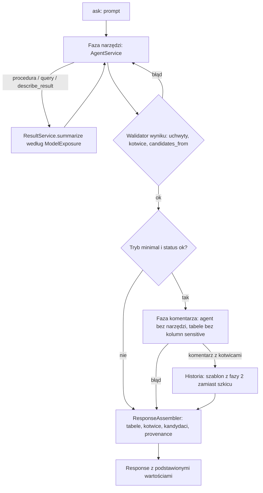
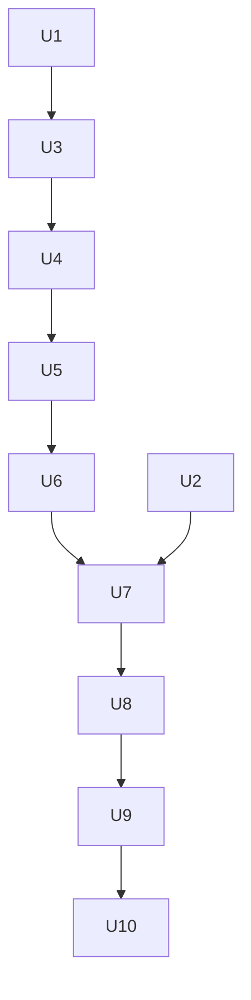

# Dostęp modelu do danych (etap 2) - Plan

## Goal Capsule

- **Objective:** Właściciel usługi jednym ustawieniem decyduje, ile danych z bazy trafia do dostawcy modelu. W trybie `none` (domyślnym) dostawca nie dostaje nazw klientów, produktów i osób ani wartości i ilości sprzedaży. W trybie `minimal` dostaje tylko wartości potrzebne do filtrów i komentarza, nigdy z kolumn wrażliwych. Użytkownik w obu trybach dostaje tabele i komentarz, w którym liczby wstawia backend. W trybie `none` kształt wyniku może się różnić od v1 (np. postać długa zamiast pivotu dla wymiaru bez `values`), a skalę zmian mierzy ewaluacja.
- **Means:** podsumowania wyników według trybu, kotwice w tekstach dla użytkownika, kandydaci z uchwytu, komunikaty błędów bez wartości i osobna faza komentarza w trybie `minimal` (KTD1–KTD9).
- **Authority:** `docs/architecture/002-dostep-modelu-do-danych.md` jest źródłem prawdy o dostępie modelu do danych, a `docs/architecture/001-architektura-data-concierge.md` o reszcie systemu. Ten plan ustala kolejność prac i decyzje techniczne. `CLAUDE.md` i `docs/standards/` ustalają sposób pisania kodu. Gdy plan i dokument 002 się rozjadą, najpierw aktualizujemy 002, potem plan.
- **Execution profile:** cztery etapy (2A–2D), każdy to osobne uruchomienie `ce-work`, osobna gałąź `feat/etap-2x-…` i osobny PR. Commity i PR tylko na prośbę użytkownika.
- **Stop conditions:** przerwij i zapytaj użytkownika, gdy:
  - test szczelności (U7) pokaże wartość z danych w ruchu do modelu, a jej źródła nie da się zamknąć w ramach decyzji z 002;
  - sprawdzenie na żywo w etapie 2C pokaże, że podmiana szablonu w historii (KTD8) wywołuje błędy albo stałe pomijanie bloków myślenia;
  - zmiana wymagałaby odejścia od decyzji D1–D8 z dokumentu 002;
  - brakuje klucza Anthropic albo zgody na koszt przed sprawdzeniem na żywo w etapach 2B i 2C albo przed przebiegiem ewaluacji w etapie 2D;
  - tryb przechodzi w ewaluacji mniej przypadków niż v1 z powodu spoza listy zmian oczekiwanych z 002, sekcja 9 (przed zamknięciem etapu 2D).

---

## Product Contract

### Summary

Usługa dostaje przełącznik `model_data_access` z trybami `none` i `minimal`. Model przestaje dostawać podglądy wierszy, a wartości z danych wpisuje w tekst kotwicami, które wypełnia backend. Plan kończy się przebiegiem zestawu ewaluacyjnego w obu trybach na prawdziwym modelu i bazie.

### Problem Frame

W v1 model widzi dane po każdym wywołaniu narzędzia: podgląd do 50 wierszy, wartości wymiarów (np. nazwy klientów), min i max miar oraz komunikaty błędów, które mogą cytować wartości. Historia sesji niesie to do kolejnych tur. Klient, który nie chce wysyłać danych sprzedaży do dostawcy modelu, nie może dziś korzystać z usługi. Dokument 002 opisuje docelowy projekt, a właściciel podjął decyzje D1–D8 w dniu 2026-10-24.

### Requirements

**Przełącznik**

- R1. Tryb dostępu modelu do danych to ustawienie procesu `model_data_access` z wartościami `none` (domyślna) i `minimal`, czytane przy starcie i wspólne dla wszystkich sesji procesu (002, sekcja 3).

**Co widzi model**

- R2. W trybie `none` podsumowanie wyniku (po procedurze, `query` i `describe_result`) zawiera tylko: uchwyt, liczbę wierszy, obcięcie, schemat kolumn, min i max kolumn `time`, wartości kolumn `id` bez oznaczenia `sensitive` dla wyników do 50 wierszy, a dla `query` także źródła i SQL (002, sekcja 4.1).
- R3. W trybie `minimal` podsumowanie zawiera to samo co w R2 oraz wartości wymiarów bez `sensitive`, gdy jest ich do 20 (002, sekcja 5.1).
- R4. Wartość kolumny oznaczonej `sensitive` nie trafia do modelu w żadnym trybie. Kolumny wyników `query` dziedziczą wrażliwość według reguł z 002, sekcja 5.3. Katalog dostaje wstępne oznaczenie z tej sekcji.
- R5. Komunikaty błędów, które dostaje model (DuckDB, SQL Server i zamiana wyniku procedury na tabelę Arrow), nie zawierają wartości z danych. Pełny tekst trafia do logu z identyfikatorem zgłoszenia (002, sekcja 6.2).

**Teksty dla użytkownika**

- R6. Model wstawia wartości z danych do `message`, `assumptions`, tytułów tabel i pytania doprecyzowującego kotwicami `{rN.kolumna}`, `{rN[k].kolumna}` i `{rN#rows}` (liczba wierszy uchwytu). Backend sprawdza je przed zakończeniem tury i podstawia wartości w odpowiedzi (002, sekcja 6.1).
- R7. Lista kandydatów w pytaniu doprecyzowującym powstaje w backendzie z uchwytu wskazanego przez model, w obu trybach (002, sekcja 4.3).
- R8. Model zna wartości wymiarów zadeklarowane w katalogu (`values`), więc w trybie `none` może pisać `PIVOT` po tych wymiarach. Katalog dostaje `values` dla `Category` (002, sekcja 4.4).

**Tryb `minimal`**

- R9. Tura w trybie `minimal` przy statusie `ok` ma drugą fazę: model bez narzędzi pisze komentarz po obejrzeniu tabel zwracanych użytkownikowi i uchwytów użytych w kotwicach szkicu, do 50 wierszy, bez kolumn `sensitive`. Gdy faza zawiedzie, odpowiedź dostaje szkic z fazy pierwszej (002, sekcja 5.2).
- R10. Historia sesji przechowuje szablony z kotwicami, nigdy podstawione wartości. W trybie `minimal` szablon komentarza z fazy drugiej zastępuje szkic w historii.

**Kontrakt i niezawodność**

- R11. Kontrakt odpowiedzi HTTP i CLI (001, sekcja 9) się nie zmienia: `message` i pozostałe teksty przychodzą z podstawionymi wartościami.
- R12. Gdy model nie poda poprawnych kotwic w ramach budżetu ponowień, tura kończy się statusem `error`, a nie tekstem z niepodstawioną kotwicą.

**Weryfikacja**

- R13. Test bez modelu dowodzi, że w trybie `none` do modelu nie trafia żadna wartość wymiaru, miary ani kolumny `sensitive`, także policzona przez `query`. Dozwolone są tylko `row_count`, min i max kolumn `time` oraz wartości z pola `ids`. W trybie `minimal` nie trafia żadna wartość kolumny `sensitive`, a wiersze wyników procedur i `query` trafiają tylko do fazy komentarza, jako tabele zwracane użytkownikowi lub uchwyty kotwic szkicu (R9).
- R14. Zestaw ewaluacyjny przechodzi przez oba tryby, a raport pokazuje nowe miary z 002, sekcja 9. Oczekiwania zależne od trybu obejmują tylko zmiany wymienione w 002, sekcja 9. Każda inna porażka zostaje w raporcie jako porażka z przyczyną.

### Key Decisions

- **Domyślny tryb `none`, drugi tryb `minimal`, bez zachowania v1 jako trzeciego trybu.** Bezpiecznie domyślnie, a punktem odniesienia jest zapisany przebieg ewaluacji v1. (session-settled: user-approved — chosen over zostawienia trybu `full` z v1: jeden tryb mniej do utrzymania, D5 i D7) Governs R1.
- **Klucze techniczne są widoczne w trybie `none`.** Z kluczy model nie wyczyta wiedzy o danych, a bez nich nie przekaże `CustomerID` do kolejnej procedury. (session-settled: user-directed — chosen over kotwic w parametrach procedur `{r1.CustomerID}`: kotwice zużywają budżet unii trybu `strict`, zostają możliwym rozszerzeniem, D1) Governs R2.
- **W trybie `none` model widzi zakresy dat i liczbę wierszy, ale nie nazwy ani wartości i ilości sprzedaży.** Bez dat nie rozwiąże „trzech ostatnich miesięcy”, bez liczby wierszy nie rozpozna pustego wyniku. (session-settled: user-directed — chosen over ukrycia także dat: prośby o okresy względne muszą działać, D4) Governs R2.
- **Tryb `minimal` to lista dozwolonych z dwiema fazami tury.** (session-settled: user-approved — chosen over podglądu jak w v1: do modelu trafia tylko to, czemu przypisano cel, D2) Governs R3, R9.
- **Kolumny domyślnie widoczne, wrażliwe oznacza właściciel katalogu.** (session-settled: user-approved — chosen over domyślnego ukrywania: wrażliwych kolumn jest kilka, a wymiary są potrzebne do filtrów, D6) Governs R4.
- **Formatowanie wartości z kotwic: polskie separatory od pięciu cyfr części całkowitej, kolumny `id` bez separatorów, skala z typu kolumny, daty ISO, `NULL` jako „brak danych”.** (session-settled: user-approved — chosen over spacji co trzy cyfry w każdej liczbie: lata i identyfikatory wyglądałyby jak kwoty, D3 skorygowane 2026-10-24) Governs R6.
- **Kandydaci zawsze z uchwytu, także w trybie `minimal`.** (session-settled: user-approved — chosen over opisów kandydatów pisanych przez model w trybie `minimal`: jedna ścieżka, model nie przepisuje danych, D8) Governs R7.
- **Kontrakt odpowiedzi bez zmian, szablon w historii, zła kotwica kończy turę błędem, szczelność dowodzona testem.** Potwierdzone w zakresie planu. (session-settled: user-approved — chosen over zwracania szablonu klientowi i odpowiedzi z niepodstawioną kotwicą: klient dostaje gotowy tekst, a błąd jest widoczny) Governs R10, R11, R12, R13.

### Acceptance Examples

- AE1. Komentarz z sumą w trybie `none`
  - **Covers:** R2, R6
  - **Given:** raport sprzedaży po miesiącach za 2024 (P3), a model policzył jednowierszowe `r3` z kolumną `annual_total` typu `decimal(38,2)`.
  - **When:** model kończy turę z `message` „Sprzedaż netto w 2024: {r3.annual_total}.”
  - **Then:** odpowiedź ma „Sprzedaż netto w 2024: 32 145 678,12.” (spacja niełamliwa co trzy cyfry), `r3` jest w `provenance`, a historia sesji ma tekst z kotwicą.
- AE2. Wielu klientów o tej samej nazwie
  - **Covers:** R7
  - **Given:** `customer_search` zwraca trzech klientów „Mohamed Pal” pod `r1`, a model zapytaniem `query` buduje `r2` z kolumnami `CustomerID`, `AccountNumber`, `Territory`, `order_count`.
  - **When:** model kończy turę statusem `needs_clarification` z `candidates_from: {handle: r2, id_column: CustomerID}`.
  - **Then:** odpowiedź ma trzech kandydatów z `id` 12698, 20550 i 28763 i opisami złożonymi z pozostałych kolumn, a model nie widział ani nazw, ani numerów kont.
- AE3. Zła kotwica
  - **Covers:** R6, R12
  - **Given:** uchwyt `r2` ma 12 wierszy.
  - **When:** model pisze `{r2.net_sales}` bez numeru wiersza albo `{r9.total}` dla nieistniejącego uchwytu.
  - **Then:** model dostaje prośbę o poprawkę z opisem błędu. Po wyczerpaniu ponowień odpowiedź ma status `error`.
- AE4. Faza komentarza zawodzi
  - **Covers:** R9
  - **Given:** tryb `minimal`, faza narzędzi kończy się statusem `ok` ze szkicem „Raport sprzedaży za 2024, suma: {r3.annual_total}.”
  - **When:** faza komentarza kończy się błędem modelu.
  - **Then:** odpowiedź ma szkic z podstawioną sumą, a przypadek trafia do logu z identyfikatorem zgłoszenia.

### Scope Boundaries

- Kontrola liczb w komentarzu (skanowanie tekstu) zostaje odłożona. Zestaw ewaluacyjny mierzy liczby spoza kotwic (002, sekcja 12).
- Ochrona przed prompt injection i celowym wyprowadzaniem wartości przez model (np. `length("CustomerName")`, zapytania zawężające liczbę wierszy) jest poza zakresem (002, sekcja 10).
- Narzędzie wyszukiwania wartości (`find_values`) i kotwice w parametrach procedur są poza zakresem.
- Przełącznik per żądanie lub per sesja jest poza zakresem (002, sekcja 3).
- Rozważone i niezbudowane: znak ucieczki dla dosłownego `{r1.x}` w tekście. Polski komentarz nie zawiera takich ciągów, a gdyby się pojawiły, walidator kotwic zgłosi je modelowi. Wróci, jeśli ewaluacja pokaże taki tekst.
- Rozważone i niezbudowane: przedziały zamiast dokładnej liczby wierszy w trybie `none`. Właściciel przyjął `row_count` jako metadane (D4).

#### Deferred to Follow-Up Work

- Sprawy odłożone z review etapu 4 v1 (cztery decyzje i ryzyka resztkowe) idą osobno, po etapie 2.

### Success Criteria

- Test szczelności (R13) przechodzi w obu trybach na scenariuszach z procedurą, `query`, `describe_result`, błędem konwersji, kotwicami i pytaniem doprecyzowującym.
- Zestaw 37 przypadków przechodzi przez oba tryby na prawdziwym modelu i bazie. Każdy przypadek, który przechodził w v1, a nie przechodzi w nowym trybie, ma w raporcie opis przyczyny, a wynik trafia do dokumentu 002. Spadek względem v1 z powodu spoza listy z 002, sekcja 9, wymaga decyzji właściciela przed zamknięciem etapu 2D.

---

## Planning Contract

### Key Technical Decisions

- KTD1. **Tryb jako ustawienie i obiekt wartości.** `Settings.model_data_access` (literał `none` / `minimal`) daje przy starcie obiekt wartości `ModelExposure` z regułami trybu: czy pokazywać wartości wymiarów i czy uruchamiać fazę komentarza. Kompozycja wstrzykuje go do `ResultService` (przez `DuckDBSessionFactory`), do instrukcji i rejestru narzędzi oraz do `AskService`. Różnice trybów to dane, a nie zachowanie, więc obiekt wartości wystarcza zamiast dwóch klas strategii. Governs R1.
- KTD2. **Wrażliwość na kolumnie domenowej.** `core.types.Column` dostaje pole `sensitive` (domyślnie `false`), a `ColumnSpec.sensitive` z katalogu przechodzi do schematu przez `CatalogEntry.table_schema`. `QueryService._result_columns` dziedziczy rolę i wrażliwość z kolumny źródłowej o tej samej nazwie (bez względu na wielkość liter) i typie. Pozostałe kolumny tekstowe są wrażliwe, gdy którekolwiek źródło ma kolumnę wrażliwą (002, sekcja 5.3). Governs R4.
- KTD3. **Jedno podsumowanie bez podglądu.** `ResultSummary` traci `preview`. `stats` zawiera min i max kolumn `time` i, gdy `ModelExposure` na to pozwala, wartości wymiarów bez `sensitive` (do 20) albo ich liczbę. Nowe pole `ids` zawiera wartości kolumn `id` bez `sensitive`, gdy wynik ma do `model_max_rows` wierszy. Min i max miar znikają w obu trybach. Governs R2, R3.
- KTD4. **Kotwice: składnia, sprawdzenie, wstawienie.** Moduł `agent/anchors.py` rozpoznaje kotwice (szkic gramatyki w High-Level Technical Design) i rozwiązuje je przez nową metodę `ResultService`, która czyta komórkę uchwytu w kolejności wierszy z `preserve_insertion_order`. Istniejący walidator wyniku `AgentService._check_answer` sprawdza kotwice we wszystkich tekstach `AgentAnswer` i zgłasza `ModelRetry`. `ResponseAssembler` podstawia wartości i dodaje uchwyty kotwic do przodków w `provenance`. Liczba wierszy ma osobną składnię `{rN#rows}`, bo modele często nazywają kolumnę `row_count` i kotwica `{rN.row_count}` byłaby niejednoznaczna. Tekst w nawiasach klamrowych, który zaczyna się od `r` i cyfry, a nie pasuje do gramatyki (np. `{r1#count}`), jest błędną kotwicą i wraca do modelu, żeby nie złamać R12; inny tekst w nawiasach zostaje bez zmian (decyzja właściciela z 2026-10-24, po przeglądzie etapu 2B). Odpowiedź ze statusem `error` nie jest sprawdzana pod kątem kotwic, bo użytkownik dostaje wtedy ogólny komunikat, a nie tekst modelu (001, sekcja 6.2). Governs R6, R12.
- KTD5. **Formatowanie w jednej klasie.** `ValueFormatter` formatuje wartość według typu kolumny zgodnie z D3. `decimal`: tyle miejsc po przecinku, ile ma skala, i przecinek dziesiętny. Liczby, których część całkowita ma co najmniej pięć cyfr, dostają spację niełamliwą (U+00A0) co trzy cyfry, a krótsze zostają bez separatora (polska norma). `int`: ta sama reguła, a kolumny z rolą `id` zawsze bez separatorów. `date` i `datetime`: ISO. `bool`: „tak” lub „nie”. `NULL`: „brak danych”. Z formatera korzystają kotwice i opisy kandydatów. Governs R6, R7.
- KTD6. **Osobny model pytania doprecyzowującego od modelu.** `AgentAnswer` dostaje `ClarificationRequest` (pytanie i `candidates_from` z uchwytem i kolumną `id_column`) zamiast schematu odpowiedzi `api.schemas.Clarification`. `ResponseAssembler` buduje `Clarification` z kandydatami: `id` z `id_column`, a opis z pozostałych kolumn złączonych przecinkami. Walidator wyniku odrzuca nieznany uchwyt i kolumnę oraz uchwyt mający więcej wierszy niż `model_max_rows`. Kontrakt odpowiedzi zostaje bez zmian. Governs R7, R11.
- KTD7. **Błędy bez wartości na granicy silnika.** `DuckDBResultStore` przekazuje bez zmian tylko tekst `ParserException`, `BinderException` i `CatalogException`. Inne błędy DuckDB zamienia na nazwę klasy i ogólną wskazówkę. `SqlServerClient` daje modelowi numer błędu i SQLSTATE. Pełny tekst zostaje w nowym atrybucie `detail` wyjątku domenowego, a dekorator `retry_on_domain_error` loguje go z identyfikatorem zgłoszenia. Obowiązuje w obu trybach. Governs R5.
- KTD8. **Faza komentarza jako osobny agent i podmiana szablonu w historii.** `agent/comment.py` ma agenta Pydantic AI bez narzędzi, z własną stałą instrukcją, tym samym modelem i walidatorem kotwic z KTD4. Dostaje prompt, szkic odpowiedzi jako szablon z kotwicami (nigdy tekst po podstawieniu, bo `ResponseAssembler` działa dopiero po fazie komentarza) i tabele: tylko kolumny bez `sensitive`, do `model_max_rows` wierszy, a przy większych tabelach samą strukturę i liczbę wierszy. `AskService` woła go tylko w trybie `minimal` przy statusie `ok`, a przy błędzie używa szkicu i loguje przypadek. Po sukcesie w ostatniej odpowiedzi modelu w historii argumenty wywołania `present_result` dostają `message` z fazy drugiej. Governs R9, R10.
- KTD9. **Teksty dla modelu według trybu, zbudowane raz.** `AgentInstructions` i `ToolRegistry` biorą `ModelExposure`. Opisy `query` i `describe_result` przestają pochodzić z docstringów: rejestr nadaje je według trybu (`Tool(description=…)`). Opis narzędzia procedury wymienia wymiary z `values` z katalogu, w obu trybach. Stały początek rozmowy w obrębie procesu zostaje zachowany (001, sekcja 11.3). Governs R1, R8.
- KTD10. **Szczelność dowodzona przechwyceniem ruchu.** Test podaje sesji dane z wartościami-wartownikami (np. nazwa `SENTINEL-NAME-7Q`, kwota `98765.4321`, wartość wrażliwa `SENTINEL-ACCOUNT`). `FunctionModel` zapisuje każde żądanie do modelu, a test szuka wartowników w całym zserializowanym ruchu: instrukcjach, wynikach narzędzi, prośbach o poprawkę i historii kolejnej tury. Wartownikami są też wartości policzone przez `query`: po scenariuszu test czyta każdą komórkę każdego uchwytu sesji poza kolumnami `id` i `time` i sprawdza, że żadna z nich, ani w postaci z podsumowania, ani po sformatowaniu, nie występuje w ruchu. Kwoty w danych testowych są dobrane tak, żeby ich sumy i średnie były rozpoznawalne. Governs R13.
- KTD11. **Ewaluacja według trybu.** Tryb przebiegu wybiera zmienna `DC_MODEL_DATA_ACCESS`, a nazwa katalogu przebiegu w `evals/runs/` zawiera tryb. Przypadek w `evals/cases.yaml` może mieć opcjonalne oczekiwania dla trybu, ale tylko dla zmian z 002, sekcja 9 (R14). Harness bierze końcowy szablon komentarza z historii sesji zapisanej po turze, czyli po podmianie z KTD8, żeby liczyć liczby spoza kotwic. `capture_run_messages` widzi tylko pierwsze uruchomienie agenta, więc ponowienia i koszt fazy komentarza harness zbiera osobno, a odpowiedzi ze szkicem liczy z wpisu w logu z KTD8. Governs R14.
- KTD12. **Jeden limit wierszy dla modelu.** Ustawienie `model_max_rows` (domyślnie 50) zastępuje `preview_rows` i `full_preview_max_rows`. Rządzi polem `ids`, tabelami fazy komentarza i liczbą kandydatów. Governs R2, R7, R9.

### High-Level Technical Design

Tura w obu trybach:



Co zależy od trybu (pełna macierz widoczności: 002, sekcja 7):

| Element | `none` | `minimal` |
|---------|--------|-----------|
| `stats` wymiarów w podsumowaniu | brak | wartości do 20 lub liczba, bez `sensitive` |
| Faza komentarza | brak | przy statusie `ok` |
| Instrukcje i opisy `query` / `describe_result` | wariant bez danych | wariant z wartościami wymiarów i fazą komentarza |
| Kotwice, kandydaci z uchwytu, `ids`, czyste błędy | tak | tak |

Gramatyka kotwic (szkic):

```text
anchor   := cell | rows
cell     := "{" handle [ "[" row "]" ] "." column "}"
rows     := "{" handle "#rows}"   -- the handle's row count
handle   := "r" digits            -- a handle of the session
row      := digits                -- 1-based, in the handle's row order
column   := a name from the handle's schema (case-insensitive)
-- {rN.column} without [row] requires a one-row handle
```

### Sequencing



Etap 2A (U1, U2) nie zmienia zachowania widocznego dla modelu poza komunikatami błędów. Etap 2B (U3–U7) wprowadza tryb `none` w całości. Domyślny tryb to `none`, więc po 2B usługa już chroni dane. Etap 2C (U8) dodaje tryb `minimal`. Etap 2D (U9, U10) mierzy oba tryby i zamyka dokumentację.

### Risks & Dependencies

| Ryzyko | Skutek | Ograniczenie |
|--------|--------|--------------|
| Haiku 5.5 w trybie `none` źle używa kotwic albo pisze liczby z głowy | Ponowienia, statusy `error`, zmyślone liczby | Instrukcje z przykładami kotwic (U6), miara liczb spoza kotwic (U9). Kolejny krok to Sonnet 5.5 (001, sekcja 11.3). |
| Podmiana argumentów `present_result` w historii zmienia zawartość odpowiedzi z blokiem myślenia | Anthropic pomija blok (`drop_block`), kolejna tura traci rozumowanie | `_log_dropped_thinking` już to loguje. Sprawdzenie na żywo dwóch tur w trybie `minimal` w U8. Warunek przerwania w Goal Capsule. |
| U3 zmienia kształt podsumowania, na którym stoi wiele testów | Duży diff testów | Zmiana w jednym etapie, testy przepisane razem z kodem. Brak zachowania v1 jako trybu (D5) zwalnia z utrzymywania obu kształtów. |
| Przypadki ewaluacji oparte na podglądzie (pivoty, kandydaci) zmieniają oczekiwania | Fałszywe porażki | Oczekiwania według trybu (KTD11), `values` dla `Category` (U1). |
| Faza komentarza wydłuża turę i podnosi koszt | Wolniejsze odpowiedzi w `minimal` | Krótki kontekst bez narzędzi. Raport mierzy czas i koszt tury (U9). |

Zależności: lokalny SQL Server z `AdventureWorks2025` dla testów integracyjnych i ewaluacji. Klucz Anthropic dla sprawdzeń na żywo (U8) i ewaluacji (U9).

### Sources & Research

- `docs/architecture/002-dostep-modelu-do-danych.md`: projekt i decyzje D1–D8.
- `src/data_concierge/results/service.py`: `summarize`, `_stats`, `_dimension_stats` (dzisiejszy podgląd i statystyki).
- `src/data_concierge/query/service.py`: `_result_columns` (dziedziczenie ról, wzór dla wrażliwości).
- `src/data_concierge/results/repository.py`: `_execute`, `statement_types`, `_brief` (mapowanie błędów DuckDB).
- `src/data_concierge/core/sqlserver.py`: `_domain_error`, `_driver_text` (tekst błędu SQL Server dla modelu).
- `src/data_concierge/agent/service.py`: `_check_answer` (istniejący walidator wyniku), `run` (historia z `all_messages()`).
- `src/data_concierge/agent/prompts.py`: reguła PIVOT „take the values from the handle's statistics” i reguła o liczbach w `message`. Obie trzeba zmienić.
- `src/data_concierge/catalog/models.py`: `ColumnSpec.values` istnieje, ale nie trafia dziś do modelu (wartości model brał ze statystyk).
- `tests/evals/report.py`: miara liczb w komentarzu spoza wyników, do przestawienia na szablon.

---

## Implementation Units

### Etap 2A: Podstawy

### U1. Przełącznik, kolumny wrażliwe i wartości w katalogu

- **Goal:** usługa zna tryb, a każda kolumna, także kolumna wyniku `query`, wie, czy jest wrażliwa.
- **Requirements:** R1, R4, R8 (KTD1, KTD2)
- **Dependencies:** brak
- **Files:**
  - `src/data_concierge/core/settings.py`
  - `src/data_concierge/core/types.py`
  - `src/data_concierge/catalog/models.py`
  - `src/data_concierge/query/service.py`
  - `catalog/agent-procedures.yaml`
  - `.env.example`
  - `tests/core/test_settings.py`
  - `tests/core/test_types.py`
  - `tests/catalog/test_repository.py`
  - `tests/query/test_service.py`
- **Approach:**
  1. `Settings.model_data_access` z wartością domyślną `none` (także w `.env.example`). `ModelExposure` jako obiekt wartości w module `core` z fabryką z ustawień (KTD1).
  2. `Column.sensitive` i `ColumnSpec.sensitive`, przeniesione do `table_schema`.
  3. Dziedziczenie wrażliwości w `QueryService._result_columns` według KTD2.
  4. Oznaczenie katalogu według 002, sekcja 5.3, i `values` dla `Category` w `sales_order_line_list` i `product_search` (wartości sprawdzone zapytaniem do bazy przy wdrożeniu).
- **Patterns to follow:** istniejące dziedziczenie ról w `QueryService._result_columns`. Ustawienia jak `effort` w `core/settings.py`.
- **Test scenarios:**
  - Brak `DC_MODEL_DATA_ACCESS` daje tryb `none`, wartość `minimal` jest przyjmowana, a inna kończy start błędem walidacji.
  - `ModelExposure` dla `none` nie pokazuje wartości wymiarów i nie ma fazy komentarza, a dla `minimal` ma oba.
  - Katalog z `sensitive: true` daje kolumnę wrażliwą w `table_schema`, a bez pola kolumnę niewrażliwą.
  - Plik katalogu z repozytorium wczytuje się i ma oznaczone kolumny z 002, sekcja 5.3, oraz `values` dla `Category`.
  - `SELECT "CustomerName" FROM r1` daje wrażliwą kolumnę `CustomerName`, a `SELECT "customername" FROM r1` też (wielkość liter).
  - `SELECT upper("CustomerName") AS name FROM r1` daje wrażliwą kolumnę `name`, a `SELECT sum("SubTotal") AS net_sales FROM r1` niewrażliwą, gdy `r1` ma kolumnę wrażliwą.
  - Kolumna tekstowa wyliczona z uchwytu bez kolumn wrażliwych jest niewrażliwa.
- **Verification:** każda kolumna wyniku procedury i `query` ma ustaloną wrażliwość, a zachowanie widoczne dla modelu się nie zmienia.

### U2. Komunikaty błędów bez wartości

- **Goal:** model dostaje komunikaty błędów, które pozwalają poprawić wywołanie, ale nie cytują danych.
- **Requirements:** R5 (KTD7)
- **Dependencies:** brak
- **Files:**
  - `src/data_concierge/core/errors.py`
  - `src/data_concierge/results/repository.py`
  - `src/data_concierge/core/sqlserver.py`
  - `src/data_concierge/agent/tools.py`
  - `src/data_concierge/procedures/repository.py`
  - `tests/results/test_duckdb_store.py`
  - `tests/core/test_sqlserver.py`
  - `tests/procedures/test_sqlserver_repository.py`
  - `tests/agent/test_tools.py`
- **Approach:**
  1. Wyjątki domenowe dostają opcjonalny `detail` z pełnym tekstem.
  2. Klasyfikacja błędów DuckDB według KTD7 w miejscach, które dziś używają `_brief`.
  3. `_domain_error` w `SqlServerClient` daje numer błędu i SQLSTATE, a tekst sterownika idzie do `detail`. Komunikaty o przekroczeniu czasu i o połączeniu zostają bez zmian.
  4. `retry_on_domain_error` loguje `detail` z identyfikatorem zgłoszenia z `ctx.deps.context`.
  5. `SqlServerProcedureRepository._arrow_table` daje modelowi tylko procedurę, kolumnę i typ z katalogu, a tekst wyjątku Arrow (który cytuje wartość) przenosi do `detail`.
  6. Przegląd pozostałych komunikatów backendu, które trafiają do modelu (kontrole `query`, limity, walidacja parametrów), potwierdza, że nie cytują danych (002, sekcja 6.2).
- **Patterns to follow:** dekorator `retry_on_domain_error`, `_driver_text` w `core/sqlserver.py`.
- **Test scenarios:**
  - `SELECT CAST("CustomerName" AS INTEGER) FROM r1` z wartością `SENTINEL-NAME` daje `QueryExecutionError` bez tej wartości, z nazwą klasy błędu konwersji, a `detail` ją zawiera.
  - Błąd wiązania (nieznana kolumna `Subtotal`) wraca z tekstem DuckDB i podpowiedzią kandydatów, bez zmian.
  - Błąd parsera wraca bez zmian.
  - Błąd SQL Server z tekstem zawierającym wartość daje komunikat z numerem i SQLSTATE, bez tekstu sterownika.
  - Przekroczenie czasu procedury i błąd połączenia dają te same komunikaty co w v1.
  - Dekorator przy `QueryError` z `detail` zapisuje do logu `detail` i identyfikator zgłoszenia, a model dostaje tylko komunikat.
  - Wartość `SENTINEL-NAME` w kolumnie typu `int` wyniku procedury daje `ProcedureError` bez tej wartości, z nazwą kolumny i typem, a `detail` ją zawiera.
- **Verification:** żaden komunikat dla modelu z DuckDB, SQL Server ani repozytorium procedur nie zawiera tekstu z danych testowych.

### Etap 2B: Tryb zamknięty

### U3. Podsumowanie wyniku według trybu

- **Goal:** podsumowanie wyniku zawiera dokładnie to, co dla trybu ustala 002, sekcje 4.1 i 5.1.
- **Requirements:** R2, R3, R4 (KTD3, KTD12)
- **Dependencies:** U1
- **Files:**
  - `src/data_concierge/results/models.py`
  - `src/data_concierge/results/service.py`
  - `src/data_concierge/core/settings.py`
  - `src/data_concierge/agent/prompts.py`
  - `src/data_concierge/bootstrap.py`
  - `.env.example`
  - `tests/results/test_service.py`
  - `tests/core/test_settings.py`
  - `tests/agent/test_service.py`
  - `tests/query/test_service.py`
  - `tests/procedures/test_service.py`
  - `tests/agent/test_tools.py`
- **Approach:**
  1. `ResultSummary` bez `preview`, z `ids`. `ColumnStats` bez min i max miar.
  2. `ResultService` dostaje `ModelExposure` i `model_max_rows` przez konstruktor. `_stats` pomija kolumny `sensitive` i miary, a wartości wymiarów liczy tylko przy `minimal`.
  3. `DuckDBSessionFactory` przekazuje `ModelExposure` z ustawień.
  4. `model_max_rows` zastępuje `preview_rows` i `full_preview_max_rows` w ustawieniach, `.env.example`, stałych `results/service.py` i w `AgentInstructions` (KTD12). Do U6 reguła w `RULES` odwołuje się do `model_max_rows`, a jej treść zmienia U6.
  5. Testy oparte na podglądzie przepisane na nowy kształt.
- **Patterns to follow:** `ResultService._stats` i `_dimension_stats`.
- **Test scenarios:**
  - `none`: podsumowanie wyniku z kolumnami `id`, `time`, `dimension` i `measure` ma `row_count`, schemat, min i max daty i `ids`, a nie ma wartości wymiarów, miar ani wierszy.
  - `minimal`: to samo plus wartości wymiaru `CustomerType`, a bez wartości `CustomerName` (`sensitive`).
  - `minimal`: wymiar z 25 wartościami ma tylko ich liczbę.
  - Wynik z 51 wierszami nie ma `ids`, a z 50 ma wszystkie wartości kolumny `CustomerID` w kolejności wierszy.
  - Kolumna `id` z `sensitive` (`AccountNumber`) nie trafia do `ids`.
  - Pusty wynik ma `row_count` 0, puste `ids` i min oraz max dat `null`.
  - `QuerySummary` zachowuje `sources` i `sql`.
- **Verification:** podsumowanie nie ma pola z wierszami, różnice trybów ograniczają się do `stats` wymiarów, a w repozytorium nie zostaje `preview_rows` ani `full_preview_max_rows`.

### U4. Kotwice i formatowanie wartości

- **Goal:** model pisze kotwice we wszystkich tekstach dla użytkownika, backend je sprawdza i podstawia sformatowane wartości.
- **Requirements:** R6, R11, R12 (KTD4, KTD5)
- **Dependencies:** U3
- **Files:**
  - `src/data_concierge/agent/anchors.py`
  - `src/data_concierge/results/service.py`
  - `src/data_concierge/agent/service.py`
  - `src/data_concierge/agent/assembler.py`
  - `src/data_concierge/agent/models.py`
  - `tests/agent/test_anchors.py`
  - `tests/agent/test_service.py`
  - `tests/agent/test_assembler.py`
- **Approach:**
  1. Rozpoznanie kotwic według gramatyki z High-Level Technical Design i ich rozwiązanie przez nową metodę odczytu komórki w `ResultService`.
  2. `ValueFormatter` według KTD5.
  3. `_check_answer` sprawdza kotwice w `message`, `assumptions`, tytułach i pytaniu doprecyzowującym i zbiera wszystkie błędy w jedną prośbę o poprawkę.
  4. `ResponseAssembler` podstawia wartości we wszystkich tekstach i dodaje uchwyty kotwic do `provenance`.
  5. Opisy pól `AgentAnswer` mówią o kotwicach zamiast o liczbach z wyników.
- **Technical design:** walidacja i podstawienie korzystają z jednego obiektu rozwiązującego kotwice, żeby reguły nie rozjechały się między sprawdzeniem a wstawieniem.
- **Patterns to follow:** `_check_answer` (ModelRetry ze spisem dostępnych uchwytów), `ResultService.to_json_scalar` (konwersja wartości Arrow).
- **Test scenarios:**
  - Covers AE1. `{r3.annual_total}` na jednowierszowym uchwycie z `decimal(38,2)` 32145678.12 daje „32 145 678,12” ze spacjami niełamliwymi.
  - `{r2[6].month}` daje datę szóstego wiersza w ISO, a `{r2#rows}` liczbę wierszy.
  - Na jednowierszowym uchwycie z kolumną `row_count` (`count(*) AS row_count`) `{r3.row_count}` daje wartość kolumny, a `{r3#rows}` daje 1.
  - `decimal(38,4)` 1234.5000 daje „1234,5000”, liczba ujemna -12345.50 daje „-12 345,50”, `int` 14244 daje „14 244”, rok 2024 daje „2024”, `CustomerID` 12650 daje „12650”, `NULL` daje „brak danych”, `bool` daje „tak” lub „nie”.
  - Covers AE3. `{r2.net_sales}` na uchwycie z 12 wierszami, `{r9.total}`, `{r2[13].month}` i `{r2.Netsales}` dają prośbę o poprawkę z opisem każdego błędu i spisem kolumn.
  - Kolumna podana inną wielkością liter niż w schemacie jest rozpoznana.
  - Tekst „{nie kotwica}” zostaje bez zmian, a `{r1#count}` i `{ r1.x }` dają prośbę o poprawkę.
  - Kotwica w tytule tabeli i w `assumptions` jest podstawiona w odpowiedzi.
  - Odpowiedź ze statusem `error` i złą kotwicą w `message` kończy turę bez prośby o poprawkę.
  - Uchwyt użyty tylko w kotwicy jest w `provenance` razem ze swoimi przodkami.
  - Covers AE3. `FunctionModel`, który trzy razy podaje złą kotwicę, daje odpowiedź `error`.
  - Historia tury zawiera szablon z kotwicą, a odpowiedź tekst z wartością.
- **Verification:** odpowiedź nigdy nie zawiera kotwicy, a historia nigdy podstawionej wartości.

### U5. Kandydaci z uchwytu

- **Goal:** pytanie doprecyzowujące ma listę kandydatów zbudowaną przez backend z uchwytu.
- **Requirements:** R7, R11 (KTD6)
- **Dependencies:** U4
- **Files:**
  - `src/data_concierge/agent/models.py`
  - `src/data_concierge/agent/service.py`
  - `src/data_concierge/agent/assembler.py`
  - `tests/agent/test_service.py`
  - `tests/agent/test_assembler.py`
  - `tests/api/test_service.py`
- **Approach:**
  1. `ClarificationRequest` z `question` i opcjonalnym `candidates_from` (uchwyt, `id_column`) w `AgentAnswer`.
  2. Walidacja w `_check_answer` według KTD6.
  3. `ResponseAssembler` buduje `Clarification` z kandydatami, opisami z `ValueFormatter` i podstawionymi kotwicami w pytaniu.
- **Patterns to follow:** `ResponseAssembler._table` (odczyt uchwytu przez `ResultService.export`).
- **Test scenarios:**
  - Covers AE2. Uchwyt z trzema wierszami (`CustomerID`, `AccountNumber`, `Territory`, `order_count`) daje trzech kandydatów z `id` i opisem „AW00012698, Southwest, 3”.
  - Pytanie bez `candidates_from` (brak okresu) daje `Clarification` bez kandydatów.
  - Nieznany uchwyt, nieznana `id_column` i uchwyt z 51 wierszami dają prośbę o poprawkę.
  - `id_column` tekstowa (`ProductNumber`) daje `id` jako tekst.
  - `FunctionModel` odgrywa P2 w dwóch turach: pierwsza daje kandydatów z uchwytu, druga, z wybranym `CustomerID`, wywołuje `sales_order_list` z tym id.
- **Verification:** model nigdzie nie wpisuje kandydatów sam, a kształt `Clarification` w odpowiedzi jest taki jak w v1.

### U6. Instrukcje i opisy narzędzi według trybu

- **Goal:** model w każdym trybie dostaje instrukcje zgodne z tym, co naprawdę widzi.
- **Requirements:** R1, R6, R7, R8 (KTD9)
- **Dependencies:** U5
- **Files:**
  - `src/data_concierge/agent/prompts.py`
  - `src/data_concierge/agent/tools.py`
  - `src/data_concierge/agent/registry.py`
  - `src/data_concierge/bootstrap.py`
  - `tests/agent/test_registry.py`
  - `tests/agent/test_request_shape.py`
  - `tests/agent/test_live_smoke.py`
- **Approach:**
  1. Wspólna część instrukcji o kotwicach i `candidates_from` z przykładami: suma do komentarza przez jednowierszowe `query`, top 1 przez `{r4[1].CustomerName}`. Wartość, która trafi do kotwicy, model rzutuje w zapytaniu na skalę pokazywaną użytkownikowi, a kwoty na `DECIMAL(38,2)` (D3: skalę ustala model). Przykład „Total and best month” w `SQL_GUIDE` rzutuje `annual_total` i `best_month_sales` na `DECIMAL(38,2)`.
  2. Wariant `none`: model nie widzi wartości, `PIVOT` tylko z `values` z opisu procedury, wymiar bez `values` zostaje w postaci długiej. Wariant `minimal`: wartości wymiarów ze statystyk. Zdanie o szkicu komentarza dochodzi w U8 razem z fazą komentarza.
  3. Opisy `query` i `describe_result` nadawane przez rejestr według trybu, bez wzmianki o podglądzie.
  4. Opis narzędzia procedury wymienia wymiary z `values`.
  5. Sprawdzenie na żywo (`test_live_smoke.py`) w trybie `none` sprawdza kotwicę w komentarzu.
- **Patterns to follow:** `AgentInstructions.text`, `ProcedureToolFactory._description`.
- **Test scenarios:**
  - Instrukcje `none` nie zawierają słów o podglądzie i statystykach wartości, a zawierają regułę kotwic i `candidates_from`.
  - Instrukcje `minimal` zawierają regułę o wartościach wymiarów.
  - Instrukcje obu trybów zawierają regułę rzutowania kwot w kotwicach na `DECIMAL(38,2)`, a przykład sumy rocznej ją stosuje.
  - Opis `sales_order_line_list` zawiera wartości `Category`, a opis bez `values` nie ma sekcji wartości.
  - Dwa żądania w tym samym procesie mają identyczne instrukcje i definicje narzędzi (stały początek, `test_request_shape.py`), osobno dla każdego trybu.
  - Budżet trybu `strict` przechodzi na katalogu z repozytorium w obu trybach.
- **Verification:** żaden tekst dla modelu nie obiecuje danych, których tryb nie pokazuje.

### U7. Test szczelności trybu zamkniętego

- **Goal:** test dowodzi, że w trybie `none` żadna wartość z wierszy nie trafia do modelu.
- **Requirements:** R13 (KTD10)
- **Dependencies:** U2, U6
- **Files:**
  - `tests/agent/test_data_exposure.py`
  - `tests/conftest.py`
- **Approach:**
  1. Fałszywe repozytorium procedur zwraca dane z wartownikami w nazwach, kwotach, ilościach i kolumnie wrażliwej.
  2. `FunctionModel` odgrywa scenariusze i zapisuje każde żądanie, a test sprawdza cały zserializowany ruch.
- **Execution note:** zacznij od testu, który nie przechodzi na kodzie sprzed U3, żeby udowodnić, że łapie wyciek.
- **Patterns to follow:** `FunctionModel` w `tests/agent/test_service.py`, fixtury danych w `tests/conftest.py`.
- **Test scenarios:**
  - Procedura, `query` z agregacją, `describe_result` i odpowiedź z kotwicą: żaden wartownik i żadna wartość policzona przez `query` (w postaci surowej i sformatowanej) nie występuje w żądaniach do modelu, a odpowiedź zawiera podstawioną kwotę.
  - `query` z błędem konwersji na kolumnie z wartownikiem: prośba o poprawkę nie zawiera wartownika.
  - Pytanie doprecyzowujące z `candidates_from` i druga tura z historią: żadne żądanie drugiej tury nie zawiera wartownika.
  - Klucze techniczne i daty występują w ruchu (D1, D4), co potwierdza, że test widzi wyniki narzędzi.
- **Verification:** test przechodzi w trybie `none` i nie przechodzi po przywróceniu podglądu.

### Etap 2C: Tryb ograniczony

### U8. Faza komentarza i szablon w historii

- **Goal:** w trybie `minimal` użytkownik dostaje komentarz napisany po obejrzeniu wyników, a model widzi tylko dozwolone wartości.
- **Requirements:** R9, R10, R13 (KTD8)
- **Dependencies:** U7
- **Files:**
  - `src/data_concierge/agent/comment.py`
  - `src/data_concierge/agent/prompts.py`
  - `src/data_concierge/agent/models.py`
  - `src/data_concierge/results/service.py`
  - `src/data_concierge/api/service.py`
  - `src/data_concierge/bootstrap.py`
  - `tests/agent/test_comment.py`
  - `tests/api/test_service.py`
  - `tests/agent/test_data_exposure.py`
  - `tests/agent/test_live_smoke.py`
- **Approach:**
  1. Agent fazy komentarza według KTD8, z własną stałą instrukcją i walidatorem kotwic z U4. Instrukcje fazy narzędzi w trybie `minimal` dostają zdanie o krótkim szkicu komentarza, bo końcowy komentarz pisze faza druga.
  2. `ResultService` daje tabele dla modelu: tylko kolumny bez `sensitive`, do `model_max_rows` wierszy, a przy większych samą strukturę i `row_count`.
  3. `AskService` woła fazę komentarza po fazie narzędzi tylko przy `minimal` i statusie `ok`. Po sukcesie zastępuje `message` w odpowiedzi i w argumentach ostatniego `present_result` w historii, a przy błędzie zostawia szkic i loguje przypadek.
  4. Sprawdzenie na żywo dwóch tur w trybie `minimal` z logiem pominiętych bloków myślenia.
- **Patterns to follow:** `AgentService` (budowa agenta, ustawienia modelu, `_log_dropped_thinking`), `AskService._turn`.
- **Test scenarios:**
  - Faza komentarza dostaje tabele zwracane użytkownikowi i uchwyty z kotwic szkicu, bez kolumny `CustomerName`.
  - Szkic z kotwicą `{r4[1].CustomerName}` w tytule tabeli i w `assumptions` trafia do fazy komentarza jako szablon: żądanie nie zawiera wartownika kolumny wrażliwej.
  - Instrukcje fazy narzędzi w trybie `minimal` zawierają zdanie o szkicu komentarza.
  - Tabela z 51 wierszami trafia do fazy komentarza jako struktura i `row_count`.
  - Komentarz z fazy drugiej trafia do odpowiedzi z podstawionymi kotwicami, a do historii jako szablon w argumentach `present_result`.
  - Covers AE4. Błąd modelu w fazie komentarza daje odpowiedź ze szkicem i wpis w logu z identyfikatorem zgłoszenia.
  - Zła kotwica w fazie komentarza daje prośbę o poprawkę, a po wyczerpaniu ponowień szkic.
  - Status `needs_clarification`, `no_data` i `unsupported` nie uruchamia fazy komentarza, tryb `none` też nie.
  - Szczelność `minimal` (R13): wartownik kolumny wrażliwej nie występuje w żadnym żądaniu, a wartości miar i wiersze wyników procedur występują tylko w żądaniu fazy komentarza.
  - Uchwyt procedury zwrócony wprost jako tabela trafia do fazy komentarza bez kolumn `sensitive`, a jego wartości nie występują w żądaniach fazy narzędzi.
  - Kolejna tura w trybie `minimal` dostaje w historii szablon z fazy drugiej.
- **Verification:** sprawdzenie na żywo dwóch tur w trybie `minimal` przechodzi bez pominiętych bloków myślenia albo z udokumentowanym wynikiem (warunek przerwania).

### Etap 2D: Ewaluacja i dokumentacja

### U9. Ewaluacja w obu trybach

- **Goal:** zestaw ewaluacyjny mierzy oba tryby, a wyniki są zapisane.
- **Requirements:** R14 (KTD11)
- **Dependencies:** U8
- **Files:**
  - `tests/evals/conftest.py`
  - `tests/evals/cases.py`
  - `tests/evals/harness.py`
  - `tests/evals/test_cases.py`
  - `tests/evals/report.py`
  - `evals/cases.yaml`
  - `tests/evals/test_case_file.py`
  - `tests/evals/test_checks.py`
- **Approach:**
  1. Tryb przebiegu z ustawień, w nazwie katalogu przebiegu i w nagłówku raportu.
  2. Opcjonalne oczekiwania dla trybu w przypadkach, tylko dla zmian z 002, sekcja 9 (R14): kandydaci porównywani po `id`, pivoty z dopuszczoną postacią długą bez `values`, `CustomerID` przez `ids`, suma przez kotwicę.
  3. Miary w raporcie (002, sekcja 9): ponowienia przez kotwice, liczby w szablonie spoza kotwic, odpowiedzi ze szkicem zamiast komentarza, czas i koszt tury.
  4. Przebieg obu trybów na prawdziwym modelu i bazie oraz porównanie z przebiegiem v1 (37/37).
- **Patterns to follow:** `EvalReport`, `tests/evals/harness.py`.
- **Test scenarios:**
  - Plik przypadków z oczekiwaniami dla trybu przechodzi walidację schematu, a nieznany tryb jest błędem.
  - Liczba spoza kotwic w szablonie jest wykazana, a liczba z kotwicy i data nie są.
  - Kandydaci porównani po `id` przechodzą niezależnie od opisu.
  - Raport ma osobne kolumny nowych miar i nazwę trybu.
- **Verification:** raporty obu trybów są zapisane w `evals/runs/`, a każda różnica względem v1 ma przyczynę w raporcie.

### U10. Dokumentacja po wdrożeniu

- **Goal:** dokumenty 001 i 002 opisują system po etapie 2.
- **Requirements:** R1–R14
- **Dependencies:** U9
- **Files:**
  - `docs/architecture/002-dostep-modelu-do-danych.md`
  - `docs/architecture/001-architektura-data-concierge.md`
- **Approach:**
  1. 002: status „wdrożone”, wyniki ewaluacji obu trybów i odejścia od projektu, które wyszły przy wdrożeniu.
  2. 001: przykłady wyniku narzędzia (sekcje 6.1 i 6.2), limity (sekcja 8), przykład `message` (sekcja 9) i reguły PIVOT (sekcja 7.2) zgodne z kotwicami i nowym podsumowaniem, z odesłaniem do 002.
- **Test expectation:** none -- zmiana dokumentów.
- **Verification:** dokumenty nie opisują podglądu wierszy jako zachowania usługi.

---

## Verification Contract

| Bramka | Polecenie | Kiedy |
|--------|-----------|-------|
| Formatowanie | `uv run ruff format --check` | każdy etap |
| Lint | `uv run ruff check` | każdy etap |
| Typy | `uv run mypy src` | każdy etap |
| Testy jednostkowe | `uv run pytest` | każdy etap |
| Testy integracyjne | `uv run pytest -m integration` | etapy 2A (błędy SQL Server) i 2B, wymagają wdrożonej bazy |
| Sprawdzenie na żywo | `uv run pytest -m eval tests/agent/test_live_smoke.py` | etapy 2B (`none`) i 2C (`minimal`), wymagają klucza Anthropic |
| Ewaluacja | `uv run pytest -m eval tests/evals` z `DC_MODEL_DATA_ACCESS=none`, potem `minimal` | etap 2D |

---

## Definition of Done

**Globalnie:**

- Bramki z Verification Contract właściwe dla etapu przechodzą.
- Kod spełnia `docs/standards/`: warstwy, wstrzykiwanie przez konstruktor, brak luźnych funkcji modułowych bez komentarza `# module-level:`, nazwy i komentarze po angielsku.
- Dokument 002 zgadza się z kodem. Każde odejście od projektu zaczyna się od zmiany 002.
- W zmianach nie zostaje kod z porzuconych prób, zakomentowany kod ani nieużywane ustawienia.

| Etap | Kryterium zakończenia |
|------|-----------------------|
| 2A | Tryb i wrażliwość kolumn działają, katalog jest oznaczony. Żaden komunikat błędu DuckDB ani SQL Server dla modelu nie cytuje danych testowych. |
| 2B | Tryb `none` jest domyślny i kompletny: podsumowania bez wartości, kotwice, kandydaci z uchwytu, instrukcje według trybu. Test szczelności przechodzi. Sprawdzenie na żywo w trybie `none` przeszło. |
| 2C | Tryb `minimal` z fazą komentarza i szablonem w historii działa. Test szczelności `minimal` przechodzi. Sprawdzenie na żywo dwóch tur przeszło. |
| 2D | Raporty ewaluacji obu trybów zapisane, wyniki w 002 i w opisie PR. Dokumenty 001 i 002 opisują stan po wdrożeniu. |
