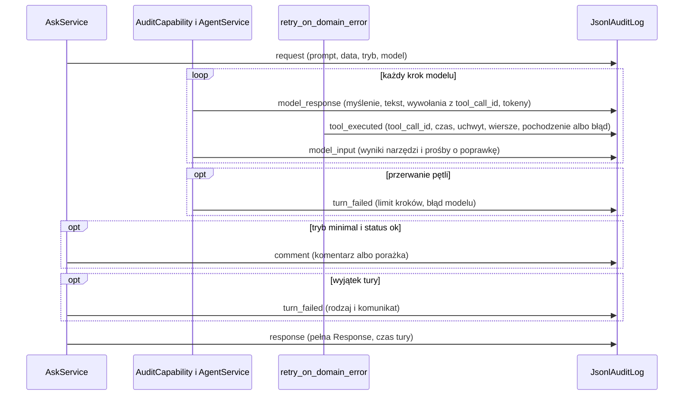
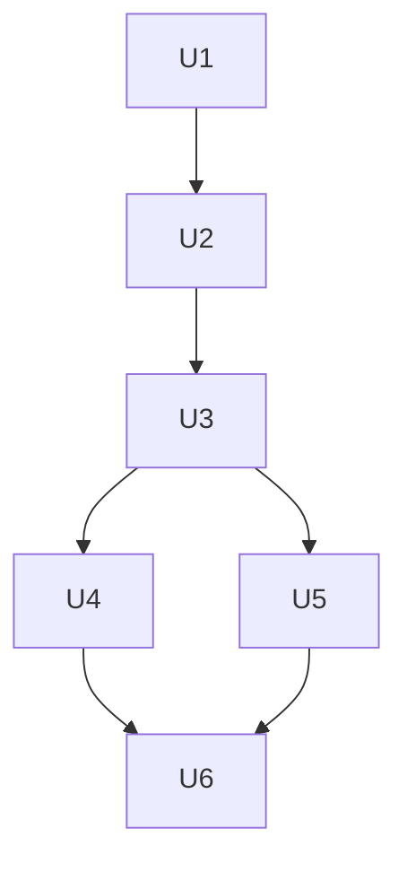

# Log audytowy - Plan

## Goal Capsule

- **Objective:** Osoba sprawdzająca działanie usługi może wziąć dowolną turę rozmowy, także nieudaną, i prześledzić ją od promptu do odpowiedzi. Widzi, o co pytał użytkownik, co postanowił model, co backend wykonał w bazie i w DuckDB, z jakim skutkiem, i co użytkownik dostał. POC ma pokazać ideę audytu, nie dawać gotowego mechanizmu produkcyjnego.
- **Means:** zdarzenia tury w lokalnym pliku JSONL (KTD1, KTD2) zapisywane z trzech miejsc przepływu (KTD4–KTD6) i polecenie `data-concierge audit` do ich odczytu (KTD8).
- **Authority:** `docs/architecture/001-architektura-data-concierge.md` jest źródłem prawdy o architekturze, a `docs/architecture/002-dostep-modelu-do-danych.md` o danych wysyłanych do modelu. Ten plan zaczyna się od ich aktualizacji (U1). `CLAUDE.md` i `docs/standards/` ustalają sposób pisania kodu.
- **Execution profile:** jedno uruchomienie `ce-work`, jedna gałąź `feat/log-audytowy`, jeden PR. Commity i PR tylko na prośbę użytkownika.
- **Stop conditions:** przerwij i zapytaj użytkownika, gdy:
  - rejestracja capability audytu (KTD4) zmienia to, co dostaje model, albo zachowanie tury. Wykażą to istniejące testy `tests/agent/test_request_shape.py`, `tests/agent/test_service.py` albo `tests/api/test_service.py`, a przyczyny nie da się usunąć bez zmiany KTD4;
  - hooki capability nie dostają kroków tury, np. odpowiedzi kończącej `present_result` albo prośby o poprawkę;
  - sprawdzenie na żywo wymaga uruchomienia SQL Server albo klucza Anthropic, a użytkownik ich nie udostępnił.

---

## Product Contract

### Summary

Każda tura zostawia w `logs/audit.jsonl` ciąg zdarzeń związanych `correlation_id`. Ciąg obejmuje prompt, kolejne odpowiedzi modelu z myśleniem i wywołaniami narzędzi, wykonanie procedur i zapytań DuckDB, to, co backend odesłał modelowi, fazę komentarza i pełną odpowiedź. Polecenie `data-concierge audit <id>` wypisuje turę albo całą rozmowę krok po kroku.

### Problem Frame

Dziś po turze zostaje odpowiedź JSON z proweniencją zwracanych tabel i kilka ostrzeżeń w logu Pythona. Proweniencja mówi, jak powstał wynik, ale nie mówi, o co pytał użytkownik ani co model rozważał i odrzucił. Nie pokazuje też wywołań, które się nie udały, ani tego, co backend kazał modelowi poprawić. Tura zakończona błędem nie zostawia prawie nic poza identyfikatorem. Architektura od v1 zapowiada log audytowy (001, sekcje 7.6 i 12), ale go nie ma. POC potrzebuje go, żeby pokazać klientowi, że decyzje agenta da się sprawdzić po fakcie.

### Requirements

**Zawartość logu**

- R1. Każda tura `ask` (CLI i HTTP) zapisuje uporządkowany ciąg zdarzeń z tym samym `correlation_id`, `session_id` i `user_id`, od przyjęcia promptu do odpowiedzi. Dotyczy to także tury z wygasłą sesją i tury zakończonej błędem.
- R2. Log zawiera prompt w postaci, w jakiej przyszedł, datę doklejoną przez backend, tryb dostępu do danych i nazwę modelu.
- R3. Log zawiera każdą odpowiedź modelu w turze: treść bloków myślenia (bez podpisów), tekst, wywołania narzędzi z argumentami, w tym końcowe `present_result`, oraz zużycie tokenów.
- R4. Log zawiera to, co backend odesłał modelowi: wyniki narzędzi, czyli podsumowania, które model zobaczył, i prośby o poprawkę (błędy argumentów, błędy SQL, odrzucone kotwice i uchwyty).
- R5. Log zawiera każde wykonanie procedury i `query`: czas, uchwyt, liczbę wierszy, obcięcie i pochodzenie (procedura z parametrami albo SQL modelu i SQL wykonany). Przy błędzie zawiera klasę błędu, komunikat dla modelu i pełny `detail`, którego model nie widzi.
- R6. W trybie `minimal` log zawiera wynik fazy komentarza: komentarz albo przyczynę porażki.
- R7. Log zawiera pełną odpowiedź dla użytkownika (z podstawionymi wartościami, tabelami i proweniencją) i czas tury. Przy porażce zawiera jej przyczynę.
- R8. Tura przerwana limitem kroków albo błędem modelu ma w logu wszystkie kroki wykonane przed przerwaniem.

**Zapis i odczyt**

- R9. Log to plik JSONL z jednym zdarzeniem na wiersz, pod ścieżką z ustawień. Plik jest tylko dopisywany, a współbieżne tury nie przeplatają wierszy.
- R10. Błąd zapisu logu nie zmienia odpowiedzi dla użytkownika i trafia do ostrzeżenia w logu Pythona.
- R11. `data-concierge audit <id>` wypisuje czytelnie turę (po `correlation_id`) albo całą rozmowę (po `session_id`), krok po kroku i w kolejności zdarzeń. Działa bez SQL Server i bez modelu.

**Dokumentacja**

- R12. Dokumenty 001 i 002 opisują log audytowy, zanim powstanie kod. README pokazuje, jak w demo prześledzić turę.

### Key Decisions

- **Plik JSONL za wymiennym interfejsem.** (session-settled: user-approved — chosen over tabeli w SQL Server i osobnego loggera `logging`: tabela wymaga uprawnień zapisu dla `agent_reader`, a logger miesza się z resztą logów) Governs R9.
- **Log z pełną odpowiedzią, także z wartościami kolumn `sensitive`.** (session-settled: user-directed — chosen over logu bez wierszy, w którym wynik odtwarza się z proweniencji: audyt ma pokazać, co dokładnie dostał użytkownik) Governs R5, R7.
- **Treść myślenia modelu w logu.** Najlepiej pokazuje, dlaczego model wybrał narzędzie. (session-settled: user-approved — chosen over zapisu samej informacji, że myślenie wystąpiło) Governs R3.
- **Błąd zapisu logu nie psuje tury.** (session-settled: user-approved — chosen over zasady „bez zapisu w logu nie ma odpowiedzi”, typowej dla audytu produkcyjnego: w POC to zbędna ostrożność) Governs R10.
- **Polecenie `audit` w CLI.** (session-settled: user-approved — chosen over samego opisu w README: wygodne na demo) Governs R11.

### Scope Boundaries

- Rotacja, retencja i limit rozmiaru pliku są poza zakresem.
- Odporność logu na manipulację (podpisy, łańcuch skrótów, magazyn append-only) jest poza zakresem.
- Zapis do bazy, OpenTelemetry i Logfire są poza zakresem. Interfejs `AuditLog` (KTD2) zostawia na nie miejsce.
- Odczyt logu przez HTTP jest poza zakresem.
- Wewnętrzne kroki fazy komentarza (jej ponowienia przy złych kotwicach) są poza zakresem. Log ma tylko jej wynik (R6).
- Rozważone i niezbudowane: zdarzenie startowe ze skrótem instrukcji i definicji narzędzi. Są stałe w procesie (001, sekcja 11.3) i wynikają z katalogu w repozytorium. Wróci, gdy audyt będzie musiał udowodnić, jaki prompt systemowy obowiązywał w danej chwili.
- Rozważone i niezbudowane: wersja schematu zdarzeń w każdym wierszu. Plik służy do demo, a czyta go tylko polecenie `audit` z tej samej wersji kodu. Wróci razem z trwałym magazynem.

#### Deferred to Follow-Up Work

- Instrumentacja Pydantic AI przez OpenTelemetry jako produkcyjna droga do śladu tury, jeśli POC zostanie przyjęty.

### Success Criteria

- Na demo jedno polecenie `audit` z `session_id` z odpowiedzi pokazuje dla promptu `raport sprzedaży po miesiącach za 2024` kolejno: prompt, decyzję modelu o `sales_order_list` z argumentami, wykonanie procedury z liczbą wierszy, podsumowanie dla modelu, `query` z SQL i wynikiem, `present_result` i odpowiedź z tabelą.
- Tura przerwana limitem kroków pokazuje w `audit` wszystkie kroki modelu przed przerwaniem i przyczynę przerwania.

---

## Planning Contract

### Key Technical Decisions

- KTD1. **Nowy moduł `audit` bez wiedzy o Pydantic AI.** Moduł ma model zdarzenia, repozytorium i rejestrator tury. Zdarzenie `AuditEvent` to niemutowalny model Pydantic: czas (UTC, ISO 8601), `correlation_id`, `session_id`, `user_id`, rodzaj zdarzenia i `data` jako słownik wartości JSON. Zamianę wiadomości Pydantic AI na `data` robi moduł `agent`, który zna Pydantic AI. Dzięki temu `audit` zależy tylko od `core`, a zmiana biblioteki agenta nie dotyka formatu logu. Governs R1, R9.
- KTD2. **`AuditLog` jako `Protocol` z dwiema implementacjami.** `JsonlAuditLog` dopisuje zdarzenie jako jeden wiersz UTF-8 pod blokadą `threading.Lock`, bo narzędzia synchroniczne działają w wątkach roboczych, a tury HTTP równolegle. Przy pierwszym zapisie tworzy katalog. `OSError` zamienia na ostrzeżenie (R10). Czyta zdarzenia po `correlation_id` albo `session_id`. `NullAuditLog` nic nie robi i jest wartością domyślną konstruktorów, więc istniejące testy nie zmieniają się. Instancja to warstwa repository. Governs R9, R10.
- KTD3. **Rejestrator tury w zależnościach agenta.** `AskService` tworzy na każdą turę `TurnAudit`, który zna `AuditLog`, `correlation_id`, `session_id` i `user_id`. Udostępnia jedną metodę zapisu zdarzenia z rodzajem i danymi. Narzędzia dostają go przez nowe pole `AgentDeps.audit`, a `Session.deps` przyjmuje go obok `RequestContext`. `AskService` dostaje `AuditLog` przez konstruktor (domyślnie `NullAuditLog`), a `CompositionRoot.assemble` podaje `JsonlAuditLog`, gdy log jest włączony (KTD9). Governs R1.
- KTD4. **Kroki modelu zapisuje na żywo capability Pydantic AI.** `AgentService` rejestruje w `Agent(capabilities=[...])` małą klasę `AuditCapability`, podklasę `AbstractCapability` z modułu `agent`. Hooki tylko obserwują, a `Agent.run()` zostaje bez zmian. Klasa ma dwa hooki:
  - `after_model_request` zapisuje `model_response`, czyli decyzję modelu, zanim narzędzia ruszą;
  - `before_model_request` zapisuje `model_input` z częściami `ToolReturnPart` i `RetryPromptPart` ostatniej `ModelRequest` w `request_context.messages`.

  Zapis idzie przez `ctx.deps.audit`. Kolejność w pliku jest więc kolejnością przepływu: decyzja, wykonanie (KTD5), wynik dla modelu. Tura przerwana wyjątkiem ma już zapisane kroki (R8), a `turn_failed` zapisuje istniejący blok `except` w `AgentService.run` (KTD6). Po ostatnim `present_result` nie ma kolejnego żądania do modelu, więc tura kończy się na `model_response`.

  Odrzucone alternatywy:
  - `capture_run_messages` w `AgentService`. Zagnieżdżony kontekst odebrałby wiadomości testowi ewaluacji, który łapie je wokół `AskService.ask` (`tests/evals/test_cases.py`).
  - Przepisanie `run()` na `Agent.iter()`. Zmienia pętlę, którą hooki tylko obserwują, i niesie ryzyko innej obsługi walidatora wyniku, `end_strategy='early'` i limitów.

  Governs R3, R4, R8.
- KTD5. **Wykonanie narzędzia zapisuje dekorator `retry_on_domain_error`.** Dekorator już owija każde narzędzie (procedury, `query`, `describe_result`) i czyta `ctx.deps`. Dostaje pomiar czasu i zdarzenie `tool_executed` z `ctx.tool_name` (domknięcia procedur nazywają się `call`) i `ctx.tool_call_id`, który łączy je z wywołaniem w `model_response`. Przy sukcesie zdarzenie ma uchwyt i liczbę wierszy z podsumowania, a obcięcie i pochodzenie z `results.describe(handle)`. Przy błędzie domenowym ma klasę błędu, komunikat i `detail`. Inny wyjątek dostaje zdarzenie z klasą błędu i przechodzi dalej bez zmian. Błąd walidacji argumentów przez Pydantic AI nie dociera do dekoratora i jest widoczny jako prośba o poprawkę w `model_input` (KTD4). Istniejące `logger.warning` zostają. Governs R5.
- KTD6. **Ramy tury zapisuje `AskService`.** `ask` zapisuje `request` (R2) zaraz po ustaleniu sesji, także dla wygasłej sesji, a potem `response` z pełną `Response` i czasem tury na każdej ścieżce wyjścia. W blokach `except` zapisuje `turn_failed` z rodzajem i komunikatem wyjątku. `_commented` zapisuje `comment` z tekstem albo z `detail` porażki. Porażkę pętli agenta (`UsageLimitExceeded`, `UnexpectedModelBehavior`) zapisuje `AgentService` jako `turn_failed`, bo tam jest łapana. Istniejące `logger.warning` i `logger.exception` zostają bez zmian, bo raport ewaluacji porównuje ich teksty. Governs R1, R2, R6, R7.
- KTD7. **Dane zdarzeń jako zwykły JSON.** Modele Pydantic trafiają do `data` przez `model_dump(mode="json")`, a argumenty narzędzi przez `args_as_dict()` z konwersją Pydantic do JSON (kwoty `Decimal` jako tekst, jak w odpowiedzi). Z `ThinkingPart` zapisujemy tylko niepustą treść, nigdy `signature`. Zużycie tokenów bierzemy z `ModelResponse.usage`. Governs R3, R7.
- KTD8. **Odczyt w CLI bez kompozycji aplikacji.** Polecenie `audit <id>` czyta ścieżkę z `Settings`, ale nie buduje `CompositionRoot`, więc nie łączy się z SQL Server ani z modelem. `JsonlAuditLog` zwraca zdarzenia pasujące do `correlation_id` albo `session_id`, w kolejności z pliku. Klasa w `api/cli.py` wypisuje je jako ponumerowane kroki z krótkim nagłówkiem tury (prompt, status, czas) i zwięzłą treścią każdego zdarzenia. Wiersze tabel w odpowiedzi skraca do liczby wierszy, bo pełne dane są w pliku. Brak pliku albo brak zdarzeń dla `id` daje komunikat i kod wyjścia 1. Governs R11.
- KTD9. **Przełącznik i ścieżka.** Dwa ustawienia: `Settings.audit_log_enabled` (domyślnie `true`) i `Settings.audit_log_path` (domyślnie `logs/audit.jsonl`). Przełącznik jest osobny, bo `Settings` ma `env_ignore_empty=True`: pusta wartość w `.env` wraca do domyślnej ścieżki, więc samą ścieżką nie da się wyłączyć logu. Przy `false` kompozycja używa `NullAuditLog`. Logu nie piszą testy:
  - fikstura `agent_settings` w `tests/conftest.py` ustawia `false`;
  - fikstura `eval_root` w `tests/evals/conftest.py` też, żeby przebieg ewaluacji nie zapisywał danych klientów.

  `logs/` trafia do `.gitignore`, a `DC_AUDIT_LOG_ENABLED` i `DC_AUDIT_LOG_PATH` do `.env.example`. Governs R9.

### High-Level Technical Design

Zdarzenia jednej tury i ich źródła:



| Zdarzenie | Źródło | Najważniejsze dane |
|-----------|--------|--------------------|
| `request` | `AskService.ask` | prompt, data bieżąca, nowa czy kontynuowana sesja, tryb, model |
| `model_response` | `AuditCapability` (`after_model_request`) | myślenie, tekst, wywołania narzędzi z `tool_call_id` i argumentami, tokeny |
| `tool_executed` | `retry_on_domain_error` | narzędzie, `tool_call_id`, czas, wynik (uchwyt, wiersze, obcięcie, pochodzenie) albo błąd (klasa, komunikat, `detail`) |
| `model_input` | `AuditCapability` (`before_model_request`) | wyniki narzędzi dla modelu, prośby o poprawkę |
| `comment` | `AskService._commented` | komentarz albo `detail` porażki |
| `turn_failed` | `AgentService`, `AskService` | rodzaj i komunikat przyczyny |
| `response` | `AskService.ask` | pełna `Response`, czas tury |

Każdy wiersz pliku ma wspólne pola z KTD1. Przykład kształtu, poglądowo:

```json
{"ts": "2026-10-26T17:10:02.114Z", "correlation_id": "9f…", "session_id": "3c…", "user_id": 1, "event": "tool_executed", "data": {"tool": "sales_order_list", "tool_call_id": "toolu_01…", "ms": 412, "handle": "r1", "rows": 3415, "truncated": false, "lineage": {"step": "procedure", "procedure": "api.SalesOrder_List", "params": {"DateFrom": "2024-01-01", "DateTo": "2025-01-01"}}}}
```

### Output Structure

```text
src/data_concierge/audit/
  __init__.py
  models.py       # AuditEvent
  repository.py   # AuditLog, JsonlAuditLog, NullAuditLog
  service.py      # TurnAudit
tests/audit/
  test_repository.py
  test_service.py
```

### Sequencing



### Risks & Dependencies

| Ryzyko | Skutek | Ograniczenie |
|--------|--------|--------------|
| Capability zmienia żądanie do modelu albo przebieg tury | Inny początek rozmowy (cache, 001, sekcja 11.3) albo inne zachowanie | Hooki zwracają kontekst i odpowiedź bez zmian. Testy kształtu żądania (`tests/agent/test_request_shape.py`) i tury, warunek przerwania w Goal Capsule. |
| Ewaluacja traci ślad tury | Fałszywe miary `query_retries` | `run()` bez zmian i test zgodności z `capture_run_messages` w U4. |
| Plik zawiera dane klientów, także z kolumn `sensitive` | Wyciek przy udostępnieniu pliku | Plik lokalny w `.gitignore`. 002 mówi wprost, że granica danych dotyczy dostawcy modelu, nie własnego logu backendu (U1). |
| Odpowiedź z 10 000 wierszy to bardzo długi wiersz pliku | Duży plik | Akceptowane w POC (brak rotacji w Scope Boundaries). `audit` skraca tabele (KTD8). |

Zależności: brak nowych pakietów. Sprawdzenie na żywo wymaga lokalnego SQL Server (usługa `MSSQLSERVER` uruchamiana ręcznie przez użytkownika) i klucza Anthropic.

### Sources & Research

- `src/data_concierge/api/service.py`: `AskService.ask`, `_turn`, `_commented` (ścieżki wyjścia tury i istniejące logi).
- `src/data_concierge/agent/service.py`: `AgentService.run` (łapane wyjątki, `_log_dropped_thinking` jako wzór przeglądania wiadomości).
- `src/data_concierge/agent/tools.py`: `retry_on_domain_error` (jedyne miejsce wokół każdego narzędzia).
- `src/data_concierge/agent/registry.py`: domknięcie `call` procedur (stąd `ctx.tool_name` zamiast nazwy funkcji).
- `src/data_concierge/api/sessions.py`: `Session.deps`.
- `tests/evals/test_cases.py`: `capture_run_messages` wokół `ask` (powód KTD4).
- `.venv/Lib/site-packages/pydantic_ai/capabilities/abstract.py`: `AbstractCapability` z hookami `before_model_request` i `after_model_request` (Pydantic AI 2.55).
- `.venv/Lib/site-packages/pydantic_ai/_agent_graph.py`: `capture_run_messages` (zagnieżdżone konteksty), `RunContext.tool_name` i `tool_call_id` w `_run_context.py`.
- 001, sekcje 7.6 i 12: proweniencja jako zalążek logu audytowego.

---

## Implementation Units

### U1. Dokumentacja projektu: 001 i 002

- **Goal:** architektura opisuje log audytowy, zanim powstanie kod.
- **Requirements:** R12 (KTD1–KTD9)
- **Dependencies:** brak
- **Files:**
  - `docs/architecture/001-architektura-data-concierge.md`
  - `docs/architecture/002-dostep-modelu-do-danych.md`
- **Approach:**
  1. 001: nowa sekcja 8.1 „Log audytowy” po przebiegu żądania: cel, zdarzenia i ich źródła (tabela z High-Level Technical Design), plik i ustawienie, polecenie `audit`, granice POC ze Scope Boundaries.
  2. 001, sekcja 4: wiersz komponentu „Log audytowy” w tabeli komponentów. Zdanie o proweniencji jako „zalążku logu audytowego” w sekcjach 4 i 7.6 dostaje odwołanie do 8.1.
  3. 001, sekcja 12: wiersz „Log audytowy” opisuje stan po wdrożeniu i to, co zostaje na później (rotacja, odporność na manipulację, OpenTelemetry).
  4. 001: wpis v3.9 w historii zmian i nowa wersja w nagłówku.
  5. 002, sekcja 7: akapit, że log audytowy backendu zawiera prompt, myślenie modelu i pełne odpowiedzi z kolumnami `sensitive`. Plik zostaje na maszynie usługi i nie trafia do dostawcy modelu.
- **Patterns to follow:** styl wpisów v3.x w 001.
- **Test expectation:** none -- zmiana tylko w dokumentacji.
- **Verification:** 001 i 002 opisują zachowanie z Requirements, a 001, sekcja 12, nie zapowiada już logu jako przyszłej warstwy.

### U2. Moduł `audit` i ustawienie

- **Goal:** usługa ma zdarzenie audytowe, plik JSONL z bezpiecznym dopisywaniem i odczytem oraz rejestrator tury.
- **Requirements:** R9, R10 (KTD1, KTD2, KTD3, KTD9)
- **Dependencies:** U1
- **Files:**
  - `src/data_concierge/audit/__init__.py`
  - `src/data_concierge/audit/models.py`
  - `src/data_concierge/audit/repository.py`
  - `src/data_concierge/audit/service.py`
  - `src/data_concierge/core/settings.py`
  - `.env.example`
  - `.gitignore`
  - `tests/audit/test_repository.py`
  - `tests/audit/test_service.py`
  - `tests/core/test_settings.py`
  - `tests/conftest.py`
- **Approach:**
  1. `AuditEvent` według KTD1, z czasem nadawanym przy tworzeniu (zegar wstrzykiwany do `TurnAudit`, żeby testy miały stały czas).
  2. `AuditLog`, `JsonlAuditLog` i `NullAuditLog` według KTD2.
  3. `TurnAudit` według KTD3.
  4. `audit_log_enabled` i `audit_log_path` według KTD9, fikstura `agent_settings` z wyłączonym logiem.
- **Patterns to follow:** `SessionRepository` i `InMemorySessionRepository` w `api/sessions.py` (Protocol i implementacja). Ustawienia jak `catalog_path`.
- **Test scenarios:**
  - Zapis dwóch zdarzeń do pliku w `tmp_path` daje dwa wiersze JSON z polami z KTD1 w kolejności zapisu, a polskie znaki w prompcie zapisują się jako UTF-8.
  - Zapis do nieistniejącego katalogu tworzy katalog i plik.
  - Odczyt po `correlation_id` zwraca zdarzenia tylko tej tury, a po `session_id` zdarzenia wszystkich tur tej sesji, w kolejności z pliku.
  - Odczyt `id`, którego nie ma, zwraca pustą listę, a odczyt bez pliku nie rzuca wyjątku.
  - Kilka wątków zapisujących po sto zdarzeń daje plik, w którym każdy wiersz jest poprawnym JSON, a liczba wierszy się zgadza.
  - Zapis do ścieżki, której nie da się otworzyć (np. katalog zamiast pliku), nie rzuca wyjątku i daje ostrzeżenie w logu Pythona.
  - `TurnAudit` zapisuje zdarzenie z polami tury i danymi przekazanymi przez wywołującego.
  - Bez zmiennych środowiskowych log jest włączony i ma ścieżkę `logs/audit.jsonl`. `DC_AUDIT_LOG_ENABLED=false` go wyłącza, a pusta `DC_AUDIT_LOG_PATH` daje ścieżkę domyślną.
- **Verification:** moduł działa samodzielnie, bez zmian w przepływie tury.

### U3. Ramy tury w `AskService` i podłączenie

- **Goal:** każda tura ma w logu `request` i `response`, porażki mają `turn_failed`, a faza komentarza `comment`. Rejestrator trafia do narzędzi.
- **Requirements:** R1, R2, R6, R7 (KTD3, KTD6)
- **Dependencies:** U2
- **Files:**
  - `src/data_concierge/api/service.py`
  - `src/data_concierge/api/sessions.py`
  - `src/data_concierge/agent/deps.py`
  - `src/data_concierge/bootstrap.py`
  - `tests/api/test_service.py`
  - `tests/api/test_bootstrap.py`
  - `tests/conftest.py`
  - `tests/evals/conftest.py`
- **Approach:**
  1. `AskService` przyjmuje `AuditLog` i tworzy `TurnAudit` po ustaleniu sesji.
  2. Zdarzenia według KTD6 na wszystkich ścieżkach `ask`: wygasła sesja, sukces, `ResultStoreError`, inny wyjątek.
  3. `AgentDeps.audit` i `Session.deps(context, audit)` według KTD3. Fikstury `AgentDeps` w `tests/conftest.py` dostają rejestrator nad `NullAuditLog`.
  4. `CompositionRoot.assemble` tworzy `JsonlAuditLog` z `settings.audit_log_path`, gdy log jest włączony, a inaczej `NullAuditLog`. `eval_root` wyłącza log według KTD9.
- **Patterns to follow:** wstrzykiwanie `today` i `exposure` do `AskService`. Fikstura `ask_service` w `tests/api/test_service.py` (scenariusze modelu przez `FunctionModel`).
- **Test scenarios:**
  - Tura ze scenariuszem procedura, `query`, `present_result` zapisuje `request` jako pierwsze i `response` jako ostatnie zdarzenie, wszystkie z tym samym `correlation_id`, `session_id` i `user_id`.
  - `request` ma prompt bez doklejonej daty, osobno datę bieżącą i tryb.
  - `response` ma pełną odpowiedź z wierszami tabel i wartościami podstawionymi w `message`, równą zwróconej `Response`, oraz czas tury.
  - Prośba z nieznanym `session_id` zapisuje `request` i `response` ze statusem `error` i nie zapisuje zdarzeń agenta.
  - Tura, w której magazyn wyników rzuca `ResultStoreError`, zapisuje `turn_failed` z rodzajem błędu przed `response` ze statusem `error`.
  - Tryb `minimal` ze statusem `ok` zapisuje `comment` z tekstem komentarza, a przy porażce fazy `comment` z `detail` i istniejące ostrzeżenie o szkicu.
  - Druga tura tej samej sesji ma nowy `correlation_id` i ten sam `session_id`.
  - `CompositionRoot.assemble` z włączonym logiem i `audit_log_path` w `tmp_path` zapisuje zdarzenia tury do tego pliku, a z wyłączonym logiem nie tworzy pliku.
- **Verification:** istniejące testy `AskService` przechodzą bez zmian oczekiwań, a log tury ma ramy z R1.

### U4. Kroki modelu na żywo

- **Goal:** log pokazuje każdą decyzję modelu i każdą odpowiedź backendu dla modelu, także w turze przerwanej.
- **Requirements:** R3, R4, R8 (KTD4, KTD7)
- **Dependencies:** U3
- **Files:**
  - `src/data_concierge/agent/audit.py`
  - `src/data_concierge/agent/service.py`
  - `tests/agent/test_audit.py`
  - `tests/agent/test_service.py`
  - `tests/api/test_service.py`
- **Approach:**
  1. `AuditCapability` według KTD4 i KTD7, zarejestrowana w `Agent` w konstruktorze `AgentService`. `Agent.run()` zostaje bez zmian.
  2. `turn_failed` dla `UsageLimitExceeded` i `UnexpectedModelBehavior` w istniejącym bloku `except`, obok istniejącego ostrzeżenia.
- **Execution note:** najpierw zarejestruj capability z hookami, które niczego nie zapisują, i uruchom istniejące testy agenta, w tym `tests/agent/test_request_shape.py`. Zapis zdarzeń dodawaj dopiero, gdy przechodzą bez zmian.
- **Patterns to follow:** `_log_dropped_thinking` (przegląd części `ModelResponse`). Skryptowane modele w `tests/agent/test_service.py`.
- **Test scenarios:**
  - Tura procedura, `query`, `present_result` daje w kolejności: `model_response` z wywołaniem procedury, `model_input` z jej podsumowaniem, `model_response` z `query`, `model_input`, `model_response` z `present_result` i jego argumentami.
  - Odpowiedź modelu z `ThinkingPart` zapisuje jego treść bez `signature`, a pusta treść myślenia nie daje wpisu.
  - Złe argumenty procedury (np. data w złym formacie) dają w `model_input` prośbę o poprawkę z nazwą narzędzia.
  - `present_result` z nieznanym uchwytem daje w `model_input` prośbę o poprawkę z treścią z walidatora wyniku.
  - Tura przekraczająca `max_agent_steps` ma w logu wszystkie `model_response` sprzed przerwania i `turn_failed` z rodzajem limitu, a historia sesji zostaje jak przed turą.
  - `model_response` ma zużycie tokenów z odpowiedzi skryptowanego modelu.
  - `capture_run_messages` wokół `AskService.ask` dalej zwraca wiadomości tury przy zarejestrowanej capability (zgodność z ewaluacją, test w `tests/api/test_service.py`).
  - Żądanie do modelu z zarejestrowaną capability jest takie samo jak bez niej (instrukcje, narzędzia, wiadomości).
- **Verification:** istniejące testy agenta przechodzą, a log tury ma kroki modelu w kolejności przepływu.

### U5. Wykonanie narzędzi

- **Goal:** log pokazuje, co backend naprawdę wykonał dla każdego wywołania narzędzia i z jakim skutkiem.
- **Requirements:** R5 (KTD5, KTD7)
- **Dependencies:** U3
- **Files:**
  - `src/data_concierge/agent/tools.py`
  - `tests/agent/test_tools.py`
- **Approach:**
  1. Pomiar czasu i zdarzenie `tool_executed` w `retry_on_domain_error` według KTD5, w obu gałęziach: sukces i błąd domenowy. Inny wyjątek dostaje zdarzenie i przechodzi dalej bez zmian.
  2. Docstring dekoratora opisuje nową odpowiedzialność. Nazwa zostaje, żeby nie zmieniać `registry.py`.
- **Patterns to follow:** istniejące logowanie `detail` w dekoratorze. Fikstury `AgentDeps` z `tests/conftest.py`.
- **Test scenarios:**
  - Udane wywołanie procedury zapisuje `tool_executed` z nazwą narzędzia z katalogu (nie `call`), `tool_call_id`, uchwytem, liczbą wierszy, obcięciem i pochodzeniem z parametrami bez wartości wstrzykiwanych (`@UserId`).
  - Udane `query` zapisuje SQL modelu i SQL wykonany oraz uchwyty źródłowe.
  - `query` odrzucone przez politykę (np. dwie instrukcje) zapisuje błąd z klasą `QueryError` i komunikatem, a model dostaje `ModelRetry` jak dziś.
  - Błąd procedury z `detail` zapisuje klasę `ProcedureError`, komunikat dla modelu i pełny `detail`, a model dostaje `ToolFailed` jak dziś.
  - `describe_result` zapisuje zdarzenie z uchwytem bez nowego wyniku.
  - Czas wykonania jest liczbą nieujemną.
- **Verification:** każde wykonanie narzędzia ma zdarzenie połączone z wywołaniem modelu przez `tool_call_id`.

### U6. Polecenie `audit` i README

- **Goal:** turę albo rozmowę da się przejrzeć jednym poleceniem, a README pokazuje to w demo.
- **Requirements:** R11, R12 (KTD8)
- **Dependencies:** U4, U5
- **Files:**
  - `src/data_concierge/api/cli.py`
  - `README.md`
  - `tests/api/test_cli.py`
- **Approach:**
  1. Podpolecenie `audit` z jednym argumentem `id` w parserze `CommandLine`. Obsługa poza `CompositionRoot` według KTD8.
  2. Klasa wypisująca zdarzenia jako kroki. `tool_executed` pokazuje pod wywołaniem modelu o tym samym `tool_call_id`, myślenie i SQL w całości, tabele odpowiedzi skrócone do liczby wierszy.
  3. README: sekcja „Log audytowy” z plikiem, ustawieniem, przykładem `audit` po `session_id` z odpowiedzi i krótkim opisem rodzajów zdarzeń. W „Scenariuszu demo” zdanie o śledzeniu tury.
- **Patterns to follow:** `CommandLine` z wstrzykniętym `stdout`, testy w `tests/api/test_cli.py`.
- **Test scenarios:**
  - `audit <correlation_id>` dla pliku z dwiema turami wypisuje tylko kroki tej tury, z promptem, wywołaniem procedury, jej wykonaniem, `query`, `present_result` i statusem odpowiedzi, i kończy kodem 0.
  - `audit <session_id>` wypisuje obie tury tej rozmowy w kolejności.
  - Tura przerwana limitem pokazuje kroki i przyczynę przerwania.
  - Nieznany `id` wypisuje komunikat i kończy kodem 1, a brak pliku daje komunikat ze ścieżką i kod 1.
  - Odpowiedź z tabelą 10 000 wierszy wypisuje liczbę wierszy, nie same wiersze.
- **Verification:** po `uv run data-concierge ask` polecenie `audit` z `session_id` z odpowiedzi pokazuje całą turę (Success Criteria).

---

## Verification Contract

| Bramka | Polecenie | Kiedy |
|--------|-----------|-------|
| Formatowanie | `uv run ruff format --check` | każda jednostka |
| Lint | `uv run ruff check` | każda jednostka |
| Typy | `uv run mypy` (src i tests) | każda jednostka |
| Testy | `uv run pytest` | każda jednostka |
| Sprawdzenie na żywo | `uv run data-concierge ask --user 1 "raport sprzedaży po miesiącach za 2024"`, potem `uv run data-concierge audit <session_id>` | po U6, gdy użytkownik uruchomi SQL Server i zgodzi się na koszt jednej tury |

---

## Definition of Done

**Globalnie:**

- Bramki z Verification Contract przechodzą. Sprawdzenie na żywo przeszło albo jest w opisie PR jako pominięte z podaniem przyczyny.
- Kod spełnia `docs/standards/`: warstwy, wstrzykiwanie przez konstruktor, `Protocol` dla interfejsu, brak luźnych funkcji modułowych bez komentarza `# module-level:`, nazwy i komentarze po angielsku.
- Dokumenty 001 i 002 zgadzają się z kodem.
- Istniejące komunikaty `logger.warning` i `logger.exception` mają niezmieniony tekst.
- W zmianach nie zostaje kod z porzuconych prób, zakomentowany kod ani nieużywane ustawienia.

| Jednostka | Kryterium zakończenia |
|-----------|-----------------------|
| U1 | 001 (8.1, 4, 7.6, 12, v3.9) i 002 (sekcja 7) opisują log audytowy. |
| U2 | Moduł `audit` z testami, przełącznik i ścieżka w ustawieniach, `logs/` w `.gitignore`. |
| U3 | Każda ścieżka `ask` zapisuje ramy tury, kompozycja podłącza plik. |
| U4 | Kroki modelu w logu na żywo przez capability, `run()` bez zmian, tura przerwana ma swoje kroki, ewaluacja dalej widzi wiadomości. |
| U5 | Każde wykonanie narzędzia ma zdarzenie z czasem i skutkiem. |
| U6 | `audit` wypisuje turę i rozmowę, README ma sekcję o logu. |
