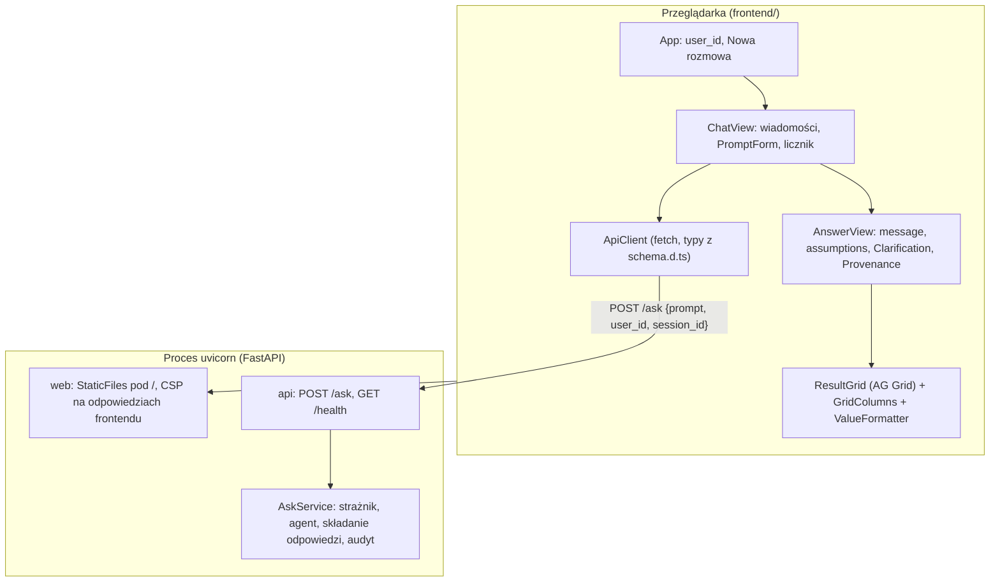
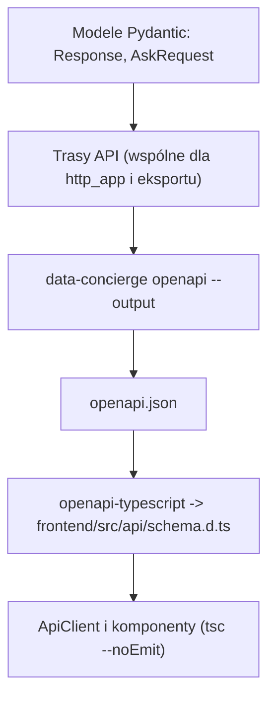
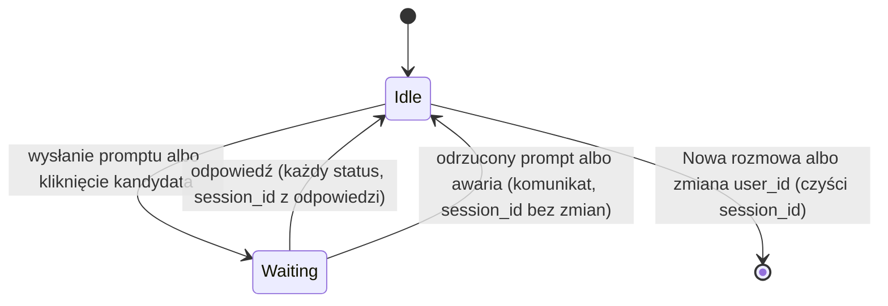

# Interfejs w przeglądarce, krok 3A (czat i tabele) - Plan

## Goal Capsule

- **Objective:** Użytkownik rozmawia z asystentem w przeglądarce i czyta wyniki w siatce z sortowaniem, filtrami i polskim formatem liczb. Każda tura przechodzi te same kontrole co w CLI i HTTP.
- **Means:** Aplikacja React + TypeScript w `frontend/`, która woła wyłącznie `POST /ask` i jest serwowana przez istniejącą aplikację FastAPI (KTD1, KTD8).
- **Product authority:** Właściciel projektu. Architekturę rozstrzyga [`docs/architecture/003-interfejs-uzytkownika.md`](../architecture/003-interfejs-uzytkownika.md). Przy sprzeczności R rozstrzyga zachowanie, a KTD mechanizm.
- **Execution profile:** Jeden PR z gałęzi `feat/web-ui`, na której jest już commit z dokumentem 003. Implementacja skillem `ce-work`. Język i standardy według `CLAUDE.md`, a dla kodu TypeScript według nowego standardu z U1.
- **Stop conditions:** Przerwij i zapytaj właściciela, gdy:
  - przypięte wersje paczek nie instalują się bez wymuszania zależności (`--force`, `--legacy-peer-deps`),
  - AG Grid wstawia HTML z wartości komórki i nie da się tego wyłączyć domyślnym rendererem,
  - realizacja wymaga zmiany kontraktu `Response` albo `AskRequest`,
  - model na żywo nie kontynuuje rozmowy po prompcie kandydata z samym `id` (KTD6).
- **Who finishes:** `ce-work` wykonuje jednostki i bramki offline. Właściciel uruchamia lokalny SQL Server z kluczem API, przechodzi listę sprawdzeń na żywo z U7 i scala PR.
- **Open blockers:** Brak.

---

## Product Contract

### Summary

Strona pod `/` w aplikacji FastAPI pokazuje okno rozmowy z asystentem.
Każda odpowiedź ma komentarz, tabele w siatce AG Grid, założenia, pytanie doprecyzowujące z przyciskami kandydatów i zwiniętą sekcję „Jak policzono”.
Kontrakt backendu się nie zmienia: strona wysyła prompt, `user_id` i `session_id`, a historia rozmowy zostaje w sesji backendu.
Typy TypeScript kontraktu powstają z OpenAPI backendu, a kod frontendu ma własny standard i bramki jakości.

### Problem Frame

Dziś z asystentem rozmawia się tylko w terminalu (`data-concierge chat`) albo przez surowe `POST /ask`.
Terminal pokazuje pierwsze 20 wierszy tabeli, bez sortowania i filtrowania, a wyniki procedur mają tysiące wierszy (np. 14 244 zamówienia z 2024).
Właściciel projektu wybrał React, bo projekt ma dostać produkcyjny frontend, a ten interfejs ma być jego pierwszą wersją (003, sekcja 4.3).
Krok 3A daje rozmowę i tabele; wykresy (3B) i postęp tury (3C) budują na nim później.

### Key Decisions

- **Historia rozmowy tylko w sesji backendu.** Strona nie przechowuje ani nie odsyła historii, więc nie decyduje, co zobaczy model. Governs R2. (session-settled: user-approved — chosen over protokołom z historią po stronie klienta (Vercel AI `useChat`, AG-UI): klient musiałby trzymać wersję z kotwicami, a backend jej ufać)
- **Przycisk kandydata wysyła samo `id`.** Opis kandydata pochodzi z kolumn wrażliwych i jest dla użytkownika, nie dla modelu (002, sekcja 4.3). Governs R4. (session-settled: user-approved — chosen over wysyłaniu tekstu opisu: numer konta czy adres trafiłby do dostawcy modelu)
- **Bez zmian kontraktu backendu w 3A.** Governs R1, R15. Zmiany `AgentAnswer` i `Response` należą do 3B.

### Requirements

**Rozmowa**

- R1. Użytkownik wpisuje prośbę i dostaje odpowiedź w tej samej rozmowie. Pierwsza wiadomość idzie bez `session_id`, każda kolejna z `session_id` z poprzedniej odpowiedzi.
- R2. Strona wysyła do backendu tylko nowy prompt, `user_id` i `session_id`, bez historii rozmowy.
- R3. Odpowiedź pokazuje `message`, tabele, `assumptions` i pytanie doprecyzowujące. Statusy `no_data`, `unsupported`, `needs_clarification` i `error` wyglądają inaczej niż `ok`.
- R4. Przy `needs_clarification` każdy kandydat jest przyciskiem z opisem, a kliknięcie wysyła prompt z samym `id` kandydata. Po wysłaniu nowej wiadomości przyciski starszych odpowiedzi są nieaktywne.
- R5. Sekcja „Jak policzono”, domyślnie zwinięta, pokazuje kroki `provenance`: procedurę z parametrami albo zapytanie z uchwytami źródłowymi i wykonanym SQL.
- R6. Podczas tury strona pokazuje licznik sekund i blokuje wysyłanie. W jednej karcie trwa najwyżej jedna tura.

**Tożsamość i sesja**

- R7. Pole `user_id` przyjmuje liczbę całkowitą i jest zapamiętane w przeglądarce. Zmiana `user_id` zaczyna nową rozmowę.
- R8. Przycisk „Nowa rozmowa” czyści widok i `session_id`. Przy odpowiedzi ze statusem `error` (np. wygasła sesja po restarcie serwera) strona pokazuje go obok komunikatu.
- R9. Odrzucony prompt (HTTP 422 z komunikatem) i błąd sieci lub serwera pokazują komunikat, a rozmowa, `session_id` i wpisany tekst zostają.

**Tabele**

- R10. Każda tabela odpowiedzi to siatka AG Grid z tytułem, sortowaniem i filtrem w kolumnach. Tabela ponad 15 wierszy ma stałą wysokość z przewijaniem i działa płynnie przy 10 000 wierszy.
- R11. Wartości są formatowane według typu kolumny tak jak w `data-concierge chat`, a sortowanie kolumn `int` i `decimal` jest liczbowe (KTD4).
- R12. Tabela z `truncated: true` ma nad siatką informację, że wynik jest niepełny.

**Bezpieczeństwo**

- R13. Teksty odpowiedzi i wartości komórek są pokazywane jako zwykły tekst: bez HTML, Markdown i klikalnych linków (001, sekcje 8.2 i 9).
- R14. Strona i biblioteki pochodzą z backendu, bez CDN, a odpowiedzi frontendu mają nagłówek `Content-Security-Policy` (KTD8).

**Serwowanie i narzędzia**

- R15. `uvicorn data_concierge.bootstrap:create_app --factory` serwuje zbudowaną aplikację pod `/` obok `POST /ask` i `GET /health`. Bez zbudowanej aplikacji `/` mówi, jak ją zbudować, a API działa jak dziś.
- R16. Tryb deweloperski: serwer Vite z przeładowaniem i proxy API do uvicorna.
- R17. Typy kontraktu w TypeScript powstają z OpenAPI backendu bez bazy i modelu, a osobne polecenie wykrywa nieaktualne typy.
- R18. Kod frontendu ma standard w `docs/standards/` i bramki: ESLint, Prettier, kontrola typów, testy Vitest.

**Dokumentacja**

- R19. README opisuje budowanie i uruchomienie interfejsu. 001 odsyła do 003, a 003 dostaje uzupełnienie z implementacji.

### Success Criteria

- Właściciel przechodzi w przeglądarce przykłady P1–P5 z 001, sekcja 10, w tym P2 z wyborem klienta przyciskiem, bez wpisywania identyfikatora ręcznie.
- Tabela 10 000 wierszy (np. zamówienia z 2024, obcięte limitem odpowiedzi) przewija się i sortuje bez zauważalnego zawieszenia strony.
- Log audytowy pokazuje tury z przeglądarki tak samo jak tury z CLI.

### Scope Boundaries

- Wykresy (3B) i strumień postępu tury (3C).
- Zmiany kontraktu `Response`, `AskRequest` i `AgentAnswer`.
- Uwierzytelnianie: `user_id` dalej podaje wywołujący (001, sekcja 8.2).
- Odtwarzanie rozmowy po odświeżeniu strony (KTD5).
- Wersja mobilna i dostępność ponad podstawy (etykiety pól, obsługa klawiaturą).

Rozważone i świadomie niebudowane:

- **Przycisk „Anuluj” turę.** Przerwanie `fetch` nie zatrzymuje tury na serwerze, a sesja nie ma blokady, więc kolejna wiadomość mogłaby iść równolegle z porzuconą turą i pomieszać historię. Wróci, gdy backend dostanie anulowanie tury albo blokadę sesji.
- **Limit długości promptu po stronie strony.** Limit żyje w konfiguracji backendu (`DC_MAX_PROMPT_CHARS`) i nie jest wystawiony. Backend odrzuca za długi prompt z komunikatem (R9), co wystarcza.
- **Automatyczne ponawianie po błędzie sieci.** Tura może się wykonać mimo błędu połączenia, a ponowienie wysłałoby ją drugi raz. Użytkownik ponawia świadomie.

#### Deferred to Follow-Up Work

- Testy end-to-end w przeglądarce (Playwright) dla przepływu rozmowy.
- Eksport tabeli do CSV (AG Grid Community to ma; nikt o to nie prosił w 3A).
- Przypadki ewaluacyjne dla promptu kandydata wysyłanego przyciskiem, razem z przypadkami wykresów w 3B.

### Sources / Research

- Projekt: [`docs/architecture/003-interfejs-uzytkownika.md`](../architecture/003-interfejs-uzytkownika.md), sekcje 3–6, 9–11.
- Kontrakt: `src/data_concierge/api/schemas.py` (`Response`, `ResponseTable`, `Clarification`, kroki `provenance`), `src/data_concierge/api/controller.py` (`AskRequest`, 422 dla `PromptTooLongError` z `detail` jako tekstem).
- OpenAPI wygenerowane z samego `router` (sprawdzone 2026-11-04): `ColumnType` to `string` (np. `decimal(38,4)`), `Rows` to tablica tablic `string | integer | boolean | null`. Nie wymaga `Settings` ani bazy.
- Formatowanie: `ValueFormatter` w `src/data_concierge/agent/formatting.py` i `ConversationPrinter._cell` w `src/data_concierge/api/cli.py` (grupy cyfr tylko dla `decimal`, bo odpowiedź nie niesie ról kolumn). Przypadki testowe w `tests/agent/test_anchors.py`.
- Wersje i licencje z rejestru npm (2026-11-04): tabela w KTD3.
- AG Grid: [Security](https://www.ag-grid.com/react-data-grid/security/) (CSP: style wstrzykiwane przez Theming API wymagają `style-src 'unsafe-inline'` albo `styleNonce`, `img-src data:`), [Modules](https://www.ag-grid.com/react-data-grid/modules/) (rejestracja modułów przed utworzeniem siatki, `AllCommunityModule`).

---

## Planning Contract

### Key Technical Decisions

- KTD1. **React + TypeScript + Vite w katalogu `frontend/` tego repozytorium, wywołania zwykłym `fetch`.** Bez Vercel AI SDK i bez biblioteki zarządzania stanem. (session-settled: user-directed — chosen over statycznej stronie z JS bez budowania i NiceGUI: projekt dostanie produkcyjny frontend w React rozwijany przez zespół)
- KTD2. **Siatka: AG Grid React (Community) w jednym komponencie `ResultGrid`, z `AllCommunityModule`.** Pełny zestaw modułów Community oszczędza szukania brakującego modułu sortowania czy filtra; zawężenie listy modułów to optymalizacja rozmiaru na później. Theming API (`themeQuartz`), bez motywów CSS z poprzednich wersji. (session-settled: user-approved — chosen over TanStack Table: na start daje najwięcej bez własnego kodu, a wymiana dotyczy tylko `ResultGrid`)
- KTD3. **Wersje przypięte dokładnie (bez `^`) w `package.json`, `package-lock.json` w repozytorium, instalacja przez `npm ci`.** TypeScript zostaje na 5.9, choć najnowszy jest 7.0: `typescript-eslint` wymaga `<6.1.0`, a `openapi-typescript` `^5.x`. Node co najmniej 22.12 (wymóg Vite 8 i Vitest 5), na maszynie dewelopera jest 24.13.

  | Paczka | Wersja | Licencja |
  |---|---|---|
  | `react`, `react-dom` | 19.3.1 | MIT |
  | `vite` | 8.3.5 | MIT |
  | `@vitejs/plugin-react` | 6.2.1 | MIT |
  | `typescript` | 5.9.3 | Apache-2.0 |
  | `ag-grid-community`, `ag-grid-react` | 36.3.0 | MIT |
  | `openapi-typescript` | 7.13.0 | MIT |
  | `vitest` | 5.1.0 | MIT |
  | `jsdom` | 30.1.3 | MIT |
  | `@testing-library/react` | 16.3.3 | MIT |
  | `eslint`, `@eslint/js` | 10.14.0, 10.0.1 | MIT |
  | `typescript-eslint` | 8.72.1 | MIT |
  | `eslint-plugin-react-hooks` | 7.1.1 | MIT |
  | `prettier` | 3.9.10 | MIT |

  Typy `@types/react`, `@types/react-dom`, `@testing-library/dom` i `globals` dobiera U1 w wersjach zgodnych z tabelą.
- KTD4. **Formatowanie wartości to klasa `ValueFormatter` w TypeScript, przeniesiona 1:1 z Pythona, a nie `Intl.NumberFormat`.** Algorytm działa na tekście kwoty, więc nie traci precyzji `decimal(38,4)` i daje dokładnie ten sam wynik co `data-concierge chat`: przecinek dziesiętny, grupy cyfr co trzy od pięciu cyfr części całkowitej oddzielone twardą spacją, skala z tekstu, `int` bez grup, daty i daty z czasem bez zmian, `bool` jako „tak”/„nie”, `null` jako pusta komórka. Sortowanie `int` i `decimal` porównuje wartości liczbowe; `Number()` z tekstu kwoty wystarcza do kolejności, bo kwoty w danych mają mniej niż 15 cyfr znaczących. To rozstrzyga sprawdzenie `Intl.NumberFormat` z 003: nie jest potrzebny.
- KTD5. **Stan rozmowy żyje w pamięci strony; odświeżenie zaczyna nową rozmowę.** `user_id` jest w `localStorage` jako wygoda, z obsługą wyjątku przy zablokowanym magazynie. To odejście od 003, sekcja 5 (tam `session_id` w `sessionStorage`): po odświeżeniu użytkownik nie widziałby wcześniejszych wiadomości, które model ma w historii. U7 wpisuje to do 003.
- KTD6. **Prompt kandydata buduje jedna klasa ze stałego szablonu z samym `id`, np. `Wybieram {id}.`** Szablon jest po polsku, bez opisu kandydata. Brzmienie potwierdza sprawdzenie na żywo w U7; README pokazuje dziś ręczną odpowiedź „Chodzi o klienta 12698”, więc model radzi sobie z samym identyfikatorem w zdaniu.
- KTD7. **Typy kontraktu z OpenAPI przez nowe polecenie `data-concierge openapi --output <plik>`.** Polecenie składa aplikację FastAPI z tych samych tras co `CompositionRoot.http_app()` i zapisuje `app.openapi()`, nie tworząc `Settings`, bazy ani modelu. Jedna metoda buduje zestaw tras API dla obu ścieżek, żeby schemat i serwowana aplikacja się nie rozjechały. Wygenerowany `frontend/src/api/schema.d.ts` jest w repozytorium. `npm run api:types` go odświeża, a `npm run api:check` odświeża i kończy się błędem, gdy plik się zmienił.
- KTD8. **Serwowanie: nowy moduł `web` (warstwa controller) montuje `frontend/dist` pod `/` za trasami API i dodaje nagłówek CSP tylko do odpowiedzi frontendu (pliki statyczne i strona zastępcza `/`).** Nie do całej aplikacji, bo strony `/docs` i `/redoc` FastAPI ładują skrypty z CDN i mają skrypt inline, więc `script-src 'self'` by je zepsuło. Ścieżka z ustawienia `DC_WEB_DIST_PATH` (domyślnie `frontend/dist`). Bez katalogu `/` zwraca stronę tekstową z poleceniami budowania. Polityka: `default-src 'self'; script-src 'self'; style-src 'self' 'unsafe-inline'; img-src 'self' data:; connect-src 'self'; object-src 'none'; base-uri 'none'; frame-ancestors 'none'`. `'unsafe-inline'` dla stylów, bo AG Grid wstrzykuje style motywu, a `styleNonce` wymagałby nonce generowanego przy każdym wczytaniu strony; skrypty zostają bez wyjątków.
- KTD9. **`ApiClient` rozróżnia trzy wyniki: odpowiedź, odrzucony prompt i awarię.** HTTP 200 to `Response` (także ze statusem `error`). HTTP 422 z `detail` jako tekstem to odrzucony prompt z komunikatem backendu. Każdy inny status, `detail` w innej postaci, błąd sieci albo treść nie-JSON to awaria z ogólnym komunikatem po polsku.
- KTD10. **Zwykły tekst wymuszają narzędzia, nie dyscyplina.** Reguła ESLint z rdzenia (`no-restricted-syntax` na atrybut `dangerouslySetInnerHTML`, bez dodatkowej wtyczki) i domyślny renderer komórek AG Grid. Test w U4 sprawdza, że wartość `` jest tekstem, a nie elementem.
- KTD11. **Testy: Vitest z jsdom i Testing Library dla klas i komponentów, pytest z `TestClient` dla serwowania i polecenia `openapi`.** Testy frontendu leżą obok kodu jako `*.test.ts(x)`. Płynność przy 10 000 wierszy sprawdza się na żywo (U7), bo jsdom nie ma układu strony ani wirtualizacji w realnym oknie.
- KTD12. **Tryb deweloperski: serwer Vite przekazuje `/ask` i `/health` do `http://127.0.0.1:8000`.** Ta sama domena w obu trybach, bez CORS w backendzie.

### High-Level Technical Design

Komponenty i granice:



Przepływ kontraktu od modeli Pydantic do TypeScript:



Stan rozmowy w karcie:



### Output Structure

```text
frontend/
  package.json, package-lock.json, tsconfig.json, vite.config.ts,
  eslint.config.js, .prettierrc.json, index.html
  src/
    main.tsx, App.tsx, App.css
    api/        schema.d.ts (generowany), ApiClient.ts
    format/     ColumnType.ts, ValueFormatter.ts
    grid/       ResultGrid.tsx, GridColumns.ts, agGridSetup.ts
    chat/       ChatView.tsx, AnswerView.tsx, ClarificationView.tsx,
                ProvenanceView.tsx, PromptForm.tsx, ElapsedTimer.tsx,
                UserIdField.tsx, CandidatePrompt.ts, useConversation.ts
    (testy *.test.ts(x) obok plików)
src/data_concierge/web/
  __init__.py, controller.py
tests/web/
  test_controller.py
docs/standards/
  typescript-react.md
```

Drzewo pokazuje zamierzony kształt; pliki w `**Files:**` jednostek są wiążące.

### System-Wide Impact

- **HTTP:** nowa trasa statyczna pod `/` z nagłówkiem CSP tylko na odpowiedziach frontendu. `POST /ask`, `GET /health`, `/docs` i `/redoc` bez zmian.
- **CLI:** nowe polecenie `data-concierge openapi`, działające bez `.env`.
- **Log audytowy:** bez zmian. Tury z przeglądarki idą przez `AskService`, więc zapisują te same zdarzenia. Strona działa w procesie uvicorna, więc nie uruchamiać jednocześnie `data-concierge chat` na tym samym pliku logu (001, sekcja 8.1).
- **Narzędzia:** drugi ekosystem obok `uv`: Node, npm i polecenia w `frontend/`. CI nie ma, więc bramki frontendu uruchamia się lokalnie przed commitem, tak jak `ruff` i `mypy`.

### Risks & Dependencies

| Ryzyko | Skutek | Ograniczenie |
|---|---|---|
| Szybkie wydania AG Grid (36.x) i Vite (8.x) | Zmiany API między wersjami głównymi | Dokładne wersje i lockfile (KTD3); aktualizacje świadomie, jedną paczką naraz |
| Przejście ekosystemu na TypeScript 7 | `typescript-eslint` i `openapi-typescript` nie działają z 7.0 | TypeScript 5.9 (KTD3); podniesienie, gdy obie paczki to wspierają |
| AG Grid w jsdom | Testy komponentu mogą wymagać obejść (brak układu, `ResizeObserver`) | Testy sprawdzają kolumny, tekst komórek i pasek obcięcia, nie przewijanie; płynność sprawdza U7 |
| `style-src 'unsafe-inline'` | Wstrzyknięty styl mógłby zmienić wygląd strony | Skrypty bez wyjątków, a tekst danych nie trafia do HTML (R13); nonce jako ulepszenie później |
| Łańcuch dostaw npm | Złośliwa albo podatna paczka przechodnia | Mała lista zależności, lockfile, `npm ci`, `npm audit` w bramkach |
| Końce linii na Windows | `api:check` zgłasza różnicę samych końców linii | Porównanie przez `git diff`, który normalizuje końce linii; generator pisze LF |

---

## Implementation Units

### U1. Szkielet frontendu i standard TypeScript/React

**Goal:** Projekt `frontend/` buduje się, przechodzi lint, kontrolę typów i testy, a standard opisuje, jak w nim pisać.

**Requirements:** R16, R18; KTD1, KTD3, KTD10, KTD11, KTD12.

**Dependencies:** Brak.

**Files:**
- Create: `frontend/package.json`, `frontend/package-lock.json`, `frontend/tsconfig.json`, `frontend/vite.config.ts`, `frontend/eslint.config.js`, `frontend/.prettierrc.json`, `frontend/index.html`, `frontend/src/main.tsx`, `frontend/src/App.tsx`, `frontend/src/App.css`, `frontend/src/test-setup.ts`
- Create: `docs/standards/typescript-react.md`
- Modify: `docs/standards/README.md` (wiersz tabeli), `.gitignore` (`node_modules/`; `dist/` jest już ignorowany)

**Approach:**
1. Szkielet Vite + React + TypeScript z wersjami z KTD3, `"engines": {"node": ">=22.12"}`, `tsconfig` w trybie `strict` z `noUncheckedIndexedAccess`.
2. Skrypty npm: `dev`, `build`, `preview`, `lint`, `format`, `format:check`, `typecheck` (`tsc --noEmit`), `test` (`vitest run`), `api:types`, `api:check` (dwa ostatnie wypełnia U2).
3. Vite: proxy z KTD12, wynik budowania w `frontend/dist`.
4. ESLint: `@eslint/js`, `typescript-eslint` w trybie z typami, `eslint-plugin-react-hooks`, reguła z KTD10.
5. Vitest: środowisko `jsdom`, plik startowy z rozszerzeniami Testing Library.
6. Standard `typescript-react.md` po polsku, krótki, w duchu `python-czysty-kod.md`: komponenty funkcyjne z jedną odpowiedzialnością, logika bez UI w klasach z zależnościami w konstruktorze (`ApiClient`, `ValueFormatter`, `GridColumns`, `CandidatePrompt`), nazwy i komentarze po angielsku, teksty dla użytkownika po polsku, typy z `schema.d.ts` zamiast ręcznych, zakaz `any` i `dangerouslySetInnerHTML`, testy obok kodu, bramki z Verification Contract.

**Execution note:** Głównie konfiguracja: najpierw zainstaluj przypięte wersje przez `npm install` z dokładnymi numerami, potem sprawdź, że `npm ci` na czystym `node_modules` przechodzi bez ostrzeżeń o konfliktach zależności.

**Patterns to follow:** Struktura i ton `docs/standards/python-czysty-kod.md`; tabela w `docs/standards/README.md`.

**Test scenarios:**
- Test expectation: none -- szkielet bez zachowania; jeden test-wartownik renderuje `App` i sprawdza nagłówek strony, żeby potwierdzić działanie Vitest z jsdom.

**Verification:** `npm ci`, `lint`, `format:check`, `typecheck`, `test` i `build` przechodzą w `frontend/`, a `npm run dev` z działającym uvicornem przekazuje `GET /health`.

---

### U6. Serwowanie aplikacji przez FastAPI

**Goal:** Ta sama aplikacja FastAPI serwuje zbudowany frontend pod `/` z nagłówkiem CSP, a bez budowania API działa jak dziś.

**Requirements:** R14, R15; KTD8.

**Dependencies:** Brak (testy używają tymczasowego katalogu z plikami, nie prawdziwego budowania).

**Files:**
- Create: `src/data_concierge/web/__init__.py`, `src/data_concierge/web/controller.py`
- Modify: `src/data_concierge/core/settings.py` (`web_dist_path`), `src/data_concierge/bootstrap.py` (`http_app` montuje moduł `web`), `.env.example` (`DC_WEB_DIST_PATH`)
- Test: `tests/web/test_controller.py`

**Approach:**
1. Klasa w `web/controller.py` dostaje ścieżkę katalogu w konstruktorze i dokłada do aplikacji `StaticFiles(html=True)` pod `/` z nagłówkiem CSP na swoich odpowiedziach (np. podklasa `StaticFiles` albo opakowanie ASGI tylko tego montowania, KTD8), albo trasę `GET /` z tekstem o budowaniu i tym samym nagłówkiem, gdy katalogu nie ma. Trasa zastępcza ma `include_in_schema=False`, żeby nie trafiła do OpenAPI (U2).
2. `CompositionRoot.http_app()` przyjmuje ścieżkę katalogu (z `Settings` w `create_app`), dokłada trasy API przed montowaniem `/`, żeby `/ask` i `/health` miały pierwszeństwo.
3. Bez nowych luźnych funkcji modułowych; ewentualny wyjątek z komentarzem `# module-level:` jak przy handlerach FastAPI w `api/controller.py`.

**Patterns to follow:** `api/controller.py` (cienki controller), `CompositionRoot.http_app()` w `bootstrap.py`, `StubAskService` i `TestClient` w `tests/api/test_controller.py`.

**Test scenarios:**
- Katalog z `index.html` i `assets/app.js`: `GET /` zwraca `index.html` z typem `text/html`, `GET /assets/app.js` zwraca plik.
- Ten sam układ: `POST /ask` trafia do `StubAskService` i zwraca kontrakt, `GET /health` zwraca `{"status": "ok"}`.
- Katalog nie istnieje: `GET /` zwraca 200 z tekstem zawierającym polecenie budowania, a `POST /ask` działa.
- Nagłówek `Content-Security-Policy` z `script-src 'self'` jest na `GET /` i `GET /assets/app.js` (także na stronie zastępczej bez katalogu), a nie ma go na `GET /docs` ani `POST /ask`.
- `GET /nie-ma-takiego-pliku` zwraca 404, a nie `index.html` (aplikacja ma jedną stronę bez ścieżek klienta).

Seam: `TestClient` łapie kolejność tras, nagłówki i zachowanie bez katalogu; nie łapie tego, czy prawdziwy build działa w przeglądarce (U7).

**Verification:** Testy przechodzą, a `uvicorn ... --factory` po `npm run build` pokazuje stronę pod `http://127.0.0.1:8000/`.

---

### U2. Eksport OpenAPI i klient API

**Goal:** Frontend ma typy kontraktu generowane z backendu i jedną klasę, która wysyła turę i zamienia wynik HTTP na odpowiedź, odrzucenie albo awarię.

**Requirements:** R1, R2, R9, R17; KTD7, KTD9.

**Dependencies:** U1, U6 (porównanie ścieżek z `http_app()` zakłada, że trasa zastępcza `/` jest już ukryta w OpenAPI, a obie jednostki zmieniają `http_app()` w `bootstrap.py`).

**Files:**
- Modify: `src/data_concierge/api/cli.py` (polecenie `openapi`), `src/data_concierge/bootstrap.py` (wspólne składanie tras API)
- Test: `tests/api/test_cli.py`, `tests/api/test_bootstrap.py`
- Create: `frontend/src/api/schema.d.ts` (generowany), `frontend/src/api/ApiClient.ts`, `frontend/.prettierignore`
- Modify: `frontend/package.json` (`api:types`, `api:check`), `frontend/eslint.config.js`
- Test: `frontend/src/api/ApiClient.test.ts`

**Approach:**
1. `openapi` obsłużone w `main()` przed `Settings()`, tak jak `audit` jest obsłużony przed `CompositionRoot.from_settings`, z zapisem pliku w UTF-8 i końcami linii LF.
2. Jedna metoda w `bootstrap.py` dokłada trasy API do aplikacji FastAPI; korzystają z niej `http_app()` i eksport.
3. `api:types` uruchamia `uv run data-concierge openapi` do pliku tymczasowego i `openapi-typescript` do `src/api/schema.d.ts`; `api:check` robi to samo i sprawdza brak różnic przez `git diff --exit-code` na tym pliku. Wygenerowany plik jest wyłączony z ESLint i Prettiera (`.prettierignore`, `ignores` w `eslint.config.js`), żeby formatowanie nie rozjechało go z wynikiem generatora.
4. `ApiClient` dostaje w konstruktorze funkcję `fetch` i adres bazowy (domyślnie pusty, ta sama domena). Metoda tury zwraca wynik dyskryminowany z KTD9; typy `Response` i `AskRequest` z `schema.d.ts`.

**Patterns to follow:** Obsługa `audit` w `api/cli.py` `main()`; testy CLI w `tests/api/test_cli.py`.

**Test scenarios:**
- `data-concierge openapi --output plik` bez zmiennych `DC_SQL_*` w środowisku zapisuje JSON ze schematami `Response`, `ResponseTable`, `AskRequest` i ścieżkami `/ask`, `/health`.
- Ścieżki w eksporcie są takie same jak w `CompositionRoot(stub).http_app().openapi()`.
- `ApiClient`: pierwsza tura wysyła `POST /ask` z `Content-Type: application/json` i ciałem `{prompt, user_id, session_id: null}`.
- Kolejna tura wysyła `session_id` podany przez wywołującego.
- 200 z `status: error` zwraca odpowiedź, a nie awarię.
- 422 z `detail` tekstowym („Prośba jest za długa…”) zwraca odrzucenie z tym tekstem.
- 422 z `detail` jako listą (walidacja FastAPI) zwraca awarię z ogólnym komunikatem.
- 500, odrzucony `fetch` i treść nie-JSON zwracają awarię z ogólnym komunikatem.

Seam: testy z podstawionym `fetch` łapią mapowanie statusów i kształt żądania; nie łapią zgodności z prawdziwym serwerem, którą daje `api:check` i U7.

**Verification:** `api:check` przechodzi na świeżo wygenerowanym pliku, `typecheck` przechodzi z typami z `schema.d.ts`, testy pytest i Vitest przechodzą.

---

### U3. Typy kolumn i formatowanie wartości

**Goal:** Wartości w tabelach wyglądają tak samo jak w `data-concierge chat` i sortują się według typu kolumny.

**Requirements:** R11; KTD4.

**Dependencies:** U1.

**Files:**
- Create: `frontend/src/format/ColumnType.ts`, `frontend/src/format/ValueFormatter.ts`
- Test: `frontend/src/format/ColumnType.test.ts`, `frontend/src/format/ValueFormatter.test.ts`

**Approach:**
1. `ColumnType` odczytuje rodzaj i skalę z tekstu typu (`int`, `string`, `date`, `datetime`, `bool`, `decimal(p,s)`); nieznany tekst traktuje jak `string`.
2. `ValueFormatter` przenosi algorytm `_number` z `agent/formatting.py` i regułę `ConversationPrinter._cell` (grupy tylko dla `decimal`). Twarda spacja `U+00A0` jako separator.
3. Komparator dla `int` i `decimal`: `null` zawsze na początku przy sortowaniu rosnącym, reszta liczbowo.

**Patterns to follow:** `ValueFormatter` i `ConversationPrinter._cell`; przypadki z `tests/agent/test_anchors.py` jako wzorzec oczekiwanych tekstów.

**Execution note:** Zacznij od testów przeniesionych z przypadków Pythona, żeby zgodność z CLI była sprawdzona przed użyciem w siatce.

**Test scenarios:**
- `decimal(38,4)` z `"32145678.1200"` daje `"32 145 678,1200"` z twardymi spacjami.
- `decimal(19,4)` z `"1234.5000"` daje `"1234,5000"` (cztery cyfry bez grup).
- `"-12345.50"` daje `"-12 345,50"`.
- `int` z `14244` daje `"14244"` (bez grup, jak w CLI).
- `null` daje pusty tekst, `true` daje „tak”, `false` daje „nie”.
- `date` `"2024-06-01"` i `datetime` `"2024-06-01T10:15:00"` bez zmian.
- `ColumnType` z `"decimal(38,6)"` ma rodzaj `decimal` i skalę 6; `"varchar"` daje `string`.
- Komparator sortuje `"10.00"`, `"9.50"`, `"-5.00"` liczbowo jako `-5.00`, `9.50`, `10.00` (nie tekstowo), a `null` stawia przed liczbami.

**Verification:** Testy przechodzą, a te same wartości w CLI i w przeglądarce wyglądają identycznie (U7).

---

### U4. Siatka wyników

**Goal:** Każda tabela odpowiedzi to siatka z tytułem, sortowaniem, filtrami, poprawnym formatem i informacją o obcięciu, a dane z bazy są tylko tekstem.

**Requirements:** R10, R11, R12, R13; KTD2, KTD10.

**Dependencies:** U1, U3.

**Files:**
- Create: `frontend/src/grid/agGridSetup.ts`, `frontend/src/grid/GridColumns.ts`, `frontend/src/grid/ResultGrid.tsx`
- Test: `frontend/src/grid/GridColumns.test.ts`, `frontend/src/grid/ResultGrid.test.tsx`

**Approach:**
1. `agGridSetup` rejestruje `AllCommunityModule` raz, przed pierwszą siatką.
2. `GridColumns` buduje definicje kolumn z `ResponseTable.columns`: formatter i komparator z U3, filtr liczbowy dla `int` i `decimal`, tekstowy dla reszty, wyrównanie do prawej dla liczb. Wiersze z tablic zamienia na obiekty z kluczami po indeksie kolumny, bo nazwy kolumn mogą zawierać znaki niedozwolone w ścieżkach pól AG Grid.
3. `ResultGrid` pokazuje tytuł, liczbę wierszy, pasek obcięcia (R12) i siatkę. Do 15 wierszy wysokość dopasowana do treści, powyżej stała wysokość z przewijaniem.
4. Puste wyniki: tekst „Brak wierszy” zamiast pustej siatki.

**Execution note:** Najpierw test z wartością `` w komórce (KTD10); gdy AG Grid wstawi element, zatrzymaj się według Stop conditions.

**Patterns to follow:** Klasy z jedną odpowiedzialnością według `docs/standards/typescript-react.md` (U1).

**Test scenarios:**
- Komórka z `` pokazuje ten tekst, a w siatce nie ma elementu `img`.
- Kolumny `int` i `decimal` dostają filtr liczbowy, komparator liczbowy i wyrównanie do prawej; `string` i `date` filtr tekstowy.
- Kolumna o nazwie z kropką albo spacją (np. `net.sales`) pokazuje wartości.
- Tabela z `truncated: true` pokazuje pasek z liczbą wierszy; z `false` go nie ma.
- 15 wierszy daje wysokość dopasowaną do treści, 16 wierszy stałą wysokość.
- `row_count: 0` pokazuje „Brak wierszy”.
- Tytuł tabeli z odpowiedzi jest nad siatką jako tekst.

Seam: jsdom łapie definicje kolumn, tekst komórek i paski; nie łapie płynności przewijania przy 10 000 wierszy (U7).

**Verification:** Testy przechodzą, a w przeglądarce tabela z P3 i tabela 10 000 wierszy sortują się i filtrują (U7).

---

### U5. Okno rozmowy

**Goal:** Użytkownik prowadzi rozmowę w przeglądarce: wysyła prośby, wybiera kandydatów przyciskami, widzi tabele, założenia i proweniencję, a błędy nie gubią rozmowy.

**Requirements:** R1–R9, R13; KTD5, KTD6, KTD9.

**Dependencies:** U2, U4.

**Files:**
- Create: `frontend/src/chat/useConversation.ts`, `frontend/src/chat/ChatView.tsx`, `frontend/src/chat/AnswerView.tsx`, `frontend/src/chat/ClarificationView.tsx`, `frontend/src/chat/ProvenanceView.tsx`, `frontend/src/chat/PromptForm.tsx`, `frontend/src/chat/ElapsedTimer.tsx`, `frontend/src/chat/UserIdField.tsx`, `frontend/src/chat/CandidatePrompt.ts`
- Modify: `frontend/src/App.tsx`, `frontend/src/App.css`
- Test: `frontend/src/chat/useConversation.test.ts`, `frontend/src/chat/ChatView.test.tsx`, `frontend/src/chat/AnswerView.test.tsx`, `frontend/src/chat/CandidatePrompt.test.ts`, `frontend/src/chat/UserIdField.test.tsx`

**Approach:**
1. `useConversation` trzyma wiadomości, `session_id`, stan oczekiwania i ostatni błąd; woła `ApiClient` wstrzyknięty przez kontekst albo parametr, żeby testy podstawiały klienta.
2. Po odpowiedzi `session_id` bierze z odpowiedzi; po odrzuceniu albo awarii zostawia `session_id` i przywraca wpisany tekst (R9).
3. `AnswerView` składa: `message`, tabele przez `ResultGrid`, `assumptions` jako listę, `ClarificationView`, `ProvenanceView` (zwinięte), przycisk „Nowa rozmowa” przy statusie `error`.
4. `CandidatePrompt` buduje prompt z samego `id` (KTD6); `ClarificationView` blokuje przyciski, gdy odpowiedź nie jest ostatnią albo trwa tura.
5. `PromptForm`: Enter wysyła, Shift+Enter dodaje wiersz, pusty tekst nie idzie; `ElapsedTimer` liczy sekundy od wysłania.
6. `UserIdField` zapisuje `user_id` w `localStorage` w `try/catch`; zmiana wartości zaczyna nową rozmowę.
7. Wszystkie teksty przez JSX jako tekst (R13); interfejs po polsku.

**Patterns to follow:** Kolejność sekcji odpowiedzi jak w `ConversationPrinter.answer` w `api/cli.py`; teksty statusów i pustych wyników po polsku jak w CLI.

**Test scenarios:**
- Pierwsza wiadomość idzie bez `session_id`, druga z `session_id` z pierwszej odpowiedzi.
- Podczas tury pole i przyciski są zablokowane, a licznik pokazuje kolejne sekundy (fałszywe zegary).
- Odpowiedź `ok` pokazuje `message`, listę `assumptions` i tabelę; odpowiedź `no_data` ma klasę statusu inną niż `ok`.
- `message` z `<b>x</b>` pokazuje dosłowny tekst, bez elementu `b`.
- `needs_clarification` z kandydatami `{id: 12698, description: "AW00012698, Australia"}`: kliknięcie wysyła prompt zawierający `12698` i niezawierający `AW00012698` ani `Australia`.
- Po wysłaniu kolejnej wiadomości przyciski kandydatów ze starszej odpowiedzi są nieaktywne.
- „Jak policzono” jest zwinięte; po rozwinięciu pokazuje nazwę procedury z parametrami i SQL wykonany jako tekst.
- Status `error` pokazuje „Nowa rozmowa”; kliknięcie czyści wiadomości, a następna tura idzie bez `session_id`.
- Odrzucony prompt pokazuje komunikat backendu, `session_id` zostaje, a pole ma z powrotem wpisany tekst.
- Awaria sieci pokazuje ogólny komunikat i nie dodaje odpowiedzi.
- Zmiana `user_id` czyści rozmowę i zapisuje wartość; `localStorage` rzucający wyjątkiem nie psuje strony.
- Puste albo niecałkowite `user_id` (np. `abc`, `1.5`) blokuje wysyłanie z podpowiedzią przy polu, bo backend odrzuciłby żądanie walidacją 422.
- Enter wysyła, Shift+Enter nie wysyła, pusty tekst nie wysyła.

Seam: testy komponentów z podstawionym `ApiClient` łapią przepływ stanu i treść; nie łapią prawdziwego zachowania modelu po prompcie kandydata (U7).

**Verification:** Testy przechodzą, a rozmowa P2 w przeglądarce kończy się tabelą sprzedaży po kliknięciu kandydata (U7).

---

### U7. Dokumentacja i sprawdzenie na żywo

**Goal:** Dokumenty opisują interfejs tak, jak działa, a właściciel potwierdza go na prawdziwym modelu i bazie.

**Requirements:** R19; Success Criteria; KTD5, KTD6.

**Dependencies:** U1–U6.

**Files:**
- Modify: `README.md` (sekcja „Interfejs w przeglądarce”: `npm ci`, `npm run build`, uruchomienie, tryb deweloperski, `api:types`), `docs/architecture/001-architektura-data-concierge.md` (sekcje 1, 4, 12: frontend w 003; wpis w historii zmian), `docs/architecture/003-interfejs-uzytkownika.md` (uzupełnienie z implementacji: KTD5 zamiast `sessionStorage`, brzmienie promptu kandydata, CSP z `'unsafe-inline'` dla stylów, TypeScript 5.9), `CLAUDE.md` (krótka notka o poleceniach frontendu obok sekcji o uv i ruff)

**Approach:**
1. Dokumenty po polsku, według istniejących sekcji README i stylu historii zmian 001.
2. Lista sprawdzeń na żywo dla właściciela, w README albo w opisie PR: P1–P5 w przeglądarce; P2 z wyborem kandydata przyciskiem; tabela 10 000 wierszy sortowana i filtrowana; restart serwera w trakcie rozmowy i „Nowa rozmowa”; `data-concierge audit <session_id>` pokazuje tury z przeglądarki.
3. Gdy sprawdzenie promptu kandydata nie przejdzie, zmień szablon w `CandidatePrompt` i jego test, a brzmienie wpisz do 003.

**Test scenarios:**
- Test expectation: none -- dokumentacja i sprawdzenie ręczne; zachowanie pokrywają testy U2–U6.

**Verification:** README prowadzi od czystego klonu do działającej strony; lista sprawdzeń na żywo przechodzi u właściciela.

---

## Verification Contract

| Bramka | Polecenie | Kiedy |
|---|---|---|
| Python: format i lint | `uv run ruff format`, `uv run ruff check` | U2, U6 |
| Python: typy | `uv run mypy` | U2, U6 |
| Python: testy offline | `uv run pytest` | U2, U6 i na końcu |
| Frontend: instalacja | `npm ci` w `frontend/` | U1 i po każdej zmianie zależności |
| Frontend: lint i format | `npm run lint`, `npm run format:check` | Każda jednostka z kodem frontendu |
| Frontend: typy | `npm run typecheck` | Każda jednostka z kodem frontendu |
| Frontend: testy | `npm run test` | Każda jednostka z kodem frontendu |
| Frontend: budowanie | `npm run build` | U1, U5 i na końcu |
| Kontrakt | `npm run api:check` | U2 i na końcu |
| Zależności | `npm audit` (wynik do opisu PR; luki `high` i `critical` w paczkach produkcyjnych blokują) | Na końcu |
| Na żywo | Lista sprawdzeń z U7 z SQL Server i kluczem API | Właściciel przed scaleniem |

---

## Definition of Done

- R1–R19 mają pokrycie w testach, w sprawdzeniu na żywo albo w dokumentach.
- Wszystkie bramki z Verification Contract przechodzą; sprawdzenie na żywo potwierdzone przez właściciela.
- Kontrakt `Response`, `AskRequest` i `AgentAnswer` bez zmian; `schema.d.ts` aktualny.
- README, 001, 003 i `CLAUDE.md` opisują stan po zmianach.
- W diffie nie ma kodu z porzuconych prób ani tymczasowych sond, a `frontend/node_modules` i `frontend/dist` nie trafiają do repozytorium.
- Kod Pythona spełnia `docs/standards/` (warstwy, wstrzykiwanie przez konstruktor, brak luźnych funkcji modułowych bez `# module-level:`), a kod TypeScript nowy standard z U1.
