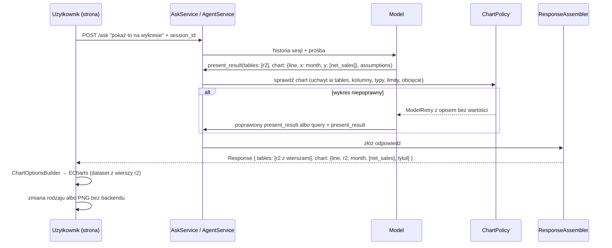

# Wykresy wybierane przez model, krok 3B - Plan

## Goal Capsule

- **Objective:** Użytkownik prosi o wykres i w tej samej odpowiedzi dostaje wykres z danych, które policzył backend. Rodzaj wykresu dobiera model i uzasadnia go w założeniach. Użytkownik może zmienić rodzaj albo pobrać obraz bez kolejnej tury.
- **Means:** Model wskazuje w `present_result` uchwyt, kolumny i jeden z pięciu rodzajów wykresu. Backend to sprawdza, a strona rysuje wykres z tabeli tej samej odpowiedzi przez ECharts (KTD2, KTD5).
- **Product authority:** Właściciel projektu. Projekt rozstrzyga [`docs/architecture/003-interfejs-uzytkownika.md`](../architecture/003-interfejs-uzytkownika.md), sekcja 7. Przy sprzeczności R rozstrzyga zachowanie, a KTD mechanizm.
- **Execution profile:** Jeden PR z gałęzi `feat/charts` (od `main` po #25). Implementacja skillem `ce-work`. Język i standardy według `CLAUDE.md`, a frontend według `docs/standards/typescript-react.md`.
- **Stop conditions:** Przerwij i zapytaj właściciela, gdy:
  - pełna ewaluacja po zmianie instrukcji wypada gorzej niż przed nią w którymkolwiek trybie, poza znaną zmiennością (`zamowienia-wg-typu-2024` padał 1 raz na 6 przebiegów),
  - domyślny dymek ECharts wstawia nazwę kategorii albo serii jako HTML,
  - przypięta wersja ECharts nie instaluje się bez wymuszania zależności,
  - limity z KTD3 odrzucają wykres w więcej niż jednym przypadku ewaluacyjnym, w którym właściciel spodziewa się wykresu.
- **Who finishes:** `ce-work` wykonuje jednostki, bramki offline, ewaluację i sprawdzenie w Chrome. Właściciel scala PR.
- **Open blockers:** Brak.

---

## Product Contract

### Summary

Odpowiedź asystenta może zawierać jeden wykres narysowany z jednej z jej tabel.
Model wybiera rodzaj z pięciu (liniowy, słupkowy, słupkowy skumulowany, kołowy, punktowy), kolumny i tytuł, a uzasadnienie wyboru zapisuje w założeniach.
Backend sprawdza wybór na schemacie i liczbie wierszy, zanim odpowiedź trafi do użytkownika.
Strona pokazuje wykres pod tabelą, pozwala przełączyć rodzaj bez modelu i pobrać wykres jako PNG.
Na koniec powstaje raport z tego kroku w `docs/reports/`.

### Problem Frame

Dziś asystent pokazuje wyniki tylko w tabelach.
Kto chce zobaczyć trend albo porównanie, przepisuje liczby do arkusza.
Właściciel chce, żeby wystarczyło powiedzieć „potrzebuję wykresu”, a model sam zaproponował i narysował odpowiedni.
Wartości liczy dalej backend, a model w trybie `none` nie widzi ani danych, ani wartości kategorii, więc wykres nie może poszerzać tego, co trafia do dostawcy modelu (architektura 002).

### Key Decisions

- **Model rysuje od razu, pyta tylko przy niejasnej prośbie** (D2 w 003). Governs R2.
- **Model wybiera z zamkniętej specyfikacji**, a nie pisze specyfikacji Vega-Lite ani opcji ECharts (003, sekcja 7.1). Governs R2, R4.
- **Jeden wykres na odpowiedź.** (session-settled: user-directed — chosen over lista wykresów od razu w kontrakcie: na początek jeden wystarczy.) Governs R1.
- **Wykres z obciętej tabeli jest odrzucany.** (session-settled: user-directed — chosen over rysowanie z ostrzeżeniem: niepełne dane na wykresie łatwo przeoczyć.) Governs R5.
- **Przycisk „pobierz PNG”.** (session-settled: user-approved — chosen over brak eksportu: wbudowany w ECharts, prawie bez kosztu.) Governs R9.
- **Pięć rodzajów wykresu.** (session-settled: user-directed — chosen over dodanie warstwowego i innych: rozszerzenie na później.) Governs R2, R8.

### Requirements

**Zachowanie modelu**

- R1. Model dołącza co najwyżej jeden wykres i tylko wtedy, gdy użytkownik o wykres prosi.
- R2. Model wybiera rodzaj z pięciu i rysuje od razu, a jednym zdaniem w `assumptions` wyjaśnia, dlaczego ten rodzaj. Pyta (`needs_clarification`) tylko, gdy prośba nie wskazuje, co narysować, np. którą z kilku miar.
- R3. Prośba o wykres danych z poprzedniej tury („pokaż to na wykresie”) korzysta z istniejącego uchwytu, bez ponownego wywołania procedury.

**Kontrola w backendzie**

- R4. Backend odrzuca wykres, którego uchwyt nie jest zwracaną tabelą, którego kolumny nie istnieją albo mają zły typ dla rodzaju, albo który przekracza limity rodzaju (KTD3). Model dostaje prośbę o poprawkę bez wartości z danych.
- R5. Backend odrzuca wykres z tabeli obciętej przez limit odpowiedzi albo przez limit procedury. Model musi najpierw zagregować dane zapytaniem.
- R6. Tytuł wykresu przechodzi te same kontrole co inne teksty: kotwice, adresy URL i znacznik instrukcji.

**Interfejs**

- R7. Strona rysuje wykres pod tabelą o tym samym uchwycie, z tytułem i legendą, gdy serii jest więcej niż jedna.
- R8. Lista „Rodzaj wykresu” pokazuje rodzaje zgodne z danymi. Zmiana rysuje wykres od nowa bez wołania modelu.
- R9. Przycisk w rogu wykresu zapisuje go jako PNG.
- R10. Dymki i osie pokazują wartości w polskim formacie siatki, a nazwy kategorii i serii wyłącznie jako tekst.
- R11. `data-concierge chat` wypisuje jedną linię o wykresie, żeby odpowiedź w terminalu nie gubiła tej informacji.

**Kontrakt, ewaluacja i dokumenty**

- R12. `Response` dostaje pole `chart`, opisane w 001, sekcja 9. Typy TypeScript powstają z OpenAPI.
- R13. Zestaw ewaluacyjny ma grupę przypadków wykresowych: oczekiwany rodzaj (albo zbiór dopuszczalnych), kolumny, brak wykresu bez prośby oraz wykres w drugiej turze bez nowej procedury.
- R14. Raport `docs/reports/2026-11-xx-wykresy.md` opisuje, co zrobiono, dlaczego i o co można to rozszerzyć.

### Success Criteria

- Pełna ewaluacja przechodzi w obu trybach, łącznie z nowymi przypadkami wykresowymi, a stare przypadki nie wypadają gorzej niż przed zmianą.
- W Chrome, na prawdziwym modelu: „sprzedaż po miesiącach za 2024”, potem „pokaż to na wykresie” daje wykres liniowy bez nowego wywołania procedury.
- Nazwa kategorii z HTML (np. ``) pokazuje się w dymku jako tekst.

### Scope Boundaries

- Wykres tylko na prośbę użytkownika. Samodzielne propozycje modelu to osobna decyzja.
- Bez własnego wyglądu ponad rozsądne ustawienia ECharts (kolory domyślne, polska lokalizacja).
- Bez zmian w siatce z #25 poza miejscem, w którym pod tabelą pojawia się wykres.

#### Deferred to Follow-Up Work

- Kilka wykresów w jednej odpowiedzi (kontrakt `charts` jako lista).
- Kolejne rodzaje: warstwowy, kombinowany słupkowo-liniowy, mapa cieplna, lejek.
- Postęp tury (krok 3C).
- Zawężenie modułów AG Grid (paczka JS, 003 sekcja 13).

Raport z R14 wymienia te rozszerzenia z uzasadnieniem.

### Sources / Research

- 003, sekcja 7: warianty wyboru wykresu, szkic `ChartRequest`, kontrole, przebieg i rysowanie.
- 002, sekcje 4.1, 6.1 i 6.2: co model widzi, kotwice i komunikaty błędów bez wartości.
- Wzorce w kodzie:
  - `AgentService._check_answer` i `_check_candidates` w `src/data_concierge/agent/service.py` (kontrola z `ModelRetry`),
  - `ResponseAssembler._candidates` i `_table` w `src/data_concierge/agent/assembler.py`,
  - `ResultService.is_truncated` w `src/data_concierge/results/service.py`,
  - `CaseChecker` i `Expectation` w `tests/evals/cases.py`.
- ECharts 6.1.0 (Apache-2.0, wydany 2026-05-19), sprawdzone w paczce npm:
  - domyślny dymek przepuszcza nazwy i wartości przez `encodeHTML` (`lib/component/tooltip/tooltipMarkup.js`),
  - własny `formatter` zwracający tekst jest wstawiany jako HTML,
  - paczka ma polską lokalizację (`i18n/langPL`) i funkcję `toolbox.feature.saveAsImage`.

---

## Planning Contract

### Key Technical Decisions

- KTD1. **Kontrakt: jedno pole `chart`.** `AgentAnswer.chart: ChartRequest | None` i `Response.chart: ResponseChart | None` z polami `kind`, `handle`, `x`, `y`, `series`, `title`. Dane wykresu strona bierze z tabeli o tym samym uchwycie, więc nic nie idzie dwa razy. (session-settled: user-directed — chosen over lista z limitem jednego: na początek jeden wykres wystarczy.) Governs R1, R12.
- KTD2. **Specyfikacja zamknięta i niezależna od biblioteki.** Model podaje tylko rodzaj z listy, nazwy kolumn i tytuł. Mapowanie na opcje ECharts robi frontend, więc inny frontend może rysować tę samą specyfikację czym innym. Opisy pól `ChartRequest` mówią modelowi, kiedy który rodzaj, bo trafiają do definicji narzędzia.
- KTD3. **Limity według rodzaju, sprawdzane przez klasę `ChartPolicy`** w nowym `src/data_concierge/agent/charts.py`:

  | Rodzaj | `x` | `y` | `series` | Limit |
  |---|---|---|---|---|
  | `line` | data, liczba albo tekst | 1+ liczbowe | opcjonalna, wtedy jedna `y` | do 1000 wierszy, do 12 serii |
  | `bar` | tekst, data albo liczba | 1+ liczbowe | opcjonalna, wtedy jedna `y` | do 50 różnych `x`, do 12 serii |
  | `stacked_bar` | jak `bar` | jak `bar` | wymagana albo 2+ `y` | jak `bar` |
  | `pie` | tekst | dokładnie 1 liczbowa | brak | do 8 wierszy |
  | `scatter` | liczba | dokładnie 1 liczbowa | opcjonalna | do 1000 wierszy, do 12 serii |

  Wykres jest dozwolony tylko przy statusie `ok`. „Liczbowe” to `int` i `decimal`. Liczbę różnych wartości liczy nowa metoda `ResultService.distinct_count`. Komunikaty podają liczby wierszy i nazwy kolumn, nigdy wartości (002, sekcja 6.2), np. „pie needs at most 8 rows, r2 has 12; aggregate the rest in query or choose bar”.
- KTD4. **Obcięta tabela nie ma wykresu.** `ChartPolicy` odrzuca uchwyt, który `ResultService.is_truncated` oznacza jako obcięty albo który ma więcej wierszy niż `max_response_rows`. (session-settled: user-directed — chosen over rysowanie z ostrzeżeniem: niepełne dane łatwo przeoczyć.) Governs R5.
- KTD5. **ECharts 6.1.0 importowany modułowo.** Import z `echarts/core` z wykresami `LineChart`, `BarChart`, `PieChart`, `ScatterChart` i komponentami `DatasetComponent`, `GridComponent`, `TooltipComponent`, `LegendComponent`, `ToolboxComponent`, renderer `CanvasRenderer` i lokalizacja `PL`. Bez nakładki `echarts-for-react`: `ChartView` sam robi `init`, `setOption`, `resize` i `dispose`. Pełny import `echarts` blokuje reguła ESLint.
- KTD6. **Tekst z danych nigdy jako HTML.** Dymek używa domyślnego formatowania ECharts z `valueFormatter`, które zwraca sformatowany tekst. ECharts sam go escapuje. Opcje nie mają `tooltip.formatter`, `label.formatter` ani `rich` z danymi. Etykiety osi rysuje canvas, więc ich formatery mogą zwracać tekst. `ChartOptionsBuilder` ma test, że wynik nie zawiera `formatter` dymka.
- KTD7. **PNG przez `toolbox.feature.saveAsImage`** z polskim podpisem i nazwą pliku z tytułu. (session-settled: user-approved — chosen over brak eksportu: wbudowany w bibliotekę.) Governs R9.
- KTD8. **Pięć rodzajów i przełącznik po stronie strony.** Klasa `ChartKinds` liczy rodzaje zgodne z danymi z tych samych reguł co KTD3, z typów kolumn i liczby wierszy tabeli. Przełącznik pokazuje tylko je. (session-settled: user-directed — chosen over więcej rodzajów: rozszerzenie na później.) Governs R8.
- KTD9. **Uzasadnienie w `assumptions`, wykres w szkicu fazy komentarza.** Instrukcje każą wyjaśnić wybór w `assumptions`, bo w trybie `minimal` faza komentarza pisze `message` od nowa. Szkic przekazywany fazie komentarza zawiera `chart`, żeby komentarz nie przeczył wykresowi.
- KTD10. **Wykres pod tabelą swojego uchwytu.** `AnswerView` rysuje `ChartView` zaraz po `ResultGrid` tej tabeli. Tytuł to nagłówek w JSX, nie `title` ECharts, więc jest zwykłym tekstem i ma ten sam styl co tytuły tabel.
- KTD11. **Liczby wykresu to `Number(value)` z tekstu kwoty.** Precyzja nie ma znaczenia dla rysunku. Dymek pokazuje oryginalny tekst sformatowany przez `ValueFormatter`, jak w siatce.
- KTD12. **Ewaluacja wykresów.**
  - `Expectation` dostaje regułę `chart` (dopuszczalne rodzaje, `x`, zbiór `y`, opcjonalnie `series`) albo `chart: none` dla przypadku bez prośby.
  - Dla tury z prośbą o wykres istniejących danych reguła mówi, że w ostatniej turze nie było wywołań procedur.
  - Wynik wykresu jest liczony jak inne kontrole i pokazany w raporcie przebiegu.

### High-Level Technical Design

### System-Wide Impact

- **Kontrakt HTTP:** nowe pole opcjonalne w `Response`. Starzy klienci go nie czytają. Strona dostaje typy z OpenAPI.
- **Instrukcje i definicja narzędzia `present_result`:** dłuższe, więc zmienia się prefiks cache i rozmiar definicji narzędzi (pomiar z #17). Pełna ewaluacja w obu trybach jest warunkiem PR.
- **Audyt:** `present_result` z wykresem trafia do zdarzenia `model_response` bez zmian w logu. `audit` wypisuje wykres z odpowiedzi w zdarzeniu `response`.
- **Rozmiar paczki JS:** ECharts modułowo dodaje kilkaset KB. Wynik pomiaru trafia do raportu.

### Risks & Dependencies

- **Zmiana instrukcji przesuwa zachowanie modelu w innych przypadkach.** Tak było przy #24. Pełna ewaluacja przed i po, a reguły o wykresach tylko tam, gdzie użytkownik prosi o wykres.
- **Model w trybie `none` nie zna liczby kategorii.** Może zaproponować `pie` dla 12 wierszy. KTD3 odsyła go z komunikatem, a model może zagregować dane. Liczba ponowień trafi do raportu ewaluacji.
- **ECharts w jsdom:** canvas nie istnieje. `ChartView` dostaje fabrykę wykresu w propsach, więc testy podstawiają atrapę, a rysowanie sprawdza Playwright.
- **Reguły zgodności w dwóch miejscach:** limity KTD3 są w Pythonie (`ChartPolicy`) i w TypeScripcie (`ChartKinds`). Rozjazd jest nieszkodliwy, bo przełącznik rysuje tylko po stronie strony, ale testy obu stron używają tych samych progów z KTD3.
- **Pobieranie PNG pod CSP:** `saveAsImage` robi link `data:` z atrybutem `download`. Trzeba sprawdzić w Chrome, że CSP strony go nie blokuje.

---

## Implementation Units

### U1. Kontrakt wykresu w modelu odpowiedzi

**Goal:** `AgentAnswer` i `Response` niosą jeden wykres, a złożona odpowiedź ma tytuł z wypełnionymi kotwicami.

**Requirements:** R1, R6, R12. KTD1, KTD2, KTD9.

**Dependencies:** brak.

**Files:**
- `src/data_concierge/agent/models.py`
- `src/data_concierge/api/schemas.py`
- `src/data_concierge/agent/assembler.py`
- `src/data_concierge/agent/comment.py`
- `tests/agent/test_models.py`
- `tests/agent/test_assembler.py`
- `tests/agent/test_comment.py`

**Approach:**
1. `ChartKind` jako `Literal` z pięcioma rodzajami. `ChartRequest` z opisami pól dla modelu: kiedy który rodzaj, `y` liczbowe, `series` w formacie długim, tytuł po polsku z kotwicami.
2. `AgentAnswer.chart` opcjonalne. `AgentAnswer.texts` dołącza tytuł wykresu.
3. `ResponseChart` w `api/schemas.py`. `ResponseAssembler` wypełnia kotwice tytułu, a kolumny podaje w pisowni ze schematu uchwytu.
4. `CommentService._exchange` dołącza `chart` do szkicu.

**Patterns to follow:** `ClarificationRequest` i `CandidatesFrom` w `agent/models.py`. `_table` w `assembler.py`.

**Test scenarios:**
- Odpowiedź z wykresem `line` na `r2` daje w `Response.chart` rodzaj, uchwyt, kolumny i tytuł z wypełnioną kotwicą.
- `AgentAnswer.texts` zawiera tytuł wykresu.
- Odpowiedź bez wykresu ma `chart: null`.
- Kolumna podana inną wielkością liter („NET_SALES”) wraca w pisowni schematu.
- Szkic dla fazy komentarza zawiera `chart`.

**Verification:** `uv run pytest tests/agent` przechodzi, a schemat OpenAPI ma pole `chart`.

### U2. Kontrola wykresu w backendzie

**Goal:** Niepoprawny wykres wraca do modelu jako prośba o poprawkę, zanim odpowiedź trafi do użytkownika.

**Requirements:** R4, R5. KTD3, KTD4.

**Dependencies:** U1.

**Files:**
- `src/data_concierge/agent/charts.py` (nowy, klasa `ChartPolicy`)
- `src/data_concierge/agent/service.py`
- `src/data_concierge/results/service.py`
- `src/data_concierge/results/repository.py`
- `tests/agent/test_charts.py` (nowy)
- `tests/agent/test_service.py`
- `tests/results/test_service.py`

**Approach:**
1. `ResultService.distinct_count(handle, column)` liczy różne wartości w DuckDB. Repozytorium dostaje odpowiadające zapytanie z cytowaną nazwą kolumny.
2. `ChartPolicy.problems(answer, results, max_rows)` zwraca listę opisów według KTD3 i KTD4, w stylu `Anchors.problems`.
3. `AgentService._check_answer` woła `ChartPolicy` po kontroli uchwytów i rzuca `ModelRetry` z połączonymi opisami.

**Execution note:** Najpierw testy `ChartPolicy` na uchwytach z DuckDB (jak `tests/agent/test_anchors.py`), potem podpięcie w serwisie.

**Patterns to follow:** `_check_candidates` w `agent/service.py`. `Anchors.problems` w `agent/anchors.py`. Fixture z `QueryService` w `tests/agent/test_anchors.py`.

**Test scenarios:**
- `line` z `x: month` (data) i `y: [net_sales]` (decimal) na 12 wierszach przechodzi.
- Uchwyt istnieje, ale nie ma go w `tables` odpowiedzi: problem z nazwą uchwytu.
- Wykres przy statusie `needs_clarification` albo `no_data`: problem „chart only with status ok”.
- Brak kolumny `y`: problem z listą kolumn uchwytu.
- `y` tekstowe: problem „must be numeric”.
- `pie` na 12 wierszach: problem z liczbą wierszy i podpowiedzią agregacji.
- `pie` z dwiema `y` albo z `series`: problem.
- `bar` z 60 różnymi `x`: problem z liczbą kategorii.
- `series` z 13 wartościami: problem z liczbą serii.
- `series` razem z dwiema `y`: problem.
- `stacked_bar` z jedną `y` i bez `series`: problem.
- `scatter` z `x` tekstowym: problem.
- Uchwyt z obciętej procedury: problem „truncated, aggregate first”.
- Uchwyt dłuższy niż `max_response_rows`: problem.
- Żaden komunikat nie zawiera wartości z danych. Sprawdza to test z kategorią o rozpoznawalnej nazwie.
- W serwisie odpowiedź z błędnym wykresem kończy się `ModelRetry`, a poprawiona przechodzi.
- `distinct_count` liczy wartości z `NULL` jako jedną kategorię i działa dla nazwy kolumny ze spacją.

**Verification:** testy z `tests/agent/test_charts.py` i `tests/results/test_service.py` przechodzą, a ruff i mypy są czyste.

### U3. Instrukcje dla modelu i ewaluacja wykresów

**Goal:** Model rysuje na prośbę, wybiera sensowny rodzaj i uzasadnia go, a ewaluacja to mierzy.

**Requirements:** R1, R2, R3, R13. KTD9, KTD12.

**Dependencies:** U1, U2.

**Files:**
- `src/data_concierge/agent/prompts.py`
- `tests/evals/cases.py`
- `tests/evals/test_cases.py`
- `tests/evals/report.py`
- `evals/cases.yaml`
- `tests/evals/test_case_file.py`
- `tests/evals/test_checks.py`
- `tests/agent/test_request_shape.py`

**Approach:**
1. W `RULES` krótki blok o wykresach:
   - tylko na prośbę użytkownika,
   - wybór rodzaju według danych (czas → `line`, kategorie → `bar`, udział do 8 części → `pie`, podział w czasie → `stacked_bar`, dwie miary → `scatter`),
   - uzasadnienie w jednym zdaniu w `assumptions`,
   - wykres istniejących danych z poprzedniej tury bez nowej procedury,
   - zbyt wiele kategorii albo obcięta tabela: najpierw `query` z agregacją.
2. Reguły komentarza (`_COMMENT_RULES`) dostają jedno zdanie: nie opisuj innego wykresu niż ten w szkicu.
3. `Expectation.chart` i sprawdzenie w `CaseChecker` według KTD12, z kolumną w raporcie przebiegu.
4. Nowe przypadki w grupie „wykresy”, co najmniej:
   - sprzedaż po miesiącach na wykresie (`line`),
   - sprzedaż po kategoriach (`bar` albo `pie`),
   - udział kategorii w 2024 (`pie` albo `bar`),
   - miesiące i kategorie (`stacked_bar` albo `line` z serią),
   - raport, potem „pokaż to na wykresie” (`line`, bez nowej procedury),
   - prośba o wykres listy 14 244 zamówień (agregacja, potem wykres),
   - zwykły raport bez prośby (`chart: none`).

**Execution note:** Pełną ewaluację w obu trybach uruchom przed zmianą instrukcji i po niej, a wyniki zapisz do raportu z U7.

**Patterns to follow:** `assumptions` i `candidates` w `Expectation`. Przypadki z `followups` w `evals/cases.yaml`.

**Test scenarios:**
- `CaseChecker` uznaje wykres `bar`, gdy dopuszczalne są `bar` i `pie`, a kolumny się zgadzają.
- Inny rodzaj albo inne `y` daje porażkę kontroli.
- `chart: none` zalicza odpowiedź bez wykresu i nie zalicza odpowiedzi z wykresem.
- Reguła „bez procedur w ostatniej turze” zalicza przypadek, w którym procedury były tylko w pierwszej turze.
- Plik przypadków przechodzi walidację z nowymi polami.
- Instrukcje zawierają blok o wykresach w obu trybach i dalej są takie same przy każdym wywołaniu.

**Verification:** testy jednostkowe ewaluacji przechodzą, a pełna ewaluacja w trybach `none` i `minimal` spełnia Success Criteria.

### U4. Typy frontu, zgodne rodzaje i opcje ECharts

**Goal:** Strona zamienia specyfikację wykresu i tabelę na opcje ECharts oraz wie, na które rodzaje można przełączyć.

**Requirements:** R8, R10, R12. KTD2, KTD6, KTD7, KTD8, KTD11.

**Dependencies:** U1.

**Files:**
- `frontend/package.json`
- `frontend/package-lock.json`
- `frontend/src/api/schema.d.ts` (generowany)
- `frontend/src/api/ApiClient.ts`
- `frontend/src/chart/ChartKinds.ts` (nowy)
- `frontend/src/chart/ChartOptionsBuilder.ts` (nowy)
- `frontend/src/chart/ChartKinds.test.ts` (nowy)
- `frontend/src/chart/ChartOptionsBuilder.test.ts` (nowy)
- `frontend/eslint.config.js`

**Approach:**
1. `npm install --save-exact echarts@6.1.0`, `npm run api:types`, eksport typu `ResponseChart` z `ApiClient.ts`.
2. `ChartKinds.compatible(table, chart)` zwraca rodzaje, które przeszłyby reguły KTD3 dla tej tabeli. Liczy różne wartości po stronie strony, bo ma wiersze.
3. `ChartOptionsBuilder.build(chart, table, kind)` z jedną metodą prywatną na rodzaj:
   - `dataset` z wierszy, a liczby przez `Number`,
   - `series` z `encode`,
   - format długi rozkłada się na serie według wartości kolumny `series`,
   - dymek z `valueFormatter` przez `ValueFormatter`,
   - etykiety osi liczbowej w polskim formacie,
   - `toolbox.feature.saveAsImage` z podpisem „Zapisz jako PNG”.
4. Reguła ESLint `no-restricted-imports` dla `echarts` (dozwolone `echarts/core`, `echarts/charts`, `echarts/components`, `echarts/renderers`, `echarts/i18n/langPL`).

**Patterns to follow:** `GridColumns` (klasa z formatterem w konstruktorze) i `ValueFormatter`.

**Test scenarios:**
- `line` z `x: month` i `y: [net_sales]` daje jedną serię liniową, `dataset` z 12 wierszami i liczbami jako `number`.
- Dwie kolumny `y` dają dwie serie i legendę.
- `series: category` w formacie długim daje po jednej serii na kategorię.
- `stacked_bar` ustawia wspólny `stack` dla serii.
- `pie` daje jedną serię kołową z nazwami z `x`.
- `scatter` daje oś liczbową `x`.
- Dymek ma `valueFormatter`, który formatuje `"12345.50"` jako „12 345,50”, i nie ma `formatter`.
- Opcje zawierają `saveAsImage` z polskim podpisem.
- `ChartKinds` dla 12 miesięcy i jednej miary zwraca `line`, `bar` i `scatter`, ale nie `pie`.
- `ChartKinds` dla 5 kategorii zwraca `bar` i `pie`.
- `ChartKinds` dla obciętej tabeli zwraca pustą listę.

**Verification:** `npm run lint`, `npm run typecheck`, `npm run test` i `npm run api:check` przechodzą.

### U5. Wykres w odpowiedzi na stronie

**Goal:** Wykres pojawia się pod swoją tabelą, przełącza rodzaj bez backendu i daje się pobrać.

**Requirements:** R7, R8, R9, R10. KTD5, KTD10.

**Dependencies:** U4.

**Files:**
- `frontend/src/chart/ChartView.tsx` (nowy)
- `frontend/src/chart/EChartsHost.ts` (nowy: rejestracja modułów, lokalizacja i fabryka wykresu)
- `frontend/src/chart/ChartView.test.tsx` (nowy)
- `frontend/src/chat/AnswerView.tsx`
- `frontend/src/chat/ChatView.test.tsx`
- `frontend/src/App.css`

**Approach:**
1. `EChartsHost` rejestruje moduły z KTD5 i lokalizację `PL`, a fabrykę wykresu przekazuje komponentom.
2. `ChartView` dostaje specyfikację, tabelę i fabrykę. Robi `init` na `div`, `setOption` z `ChartOptionsBuilder`, `resize` przez `ResizeObserver` i `dispose` przy odmontowaniu.
3. Nagłówek z tytułem i lista „Rodzaj wykresu” z rodzajami z `ChartKinds`. Lista jest ukryta, gdy zgodny jest tylko jeden rodzaj.
4. `AnswerView` rysuje `ChartView` zaraz po `ResultGrid` tabeli o uchwycie wykresu.

**Patterns to follow:** `ResultGrid` (sekcja z tytułem i stylami w `App.css`) i wstrzykiwanie zależności przez propsy (`ChatView` z klientem).

**Test scenarios:**
- Odpowiedź z wykresem na `r2` pokazuje tytuł wykresu po tabeli `r2`. Fabryka dostaje opcje typu `line`.
- Zmiana rodzaju na „Słupkowy” wywołuje `setOption` z serią słupkową bez wywołania klienta API.
- Lista rodzajów nie pokazuje `pie` dla 12 wierszy.
- Tytuł z HTML pokazuje się jako tekst.
- Odmontowanie odpowiedzi woła `dispose`.
- Odpowiedź bez wykresu nie tworzy wykresu.

**Verification:** testy Vitest i build przechodzą. W Chrome z podstawioną odpowiedzią wykres każdego rodzaju jest widoczny, przełącznik działa, PNG się pobiera, a w konsoli nie ma błędów CSP.

### U6. Wykres w terminalu i w audycie

**Goal:** Odpowiedź z wykresem w `data-concierge chat` i w `audit` mówi, jaki wykres dostał użytkownik.

**Requirements:** R11.

**Dependencies:** U1.

**Files:**
- `src/data_concierge/api/cli.py`
- `tests/api/test_cli.py`

**Approach:** `ConversationPrinter` po tabelach wypisuje linię w rodzaju „Wykres (liniowy): Sprzedaż netto po miesiącach, month → net_sales”. Wypis zdarzenia `response` w `audit` dodaje tę samą linię.

**Patterns to follow:** wypis założeń i pytania w `ConversationPrinter`.

**Test scenarios:**
- Odpowiedź z wykresem `bar` i dwiema `y` wypisuje jedną linię z polską nazwą rodzaju i kolumnami.
- Odpowiedź bez wykresu nie ma tej linii.
- `audit` dla tury z wykresem pokazuje linię wykresu w zdarzeniu `response`.

**Verification:** `uv run pytest tests/api` przechodzi.

### U7. Dokumenty, sprawdzenie w przeglądarce i raport

**Goal:** Projekt, kontrakt i instrukcja uruchomienia opisują wykresy, sprawdzenie w Chrome przechodzi, a raport podsumowuje krok 3B.

**Requirements:** R12, R14 i Success Criteria.

**Dependencies:** U1–U6.

**Files:**
- `docs/architecture/001-architektura-data-concierge.md` (sekcja 9 i wersja)
- `docs/architecture/003-interfejs-uzytkownika.md` (status, sekcja 7 według wdrożenia, nowa sekcja uzupełnień 3B)
- `docs/architecture/002-dostep-modelu-do-danych.md` (jedno zdanie: wykres nie poszerza dostępu, sekcja 4.1)
- `README.md` (odpowiedź z `chart`, przykład promptu)
- `docs/reports/2026-11-xx-wykresy.md` (nowy)

**Approach:**
1. Dokumenty według wdrożenia, z odejściami od szkicu 003 zapisanymi w sekcji uzupełnień.
2. Sprawdzenie w Chrome przez Playwright:
   - z podstawionym `/ask`: każdy rodzaj, przełącznik, PNG, kategoria z HTML w dymku i brak błędów w konsoli,
   - na prawdziwym modelu: raport, potem „pokaż to na wykresie”, wykres od razu i odrzucenie wykresu z listy 14 244 zamówień.
3. Raport w stylu `docs/reports/2026-11-04-log-audytowy.md`:
   - co zrobiono,
   - dlaczego tak (decyzje z ich alternatywami),
   - wyniki ewaluacji przed i po,
   - rozmiar paczki,
   - zrzuty ekranu w repozytorium tylko wtedy, gdy raport ich potrzebuje,
   - rozszerzenia z Deferred to Follow-Up Work z uzasadnieniem i kosztem.

**Test expectation:** none -- dokumenty i sprawdzenie ręczne. Wynik sprawdzenia w Chrome jest w opisie PR.

**Verification:** raport i dokumenty po polsku, linki działają, a lista sprawdzeń z punktu 2 jest odhaczona w opisie PR.

---

## Verification Contract

| Bramka | Polecenie |
|---|---|
| Backend | `uv run ruff format --check`, `uv run ruff check`, `uv run mypy`, `uv run pytest` |
| Frontend | w `frontend/`: `npm ci`, `npm run lint`, `npm run format:check`, `npm run typecheck`, `npm run test`, `npm run build`, `npm run api:check` |
| Zależności | `npm audit --omit=dev` bez nowych podatności |
| Ewaluacja | `$env:DC_MODEL_DATA_ACCESS="none"; uv run pytest -m eval tests/evals` i to samo dla `minimal`, przed zmianą instrukcji i po niej |
| Przeglądarka | skrypt Playwright w Chrome z podstawionym `/ask` oraz przebieg na prawdziwym modelu (U7) |

## Definition of Done

- Wszystkie bramki z Verification Contract przechodzą na końcowym stanie gałęzi.
- Nowe przypadki wykresowe przechodzą w obu trybach, a stare nie wypadają gorzej niż przed zmianą.
- Sprawdzenie w Chrome z U7 zrobione, a jego wynik jest w opisie PR.
- Raport `docs/reports/2026-11-xx-wykresy.md` i aktualizacje 001, 002 i 003 są w PR.
- W diffie nie ma kodu porzuconych prób ani tymczasowych logów.
- Przegląd kodu (`ce-code-review`) ukończony, a znaleziska naprawione albo wypisane w PR.
