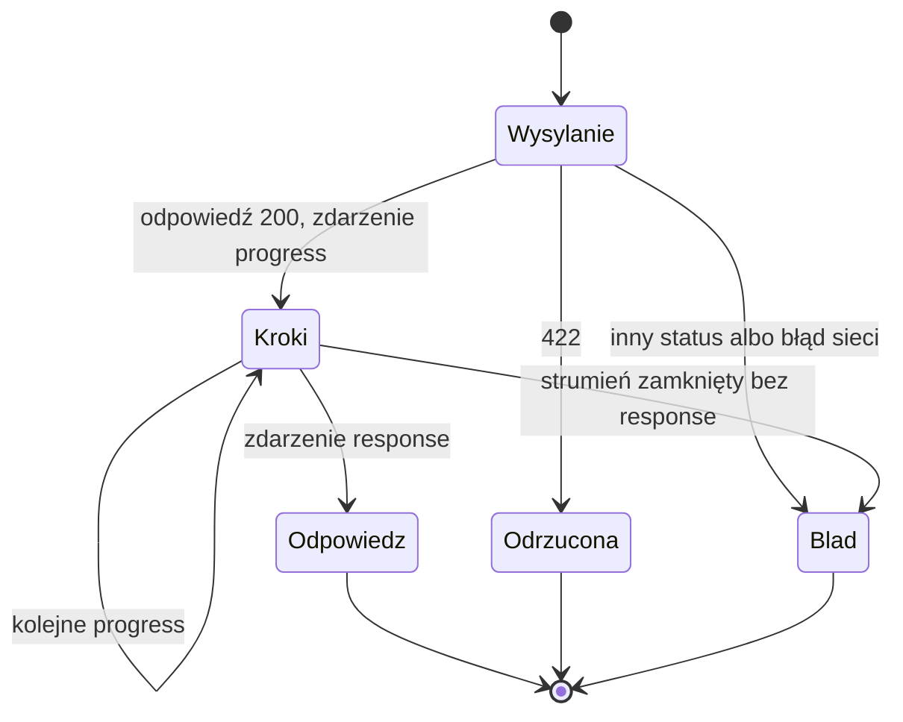

# Postęp tury w trakcie czekania, krok 3C - Plan

## Goal Capsule

- **Objective:** Kto czeka na odpowiedź asystenta, widzi na bieżąco, co się dzieje: sprawdzanie prośby, pobieranie danych z nazwą procedury, liczenie zestawienia, pisanie komentarza. Nie zgaduje, czy tura stoi. Odpowiedź na końcu jest taka sama jak dziś.
- **Means:** Strumieniowy endpoint `POST /ask/stream` z własnymi zdarzeniami SSE (KTD1, KTD2). Zdarzenia postępu buduje backend z haków agenta i z `AskService` (KTD4, KTD5), a strona czyta je zwykłym `fetch` (KTD8).
- **Product authority:** Właściciel projektu. Projekt opisuje [`docs/architecture/003-interfejs-uzytkownika.md`](../architecture/003-interfejs-uzytkownika.md), sekcja 8 (D3). Przy sprzeczności R rozstrzyga zachowanie, a KTD mechanizm.
- **Execution profile:** Jeden PR z nowej gałęzi `feat/turn-progress` od `main` po #26 (9618b56). Implementacja skillem `ce-work`. Język i standardy według `CLAUDE.md`, a frontend według `docs/standards/typescript-react.md`.
- **Stop conditions:** Przerwij i zapytaj właściciela, gdy:
  - haki Pydantic AI 2.55 (`before_tool_execute`, `before_model_request`) nie dają zdarzenia przed wykonaniem narzędzia albo przed rundą poprawki, przez co trzeba by zmienić agenta poza dodaniem capability,
  - FastAPI 0.143 nie wpuszcza modeli zdarzeń do OpenAPI tak, żeby `npm run api:types` je wygenerował, i jedyną drogą jest ręczny typ w TypeScript,
  - Vite dev proxy albo przeglądarka buforują strumień tak, że kroki przychodzą dopiero z odpowiedzią.
- **Who finishes:** `ce-work` wykonuje jednostki, bramki offline i sprawdzenie w Chrome. Właściciel scala PR.
- **Open blockers:** Brak.

---

## Product Contract

### Summary

Strona wysyła prośbę do nowego endpointu strumieniowego i od razu dostaje kolejne kroki tury jako krótkie polskie teksty, a na końcu pełną odpowiedź.
Kroki pokazują się pod prośbą jako lista z bieżącym krokiem na dole, obok licznika sekund.
Teksty pisze backend z nazw narzędzi i katalogu, nigdy model, i nie zawierają parametrów wywołań.
`data-concierge chat` wypisuje te same kroki w terminalu.
`POST /ask` zostaje bez zmian.

### Problem Frame

Tura trwa zwykle 5–10 s, a najwolniejsza w ewaluacji trwała 31,5 s (`docs/ideation/2026-10-28-szybsza-tura.md`).
Strona pokazuje dziś tylko „Czekam na odpowiedź… N s”, więc użytkownik nie wie, czy asystent pobiera dane, liczy, czy utknął.
Streaming tekstu modelu nic tu nie da: argumenty `present_result` przychodzą jednym kawałkiem około sekundy przed końcem tury (003, sekcja 8).
Informację niesie to, co robi backend: strażnik, kolejne rundy modelu, wywołania procedur i zapytań, faza komentarza.

### Key Decisions

- **Postęp tury, a nie streaming tekstu modelu** (D3 w 003). Governs R1, R2.
- **Historia rozmowy zostaje w sesji backendu**, a klient wysyła tylko nową prośbę i `session_id` (D3 w 003). Governs R6.
- **Krok z procedurą to jej opis z katalogu i nazwa techniczna, bez parametrów.** (session-settled: user-approved — chosen over pokazywanie parametrów wywołania: parametry wybiera model i mogą zawierać dane z prośby.) Governs R3.
- **Poprawka odpowiedzi to neutralny krok bez powodu.** (session-settled: user-approved — chosen over pokazywanie powodu odrzucenia: powód bywa techniczny i nic nie mówi użytkownikowi.) Governs R4.
- **Postęp także w terminalu.** (session-settled: user-approved — chosen over tylko przeglądarka: to samo źródło zdarzeń, prawie bez kosztu.) Governs R9.
- **Bez przycisku „Przerwij”.** (session-settled: user-approved — chosen over przerywanie tury: dotyka sesji i historii, więc to osobna decyzja.) Governs R7.

### Requirements

**Kroki tury**

- R1. W trakcie tury użytkownik dostaje kroki w kolejności, w jakiej backend je zaczyna: sprawdzanie prośby, każda runda modelu, każde wywołanie procedury, `query` i `describe_result`, poprawka odpowiedzi, faza komentarza.
- R2. Każdy krok to stały polski tekst z backendu albo opis z katalogu. Nie zawiera tekstu modelu, argumentów narzędzi ani wartości z danych.
- R3. Krok procedury pokazuje jej opis z katalogu i nazwę techniczną, np. „Pobieram zamówienia sprzedaży (api.SalesOrder_List)…”. Procedura bez opisu dostaje tekst zastępczy z samą nazwą techniczną.
- R4. Gdy backend odsyła modelowi odpowiedź do poprawki, krok brzmi „Poprawiam odpowiedź…”, bez powodu.

**Odpowiedź i spójność**

- R5. Strumień kończy się tą samą odpowiedzią (`Response`), jaką dla tej tury dałby `POST /ask`. Prośba za długa dostaje 422 z tym samym komunikatem, zanim strumień się zacznie.
- R6. Tura dokończona po rozłączeniu przeglądarki zapisuje sesję i log audytowy tak samo jak tura bez rozłączenia.
- R7. `POST /ask`, `data-concierge ask`, wyjście JSON i ewaluacja działają jak dotąd.

**Interfejs**

- R8. Strona pokazuje kroki bieżącej tury pod prośbą, ostatni jako bieżący, razem z licznikiem sekund. Kolejne takie same kroki (np. cztery równoległe wywołania tej samej procedury) łączy w jeden. Po odpowiedzi lista znika.
- R9. `data-concierge chat` wypisuje kroki w trakcie tury, każdy w osobnej linii przed odpowiedzią.
- R10. Strona pokazuje kroki wyłącznie jako tekst.

**Kontrakt i dokumenty**

- R11. Endpoint i zdarzenia są opisane w 001 (sekcje 8 i 9) oraz w 003 (sekcja 8). Typy zdarzeń dla TypeScript powstają z OpenAPI.

### Success Criteria

- Na prawdziwym modelu, przy prośbie „raport sprzedaży po miesiącach za 2024”, pierwszy krok pojawia się na stronie w czasie poniżej sekundy od wysłania, a kolejne kroki pojawiają się w trakcie tury, a nie dopiero razem z odpowiedzią.

### Scope Boundaries

- Streaming tekstu modelu, myślenia i argumentów `present_result`.
- Przyspieszanie tury, w tym pomiar wpływu myślenia na czas tury. (session-settled: user-approved — chosen over pomiar przed 3C: nie zmienia niczego w postępie; zostaje w `szybsza-tura`.)
- Przerywanie tury i wznawianie strumienia po przeładowaniu strony.
- Zmiany w `Response`, w promptach i w zestawie ewaluacyjnym.
- Nowe zdarzenia w logu audytowym. Kroki postępu są widokiem tych samych kroków, które audyt już zapisuje.
- Rozważone i niezbudowane: zapis rozłączenia klienta w audycie. Tura i tak kończy się zdarzeniem `response` (R6), a rozłączenie nie zmienia jej wyniku. Wróci, gdyby rozłączenia zaczęły coś psuć.
- Rozważone i niezbudowane: tryb zapasowy strony na `POST /ask`, gdy strumień nie działa. Strona i backend pochodzą z jednego buildu i jednego origin, więc nie ma starszego backendu bez strumienia.

#### Deferred to Follow-Up Work

- Raport w `docs/reports/` o kroku 3C, jeśli właściciel go zechce (dla 3B powstał na prośbę).

### Sources / Research

- `src/data_concierge/agent/audit.py`: `AuditCapability`, wzór capability, która tylko obserwuje turę.
- `src/data_concierge/agent/tools.py`: `retry_on_domain_error` zapisuje `tool_executed` dopiero po wykonaniu narzędzia, więc nie nadaje się na źródło kroku „zaczynam” (KTD4).
- Pydantic AI 2.55 `AbstractCapability`: `before_model_request` i `before_tool_execute(call, tool_def, args)`. Narzędzia wyjściowe nie przechodzą przez haki narzędzi (`tool_manager.py`, `_run_execute_hooks`). `on_output_validate_error` działa tylko przy błędzie schematu, a `ModelRetry` z `output_validator` idzie ścieżką `run_output_process_hooks` z pominięciem haków błędu (`_output.py`), co prowadzi do KTD6.
- FastAPI 0.143 `fastapi.sse`: `EventSourceResponse`, `ServerSentEvent`, keepalive co 15 s, działa z `POST`. Generator zdarzeń biegnie w grupie zadań anulowanej po zakończeniu odpowiedzi, także przy rozłączeniu klienta (`fastapi/routing.py`, `_sse_producer_cm`), co prowadzi do KTD3.
- `src/data_concierge/audit/service.py`: `TurnAudit` nigdy nie przerywa tury, wzór dla KTD7.
- `frontend/vite.config.ts`: proxy `"/ask"` obejmuje też `/ask/stream`.
- `docs/ideation/2026-10-28-szybsza-tura.md`: czasy tur i wzorce rund (P → Q → A w 19 z 39 tur).

---

## Planning Contract

### Key Technical Decisions

- KTD1. **Własne zdarzenia SSE: `progress` i `response`.** (session-settled: user-approved — chosen over format AG-UI albo Vercel AI: oba zakładają historię po stronie klienta i strumień tekstu modelu, a `Response` trzeba by upchnąć w zdarzeniu niestandardowym.) `progress` niesie rodzaj kroku i tekst, a `response` pełny `Response` i kończy strumień. Governs R1, R5.
- KTD2. **`POST /ask/stream` na wbudowanym SSE FastAPI.** `EventSourceResponse` z FastAPI 0.143, bez nowej zależności, z keepalive co 15 s. Walidacja ciała i długości prośby działa jako zależność FastAPI przed startem strumienia, więc 422 przychodzi jako zwykła odpowiedź HTTP. Wyjątek rzucony w generatorze przychodzi już po nagłówkach 200. Governs R5.
- KTD3. **Tura biegnie w osobnym zadaniu asyncio, nie w generatorze strumienia.** Przy rozłączeniu klienta FastAPI anuluje generator, więc tura w nim urwałaby się bez zapisu sesji i audytu. Generator tylko czyta kolejkę zdarzeń. Usługa strumienia trzyma referencje do trwających zadań, żeby nie zebrał ich garbage collector, i loguje wyjątek zadania. Governs R6.
- KTD4. **Źródło kroków: `TurnProgress` na turę i `ProgressCapability` w agencie.** `AskService.ask` dostaje opcjonalnego słuchacza (`ProgressListener`, `typing.Protocol`). Z niego powstaje `TurnProgress` tury, który trafia do `AgentDeps` obok `TurnAudit`. `AskService` zgłasza strażnika i fazę komentarza. Nowa capability zgłasza rundy modelu i poprawki (`before_model_request`) oraz narzędzia przed wykonaniem (`before_tool_execute`). Kroki nie pochodzą ze zdarzeń audytu, bo `tool_executed` powstaje po narzędziu, a krok ma się pojawić, zanim procedura ruszy. Governs R1, R4.
- KTD5. **Zamknięty zbiór kroków i tekstów.** Rodzaje: `guard`, `model`, `procedure`, `query`, `describe`, `retry`, `comment`. Teksty to stałe w backendzie, a dla procedury opcjonalne pole katalogu `progress` (np. „Pobieram zamówienia sprzedaży”) z nazwą techniczną w nawiasie. Pierwsza runda modelu to „Analizuję prośbę…”, kolejne „Analizuję wyniki…”. Capability dostaje gotowe teksty procedur od korzenia kompozycji (`bootstrap.py`), więc nie czyta argumentów wywołania. Governs R2, R3 (Key Decision o kroku procedury).
- KTD6. **Poprawkę rozpoznaje `before_model_request` po `RetryPromptPart` dla `present_result` w ostatnim żądaniu.** Taka runda daje „Poprawiam odpowiedź…” zamiast „Analizuję wyniki…” (Key Decision o poprawce). Obejmuje to błąd schematu i odrzucenie przez `_check_answer` (kotwice, wykres, kandydaci). Hak `on_output_validate_error` nie wystarcza, bo nie widzi `ModelRetry` z `output_validator`. Ten sam odczyt ostatniego żądania robi już `AuditCapability`. Błąd SQL albo parametrów w narzędziu nie dostaje osobnego kroku: następna runda pokaże „Analizuję wyniki…”. Governs R4.
- KTD7. **Słuchacz nigdy nie psuje tury.** `TurnProgress` łapie i loguje wyjątek słuchacza z identyfikatorem korelacji, tak jak `TurnAudit`. Bez słuchacza (`/ask`, CLI `ask`, ewaluacja) działa wersja pusta. Governs R7.
- KTD8. **Modele zdarzeń w OpenAPI, a na stronie własny parser SSE.** `ProgressEvent` jest modelem Pydantic opisanym w schemacie endpointu, więc `npm run api:types` daje jego typ. `EventSource` nie wysyła `POST`, a paczka SSE dla jednego formatu to zbędna zależność. Strona czyta więc ciało przez `ReadableStream` i małą klasę `SseParser`: podział na zdarzenia po pustej linii, wiele linii `data`, komentarze keepalive pomijane, `\r\n`. Governs R8, R11.
- KTD9. **Jedna metoda klienta strony na turę.** `ApiClient.ask` woła `/ask/stream` i przyjmuje funkcję na kroki. `TurnResult` zostaje bez zmian. Strumień zamknięty bez zdarzenia `response` to `failed` z dotychczasowym komunikatem. `useConversation` trzyma kroki bieżącej tury i czyści je po końcu. Governs R8.
- KTD10. **Terminal: kroki tylko w rozmowie.** `ConversationPrinter` wypisuje kroki w trybie interaktywnym i nieinteraktywnym rozmowy. `JsonPrinter` i jednorazowe `ask` zostają bez kroków, żeby wyjście dla skryptów się nie zmieniło. Governs R7, R9 (Key Decision o terminalu).

### High-Level Technical Design

```mermaid
sequenceDiagram
  participant P as Strona (ApiClient)
  participant C as POST /ask/stream
  participant S as TurnStream
  participant A as AskService
  participant G as Agent + ProgressCapability
  P->>C: prompt, user_id, session_id
  C->>C: walidacja i długość prośby (422 przed strumieniem)
  C->>S: start(request)
  S->>A: ask(..., listener) w osobnym zadaniu
  A-->>S: progress guard
  S-->>P: event progress
  A->>G: run
  G-->>S: progress model / procedure / query / retry
  S-->>P: event progress (kolejne)
  A-->>S: progress comment (tryb minimal)
  A-->>S: Response
  S-->>P: event response, koniec strumienia
  Note over P,S: rozłączenie przerywa tylko generator; zadanie z AskService kończy turę, zapisuje sesję i audyt
```

Strona przechodzi przez te stany tury:



### System-Wide Impact

- **Agent:** nowa capability obok `AuditCapability`. Tylko obserwuje, więc instrukcje, narzędzia i początek rozmowy (KTD11 z planu v1) się nie zmieniają.
- **Katalog:** nowe opcjonalne pole `progress`, wypełnione dla każdej wystawionej procedury w `catalog/agent-procedures.yaml`. Startowa walidacja z bazą go nie dotyczy.
- **Serwer:** strumień trzyma połączenie przez całą turę. Przy jednym użytkowniku POC to bez znaczenia.
- **Audyt:** bez zmian. Tura po rozłączeniu kończy się tym samym `response`.

### Risks & Dependencies

| Ryzyko | Co robimy |
|---|---|
| Kroki przychodzą paczką na końcu przez buforowanie (proxy Vite, kompresja, przeglądarka) | Sprawdzenie w Chrome na prawdziwym modelu w trybie dev i z buildu (U6). Brak middleware GZip w aplikacji. Stop condition w Goal Capsule. |
| Kolejność `before_tool_execute` przy równoległych wywołaniach różni się od kolejności w odpowiedzi modelu | R1 wymaga kolejności startu, a nie odpowiedzi modelu. Test na dwóch równoległych procedurach sprawdza tylko, że oba kroki są. |
| Zadanie tury zostaje bez referencji i znika | Usługa strumienia trzyma zbiór trwających zadań i usuwa zadanie po końcu (KTD3). Test z rozłączeniem. |
| Typ `ProgressEvent` nie trafia do OpenAPI | Stop condition. Sprawdza to `npm run api:check` w U3. |

---

## Implementation Units

### U1. Kroki tury i opisy procedur w katalogu

- **Goal:** Backend ma zamknięty model kroku, słuchacza i `TurnProgress` na turę, a katalog daje opis kroku każdej procedury.
- **Requirements:** R2, R3, R7.
- **Dependencies:** brak.
- **Files:**
  - `src/data_concierge/agent/progress.py` (nowy): `ProgressStep` (`Literal` z KTD5), `ProgressEvent` (Pydantic, `frozen=True`: `step`, `text`), `ProgressListener` (Protocol), `TurnProgress` z wersją pustą i stałymi tekstami
  - `src/data_concierge/catalog/models.py`: pole `progress: str | None` w `CatalogEntry`
  - `catalog/agent-procedures.yaml`: `progress` dla każdej wystawionej procedury
  - `tests/agent/test_progress.py` (nowy), `tests/catalog/test_models.py`
- **Approach:**
  1. `TurnProgress` udostępnia jedną metodę na rodzaj kroku, np. strażnik, runda modelu, procedura (z opisem i nazwą), query, describe, poprawka, komentarz. Teksty składa sam, więc wołający nie podaje tekstu.
  2. Tekst procedury: `{progress} ({procedure})…`, a bez `progress`: „Pobieram dane ({procedure})…”.
  3. Wyjątek słuchacza jest łapany i logowany z identyfikatorem korelacji (KTD7).
  4. Opisy w YAML po polsku, zaczynające się od czasownika, np. „Szukam klientów”, „Pobieram pozycje zamówień”.
- **Patterns to follow:** `TurnAudit` i `AuditService.disabled()` w `src/data_concierge/audit/service.py`. Modele Pydantic `frozen=True` jak w `agent/models.py`.
- **Test scenarios:**
  - procedura z `progress: "Pobieram zamówienia sprzedaży"` i `api.SalesOrder_List` daje tekst „Pobieram zamówienia sprzedaży (api.SalesOrder_List)…” i krok `procedure`;
  - procedura bez `progress` daje „Pobieram dane (api.X)…”;
  - pierwsza runda modelu daje „Analizuję prośbę…”, druga „Analizuję wyniki…”;
  - słuchacz, który rzuca wyjątek, nie przerywa wywołania, a ostrzeżenie trafia do logu;
  - pusta wersja przyjmuje każdy krok bez efektu;
  - katalog z `progress` wczytuje się, a bez pola ma `None`;
  - każda wystawiona procedura w `catalog/agent-procedures.yaml` ma niepusty `progress` (ten test łapie brak opisu po dodaniu procedury, ale nie ocenia jakości tekstu).
- **Verification:** testy przechodzą, a katalog wczytuje się przy starcie bez zmian w walidacji z bazą.

### U2. Kroki z agenta i z AskService

- **Goal:** Każda tura z podanym słuchaczem zgłasza kroki R1 w kolejności ich startu, a tura bez słuchacza działa jak dotąd.
- **Requirements:** R1, R4, R7.
- **Dependencies:** U1.
- **Files:**
  - `src/data_concierge/agent/progress.py`: `ProgressCapability`
  - `src/data_concierge/agent/deps.py`: pole `progress` w `AgentDeps`
  - `src/data_concierge/agent/service.py`: capability w `Agent(capabilities=[...])`, przyjmowana przez konstruktor
  - `src/data_concierge/api/sessions.py`: `Session.deps(context, audit, progress)`
  - `src/data_concierge/api/service.py`: `ask(..., listener=None)`, kroki strażnika i komentarza
  - `src/data_concierge/bootstrap.py`: teksty procedur z katalogu do capability
  - `tests/agent/test_progress.py`, `tests/api/test_service.py`
- **Approach:**
  1. `before_model_request` zgłasza rundę modelu, a gdy ostatnie żądanie niesie `RetryPromptPart` dla `present_result`, zgłasza zamiast niej poprawkę (KTD6). Żądanie wraca bez zmian.
  2. `before_tool_execute` zgłasza narzędzie po `tool_def.name`: procedura z mapy tekstów, `query`, `describe_result`. Narzędzie wyjściowe nie przechodzi przez ten hak.
  3. `AskService` zgłasza strażnika przed `guard.check` i komentarz przed `comments.write`, tylko w trybie z fazą komentarza.
  4. `TurnProgress` powstaje w `ask` obok `TurnAudit`, z tym samym kontekstem. Pole w `AgentDeps` ma domyślnie pustą wersję, żeby testy i ewaluacja, które budują `AgentDeps` same, działały bez zmian.
- **Patterns to follow:** `AuditCapability` (capability tylko obserwuje i zwraca to, co dostała). Testy agenta na `FunctionModel` w `tests/agent/test_audit.py` i `tests/agent/test_service.py`.
- **Test scenarios:**
  - tura P → Q → A na `FunctionModel` daje kolejno: `guard`, `model` „Analizuję prośbę…”, `procedure`, `model` „Analizuję wyniki…”, `query`, `model`;
  - odpowiedź odrzucona przez `_check_answer` (np. kotwica wiersza w tabeli wielowierszowej) daje przed rundą poprawki krok `retry` „Poprawiam odpowiedź…”, a nie „Analizuję wyniki…”, i tura kończy się poprawioną odpowiedzią;
  - błąd SQL w `query` nie daje kroku `retry`, a następna runda to „Analizuję wyniki…”;
  - dwie procedury w jednej odpowiedzi modelu dają dwa kroki `procedure`;
  - w trybie `minimal` tura `ok` kończy się krokiem `comment`, a w trybie `none` go nie ma;
  - zablokowana prośba daje tylko `guard`;
  - żaden tekst kroku nie zawiera argumentów wywołania: model woła procedurę z nazwą klienta, a tekst ma tylko opis i nazwę procedury;
  - `ask` bez słuchacza daje tę samą odpowiedź i te same zdarzenia audytu co przed zmianą.
- **Verification:** testy przechodzą, a ewaluacja w trybie `none` daje ten sam wynik co na `main` (capability tylko obserwuje).

### U3. Endpoint strumieniowy

- **Goal:** `POST /ask/stream` wysyła kroki jako zdarzenia `progress`, a na końcu `response`. Tura kończy się także po rozłączeniu klienta.
- **Requirements:** R5, R6, R11.
- **Dependencies:** U2.
- **Files:**
  - `src/data_concierge/api/controller.py`: handler `/ask/stream` i zależność walidująca prośbę
  - `src/data_concierge/api/stream.py` (nowy): `TurnStream`, kolejka zdarzeń i zbiór trwających zadań
  - `src/data_concierge/api/schemas.py`: eksport `ProgressEvent` do schematu
  - `src/data_concierge/bootstrap.py`: `TurnStream` w stanie aplikacji
  - `frontend/src/api/schema.d.ts` (generowany)
  - `tests/api/test_controller.py`, `tests/api/test_stream.py` (nowy)
- **Approach:**
  1. Zależność sprawdza długość prośby przez `AskService` i rzuca 422 z tym samym komunikatem co `/ask`, zanim handler zwróci strumień (KTD2).
  2. `TurnStream.start` tworzy kolejkę, uruchamia `AskService.ask` w zadaniu ze słuchaczem, który wkłada do niej `ProgressEvent`, i dokłada `Response` na końcu.
  3. Handler oddaje `ServerSentEvent` z `event="progress"` albo `event="response"`. Po `response` strumień się kończy.
  4. Wyjątek zadania jest logowany, a strumień zamyka się bez `response` (KTD9 na stronie).
- **Execution note:** zacznij od testu, w którym klient przerywa czytanie po pierwszym kroku, a sesja i tak dostaje historię tury.
- **Patterns to follow:** `ask` w `src/data_concierge/api/controller.py` (zależność `ask_service`, komentarz `# module-level:`). Testy HTTP w `tests/api/test_controller.py`.
- **Test scenarios:**
  - strumień tury P → A ma zdarzenia `progress` w kolejności z U2 i jedno `response` na końcu, a `response` ma ten sam status, komunikat, tabele i wykres co odpowiedź `/ask` dla tej samej tury na tym samym skrypcie modelu;
  - prośba dłuższa niż limit daje 422 z komunikatem z `/ask`, bez ciała `text/event-stream`;
  - brak `user_id` daje 422 jak w `/ask`;
  - nieznana sesja daje od razu `response` ze statusem `error` i komunikatem o wygasłej sesji, bez kroków;
  - klient przerywa po pierwszym `progress`: tura się kończy, sesja ma nową historię, a log audytowy ma `response` tej tury (integracja: test na usłudze, nie mock);
  - po zakończonej turze zbiór trwających zadań jest pusty;
  - schemat OpenAPI zawiera `ProgressEvent`, a `npm run api:check` przechodzi.
- **Verification:** testy przechodzą, a `/ask` odpowiada jak przed zmianą.

### U4. Kroki w terminalu

- **Goal:** `data-concierge chat` pokazuje kroki tury w osobnych liniach przed odpowiedzią.
- **Requirements:** R7, R9.
- **Dependencies:** U2.
- **Files:**
  - `src/data_concierge/api/cli.py`: `CommandLine.chat` przekazuje słuchacza z drukarki, `ConversationPrinter` wypisuje krok
  - `tests/api/test_cli.py`
- **Approach:** `ResponsePrinter` dostaje metodę na krok. `ConversationPrinter` wypisuje tekst kroku z wcięciem, a `JsonPrinter` nic nie wypisuje (KTD10). Jednorazowe `ask` woła usługę bez słuchacza.
- **Patterns to follow:** `ConversationPrinter._chart` i `_write` w `src/data_concierge/api/cli.py`.
- **Test scenarios:**
  - rozmowa z jedną turą wypisuje „Sprawdzam prośbę…”, potem kroki agenta, potem odpowiedź;
  - `chat --json` wypisuje tylko odpowiedzi, jak przed zmianą;
  - `ask` wypisuje tylko odpowiedź.
- **Verification:** testy CLI przechodzą, a ręczny przebieg `data-concierge chat` pokazuje kroki.

### U5. Kroki na stronie

- **Goal:** Strona czyta strumień, pokazuje listę kroków z licznikiem sekund i kończy turę tą samą odpowiedzią co dziś.
- **Requirements:** R5, R8, R10.
- **Dependencies:** U3.
- **Files:**
  - `frontend/src/api/SseParser.ts` (nowy) i `frontend/src/api/SseParser.test.ts`
  - `frontend/src/api/ApiClient.ts` i `frontend/src/api/ApiClient.test.ts`
  - `frontend/src/chat/useConversation.ts`, `frontend/src/chat/testing.ts`
  - `frontend/src/chat/TurnProgressView.tsx` (nowy, zastępuje `ElapsedTimer.tsx` i jego test) i `frontend/src/chat/TurnProgressView.test.tsx`
  - `frontend/src/chat/ChatView.tsx`, `frontend/src/chat/ChatView.test.tsx`, `frontend/src/App.css`
- **Approach:**
  1. `SseParser` przyjmuje kolejne kawałki tekstu i oddaje gotowe zdarzenia (`event`, `data`) według KTD8.
  2. `ApiClient.ask(request, onProgress)` woła `/ask/stream`. Przy 200 czyta ciało przez `TextDecoder` w trybie strumieniowym, `progress` przekazuje do `onProgress`, a `response` zwraca jako wynik. 422 i inne statusy obsługuje jak dziś (KTD9).
  3. `TurnClient.ask` dostaje drugi parametr, a `useConversation` trzyma `steps` bieżącej tury, łączy kolejne takie same teksty i czyści listę po końcu tury.
  4. `TurnProgressView` pokazuje listę kroków (ostatni jako bieżący) i licznik sekund w regionie `role="status"`, wszystko jako tekst JSX.
- **Patterns to follow:** `ApiClient` z wstrzykiwanym `fetchFn`, skryptowany klient w `frontend/src/chat/testing.ts`, testy `ChatView.test.tsx`.
- **Test scenarios:**
  - parser: zdarzenie podzielone na dwa kawałki w środku linii daje jedno zdarzenie;
  - parser: `\r\n`, dwie linie `data` złączone `\n`, komentarz `: ping` pominięty;
  - klient: ciało z dwoma `progress` i `response` wywołuje `onProgress` dwa razy i zwraca `{kind: "response"}`;
  - klient: 422 z `detail` daje `rejected` z tym komunikatem;
  - klient: strumień zamknięty po `progress` bez `response` daje `failed` z `FAILURE_MESSAGE`;
  - klient: błąd sieci w trakcie czytania daje `failed`;
  - rozmowa: kroki pokazują się w trakcie tury, kolejne takie same łączą się w jeden, po odpowiedzi znikają;
  - tekst kroku `` pokazuje się jako tekst, bez elementu `img`;
  - licznik sekund działa jak dotąd.
- **Verification:** `npm run lint`, `format:check`, `typecheck`, `test` i `build` przechodzą.

### U6. Dokumenty i sprawdzenie w przeglądarce

- **Goal:** Dokumenty opisują krok 3C, a Chrome pokazuje kroki w trakcie prawdziwej tury.
- **Requirements:** R11, Success Criteria.
- **Dependencies:** U3, U4, U5.
- **Files:**
  - `docs/architecture/001-architektura-data-concierge.md` (sekcje 8 i 9: endpoint, zdarzenia, tura po rozłączeniu)
  - `docs/architecture/003-interfejs-uzytkownika.md` (status, sekcja 8 z decyzją o formacie, nowa sekcja z ustaleniami 3C, tabela modułów)
  - `README.md` (endpoint i kroki w `chat`)
- **Approach:**
  1. Skrypt Playwright w Chrome z podstawionym `/ask/stream` (`page.route` z ciałem SSE): lista kroków, odpowiedź, tekst z HTML jako tekst, brak błędów konsoli i CSP.
  2. Przebieg na prawdziwym modelu i bazie w trybie dev (`npm run dev`) i z buildu: „raport sprzedaży po miesiącach za 2024”, potem „pokaż to na wykresie”. Kroki pojawiają się w trakcie tury, a nie razem z odpowiedzią. Zrzuty do opisu PR.
  3. Ręczne przeładowanie strony w trakcie tury, a potem `data-concierge audit`: tura ma `response`.
- **Test expectation:** none — dokumenty i sprawdzenie ręczne. Zachowanie pokrywają testy U1–U5.
- **Verification:** Success Criteria spełnione na prawdziwym modelu, a wynik sprawdzenia trafia do opisu PR.

---

## Verification Contract

| Bramka | Polecenie |
|---|---|
| Backend | `uv run ruff format --check`, `uv run ruff check`, `uv run mypy`, `uv run pytest` |
| Frontend | w `frontend/`: `npm ci`, `npm run lint`, `npm run format:check`, `npm run typecheck`, `npm run test`, `npm run build`, `npm run api:check` |
| Zależności | brak nowych paczek npm i Pythona |
| Ewaluacja | `$env:DC_MODEL_DATA_ACCESS="none"; uv run pytest -m eval tests/evals`: wynik taki jak na `main` (43/43), bo prompty się nie zmieniają |
| Przeglądarka | skrypt Playwright w Chrome z podstawionym `/ask/stream` oraz przebieg na prawdziwym modelu (U6) |

## Definition of Done

- Wszystkie bramki z Verification Contract przechodzą na końcowym stanie gałęzi.
- Test z rozłączeniem klienta pokazuje zapisaną sesję i `response` w audycie.
- Sprawdzenie w Chrome z U6 zrobione, a jego wynik jest w opisie PR.
- Aktualizacje 001, 003 i README są w PR.
- W diffie nie ma kodu porzuconych prób ani tymczasowych logów, a `ElapsedTimer` jest usunięty, jeśli `TurnProgressView` go zastąpił.
- Przegląd kodu (`ce-code-review`) ukończony, a znaleziska naprawione albo wypisane w PR.
