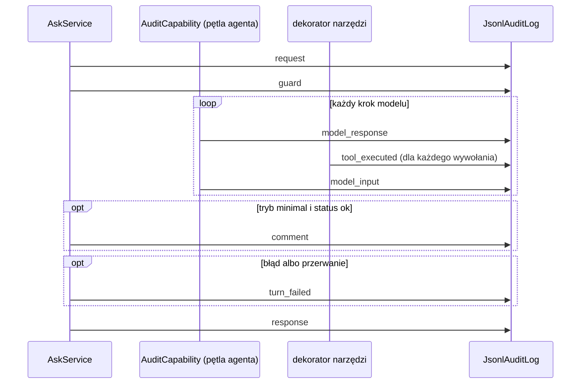

# Log audytowy: jak działa

Data: 2026-11-04. Plan: [`2026-10-26-1708-feat-log-audytowy-plan.md`](../plans/2026-10-26-1708-feat-log-audytowy-plan.md), wdrożenie: PR #15, zdarzenia ochrony dodane w PR #19 i #20. Projekt: [001, sekcja 8.1](../architecture/001-architektura-data-concierge.md), skutki dla danych: [002, sekcja 7](../architecture/002-dostep-modelu-do-danych.md).

## W skrócie

Każda tura `ask`, z CLI i z HTTP, także nieudana, dopisuje do pliku `logs/audit.jsonl` ciąg zdarzeń. Jedno zdarzenie to jeden wiersz JSON. Zdarzenia jednej tury mają ten sam `correlation_id`, a wszystkie tury rozmowy ten sam `session_id`, który jest w każdej odpowiedzi. Zdarzenia zapisują cztery miejsca przepływu: serwis tury (`AskService`), capability podpięta do pętli agenta, dekorator narzędzi i kontrola wyjścia. Polecenie `data-concierge audit <id>` czyta plik i wypisuje turę albo rozmowę krok po kroku, bez łączenia się z bazą i modelem.

Log tylko obserwuje. Nie zmienia tego, co dostaje model, ani przebiegu tury, a błąd zapisu nie psuje odpowiedzi.

## Po co

Odpowiedź ma proweniencję: mówi, z jakiej procedury i jakiego SQL powstała każda tabela. Nie mówi jednak, o co pytał użytkownik, co model rozważał, które wywołania się nie udały ani co backend kazał modelowi poprawić. Tura zakończona błędem zostawiała przed logiem prawie tylko identyfikator. Log audytowy pozwala wziąć dowolną turę i odpowiedzieć na pytania:

| Pytanie | Zdarzenie |
|---|---|
| O co pytał użytkownik, kiedy i w jakim trybie? | `request` |
| Czy strażnik przepuścił prompt? | `guard` |
| Co postanowił model i dlaczego? | `model_response` |
| Co backend naprawdę wykonał w SQL Server i DuckDB? | `tool_executed` |
| Co zobaczył model? | `model_input` |
| Co napisała faza komentarza? | `comment` |
| Czy backend coś zatrzymał albo odrzucił? | `output_blocked`, `session_rejected` |
| Dlaczego tura się przerwała? | `turn_failed` |
| Co dostał użytkownik i jak długo czekał? | `response` |

## Przebieg tury w logu



Typowa tura z raportem sprzedaży wygląda w pliku tak:

1. `request`: przyszedł prompt.
2. `guard`: strażnik zwrócił `allowed`.
3. `model_response`: model myśli i wywołuje `sales_order_list` z datami.
4. `tool_executed`: backend wykonał procedurę, wynik trafił pod uchwyt `r1`.
5. `model_input`: model dostał podsumowanie `r1` (kolumny, liczba wierszy, bez wartości).
6. `model_response`: model wywołuje `query` z SQL nad `r1`.
7. `tool_executed`: DuckDB wykonał zapytanie, wynik trafił pod `r2`.
8. `model_input`: model dostał podsumowanie `r2`.
9. `model_response`: model wywołuje `present_result` z komunikatem i tabelą `r2`.
10. `response`: użytkownik dostał odpowiedź z tabelą i proweniencją.

Kolejność w pliku jest kolejnością przepływu, bo każde zdarzenie zapisuje się w chwili, gdy nastąpiło: najpierw decyzja modelu, potem wykonanie, potem to, co wróciło do modelu. Dzięki temu tura przerwana w połowie, np. limitem kroków, ma w pliku wszystkie kroki sprzed przerwania. Po `present_result` nie ma kolejnego żądania do modelu, więc ostatnim krokiem modelu jest `model_response`.

Krótsze ścieżki:

| Sytuacja | Zdarzenia |
|---|---|
| Nieznana albo wygasła sesja | `request`, `response` ze statusem `error` |
| Sesja innego użytkownika | `request`, `session_rejected`, `response` ze statusem `error` |
| Strażnik blokuje prompt | `request`, `guard` z `blocked`, `response` ze statusem `unsupported`, bez kroków agenta |
| Limit kroków albo błąd modelu | kroki sprzed przerwania, `turn_failed`, `response` ze statusem `error` |
| Link w tekście modelu | `model_response`, `output_blocked`, `model_input` z prośbą o poprawkę |
| Znacznik instrukcji w odpowiedzi | kroki tury, `output_blocked`, `response` ze stałą odmową i statusem `unsupported` |

## Zdarzenia i ich dane

Każdy wiersz ma te same pola wspólne: `ts` (czas UTC), `correlation_id`, `session_id`, `user_id`, `event` (rodzaj) i `data` (dane zależne od rodzaju).

| Zdarzenie | Kto zapisuje | Dane |
|---|---|---|
| `request` | `AskService.ask` | prompt w postaci, w jakiej przyszedł, data doklejona przez backend, nowa czy kontynuowana sesja, tryb dostępu do danych, model |
| `guard` | `AskService` | werdykt (`allowed`, `blocked`, `unavailable` z przyczyną) i czas wywołania strażnika |
| `session_rejected` | `AskService` | właściciel sesji, której próbował użyć inny użytkownik |
| `model_response` | `AuditCapability`, hook `after_model_request` | streszczenie myślenia (bez podpisu bloku), tekst, wywołania narzędzi z `tool_call_id` i argumentami, w tym `present_result`, tokeny (wejście, wyjście, cache) |
| `tool_executed` | dekorator `retry_on_domain_error` | narzędzie, `tool_call_id`, czas; przy sukcesie uchwyt, liczba wierszy, obcięcie i pochodzenie (procedura z parametrami albo SQL modelu i SQL wykonany ze źródłami); przy błędzie klasa, komunikat dla modelu i pełny `detail`, którego model nie widzi |
| `model_input` | `AuditCapability`, hook `before_model_request` | wyniki narzędzi, które zobaczył model (podsumowania uchwytów), i prośby o poprawkę |
| `comment` | `AskService` (tryb `minimal`) | komentarz z fazy komentarza albo przyczyna porażki |
| `output_blocked` | `OutputPolicy` (obie fazy), `AskService` | adres URL w tekście modelu z fazą i adresami albo znacznik instrukcji w odpowiedzi |
| `turn_failed` | `AgentService`, `AskService` | klasa i komunikat wyjątku (limit kroków, błąd modelu, błąd magazynu wyników, inny błąd) |
| `response` | `AskService.ask` | pełna odpowiedź z wartościami, tabelami i proweniencją, czas tury |

Przykład wiersza `tool_executed` dla procedury:

```json
{"ts": "2026-10-28T13:36:58.204Z", "correlation_id": "9f…", "session_id": "3c…", "user_id": 1, "event": "tool_executed", "data": {"tool": "sales_order_list", "tool_call_id": "toolu_01…", "duration_ms": 366, "handle": "r2", "rows": 14244, "truncated": false, "lineage": {"step": "procedure", "procedure": "api.SalesOrder_List", "params": {"DateFrom": "2024-01-01", "DateTo": "2025-01-01", "CustomerID": null}, "truncated": false}}}
```

`tool_call_id` łączy wykonanie z wywołaniem w `model_response` i z wynikiem w `model_input`. Parametry procedury nie zawierają wartości wstrzykiwanych przez backend, np. `@UserId`.

## Skąd biorą się zdarzenia

### Rejestrator tury

`AskService` dostaje przez konstruktor `AuditService`. Na początku każdej tury, gdy sesja jest już ustalona, prosi go o `TurnAudit`. Ten obiekt zna `correlation_id` (nowy dla każdej tury, z `RequestContext`), `session_id` i `user_id`, a jego jedyna metoda `record(event, data)` buduje zdarzenie i oddaje je do pliku. Każde miejsce, które zapisuje, dostaje ten sam `TurnAudit`, więc nie musi znać identyfikatorów:

- `AskService` używa go wprost;
- agent i narzędzia dostają go w zależnościach (`AgentDeps.audit`), które buduje `Session.deps(context, audit)`;
- faza komentarza dostaje go jako argument `CommentService.write`.

`record` nigdy nie rzuca wyjątku. Błąd przy budowie zdarzenia albo zapisie kończy się ostrzeżeniem w logu Pythona.

### Ramy tury: `AskService`

`ask` zapisuje `request` zaraz po ustaleniu sesji, także gdy sesja wygasła, i `response` na każdej ścieżce wyjścia, z czasem całej tury. Pomiędzy nimi zapisuje werdykt strażnika (`guard`), próbę użycia cudzej sesji (`session_rejected`), wynik fazy komentarza (`comment`), znacznik instrukcji w gotowej odpowiedzi (`output_blocked`) i wyjątki tury (`turn_failed`) w blokach `except`.

### Kroki modelu: `AuditCapability`

Pydantic AI pozwala podpiąć do agenta capability, czyli obiekt z hookami wywoływanymi wokół każdego żądania do modelu. `AgentService` rejestruje `AuditCapability` przy tworzeniu agenta. Ma ona dwa hooki:

- `after_model_request` dostaje odpowiedź modelu, zanim narzędzia ruszą, i zapisuje `model_response`;
- `before_model_request` dostaje wiadomości, które zaraz pójdą do modelu, i zapisuje z ostatniej z nich wyniki narzędzi i prośby o poprawkę jako `model_input`. Pierwsze żądanie tury niesie tylko prompt, który jest już w `request`, więc nie daje `model_input`.

Oba hooki zwracają żądanie i odpowiedź bez zmian. Testy kształtu żądania (`tests/agent/test_request_shape.py`) przechodzą z zarejestrowaną capability bez zmian oczekiwań, więc początek rozmowy i cache promptu zostają takie same.

Treść myślenia przychodzi, bo agent prosi o nią jawnie (`thinking.display: summarized`, 001, sekcja 11.3). Bez tego Haiku 5.5 zwraca puste bloki. To streszczenie, które pisze model, a nie zapis jego rozumowania. Myślenie jest adaptacyjne, więc nie każdy krok je ma, a puste streszczenie nie trafia do logu.

### Wykonanie narzędzi: dekorator `retry_on_domain_error`

Każde narzędzie agenta (procedury z katalogu, `query`, `describe_result`) jest owinięte dekoratorem, który zamienia błędy domenowe na `ModelRetry` albo `ToolFailed`. Ten sam dekorator mierzy czas wywołania i zapisuje `tool_executed`:

- przy sukcesie: uchwyt i liczbę wierszy z podsumowania, a obcięcie i pochodzenie z magazynu wyników;
- przy błędzie domenowym: klasę, komunikat i `detail`, który model nie dostaje;
- przy innym wyjątku: klasę i komunikat, a wyjątek idzie dalej bez zmian.

Nazwa narzędzia pochodzi z kontekstu wywołania (`ctx.tool_name`), bo funkcje procedur generowane z katalogu nazywają się w kodzie tak samo. Błąd walidacji argumentów przez Pydantic AI nie dochodzi do dekoratora. Widać go jako prośbę o poprawkę w `model_input`.

### Kontrola wyjścia

`OutputPolicy` sprawdza teksty, które pisze model, w fazie narzędzi i fazie komentarza. Gdy znajdzie adres URL, zapisuje `output_blocked` z fazą i adresami, a model dostaje prośbę o poprawkę. Znacznik instrukcji w gotowej odpowiedzi sprawdza `AskService` i też zapisuje `output_blocked`.

## Zapis do pliku

`AuditLog` to interfejs (`Protocol`) z jedną metodą `record`. Ma dwie implementacje:

- `JsonlAuditLog` dopisuje zdarzenie jako jeden wiersz UTF-8 na końcu pliku. Zapis idzie pod blokadą `threading.Lock`, bo narzędzia synchroniczne działają w wątkach roboczych, a tury HTTP równolegle. Przy pierwszym zapisie tworzy katalog. Błąd systemu plików albo tekst, którego nie da się zakodować (np. pojedynczy surogat w prompcie), daje ostrzeżenie w logu Pythona, a tura idzie dalej.
- `NullAuditLog` nic nie robi. Używa go kompozycja, gdy log jest wyłączony, i jest wartością domyślną w testach.

`CompositionRoot` wybiera implementację według ustawień:

| Ustawienie | Domyślnie | Znaczenie |
|---|---|---|
| `DC_AUDIT_LOG_ENABLED` | `true` | `false` wyłącza log |
| `DC_AUDIT_LOG_PATH` | `logs/audit.jsonl` | ścieżka pliku |

Przełącznik jest osobny, bo ustawienia ignorują puste wartości: pusta ścieżka w `.env` wraca do domyślnej, więc samą ścieżką nie da się wyłączyć logu. Testy, testy z bazą i ewaluacja wyłączają log, żeby przebiegi nie zapisywały danych klientów. Katalog `logs/` jest w `.gitignore`.

Typowa tura zajmuje w pliku kilka do kilkunastu kilobajtów. Najwięcej miejsca zajmuje `response`, bo zawiera pełne tabele odpowiedzi. `tool_executed` zapisuje tylko liczbę wierszy wyniku, nie same wiersze.

## Odczyt: polecenie `audit`

```powershell
uv run data-concierge ask --user 1 "raport sprzedaży po miesiącach za 2024"
uv run data-concierge audit <session_id>      # cała rozmowa
uv run data-concierge audit <correlation_id>  # jedna tura
```

Polecenie czyta ścieżkę z ustawień, ale nie buduje reszty aplikacji, więc działa bez SQL Server i bez klucza do modelu. `JsonlAuditLog` przechodzi plik od początku i zwraca zdarzenia, których `correlation_id` albo `session_id` równa się podanemu `id`, w kolejności z pliku. Uszkodzony wiersz, np. po zabitym procesie, pomija z ostrzeżeniem, żeby nie ukrył innych tur. `AuditTrailPrinter` wypisuje zdarzenia jako ponumerowane kroki, z nagłówkiem przy każdej nowej turze. Myślenie i SQL wypisuje w całości, a tabele odpowiedzi tylko jako liczbę wierszy. Nieznany `id` albo brak pliku daje komunikat i kod wyjścia 1.

Przykład wydruku, skrócony (myślenie i SQL obcięte, identyfikatory skrócone):

```text
Turn f2048ad1… (session 1fc82179-…, user 1), 2026-10-28 13:37:27 UTC
  1. request          prompt: Podaj mi sprzedaż miesiąc po miesiącu w roku 2024 z informacją procentową czy sprzedaż rosła czy zmalała
                     continued session, date 2026-10-28, mode none, model claude-haiku-5-5
  2. model_response   thinking:
                       I need a full 12-month grid for 2024 with zeros filled in where there's no data, plus month-over-month growth percentages…
                     call query [toolu_01Q5…] {"sql": "WITH months AS (…) SELECT month, net_sales, order_count, … FROM monthly ORDER BY month"}
                     tokens: in 11688, out 1188, cache read 8751
  3. tool_executed    query [toolu_01Q5…] 32 ms -> r6, 12 rows
                     sources ["r3"], sql:
                       WITH months AS (
                       …
  4. model_input      result query [toolu_01Q5…]: r6, 12 rows
  5. model_response   thinking:
                       I need to craft a quick message noting that October was the only month with sales in 2024…
                     call present_result [toolu_015D…] {"status": "ok", "message": "W 2024 roku klient 12698 miał sprzedaż netto tylko w jednym miesiącu: {r6[10].month} ({r6[10].net_sales}). …", "tables": [{"handle": "r6", …}]}
                     tokens: in 13877, out 760, cache read 8751
  6. response         status ok in 11976 ms
                     message: W 2024 roku klient 12698 miał sprzedaż netto tylko w jednym miesiącu: 2024-10-01 (2294,99). …
                     table r6: Sprzedaż klienta 12698 w 2024 roku miesiąc po miesiącu z trendem (12 rows)
```

To druga tura rozmowy, więc model liczy z uchwytu `r3` pobranego wcześniej i nie wywołuje procedury. Tura sprzed wdrożenia strażnika, dlatego nie ma kroku `guard`. W kroku 5 widać kotwice `{r6[10].month}`, które model wpisał zamiast liczb, a w kroku 6 wartości, które backend podstawił w odpowiedzi.

## Czego log nie zapisuje

- **Za długiego promptu:** backend odrzuca go przed utworzeniem tury, więc nie ma jeszcze `correlation_id`.
- **Wywołań z tej samej odpowiedzi co końcowe `present_result`:** nie są wykonywane (`end_strategy='early'`), więc nie mają `tool_executed`. Widać je w `model_response`.
- **Wewnętrznych ponowień fazy komentarza:** log ma tylko jej wynik i odrzucone adresy URL.
- **Podpisów bloków myślenia i pustych streszczeń.**
- **Instrukcji systemowych i definicji narzędzi:** są stałe w procesie i wynikają z repozytorium.

## Dane w logu

Log zapisuje pełną odpowiedź, więc zawiera dane klientów, także wartości kolumn `sensitive`, w obu trybach dostępu modelu do danych. Granica z dokumentu 002 dotyczy dostawcy modelu, a nie własnych zapisów backendu: plik zostaje na maszynie usługi i nie trafia do modelu (002, sekcja 7). `user_id` w zdarzeniach podaje wywołujący, bo POC nie ma uwierzytelniania.

## Ograniczenia POC

- Plik nie ma rotacji, retencji ani ochrony przed zmianą.
- Blokada trzyma wiersze w całości tylko w obrębie jednego procesu. CLI i serwer HTTP nie powinny pisać do tego samego pliku jednocześnie.
- Nieudany zapis zostawia tylko ostrzeżenie w logu Pythona, a tura idzie dalej.
- Wiersze nie mają wersji schematu. Plik czyta polecenie `audit` z tej samej wersji kodu.
- Nie ma odczytu przez HTTP ani polecenia `/audit` w trybie czatu.

Interfejs `AuditLog` zostawia miejsce na trwały magazyn (baza albo OpenTelemetry) bez zmian w miejscach zapisu, bo wszystkie idą przez `TurnAudit` (001, sekcja 12).

## Gdzie w kodzie

| Plik | Zawartość |
|---|---|
| `src/data_concierge/audit/models.py` | `AuditEvent` i lista rodzajów zdarzeń |
| `src/data_concierge/audit/repository.py` | `AuditLog`, `JsonlAuditLog`, `NullAuditLog` |
| `src/data_concierge/audit/service.py` | `AuditService`, `TurnAudit`, `AuditTrail` |
| `src/data_concierge/agent/audit.py` | `AuditCapability` |
| `src/data_concierge/agent/tools.py` | `retry_on_domain_error` |
| `src/data_concierge/agent/output.py` | `OutputPolicy` |
| `src/data_concierge/api/service.py` | ramy tury w `AskService` |
| `src/data_concierge/api/cli.py` | polecenie `audit`, `AuditTrailPrinter` |
| `src/data_concierge/bootstrap.py` | wybór implementacji według ustawień |
| `src/data_concierge/core/settings.py` | `audit_log_enabled`, `audit_log_path` |
