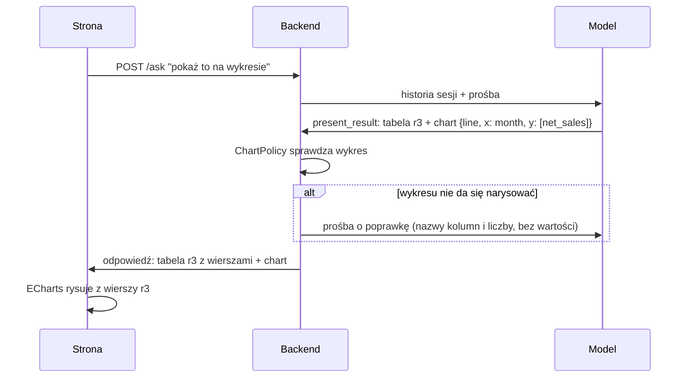

# Wykresy wybierane przez model: co zrobiliśmy i co dalej

Data: 2026-11-08. Plan: [`2026-11-08-1015-feat-wykresy-wybierane-przez-model-plan.md`](../plans/2026-11-08-1015-feat-wykresy-wybierane-przez-model-plan.md), gałąź `feat/charts`. Projekt: [003, sekcja 7](../architecture/003-interfejs-uzytkownika.md), ustalenia z implementacji: 003, sekcja 15. Kontrakt odpowiedzi: [001, sekcja 9](../architecture/001-architektura-data-concierge.md).

## W skrócie

Użytkownik może poprosić o wykres i dostaje go w tej samej odpowiedzi, pod tabelą, z której powstał. Model wybiera jeden z pięciu rodzajów (liniowy, słupkowy, słupkowy skumulowany, kołowy, punktowy) i jednym zdaniem w założeniach wyjaśnia, dlaczego ten. Dane pod wykresem liczy backend, tak jak dla tabel, więc model nie dostaje żadnych nowych wartości. Na stronie można zmienić rodzaj wykresu bez pytania modelu i zapisać wykres jako PNG.

Przykłady z prawdziwego modelu:

| Prośba | Wynik |
|---|---|
| „raport sprzedaży po miesiącach za 2024”, potem „pokaż to na wykresie” | wykres liniowy z tej samej tabeli, w 4,8 s, bez ponownego wywołania procedury |
| „pokaż na wykresie wszystkie zamówienia z 2024” | model sam zagregował 14 244 zamówienia do 12 miesięcy i dopiero je narysował |
| „udział kategorii produktów w sprzedaży 2024 na wykresie” | wykres kołowy z 4 kategoriami |

## Jak to działa

1. **Model nazywa, nie rysuje.** W `present_result` podaje uchwyt tabeli, rodzaj, kolumny i tytuł (`ChartRequest`). Opisy pól mówią mu, kiedy który rodzaj.
2. **Backend sprawdza** (`ChartPolicy`), czy z tej tabeli da się narysować taki wykres. Jeśli nie, model dostaje prośbę o poprawkę, np. „pie needs at most 8 rows, r2 has 12; aggregate the rest in query or choose bar”.
3. **Odpowiedź** ma nowe pole `chart`. Dane wykresu strona bierze z tabeli o tym samym uchwycie, więc nic nie idzie dwa razy.
4. **Strona** zamienia specyfikację na opcje ECharts (`ChartOptionsBuilder`) i rysuje wykres pod tabelą (`ChartView`). Lista „Rodzaj wykresu” pokazuje rodzaje, które pasują do danych (`ChartKinds`).
5. **Terminal i audyt:** `data-concierge chat` wypisuje linię „Wykres liniowy: tytuł (x; y)”, a `audit` pokazuje wykres w zdarzeniu `response`.

## Co sprawdza backend

| Rodzaj | Oś x | Miary (y) | Serie | Limit |
|---|---|---|---|---|
| liniowy | data, liczba albo tekst | 1 lub więcej liczbowych | opcjonalnie, wtedy jedna miara | 1000 wierszy, 12 serii |
| słupkowy | dowolna kategoria | 1 lub więcej liczbowych | opcjonalnie, wtedy jedna miara | 50 kategorii, 12 serii |
| słupkowy skumulowany | jak słupkowy | jak słupkowy | wymagana albo co najmniej 2 miary | jak słupkowy |
| kołowy | tekst | dokładnie 1 | brak | 8 wierszy |
| punktowy | liczba | dokładnie 1 | opcjonalnie | 1000 wierszy, 12 serii |

Do tego wykres jest dozwolony tylko przy statusie `ok`, na tabeli zwracanej w odpowiedzi i nieobciętej przez żaden limit wierszy. Komunikaty dla modelu zawierają nazwy kolumn i liczby, nigdy wartości z danych (002, sekcja 6.2).

## Dlaczego tak

| Decyzja | Wybrane | Odrzucone | Powód |
|---|---|---|---|
| Kto wybiera wykres | model, z zamkniętej listy rodzajów | same reguły w interfejsie; specyfikacja Vega-Lite albo opcje ECharts pisane przez model | Model rozumie prośbę („porównaj kategorie”). Specyfikacja pisana przez model to kod dla przeglądarki: Vega-Lite może pobrać dane z dowolnego adresu, a opcje ECharts przyjmują HTML w formaterach. |
| Pytać o rodzaj czy rysować | rysować od razu, uzasadnienie w założeniach (D2) | pytanie przed każdym wykresem | Pytanie to dodatkowa tura (ok. 8 s) dla decyzji, którą przełącznik na stronie załatwia od ręki. |
| Ile wykresów | jeden na odpowiedź | lista od razu | Na początek wystarczy, a kontrakt i ewaluacja są prostsze. |
| Obcięta tabela | odrzucić, model agreguje | rysować z ostrzeżeniem | Wykres z niepełnych danych łatwo wziąć za całość. W praktyce model sam agreguje, np. do miesięcy. |
| Biblioteka | ECharts 6.1.0 (Apache-2.0) | Chart.js, Vega-Lite | Wszystkie potrzebne rodzaje, eksport PNG wbudowany, dymek domyślnie zamienia HTML na tekst. |
| Eksport | przycisk PNG z ECharts | brak | Wbudowany w bibliotekę, prawie bez kosztu. |
| Gdzie uzasadnienie | `assumptions` | `message` | W trybie `minimal` faza komentarza pisze `message` od nowa, a założenia zostawia. |

Jedna próba nie weszła. Wcześniej tego dnia, przy poprawce kotwic (PR #24), dopisek w instrukcjach agenta pogorszył inny przypadek ewaluacji. Dlatego reguły o wykresach w instrukcjach dotyczą tylko sytuacji, gdy użytkownik prosi o wykres, a pełna ewaluacja przed zmianą i po niej była warunkiem PR.

## Bezpieczeństwo

- **Wartości z danych są tylko danymi.** Nazwy kategorii i serii trafiają do ECharts jako dane. Dymek zostaje przy domyślnym układzie ECharts, który zamienia je na tekst (`encodeHTML`), i dostaje tylko `valueFormatter` dla liczb. Test w Chrome z kategorią `` pokazał ją w dymku jako tekst i skrypt się nie wykonał.
- **Tytuł wykresu** przechodzi te same kontrole co inne teksty modelu (kotwice, adresy URL, znacznik instrukcji) i jest zwykłym nagłówkiem w JSX.
- **Model nie dostaje nowych danych.** Wybiera wykres ze schematu i liczby wierszy, które widział już wcześniej (002, sekcja 4.1).
- **CSP strony bez zmian.** ECharts nie potrzebuje `eval` ani zasobów z zewnątrz. Pobieranie PNG działa pod obecną polityką, a w konsoli nie było błędów.

## Wyniki

**Ewaluacja.** Pełny zestaw przed zmianą i po niej, w obu trybach. Po zmianie zestaw ma 6 nowych przypadków wykresowych, a raport sprzedaży po miesiącach sprawdza dodatkowo, że bez prośby nie ma wykresu.

| | `none` przed | `none` po | `minimal` przed | `minimal` po |
|---|---|---|---|---|
| Przypadki (bez bezpieczeństwa) | 37/37 | 43/43 | 37/37 | 42/43 |
| Wykresy | – | 7/7 | – | 7/7 |
| Ponowienia kotwic | 1 | 3 | 3 | 3 |
| Czas tury, grupa „wykresy” | – | 6,0 s | – | 10,8 s |
| Koszt tury, grupa „wykresy” | – | $0,0010 | – | $0,0017 |

Jedyna porażka po zmianie (`gdzie-uzyto-hl-fork` w trybie `minimal`) nie dotyczy wykresów: model zwrócił identyfikatory bez nazw produktów. Ten przypadek przeszedł potem 4 razy na 4, więc to zmienność modelu, a nie skutek zmiany.

**Sprawdzenie w Chrome (Playwright).**

- Na podstawionych odpowiedziach: wszystkie rodzaje się rysują, przełącznik działa bez zapytania do serwera, PNG pobiera się jako `udzial-kategorii-lacznie-2024.png`, kategoria z HTML jest tekstem, w konsoli nie ma błędów.
- Na prawdziwym modelu: przykłady z tabeli „W skrócie”.

**Testy:** backend 603 (pytest), frontend 102 (Vitest). Ruff, mypy, ESLint, Prettier, `tsc`, build i `api:check` przechodzą, a `npm audit --omit=dev` nie zgłasza podatności.

## Koszty

- **Paczka JS** urosła o ok. 610 KB: z 1,47 MB do 2,08 MB (gzip z 419 KB do 627 KB). ECharts jest importowany modułowo, tylko z pięcioma rodzajami wykresów i czterema komponentami.
- **Instrukcje dla modelu** są dłuższe o jeden akapit, a definicja `present_result` o pole `chart`. Prefiks cache zmienił się raz.

## Ograniczenia

- **Jeden wykres na odpowiedź.** Prośba o dwa wykresy da jeden.
- **Bez polskiej lokalizacji ECharts.** Plik lokalizacji wymaga pełnego pakietu. Widoczny napis to tylko podpis przycisku PNG, ustawiony po polsku wprost.
- **Kolejność kategorii** na wykresie słupkowym i kołowym jest taka jak w tabeli. Model sortuje ją w zapytaniu, strona jej nie zmienia.
- **Kołowy nie sprawdza wartości ujemnych.** Backend widzi tylko schemat i liczby wierszy, a nie wartości.
- **Limity są w dwóch miejscach:** w backendzie i w przełączniku na stronie. Rozjazd nie dotknąłby modelu, ale przy zmianie limitów trzeba poprawić oba.

## Możliwe rozszerzenia

| Rozszerzenie | Po co | Koszt i ryzyko |
|---|---|---|
| **Kilka wykresów w odpowiedzi** (`charts` jako lista) | „pokaż trend i podział na kategorie” w jednej odpowiedzi | Zmiana kontraktu i ewaluacji. Model musi decydować, ile wykresów, co łatwo przesadzić. |
| **Więcej rodzajów:** warstwowy, słupkowo-liniowy z dwiema osiami, mapa cieplna, lejek, kaskadowy | warstwowy dla udziałów w czasie, dwie osie dla miar w różnych jednostkach (kwota i liczba zamówień), mapa cieplna dla miesięcy × kategorii | Każdy rodzaj to reguły w `ChartPolicy` i `ChartKinds`, metoda w `ChartOptionsBuilder` i przypadki ewaluacji. Dwie osie wymagają nowego pola w kontrakcie (która miara na której osi). |
| **Wykres proponowany bez prośby** | model sam dodaje wykres, gdy dane się do niego nadają (trend, porównanie) | Decyzja produktowa: łatwo o wykres, którego nikt nie chciał. Wymaga przypadków „wykres tak” i „wykres nie”. |
| **Zmiana wykresu rozmową** („zrób z tego słupki”, „pokaż tylko 2024”) | dziś przełącznik zmienia rodzaj, ale nie dane | Działa już przez kolejną turę, gdy model zrobi nowe zapytanie. Można dodać przypadki ewaluacji. |
| **„Pozostałe” w kołowym i top N** | kołowy z 20 kategorii: 7 największych i „pozostałe” | Dziś model robi to zapytaniem, gdy backend odrzuci wykres. Można to podpowiedzieć w instrukcjach albo zrobić automatycznie po stronie strony. |
| **Przybliżanie i przewijanie** (`dataZoom`) | długie serie, np. dni zamiast miesięcy | Jeden komponent ECharts więcej. Limit 1000 punktów można wtedy podnieść. |
| **Eksport danych wykresu** (CSV) i SVG | do arkusza albo do druku w wysokiej jakości | CSV z tabeli to osobna funkcja siatki. SVG wymaga drugiego renderera. |
| **Leniwe ładowanie ECharts** | szybszy pierwszy widok strony bez wykresu | Dynamiczny `import()` w `EChartsHost`. Mały koszt, oszczędza ok. 610 KB przy starcie. |
| **Własne kolory i motyw** | wygląd zgodny z firmą, ciemny motyw | `registerTheme` w `EChartsHost`. Bez zmian w kontrakcie. |
